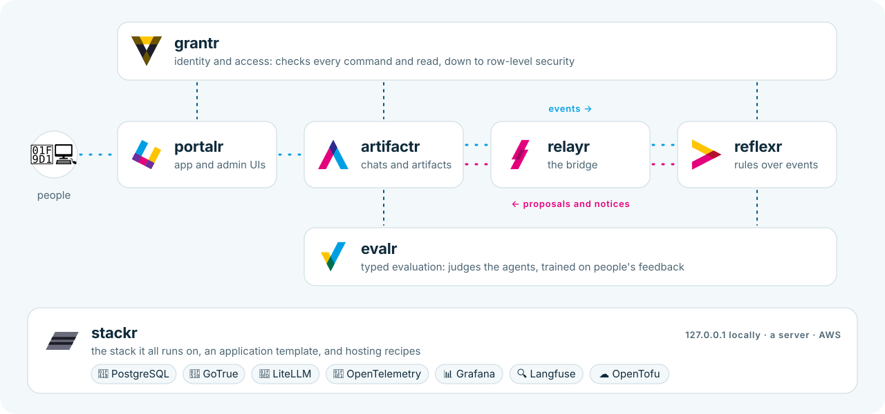
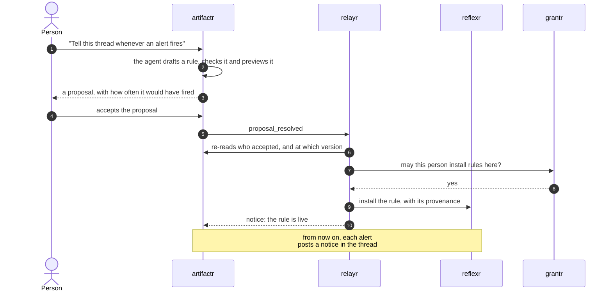
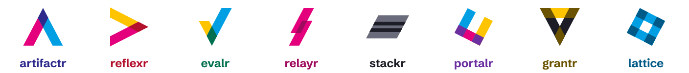

<picture>
  <source media="(prefers-color-scheme: dark)" srcset="docs/assets/readme/hero-dark.svg">
  
</picture>

<p align="center">
  <a href="https://github.com/alexnodeland/lattice/actions/workflows/nightly.yml"></a>
  <a href="https://github.com/alexnodeland/lattice/actions/workflows/codeql.yml"></a>
  <a href="https://scorecard.dev/viewer/?uri=github.com/alexnodeland/lattice"></a>
  <a href="https://lattice.alexnodeland.com"></a>
  <a href="LICENSE"></a>
</p>
<p align="center">
  
  
  
  
  <a href="https://docs.astral.sh/uv/"></a>
  <a href="https://docs.astral.sh/ruff/"></a>
  <a href="https://www.conventionalcommits.org"></a>
</p>
<p align="center">
  
  
  <a href="https://github.com/alexnodeland/lattice/pulls"></a>
</p>

<p align="center">
  <b><a href="#-start-an-application">Quick start</a></b> ·
  <b><a href="#-the-packages">The packages</a></b> ·
  <b><a href="#-how-it-fits-together">How it fits</a></b> ·
  <b><a href="https://lattice.alexnodeland.com">Docs</a></b> ·
  <b><a href="#-how-its-built">How it's built</a></b> ·
  <b><a href="CONTRIBUTING.md">Contributing</a></b>
</p>

---

**lattice** is a set of Python libraries for applications in which **people and agents work together**, and the stack they run on.

- 🤝 People and agents share **versioned artifacts**. An agent proposes a change, and a person accepts it.
- ⚡ **Rules over event streams** run agents, graphs and functions when something happens.
- 💬 People can **draft those rules in chat** (🚧 landing now). A rule goes live only once a person allowed to install it accepts.
- 📏 **Typed evaluations** learn from people's feedback.
- 🔐 **Identity and access** is checked before every command and read, down to PostgreSQL's row-level security.
- 🪟 A **portal** is where people use the application and run it.
- 🧱 **One template and one stack** hold it all, locally or on a server.

Each package keeps its own name, version, changelog and releases. They share one environment, one lockfile, one CI and one documentation site, so a change that spans packages lands in one pull request.

## 🧭 How it fits together

<picture>
  <source media="(prefers-color-scheme: dark)" srcset="docs/assets/readme/flow-dark.svg">
  
</picture>

A person chats with an agent in **artifactr**, through **portalr** or any client of artifactr's REST, WebSocket and MCP surfaces. **relayr** turns what happens in the chat into events for **reflexr**'s rules, and the rules' runs act back in the chat as proposals and notices. **grantr** decides who may do what, **evalr** measures how well the agents do it, and **stackr** runs it all. Underneath, the packages share **lattice-core**, the infrastructure they must keep identical.

<details>
<summary><b>🔁 Follow one rule from chat to live</b></summary>

<br>



🚧 relayr's library does this today, and stackr's template is wiring it in. A forged acceptance installs nothing: relayr never trusts the event, only artifactr's record of it. A rule acts as itself, inside its own workspace, and can't post into a thread its workspace restricts. [relayr's guide](https://lattice.alexnodeland.com/relayr/guides/rules/) has the details.

</details>

## 🧩 The packages

<picture>
  <source media="(prefers-color-scheme: dark)" srcset="docs/assets/brand/family-dark.svg">
  
</picture>

| Package | What it is | Status |
|---|---|---|
| **[artifactr](packages/artifactr)** | Chat applications where people and agents collaborate through shared, versioned artifacts | ✅ v0.1 · 🏷️ [0.1.0 released](https://github.com/alexnodeland/artifactr/releases/tag/v0.1.0) |
| **[reflexr](packages/reflexr)** | Rules over event streams that run LLM workflows: pydantic-ai agents, pydantic-graph graphs and functions | ✅ v0.1 |
| **[evalr](packages/evalr)** | Typed evaluation of agent systems: judges that give typed verdicts, trained on people's feedback and measured against it | ✅ v0.1 |
| **[relayr](packages/relayr)** | The bridge between artifactr and reflexr: chat events become events for rules, and runs act back in the chat. Rules can be drafted in chat. | 🚧 [v0.1 in progress](docs/relayr/rfcs/0001-v0.1-implementation-plan.md) |
| **[grantr](packages/grantr)** | Identity and access: tenants, members, groups, roles, service principals and restricted items, checked before every command and read, with row-level security | ✅ v0.1 |
| **[portalr](packages/portalr)** | The portal: an app UI to chat with agents and see their artifacts, proposals and runs, and an admin UI for access, feedback, traces and spend | 🚧 [v0.1 in progress](docs/portalr/rfcs/0001-v0.1-implementation-plan.md) |
| **[lattice-core](packages/lattice-core)** | What the packages share and must keep identical: infrastructure each depends on and re-exports, never imported by an application | 🚧 [moving in](docs/adr/0018-lattice-core-what-the-libraries-share.md) |
| **[stackr](packages/stackr)** | The stack the libraries run on (Supabase or PostgreSQL, LiteLLM, OpenTelemetry, Grafana, Langfuse), an application template, and hosting recipes | ✅ template · 🚧 [hosting recipes](docs/stackr/rfcs/0004-hosting-recipes.md) |

> [!NOTE]
> **Alpha.** artifactr's [0.1.0](https://github.com/alexnodeland/artifactr/releases/tag/v0.1.0) was released from its original repository; lattice keeps its tag, `artifactr-v0.1.0`. The others release once lattice reaches v0.1. None is on PyPI yet. APIs may still change before 1.0.

## 🚀 Start an application



stackr's [Copier](https://copier.readthedocs.io) template generates an application on artifactr, reflexr or both. It comes with:
- FastAPI, serving each library's REST, WebSocket and MCP surfaces;
- sign-in and access through grantr;
- PostgreSQL with row-level security;
- agents on the LiteLLM gateway;
- OpenTelemetry;
- feedback as Langfuse scores;
- evalr experiments;
- lattice's quality gates.

```bash
uvx copier copy gh:alexnodeland/lattice my-app
cd my-app && git init   # the git hooks and `copier update` need a repository
make install            # writes uv.lock: commit it
make env && make check
make up                 # beside stackr's stack, at http://127.0.0.1:8800
```

> [!TIP]
> Start stackr's stack first: run `make env && make up` in [`packages/stackr`](packages/stackr). Everything binds to `127.0.0.1` unless you choose otherwise. [stackr's getting started](https://lattice.alexnodeland.com/stackr/getting-started/) walks through both.

<details>
<summary><b>📦 Use a library on its own</b></summary>

<br>

Python 3.12 or newer. Until the packages are on PyPI, install one from this repository with [uv](https://docs.astral.sh/uv/). A release is tagged with its package's name, as in `artifactr-v0.1.0`; a package without a release installs from `main`:

```bash
uv add "artifactr-ai @ git+https://github.com/alexnodeland/lattice@artifactr-v0.1.0#subdirectory=packages/artifactr"
uv add "reflexr @ git+https://github.com/alexnodeland/lattice#subdirectory=packages/reflexr"
uv add "evalr @ git+https://github.com/alexnodeland/lattice#subdirectory=packages/evalr"
uv add "relayr-ai @ git+https://github.com/alexnodeland/lattice#subdirectory=packages/relayr"
uv add "grantr @ git+https://github.com/alexnodeland/lattice#subdirectory=packages/grantr"
uv add "portalr @ git+https://github.com/alexnodeland/lattice#subdirectory=packages/portalr"
```

portalr's wheel carries its two UIs, which Vite builds first, so installed from the repository it has none to serve: build them in a checkout (`bun install && moon run app:build admin:build`), or wait for its release wheel. portalr isn't in the application template yet either.

uv takes each package's own dependencies from lattice, from the same commit: relayr's, artifactr and reflexr, portalr's, grantr, and lattice-core, which artifactr, reflexr, grantr and portalr share. Each package's getting-started page lists its extras, such as artifactr's `fastapi`, `mcp` and `postgres`: [artifactr](https://lattice.alexnodeland.com/artifactr/getting-started/), [reflexr](https://lattice.alexnodeland.com/reflexr/getting-started/), [evalr](https://lattice.alexnodeland.com/evalr/getting-started/), [grantr](https://lattice.alexnodeland.com/grantr/getting-started/).

</details>

<details>
<summary><b>🎬 See it work: the reference applications</b></summary>

<br>

Two complete applications are in [`examples/`](examples). Each is built only on its library's public API:

- 📝 [**docplan**](examples/docplan) is artifactr's. A person and an agent co-write a document and plan its work, over WebSocket, REST and MCP, with a terminal client.
- 🚨 [**oncall**](examples/oncall) is reflexr's. It handles incident response: rules watch alerts, deploys and heartbeats, and run a triage agent, a runbook graph and a pager.

```bash
make install
export ANTHROPIC_API_KEY=...
uv run docplan-serve            # in one terminal
uv run docplan --user alice     # in another
```

`uv run oncall-serve` and `uv run oncall watch` run the other the same way.

</details>

## 🛠️ Built with

<p>
  
  
  
  
  
  
  
  
  
  
  
  
  
  
  
  
  
  
</p>

## 🧪 How it's built

| | What holds every change |
|:-:|---|
| 💯 | **100% branch coverage** for every Python project, and **pyright strict** for every `src/` |
| 🚫 | **No inline suppressions**, anywhere: no `# type: ignore`, `# noqa` or `@ts-expect-error` |
| 🎲 | **Tests run in a random order**, with a timeout on every test and every job |
| 🧾 | **Acceptance tests** run against the reference applications: Bruno collections for artifactr's, reflexr's and portalr's APIs, Schemathesis over their OpenAPI documents, and playwright-bdd scenarios for portalr's UI |
| 🛡️ | **CodeQL** over the Python and the TypeScript, and **osv-scanner** and dependency review, on every pull request; **OpenSSF Scorecard** every week |
| 🔍 | **The Title check** compares each released package's public API with its last release, so a breaking change must say so |
| 🚦 | **A merge queue** brings each reviewed pull request up to date and checks it again before it merges |
| 🤖 | **Renovate** keeps dependencies current, and **release-please** writes each package's changelog from its commits |
| 📜 | **Every decision is written down**: changes start as RFCs, and each decision is an ADR, in each package's documentation section |

## 💻 Development

You need [uv](https://docs.astral.sh/uv/), [Bun](https://bun.sh), `make` and [moon](https://moonrepo.dev/moon), at the versions in [`.prototools`](.prototools). `proto use` installs uv, Bun and moon. Docker runs stackr's stack and the PostgreSQL tests.

```bash
make install    # every package, example, group and extra, in one environment; the web packages; and the git hooks
make check      # every project's checks, as CI runs them: moon run :check
```

moon runs every task, from any directory, and only what a change affects: `moon run <project>:<task>`, or `moon run :<task>` for every project that has one. [`.devcontainer/`](.devcontainer) has uv, Bun, moon and Docker, and runs everything CI runs, in your editor or a GitHub Codespace.

[](https://codespaces.new/alexnodeland/lattice)

## 📚 Documentation

The documentation site is at **<https://lattice.alexnodeland.com>**, with a section per package: getting started, guides, reference, architecture, decisions and RFCs. It's built from [`docs/`](docs) on every push to `main`. To serve it locally at <http://127.0.0.1:8000>, run `moon run lattice:docs-serve`.

- 🏛️ [Architecture](docs/architecture.md) explains how the packages fit together in one repository. [lattice's decisions](docs/adr/README.md) are its ADRs.
- 🗺️ [lattice's RFCs](docs/rfcs/README.md) propose changes across packages: [grantr](docs/rfcs/0001-grantr-identity-and-access.md) and [portalr](docs/rfcs/0002-portalr-the-portal.md).
- 🎨 [lattice's brand](docs/assets/brand/README.md) covers the marks, the colours and the type, and [ADR-0001](docs/adr/0001-lattices-brand.md) records why.

## 🤝 Contributing

[CONTRIBUTING.md](CONTRIBUTING.md) covers:
- setup, and every package's commands;
- the trunk-based workflow and the merge queue;
- commit messages;
- the RFC and ADR process.

Everyone taking part follows the [code of conduct](CODE_OF_CONDUCT.md).

## 🔒 Security

Report a vulnerability privately, as [SECURITY.md](SECURITY.md) describes, never in a public issue.

## 📄 License

Every package is released under the [MIT License](LICENSE), and each keeps a copy of it in its own directory.

<p align="center"><sub>Made of one cell of the lattice that every package's mark is drawn on.</sub></p>
