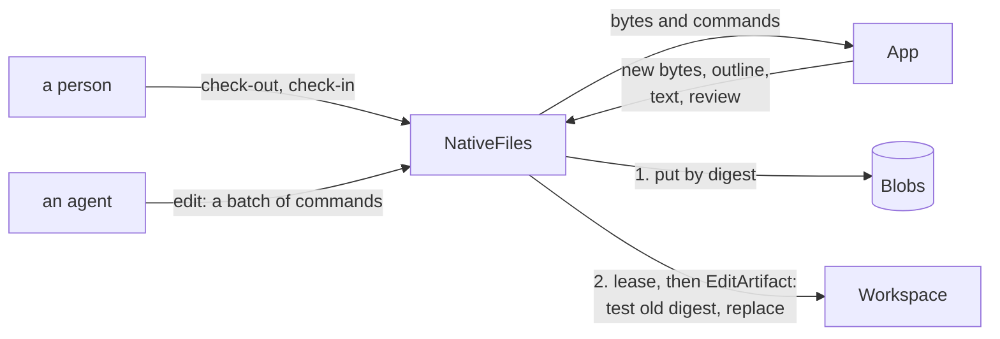

# Architecture

`artifactr.files`, artifactr's `files` extra, gives artifactr artifact types for files in native formats. It depends inward only: it imports the names in `__all__` of `artifactr.core` and `artifactr.workspace`, and `lattice_core.sql` in its SQL layer, and the rest of artifactr imports nothing of it. `tests/files/test_layering.py` holds its layers, and `tests/test_layering.py` the rest of artifactr.

## The layers

| Layer | What it is | It may import |
|---|---|---|
| `manifest` | `Blob`, `Provenance`, `NativeFile`, `WordDocument`, and `revise`, the patch that tests its base | artifactr, pydantic |
| `blobs` | The `Blobs` port, its size limit and digest, and `InMemoryBlobs` | `manifest`, artifactr |
| `checkouts` | `Checkout`, the record behind a person's lease, the `Checkouts` port, and `InMemoryCheckouts` | `manifest`, artifactr, pydantic |
| `app` | The `App` port and `FakeApp` | `manifest`, pydantic |
| `wordcraft` | WordCraft's adapter, `Subprocess`, and the `.docx` fingerprint and outline | `manifest`, `app`, pydantic, `mcp`, `anyio` |
| `native` | `NativeFiles`: uploads, check-out and check-in, agents' edits, reads and collection | every layer above, artifactr |
| `sql` | `SqlBlobs`, `SqlCheckouts`, their tables and migrations | `manifest`, `blobs`, `checkouts`, SQLAlchemy, Alembic, `lattice_core.sql` |

## A write

An agent's edit and a person's check-in end the same way. The bytes, the text and the review are put in the blob store, then one `EditArtifact` is committed through the workspace, the one write path (artifactr ADR-0002). A failure before the commit commits nothing, and what was put is collected later.

- **The revision is JSON Patch.** It tests `/content/sha256` against the digest it was made from, then replaces `/content`, `/provenance`, `/fingerprint`, `/text`, `/review`, `/outline` and `/pages`; the name is kept. `base_version` refuses a stale direct edit as `VersionConflict`, and the test refuses a stale proposal when it is accepted, as `PatchFailed` (artifactr ADR-0072).
- **One writer at a time,** through `Workspace.lease_artifact` (artifactr ADR-0071): `checkout:<id>:<participant>` for a check-out, eight hours unless extended, and `edit:<uuid>` for an agent's edit, 45 seconds. The lease is advisory, so the patch's guards hold whether or not a writer took it.
- **Provenance is a claim.** Any surface that commits `edit_artifact` can write anything into a manifest, so only the revision's actor is trusted, and nothing is authorized by provenance.

## The blob store

A blob is keyed by its tenant, workspace and artifact, then its digest: its access is its artifact's, revisions of one artifact share unchanged bytes, and bytes are never shared across artifacts or tenants. The digest and size are computed as the bytes arrive, up to the store's limit. In SQL, `artifactr_files_blobs` holds the bytes as `bytea`, stored `EXTERNAL` since zipped formats don't compress, or SQLite's `BLOB`; the bytes are loaded only when read, so putting bytes already there marks them as put without reading them. On PostgreSQL, both tables keep each row to its tenant by row-level security, through `lattice_core.sql.tenancy` (artifactr ADR-0066).

Collection runs per workspace. It reads every revision of a native file, archived ones too, and every pending proposal, and deletes the blobs last put before a cutoff that none names, in batches, each statement checking again that the blob is still that old ([ADR-0002](adr/0002-blobs-in-a-port-of-the-package.md)).

## The app

`App` is four stateless calls, bytes in and bytes out: `apply` a batch of commands, `inspect` a file, `render` a page, and find `commands`. Each takes a deadline in seconds and fails as `AppFailed`, typed `timeout`, `crashed`, `too_large` or `refused`. An app names itself, its version and build, and declares `talk`, how much it talks to the host while a person edits in it, and `integration`, the key that switches it in a workspace. `FakeApp` reads and writes JSON files of paragraphs and comments, stamps every save as a native app does, and runs on every pull request ([ADR-0004](adr/0004-an-app-is-a-port-of-stateless-calls.md)).

WordCraft's adapter, `Subprocess`, spawns `wordcraft-cli mcp` for every call, in an empty directory that is the CLI's read root and write root, and maps the call onto its tools: open or a blank document, one `batch`, a save, and the text, structure, comments and tracked changes read back. The fingerprint is read from the bytes in Python, the digest of the archive's parts' names and digests without `docProps/core.xml`, which every save stamps, inflating each part against a limit. Its talk level is `save`, since WordCraft's browser build only opens and saves files, and its switch is `files:wordcraft`. It is not a sandbox; the worker that runs hostile files is phase 3 of lattice RFC-0003 ([ADR-0005](adr/0005-wordcraft-headless-pinned-by-checksum.md)).

WordCraft is pinned by the checksums of one release, in `scripts/wordcraft.sha256`, which `scripts/wordcraft` checks before it unpacks anything. Nightly's fidelity report opens and saves each file of a generated corpus, one per feature, with that release, and publishes which features it kept and whether saving twice is a fixpoint.

## What it adds to the log

Nothing new. An upload is an `artifact_created`, and an edit or a check-in an `artifact_changed`, carrying the manifest, never the bytes. relayr bridges them as it does any artifact's, and feedback targets an artifact's version as for any type.
