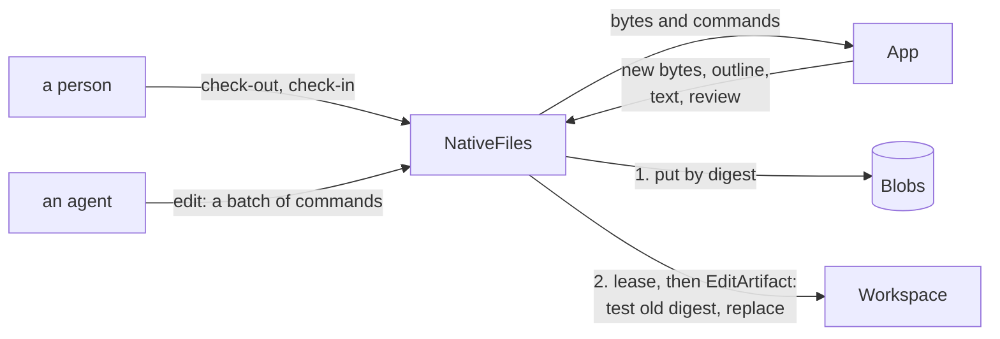

# Architecture

`artifactr.files`, artifactr's `files` extra, gives artifactr artifact types for files in native formats. It depends inward only: it imports the names in `__all__` of `artifactr.core` and `artifactr.workspace`, and `lattice_core.sql` in its SQL layer, and the rest of artifactr imports nothing of it. `tests/files/test_layering.py` holds its layers, and `tests/test_layering.py` the rest of artifactr.

## The layers

| Layer | What it is | It may import |
|---|---|---|
| `manifest` | `Blob`, `Provenance`, `NativeFile`, a type for each app's files (`WordDocument`, `Drawing`), and `revise`, the patch that tests its base | artifactr, pydantic |
| `blobs` | The `Blobs` port, its size limit and digest, and `InMemoryBlobs` | `manifest`, artifactr |
| `checkouts` | `Checkout`, the record behind a person's lease, the `Checkouts` port, and `InMemoryCheckouts` | `manifest`, artifactr, pydantic |
| `app` | The `App` port and `FakeApp` | `manifest`, pydantic |
| `craft` | The crafting apps: `CRAFTS`, a `Craft` each; `Spawn`, which starts an app's CLI for a call; and the two dialects' adapters, `ToolsDialect` and `CommandsDialect` | `manifest`, `app`, pydantic, `mcp`, `anyio` |
| `wordcraft` | WordCraft's adapter, `Subprocess`, and the `.docx` fingerprint and outline | `manifest`, `app`, `craft`, pydantic |
| `cadcraft` | CADCraft's adapter, `Subprocess`, and a drawing's format, DXF or DWG, read from its first bytes | `manifest`, `app`, `craft`, pydantic |
| `native` | `NativeFiles`: uploads, check-out and check-in, agents' edits, reads, renders and collection, behind the app's switch | `manifest`, `blobs`, `checkouts`, `app`, artifactr, `lattice_core.integrations` |
| `tools` | `native_file_tools`, the agent's toolset | `app`, `native`, artifactr and its agent, pydantic-ai |
| `fastapi` | `files_router`, people's check-out and check-in over HTTP, and `editor_app`, the app's browser build on an origin of its own | every layer but `sql` and `tools`, artifactr and its router, FastAPI |
| `sql` | `SqlBlobs`, `SqlCheckouts`, their tables and migrations | `manifest`, `blobs`, `checkouts`, SQLAlchemy, Alembic, `lattice_core.sql` |

## A write

An agent's edit and a person's check-in end the same way. The bytes, the text and the review are put in the blob store, then one `EditArtifact` is committed through the workspace, the one write path (artifactr ADR-0002). A failure before the commit commits nothing, and what was put is collected later.

- **The revision is JSON Patch.** It tests `/content/sha256` against the digest it was made from, then replaces `/content`, `/provenance`, `/fingerprint`, `/text`, `/review`, `/outline` and `/pages`; the name is kept. `base_version` refuses a stale direct edit as `VersionConflict`, and the test refuses a stale proposal when it is accepted, as `PatchFailed` (artifactr ADR-0072).
- **One writer at a time,** through `Workspace.lease_artifact` (artifactr ADR-0071): `checkout:<id>:<participant>` for a check-out, eight hours unless extended, and `edit:<uuid>` for an agent's edit, 45 seconds. The lease is advisory, so the patch's guards hold whether or not a writer took it.
- **Provenance is a claim.** Any surface that commits `edit_artifact` can write anything into a manifest, so only the revision's actor is trusted, and nothing is authorized by provenance.

## The blob store

A blob is keyed by its tenant, workspace and artifact, then its digest: its access is its artifact's, revisions of one artifact share unchanged bytes, and bytes are never shared across artifacts or tenants. The digest and size are computed as the bytes arrive, up to the store's limit. In SQL, `artifactr_files_blobs` holds the bytes as `bytea`, stored `EXTERNAL` since zipped formats don't compress, or SQLite's `BLOB`; the bytes are loaded only when read, so putting bytes already there marks them as put without reading them. On PostgreSQL, both tables keep each row to its tenant by row-level security, through `lattice_core.sql.tenancy` (artifactr ADR-0066).

Collection runs per workspace. It reads every revision of a native file, archived ones too, and every pending proposal, and deletes the blobs last put before a cutoff that none names, in batches, each statement checking again that the blob is still that old ([ADR-0002](adr/0002-blobs-in-a-port-of-the-package.md)).

## The app

`App` is four stateless calls, bytes in and bytes out: `apply` a batch of commands, `inspect` a file, `render` a page, and find `commands`. Each takes a deadline in seconds and fails as `AppFailed`, typed `timeout`, `crashed`, `too_large` or `refused`. An app names itself, its version and build, and declares `talk`, how much it talks to the host while a person edits in it, and `integration`, the key that switches it in a workspace. `FakeApp` reads and writes JSON files of paragraphs and comments, stamps every save as a native app does, and runs on every pull request ([ADR-0004](adr/0004-an-app-is-a-port-of-stateless-calls.md)).

Each crafting app is declared once, in `artifactr.files.craft.CRAFTS`, as its pinned release offers it: the dialect its CLI's MCP server speaks, the roots that CLI takes, the formats it keeps, whether it renders headless, its browser build's host surface, and whether lattice keeps its files or only what it exports. Its key is `files:<name>`, which lattice-core's registry declares too, off by default but WordCraft's; a test holds the two together. `Spawn` starts an app's CLI for every call, in an empty directory holding its roots, under the call's deadline, and refuses an app whose CLI confines nothing unless the operator says its files are trusted. An adapter subclasses `ToolsDialect`, for a server with a tool for each step, or `CommandsDialect`, for one that runs every step as a command, names its tools or commands, and reads a file into an `Inspection` its own way. The sandboxed worker will run the same adapters inside its sandbox ([ADR-0009](adr/0009-each-crafting-app-declared-once-on-one-of-two-dialects.md)).

WordCraft's adapter, `Subprocess`, is the first `ToolsDialect`. It spawns `wordcraft-cli mcp` for every call, in an empty directory that is the CLI's read root and write root, and maps the call onto its tools: open or a blank document, one `batch`, a save, and the text, structure, comments and tracked changes read back. The fingerprint is read from the bytes in Python, the digest of the archive's parts' names and digests without `docProps/core.xml`, which every save stamps, inflating each part against a limit. Its talk level is `save`, since WordCraft's browser build only opens and saves files, and its switch is `files:wordcraft`. It reads a package's format from its main part, so a `.docm` or an `.odt` is told from a `.docx`. It is not a sandbox; the worker that runs hostile files is phase 3 of lattice RFC-0003 ([ADR-0005](adr/0005-wordcraft-headless-pinned-by-checksum.md)).

Each app is pinned by the checksums of one release, in `scripts/crafts/<app>.sha256`, which `scripts/craft` checks before it unpacks anything, fetching each asset only when it is first asked for. Nightly's fidelity report runs for each app with a corpus, in `tests/files/corpus/<app>/`: it opens and saves each file, one per feature, with that release, and publishes which features it kept and whether saving twice is a fixpoint.

## The switch and the agent's tools

Each app is an integration of its own, named by its `integration` key, such as `files:wordcraft`, which lattice-core's registry declares. `NativeFiles` takes an app for each native type, or one for all, and asks its `Integrations` for a file's app before each upload, check-out, extension, check-in and edit of it, refusing with `NotEnabled` while that app is off in the workspace; reads go on ([ADR-0012](adr/0012-an-app-for-each-type-and-no-format-changed-by-a-check-in.md)). `NativeFiles.key_of` is the `key_of` of artifactr's `integration_gate`, so the same switch refuses an edit of a native file on any surface ([ADR-0006](adr/0006-the-agents-tools-behind-each-apps-switch.md)).

`native_file_tools` gives the agent the file's words and review, a page at a time, the app's commands, an edit by a batch of them, and, if the application turns it on, a rendered page. The toolset is offered only while the app is on, read once a step. A file a person has checked out is answered with who has it and until when, and the agent plans again after the check-in.

## People: check-out and check-in over HTTP

WordCraft's browser build only opens and saves files, so a person checks a file out, downloads it, edits it in the build, saves it and uploads it. `files_router`, beside artifactr's router and with its `resolve_actor`, has the routes: a file's status and lease, check-out, extension, check-in, a version's bytes, words or pages, and a proposal's words or pages, which a reviewer reads beside the head. Each names an artifact and a version, a check-out or a proposal, and resolves it through the workspace, as the actor, before any bytes move ([ADR-0008](adr/0008-what-portalr-reads-of-a-native-file.md)). `editor_app` serves the build as released on an origin of its own, under a policy that runs its own code only and reaches no other origin ([ADR-0007](adr/0007-check-out-over-http-and-the-editor-on-its-own-origin.md)). For a build with a host surface, it also serves the shim, lattice's page beside the build, which the portal frames and which frames the build, relaying open, save and dirty between them with every message's window and origin checked: talk level 1+, `bridged` ([ADR-0010](adr/0010-a-shim-beside-the-build-and-talk-level-one-plus.md)). A check-in in another format than the one checked out, by its `Content-Type` or as its app reads it, is refused as `FormatChanged`, and never converted.

## What it adds to the log

Nothing new. An upload is an `artifact_created`, and an edit or a check-in an `artifact_changed`, carrying the manifest, never the bytes. relayr bridges them as it does any artifact's, and feedback targets an artifact's version as for any type.
