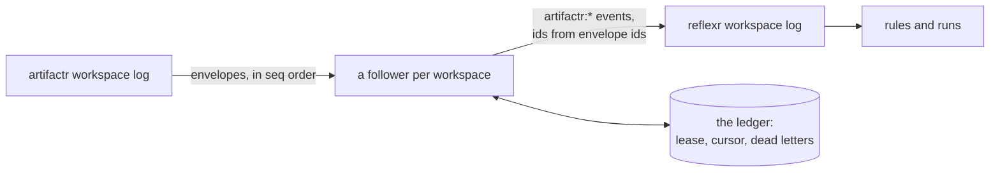

# Architecture

Decisions are recorded in [`adr/`](adr/README.md), and the plan that builds relayr in [RFC-0001](rfcs/0001-v0.1-implementation-plan.md). The design is [stackr RFC-0002](../stackr/rfcs/0002-the-combined-system.md). This page describes what exists: the inbound adapter, which is phase 1 of the plan.

## What relayr is

relayr bridges artifactr and reflexr in one application's process. Its inbound adapter turns selected artifactr events into reflexr events, so rules can react to what people and agents do in a workspace. It uses only the two libraries' public APIs, and neither library imports it or the other. The same tenant and workspace ids name the same context in both.

## Layers

| Package | Holds | May import |
|---|---|---|
| `relayr.events` | The bridged types, under `ArtifactrEvent` (`event_namespace="artifactr"`); `BRIDGED`; and `Projections`, the default set with the application's own mappings | artifactr, reflexr, pydantic |
| `relayr.ledger` | The `Ledger` port, `DeadLetter`, `WorkspaceKey`, and `InMemoryLedger` | pydantic |
| `relayr.sql` | `SqlLedger`, its tables and Alembic migrations, and `create_sqlite_engine`. The `sql`, `sqlite` and `postgres` extras | `relayr.ledger`, SQLAlchemy, Alembic |
| `relayr.inbound` | `Followers`, and the two actors a follower acts as | `relayr.events`, `relayr.ledger`, artifactr, reflexr |

`tests/test_layering.py` holds each package to its column, and checks that every name relayr imports from artifactr or reflexr is in its module's `__all__`.

## Bridged events

Each bridged type is `artifactr:<name>`, and carries who acted in artifactr (`author`), the thread (`thread_id`) and the agent turn (`turn_id`, artifactr's run id) it came from ([ADR-0006](adr/0006-bridged-types-in-the-artifactr-namespace.md), [ADR-0018](adr/0018-bridged-events-their-fields-ids-and-projections.md)):

| artifactr event | Bridged as | Also carries |
|---|---|---|
| `message_posted` | `artifactr:message_posted` | `message_id`, `content`, `kind` |
| `artifact_created` | `artifactr:artifact_created` | `artifact_id`, `kind`, `version`, `data`, `proposal_id` |
| `artifact_changed` | `artifactr:artifact_changed` | `artifact_id`, `kind`, `version`, `summary`, `patch`, `proposal_id` |
| `artifact_archived` | `artifactr:artifact_archived` | `artifact_id`, `kind`, `version`, `proposal_id` |
| `proposal_created` | `artifactr:proposal_created` | `proposal_id`, `proposed_by`, `change`, `rationale` |
| `proposal_resolved` | `artifactr:proposal_resolved` | `proposal_id`, `proposed_by`, `decision`, `artifact_id`, `changes`, `reason`, `version` |
| `run_ended` | `artifactr:turn_ended` | `status`, `usage`, `error`, `reason` |
| `feedback_given` | `artifactr:feedback_given` | `feedback_type`, `target`, `value` |
| an `app_event`, or an artifact kind's events | what the application's projection returns | |

Thread, mode and focus changes, run starts and pauses, tool calls and returns, and deferred answers stay in artifactr. An envelope becomes at most one event, and its id is the envelope's.

## Followers

`Followers` runs one follower per workspace, as a task in the application's process.

1. **It starts on open.** `Followers.watch` is the libraries' `on_open` hook, given to both `Workspaces`, so the first open of a workspace in either library starts its follower, and later opens do nothing. At startup, `Followers.resume` follows every workspace the ledger knows ([ADR-0016](adr/0016-followers-start-on-open.md)).
2. **It opens the workspace in both libraries,** as `SystemActor("relayr")` in artifactr and `SourceActor("artifactr")` in reflexr, the actor on every bridged envelope ([ADR-0017](adr/0017-the-follower-acts-as-the-application.md)).
3. **It takes the workspace's lease** in the ledger, renews it every third of its 30 seconds, and waits while another process holds it. It relays only while the renewal runs: a lost or failed renewal stops the relaying.
4. **It reads the artifactr log after its cursor,** projects each envelope, and publishes the event into reflexr with the envelope's id. Then it saves its cursor: after each envelope it published or dead-lettered, and after every 500 that bridge nothing.
5. **It dead-letters what it can't bridge:** an envelope whose projection raises, an invalid event included, or returns one of reflexr's own events. Anything else stops the follower, a type reflexr doesn't accept included, and logs it as an error; it starts again at its cursor the next time the workspace is opened ([ADR-0015](adr/0015-cursors-leases-and-dead-letters-in-the-ledger.md)).

### Delivery

Delivery is at least once, and the effect exactly once. A follower that stops between publishing and saving its cursor reads the envelope again when it restarts, and so does a second process that takes over the lease; reflexr's `publish` appends an id once, so the event is in reflexr's log once, and a rule fires on it once. `tests/inbound/test_followers.py` checks exactly that across a restart and a redelivery, on every ledger.

Order is kept per lease holder: one follower publishes a workspace's envelopes in `seq` order. Across an overlap, when a slow holder's lease lapses and another process takes it, the stale holder may publish one envelope late, after the new holder has published later ones.

## The ledger

The `Ledger` port keeps, per workspace, the follower's cursor and lease, and its dead letters, once per `seq`. `followed()` lists the workspaces with a cursor or a lease. Its adapters:

- **`InMemoryLedger`,** for tests, and for applications whose followers may start over.
- **`SqlLedger`,** on PostgreSQL or SQLite through SQLAlchemy's asyncio extension, in two tables in the application's schema: `relayr_followers` (a workspace's cursor and lease, one row, locked while it changes) and `relayr_dead_letters`. Its migrations record their version in `relayr_alembic_version`. On SQLite, its engine comes from `create_sqlite_engine`, shared verbatim with the libraries' and grantr's, and every call is awaited to its end even when its caller is cancelled, as theirs are.

One contract test, `tests/ledger/test_contract.py`, runs against memory, SQLite and, when `RELAYR_TEST_POSTGRES_URL` is set, as CI sets it, PostgreSQL. `moon run relayr:pg-up` starts a database.

## What isn't built yet

The outbound adapter, loop control and chain continuation (phase 2), the template's `bridge` question (phase 3), telemetry links and tags (phase 4), rules from chat (phase 5) and evaluation (phase 6). A bridged event starts a chain of its own: until phase 2, nothing carries a run's causation across.
