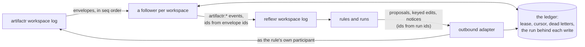

# Architecture

Decisions are recorded in [`adr/`](adr/README.md), and the plan that builds relayr in [RFC-0001](rfcs/0001-v0.1-implementation-plan.md). The design is [stackr RFC-0002](../stackr/rfcs/0002-the-combined-system.md). This page describes what exists: the inbound adapter, the outbound adapter with its loop control, and their telemetry, phases 1, 2 and 4 of the plan.

## What relayr is

relayr bridges artifactr and reflexr in one application's process. Its inbound adapter turns selected artifactr events into reflexr events, so rules can react to what people and agents do in a workspace. Its outbound adapter lets a rule's run act back in artifactr, as the rule's own participant, mostly by proposals and notices. It uses only the two libraries' public APIs, and neither library imports it or the other. The same tenant and workspace ids name the same context in both.

## Layers

| Package | Holds | May import |
|---|---|---|
| `relayr.events` | The bridged types, under `ArtifactrEvent` (`event_namespace="artifactr"`); `BRIDGED`; and `Projections`, the default set with the application's own mappings | artifactr, reflexr, pydantic |
| `relayr.ledger` | The `Ledger` port, `DeadLetter`, `Cause`, `WorkspaceKey`, and `InMemoryLedger` | pydantic |
| `relayr.sql` | `SqlLedger`, its tables and Alembic migrations, and `create_sqlite_engine`. The `sql`, `sqlite` and `postgres` extras | `relayr.ledger`, SQLAlchemy, Alembic |
| `relayr.inbound` | `Followers`, and the two actors a follower acts as | `relayr.events`, `relayr.ledger`, artifactr, reflexr |
| `relayr.outbound` | `Outbound` and its per-attempt `RunActions`, `Allowlist`, `NotAllowed`, `Refused`, the rule's actor, `turn_cause`, and `ArtifactrCapability` with its tools | `relayr.events`, `relayr.ledger`, artifactr, reflexr, pydantic, pydantic-ai |
| `relayr.rules` | `RuleDraft`, the `rule` artifact type; `check_draft` and `preview`; `RuleDrafting`, the chat agent's `draft_rule`; and relayr's rules from chat, `RULES_FROM_CHAT` and `RULE_DRIFT`, with `Installer`'s actions, `ALLOWLISTS` and `anyone` | `relayr.events`, `relayr.outbound`, artifactr, reflexr, pydantic, pydantic-ai |
| `relayr.evals` | `ProposalOutcome`, the `relayr:proposal-outcome` rule and `Outcomes`' action; `proposal_rates`, `rule_conversion` and `history`. The `evals` extra | `relayr.events`, `relayr.ledger`, `relayr.outbound`, `relayr.rules`, artifactr, reflexr, evalr |
| `relayr.telemetry` | The `relayr` scope's attributes, the counters' registry, and `Telemetry`, through the OpenTelemetry API | the OpenTelemetry API |
| `relayr.otel` | `telemetry()`, relayr's contribution to the libraries' `configure_telemetry`, and `metric_views`. The `otel` extra | `relayr.telemetry`, the OpenTelemetry SDK |
| `relayr.langfuse` | `bridged_run` and `bridged_turns`, the libraries' Langfuse contexts with relayr's tags. The `langfuse` extra | `relayr.events`, `relayr.ledger`, `relayr.outbound`, artifactr, reflexr, Langfuse |

`tests/test_layering.py` holds each package to its column, and checks that every name relayr imports from artifactr or reflexr is in its module's `__all__`.

## Bridged events

Each bridged type is `artifactr:<name>`, and carries who acted in artifactr (`author`), the thread (`thread_id`) and the agent turn (`turn_id`, artifactr's run id) it came from ([ADR-0006](adr/0006-bridged-types-in-the-artifactr-namespace.md), [ADR-0018](adr/0018-bridged-events-their-fields-ids-and-projections.md)):

| artifactr event | Bridged as | Also carries |
|---|---|---|
| `message_posted` | `artifactr:message_posted` | `message_id`, `content`, `kind` |
| `artifact_created` | `artifactr:artifact_created` | `artifact_id`, `kind`, `version`, `data`, `proposal_id` |
| `artifact_changed` | `artifactr:artifact_changed` | `artifact_id`, `kind`, `version`, `summary`, `patch`, `proposal_id` |
| `artifact_archived` | `artifactr:artifact_archived` | `artifact_id`, `kind`, `version`, `proposal_id` |
| `proposal_created` | `artifactr:proposal_created` | `proposal_id`, `proposed_by`, `change`, `rationale` |
| `proposal_resolved` | `artifactr:proposal_resolved` | `proposal_id`, `proposed_by`, `decision`, `artifact_id`, `changes`, `reason`, `version` |
| `run_ended` | `artifactr:turn_ended` | `status`, `usage`, `error`, `reason` |
| `feedback_given` | `artifactr:feedback_given` | `feedback_type`, `target`, `value` |
| an `app_event`, or an artifact kind's events | what the application's projection returns | |

Thread, mode and focus changes, run starts and pauses, tool calls and returns, and deferred answers stay in artifactr. An envelope becomes at most one event, and its id is the envelope's.

## Followers

`Followers` runs one follower per workspace, as a task in the application's process.

1. **It starts on open.** `Followers.watch` is the libraries' `on_open` hook, given to both `Workspaces`, so the first open of a workspace in either library starts its follower, and later opens do nothing. At startup, `Followers.resume` follows every workspace the ledger knows ([ADR-0016](adr/0016-followers-start-on-open.md)).
2. **It opens the workspace in both libraries,** as `SystemActor("relayr")` in artifactr and `SourceActor("artifactr")` in reflexr, the actor on every bridged envelope ([ADR-0017](adr/0017-the-follower-acts-as-the-application.md)).
3. **It takes the workspace's lease** in the ledger, renews it every third of its 30 seconds, and waits while another process holds it. It relays only while the renewal runs: a lost or failed renewal stops the relaying.
4. **It reads the artifactr log after its cursor,** projects each envelope, and publishes the event into reflexr with the envelope's id. Then it saves its cursor: after each envelope it published or dead-lettered, and after every 500 that bridge nothing.
5. **It dead-letters what it can't bridge:** an envelope whose projection raises, an invalid event included, or returns one of reflexr's own events, or whose chain would pass the depth limit. Anything else stops the follower, a type reflexr doesn't accept included, and logs it as an error; it starts again at its cursor the next time the workspace is opened ([ADR-0015](adr/0015-cursors-leases-and-dead-letters-in-the-ledger.md)).

### Delivery

Delivery is at least once, and the effect exactly once. A follower that stops between publishing and saving its cursor reads the envelope again when it restarts, and so does a second process that takes over the lease; reflexr's `publish` appends an id once, so the event is in reflexr's log once, and a rule fires on it once. `tests/inbound/test_followers.py` checks exactly that across a restart and a redelivery, on every ledger.

Order is kept per lease holder: one follower publishes a workspace's envelopes in `seq` order. Across an overlap, when a slow holder's lease lapses and another process takes it, the stale holder may publish one envelope late, after the new holder has published later ones.

## Outbound

A rule's run acts in artifactr through `Outbound.acting(reaction)`: a function action directly, an agent through `ArtifactrCapability`'s tools. Both reach the attempt's one `RunActions`.

- **As the rule's own participant,** `ExternalAgentActor(client_id="reflexr:<rule>")`, acting for no person ([ADR-0002](adr/0002-the-outbound-actor-an-external-agent-per-rule.md), [ADR-0022](adr/0022-what-a-rules-actor-needs-in-artifactr.md)). artifactr's own rules apply to it, and relayr has no way to resolve a proposal.
- **Proposals and notices by default.** `create` and `edit` propose, unless the rule's allowlist names the kind in `direct`; `notice` posts a notice, which starts no turn; `create_thread` and `send`, which starts a turn through artifactr's `Runner`, need the allowlist's permission ([ADR-0007](adr/0007-notices-by-default.md), [ADR-0020](adr/0020-allowlists.md)).
- **In the chain's threads:** those of the events that made the rule fire, in order, and those its run created, unless the allowlist allows any. A write with no thread named goes to the first.
- **Once, however often the run is retried.** Every write's ids are derived from the run, its last checkpoint and what the write is, so artifactr refuses a repeat, in any order, as already done. An edit sets one value at one path, and is skipped when it is in place. A version conflict is retried within the attempt; a missing artifact, an invalid one or a patch that doesn't apply is `Refused`, which an agent's model may retry; any other refusal fails the run for good ([ADR-0019](adr/0019-runs-act-once-through-derived-ids-and-keyed-edits.md)).

### Loop control

Before each write, `RunActions` records the run behind it in the ledger, by the ids the follower will read off its envelope. The follower publishes a rule's write back into reflexr through `caused_by(...)`, in the run's chain, as deep as the run's own events; a turn acting for a rule continues the chain of the last of the messages its `run_started` names that a run posted ([ADR-0026](adr/0026-a-retried-send-asks-again-and-turns-traced-by-their-messages.md)). reflexr refuses a firing past its depth limit, so two rules that answer each other stop there. A person's answer to a rule's proposal joins the proposal's chain without going deeper ([ADR-0021](adr/0021-chains-continue-across-the-bridge.md)). `tests/outbound/test_loops.py` checks both of phase 2's exit criteria, on every ledger.

## Rules from chat

The chat agent drafts a reflexr rule as a `rule` artifact, through `RuleDrafting`'s `draft_rule`. That tool checks the draft, previews it against the recent log and proposes it. When a person who may install rules accepts the proposal, relayr's `relayr:rules-from-chat` re-reads artifactr and installs the rule in reflexr's stored rules, with its provenance. Archiving the artifact archives the rule. The rule is scoped by the artifact, so one artifact's changes happen in order, and it never trusts the bridged event ([ADR-0028](adr/0028-rules-from-chat.md)). A rule changed in reflexr directly is proposed back to its artifact by `relayr:rule-drift`, which finds the artifact from relayr's own install facts ([ADR-0030](adr/0030-drift-proposed-back-to-a-rules-artifact.md)). `tests/rules/test_installer.py` checks phase 5's exit criterion.

## Evaluation

`relayr:proposal-outcome` gives the run behind each resolved proposal a `ProposalOutcome`, accepted, edited or rejected, as relayr's evaluator, once per resolution. `proposal_rates`, `rule_conversion` and `history` measure the rules from the logs ([ADR-0031](adr/0031-proposal-outcomes-and-the-measures.md)).

## Telemetry

relayr records through the OpenTelemetry API, under the scope `relayr`, with attributes named as the libraries name theirs (`relayr.tenant.id`, `relayr.workspace.id`).

- **Traces are linked, not continued** ([ADR-0004](adr/0004-sessions-linked-not-continued.md), [ADR-0023](adr/0023-traces-linked-across-the-bridge.md)). The follower runs in an empty context, whatever opened its workspace, and publishes each bridged event in a `relayr.bridge <type>` span, the root of its own trace, linked to the span that committed the artifactr envelope; reflexr's publish is its child, and the run links to that. A run's `send` starts a turn linked to the run's span, and the turn starts from an empty context, so the run's Langfuse attributes stay with the run.
- **Langfuse sessions are tagged with each other** ([ADR-0024](adr/0024-langfuse-sessions-tagged-with-each-other.md)). `bridged_run` tags a run with the threads of its bridged events, and sets its user to the person who acted. `bridged_turns(ledger)` tags a turn acting for a rule with the rule and with the chain of the run that sent its message, found by `turn_cause` from the messages the turn carries out, as the follower finds it ([ADR-0026](adr/0026-a-retried-send-asks-again-and-turns-traced-by-their-messages.md)). `tests/telemetry/test_links.py` checks phase 4's exit criterion.
- **Counters** ([ADR-0025](adr/0025-counters-and-how-long-causes-are-kept.md)): `relayr.followers.stopped` and `relayr.dead_letters`. `relayr.otel.telemetry()` keeps relayr's spans in Langfuse's traces and applies the cardinality policy to its counters.

## The ledger

The `Ledger` port keeps, per workspace, the follower's cursor and lease, and its dead letters, once per `seq`; and, for the outbound adapter, the `Cause` of each write, once per key, kept for `cause_ttl` (a week by default): each follower forgets its workspace's older causes at most hourly while it holds the lease, once it has caught up with the log. `followed()` lists the workspaces with a cursor or a lease. Its adapters:

- **`InMemoryLedger`,** for tests, and for applications whose followers may start over.
- **`SqlLedger`,** on PostgreSQL or SQLite through SQLAlchemy's asyncio extension, in three tables in the application's schema: `relayr_followers` (a workspace's cursor and lease, one row, locked while it changes), `relayr_dead_letters` and `relayr_causes`. Its migrations record their version in `relayr_alembic_version`. On SQLite, its engine comes from `create_sqlite_engine`, shared verbatim with the libraries' and grantr's, and every call is awaited to its end even when its caller is cancelled, as theirs are. With `row_level_security=True`, each transaction names its tenant to PostgreSQL, whose policies show it only that tenant's rows, and `followed`, which spans tenants, goes to an engine as the tables' owner ([ADR-0027](adr/0027-row-level-security-under-the-scoping.md)).

One contract test, `tests/ledger/test_contract.py`, runs against memory, SQLite and, when `RELAYR_TEST_POSTGRES_URL` is set, as CI sets it, PostgreSQL. `moon run relayr:pg-up` starts a database.

## What isn't built yet

Docs, ADRs and the product repository (phase 7). stackr's template wires relayr in with its `bridge` question ([stackr ADR-0021](../stackr/adr/0021-the-bridge-in-the-template.md)). LiteLLM's metadata doesn't carry relayr's tags yet ([lattice #86](https://github.com/alexnodeland/lattice/issues/86)).
