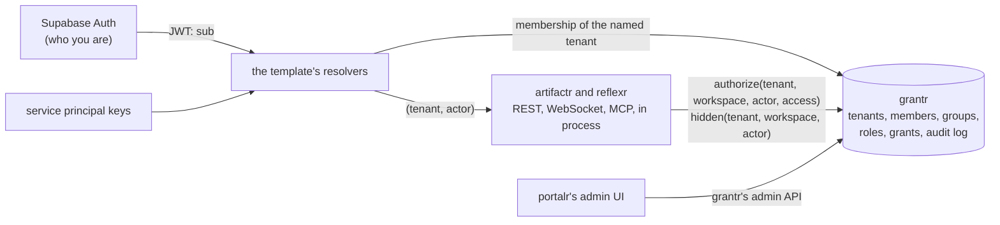

# RFC-0001: grantr, identity and access

**Status:** Accepted
**Author:** Alex Nodeland
**Created:** 2026-10-12
**Discussion:** [#43](https://github.com/alexnodeland/lattice/pull/43); accepted on 2026-10-12, with the decisions in [Decisions](#decisions) (D9 taken with lattice RFC-0002's)
**Amended by:** [grantr ADR-0015](../grantr/adr/0015-a-check-writes-nothing.md): a check writes nothing, so grantr knows a workspace from its grants; [relayr ADR-0017](../relayr/adr/0017-the-follower-acts-as-the-application.md): `subject_of` maps the source `artifactr` to the application's own principal; [artifactr ADR-0058](../artifactr/adr/0058-a-tenants-workspaces-listed-by-what-each-actor-may-open.md): artifactr lists a tenant's workspaces, asked with no workspace; [relayr ADR-0022](../relayr/adr/0022-what-a-rules-actor-needs-in-artifactr.md): `subject_of` maps a rule's actor in artifactr, and a turn acting for it, to the rule's principal; [grantr ADR-0024](../grantr/adr/0024-who-sees-a-restricted-item.md): who may restrict a thread or artifact, and who sees it; [grantr ADR-0026](../grantr/adr/0026-row-level-security-under-the-scoping.md): the second engine runs as the tables' owner, not a role with `BYPASSRLS`, and a transaction that names no tenant sees nothing, rather than failing; [artifactr ADR-0066](../artifactr/adr/0066-row-level-security-under-the-scoping.md): the same, in artifactr's adapter, which reads nothing across tenants; [reflexr ADR-0062](../reflexr/adr/0062-row-level-security-under-the-scoping.md): the same, in reflexr's adapter, whose dispatcher and scheduler read across tenants on the owner's engine
**Siblings:**

- [artifactr ADR-0012][a-adr-0012] and [ADR-0048][a-adr-0048] put authorization within a tenant behind one hook, asked in one place. This RFC widens that hook, and amends both.
- [reflexr ADR-0016][r-adr-0016] and [reflexr RFC-0003][r-rfc-0003] scope reflexr to tenants and workspaces, and give stored rules their own `allow` hook, which this RFC folds into the widened one.
- [stackr ADR-0002][s-adr-0002] and [ADR-0011][s-adr-0011] verify Supabase Auth tokens in the template, with the tenant in a claim. This RFC moves the tenant out of the token.
- [stackr RFC-0002][s-rfc-0002] leaves open who may accept a rule drafted in chat. grantr answers it.
- [lattice RFC-0002](0002-portalr-the-portal.md) is portalr, whose admin UI manages access through grantr's API.

## Summary

grantr is identity and access for the family: tenants, their members, groups, roles and service principals, and the grants that bind them to tenants, workspaces, threads and artifacts. artifactr and reflexr already ask one hook whether an actor may use a workspace. This RFC widens that hook so it also hears the action, asks it for every command and every read, and adds a second call that hides the threads and artifacts an actor may not see. grantr answers both from its own model, with in-memory and SQL adapters, an append-only audit log, and an admin API. The template wires it in, and a user's tenants come from grantr's memberships rather than from a claim in the token.

This is the family's first RFC. It changes artifactr, reflexr and stackr as well as adding grantr, so it lives in `docs/rfcs/` rather than in one package's series. grantr's own RFC-0001 is its implementation plan, derived from this design, as relayr's is from stackr RFC-0002.

## Motivation

Today, any user of a tenant may do anything in every workspace of that tenant.

- **The hook can't tell actions apart.** `Authorize = Callable[[TenantId, WorkspaceId, Actor], Awaitable[bool]]` is asked when a workspace is opened, and never hears what the actor is about to do. A role such as "viewer" can't be kept from editing. reflexr's security guide tells applications to check commands in their own routes. In the work codebase this family grew beside, that shape left one of several doors open.
- **The template allows everything.** Its only `authorize` is `Mirrors.authorize`, which starts the Langfuse feedback mirror for the workspace and returns `True`. Without Langfuse there is no hook at all.
- **A user has exactly one tenant,** set by the service role in `app_metadata.tenant_id`. Moving a user, or letting one belong to two tenants, means changing the token.
- **Nothing stores members, groups or roles.** Neither library has a registry of workspaces, let alone of who belongs to them.
- **MCP clients are keyed by the signed-in user's id.** There are no service principals: a key for an integration is a user's token.
- **Live connections are checked once.** A WebSocket or an MCP subscription is authorized when it opens, so a revoked user keeps writing until it closes.
- **Open questions wait on it.** stackr RFC-0002 can't say who may accept a rule until something knows who may install one, and portalr's admin UI has nothing to manage without grantr.

The work codebase's history is the case for doing this in one design rather than route by route. It grew six separate identity and permission systems. Its owner checks were scattered across routers, and they disagreed about what "anonymous" meant. One agent tool checked a thread's owner instead of the user acting, so a viewer inherited the owner's writes. Reads by bare id crossed workspaces. A grant was written in one shape and read in another, so a restriction to one environment applied to all of them. A production gate covered one of the four routes that deployed, and failed open when it couldn't read its own data. The fix that held was a test listing every route with its declared gate.

## Design

### Overview



Supabase Auth proves who a person is. grantr decides what they may do. The libraries ask grantr, through hooks typed in the libraries themselves, before every command and read. Neither library imports grantr, and grantr imports neither library: actions cross as strings, and the template wires the two together.

### The widened hook

The libraries define these types in their `workspace` modules, where `Authorize` lives today. artifactr defines all of them, and its `Access` has no `rule`. reflexr has no threads or artifacts, so it defines `Access` (with `rule`, without `thread_id` and `artifact_id`), `Authorize`, `OnOpen` and `ACTIONS`, and no `Visibility` or `Hidden`. grantr reads an `Access`'s fields by name, so the two shapes need no common class.

```python
class Access(BaseModel):
    """What an actor is about to do."""

    model_config = ConfigDict(frozen=True)

    action: str                      # "artifactr:edit_artifact", "reflexr:read_runs"
    thread_id: ThreadId | None = None
    artifact_id: ArtifactId | None = None
    rule: RuleName | None = None     # reflexr's rule commands and reads


class Visibility(BaseModel):
    """The threads and artifacts an actor may not see in one workspace."""

    model_config = ConfigDict(frozen=True)

    threads: frozenset[ThreadId] = frozenset()
    artifacts: frozenset[ArtifactId] = frozenset()


Authorize = Callable[[TenantId, WorkspaceId | None, Actor, Access], Awaitable[bool]]
Hidden = Callable[[TenantId, WorkspaceId, Actor], Awaitable[Visibility]]
OnOpen = Callable[[TenantId, WorkspaceId], Awaitable[None]]
```

- **The hooks move onto `Workspaces`.** `Workspaces(storage, ..., authorize=, hidden=, on_open=)` holds them, and every `Workspace` handle it opens, `as_actor` included, checks inside each of its methods. `open()`, `artifactr_router`, `ArtifactrMcp` and their reflexr twins stop taking `authorize`, so a surface can't be given a different hook from another, or none.
- **Actions are qualified strings,** `<library>:<name>`, in the form reflexr ADR-0039 gives event types. A command's action is its command name (`artifactr:post_message`, `reflexr:install_rule`). A read's is `read_` and what it reads (`artifactr:read_artifacts`, `reflexr:read_dead_letters`). Opening a workspace is `<library>:open`.
- **Each library exports its catalog,** `ACTIONS: frozenset[str]`, the complete list. grantr validates roles against the catalogs the application hands it.
- **`authorize` is asked for every command and every read,** because each `Workspace` method asks it: so every REST request, every command frame on a WebSocket, every MCP tool call and resource read, and every in-process call. Subscriptions are still checked when they open, and a command on a live connection is refused the moment its grant is revoked.
- **The workspace is `None` for tenant-wide reads:** reflexr's `GET /rules` and `GET /schedules` and its `list_rules` tool. They skip `authorize` today, and go through `Workspaces` and ask it from here on. This amends reflexr ADR-0016's amendment, and lets an application hide rule definitions from some members.
- **reflexr's `StoredRules.allow` is folded in.** Installing, updating, archiving and replaying a rule are commands like any other, with the rule's name in `Access.rule`. `StoredRules` keeps its `actions` and `namespaces` allowlists, which say what a stored rule may do, not who may store it. What a stored rule's runs may do in the workspace is the grants of the rule's own principal, below.
- **The fixed checks in the cores stay,** beneath the hook, and grantr can't grant around them. An evaluator may only give feedback, an author can't accept their own proposal, and only a thread's agent or the system records run facts. The proposal check looks through `on_behalf_of` (below), so a user can't accept their own proposal through an agent either.
- **Side effects move to `on_open`.** The template's mirrors, and relayr's followers (stackr RFC-0002), start a workspace's background work through `authorize` today. `on_open` is called on every allowed open, after the check, and its callees are idempotent, as `Mirrors.watch` is: a mirror that stopped restarts the next time its workspace is used, as now. A permission check then has no side effects.
- **Defaults stay permissive in the libraries.** No `authorize` allows everything and no `hidden` hides nothing, so the libraries stay usable alone, as their examples use them. The template is where access is closed by default, once grantr is wired.

### Seeing threads and artifacts

A thread or artifact is visible to everyone with a role in its workspace, unless it is **restricted**. Then only those granted a role on it, the workspace's admins, and the tenant's owners and admins see it.

- **`hidden` returns what the actor may not see** in one workspace, threads and artifacts together. Restricted items are the exception, so the sets are small, and a library filters with them in every listing: `id NOT IN (...)` in SQL, a set lookup in memory.
- **Every read path filters:** listing artifacts, threads, proposals and revisions; reading the log; the WebSocket's replay and live frames; and the MCP tools and resources. A single read of a hidden item answers `NotFound`, the same as a missing one, so ids can't be probed.
- **The log filters each envelope by what it is about.** A thread's events are filtered by their thread, and an artifact's events (its revisions and proposals) by the artifact. An artifact event committed from a hidden thread's run is delivered with its `thread_id` and `run_id` cleared, so a visible artifact's history stays whole for everyone who can see it.
- **A live stream filters with the sets it fetched when it opened,** and fetches them again at an interval (`hidden_refresh`, 30 seconds by default). Until then, a newly restricted item can still reach an open stream. [Drawbacks](#drawbacks) records this.
- **reflexr has no threads or artifacts,** so its grants stop at the workspace and its rules. Its runs are visible to everyone with a workspace role.
- **artifactr's agent reads through the same filter.** The tools a turn's agent uses to list and read artifacts are filtered by the visibility of the user the turn acts for, so a chat can't surface what its user may not see.

### Agent turns act for a user

A turn's agent acts for the person whose message started it.

- **`AgentActor` gains `on_behalf_of: UserActor | ExternalAgentActor | None`.** It is the `Session.requested_by` the `Runner` already sets, moved onto the actor so that every check sees it. The run's started event records it, so the log says who each agent write was for. The agent's `participant` stays `agent:{thread_id}`, so command de-duplication is unchanged.
- **A turn takes messages only up to the first change of author.** The `Runner` batches every message not yet taken into one turn today, which would let a viewer's message ride on an editor's rights. The next author's messages start the next turn. On resume, the turn acts for whoever answered the deferred call.
- **grantr checks the user it acts for,** then the agent's own write policy applies, as it does today: by default, the agent proposes and doesn't edit. A viewer's chat can make the agent read and answer, but not propose or edit, because the viewer may do neither.
- **A person on MCP is acting for themselves.** `ExternalAgentActor` gains the same `on_behalf_of: UserActor | None`. The template sets it when a person connects with their own token, and leaves it empty for a client that connects with a service principal's key.
- **A turn with no `on_behalf_of`,** such as one started by the system, is checked as the agent alone, and the template grants an agent nothing by default.
- **reflexr's runs act as their rule.** Each rule is a principal in grantr, named by its workspace and rule, with no grants until someone grants it a role. Its installer, or relayr's install rule (stackr RFC-0002), grants it one when it is installed, and grantr's rule that no one grants more than they hold bounds it. Rules defined in code run as the application's own service principal, which the template grants at startup.

This makes the work codebase's bug impossible by construction: the actor a check sees is the one acting, and whoever it acts for.

### grantr's model

| Concept | What it is |
|---|---|
| **Tenant** | The isolation boundary, keyed by the same `TenantId` the libraries use. grantr is the registry of tenants |
| **Workspace** | Known to grantr once a grant names it or an item in it (phase 5's restricted flag also makes an item known), with the same `WorkspaceId` as the libraries |
| **User** | A Supabase Auth `sub`. grantr stores no passwords or profiles, only the id, and a display name and email cached from the token for its admin UI |
| **Service principal** | A tenant's non-human principal, with an id, a name and any number of keys. Integrations, MCP clients and rules are service principals |
| **Group** | A tenant's named set of users and service principals |
| **Role** | A named set of actions. Built-in roles are fixed; a tenant may define its own |
| **Grant** | A role, on a resource (the deployment, a tenant, a workspace, or a thread, artifact or rule in a workspace), to a subject (a user, a group or a service principal) |
| **Restricted** | A flag on a thread or artifact, set and cleared with `grantr:restrict`. Grants on an item add to the workspace's grants; on a restricted item, they are the only ones |

The built-in roles:

| Role | On | May |
|---|---|---|
| `operator` | the deployment | see every tenant, and the stack's shared tools (Langfuse, Grafana, LiteLLM), which aren't tenant-scoped. Given only by another operator, or by `make operator EMAIL=...`, which grants the first |
| `owner` | tenant | everything in the tenant, including deleting it and managing owners |
| `admin` | tenant | everything but the above: members, groups, roles, keys, every workspace |
| `member` | tenant | belong to the tenant; workspace roles give access to its workspaces |
| `admin` | workspace | everything in the workspace, every restricted item in it included, and its grants |
| `editor` | workspace, thread, artifact | read; post messages; create, edit, propose and archive; accept and reject proposals; give feedback; operate runs |
| `viewer` | workspace, thread, artifact | read and give feedback |

Rule management (`reflexr:install_rule`, `update_rule`, `archive_rule`, `replay_rule`) is in the workspace `admin` role only. That answers stackr RFC-0002's "who may accept a rule": a workspace admin. A custom role can hand it to others.

- **grantr's own catalog:** `grantr:create_tenant`, `delete_tenant`, `add_member`, `remove_member`, `manage_groups`, `define_role`, `grant`, `revoke`, `issue_key`, `revoke_key`, `restrict`, `read_audit` and `grant_operator`. `operator` holds `create_tenant` and `grant_operator`, on the deployment. `owner` holds the rest on its tenant, and `admin` all of them but `delete_tenant` and granting `owner`. A workspace `admin` holds `grant`, `revoke` and `restrict` within its workspace.
- **Tenant roles cover every catalog.** The catalogs come from the application, so a tenant `owner` or `admin` holds every tenant-level action in every catalog it is handed: portalr's `portalr:read_telemetry` and `portalr:read_spend` (lattice RFC-0002), for one. Workspace roles are defined by action names in the libraries' catalogs, so a library's new read lands in `viewer` by its `read_` prefix, and a new command lands in no built-in role until the role is changed, which the matrix snapshot makes a reviewed change.
- **`operator` is a grant, never a flag.** It is given and revoked like any role, recorded in the audit log, and held by few. It doesn't put an operator inside a tenant's workspaces: reading a tenant's threads still needs a role there, which an operator can grant themselves, in the audit log.
- **No one grants more than they hold.** A grant is refused if its role has an action the granter can't take on that resource.
- **Custom roles** are a tenant's own named sets of actions, validated against the catalogs. They can be granted wherever a built-in workspace role can. The built-in roles can't be edited, so a deployment's meaning of `editor` doesn't drift.
- **Checks are deny by default.** A principal with no grant that applies, an unknown action, an action not in any catalog, or a store that can't be read: each is a refusal. Being signed in isn't access, and the template shows a member with no workspace roles that they have none, rather than an empty app.

### The ports

grantr follows the family's ports and adapters ([artifactr ADR-0034][a-adr-0034]): a core with no I/O, a storage port with an in-memory adapter and an SQL adapter, and one contract test run against both.

```python
class Grants:
    async def check(self, tenant: TenantId, subject: Subject, action: str, on: Resource) -> bool: ...
    async def hidden(self, tenant: TenantId, subject: Subject, workspace: WorkspaceId) -> Visibility: ...
    async def member(self, tenant: TenantId, user: UserId) -> Membership | None: ...
    async def memberships(self, user: UserId) -> list[Membership]: ...
    async def resources(self, tenant: TenantId, subject: Subject, action: str, kind: ResourceKind) -> list[str]: ...

    def hooks(self, subject_of: SubjectOf) -> Hooks: ...   # .authorize and .hidden, for Workspaces


SubjectOf = Callable[[TenantId, WorkspaceId | None, Actor], Subject]

type UserId = str
type Subject = User | ServicePrincipal | RulePrincipal | Agent    # frozen models, discriminated by kind
#   User(id: UserId); ServicePrincipal(id: str); RulePrincipal(workspace: WorkspaceId, rule: str); Agent()
type ResourceKind = Literal["deployment", "tenant", "workspace", "thread", "artifact", "rule"]

class Resource(BaseModel):          # frozen; its parent chain is implied by the fields set
    kind: ResourceKind
    workspace: WorkspaceId | None = None
    id: str | None = None           # the thread, artifact or rule

class Membership(BaseModel):        # frozen
    tenant: TenantId
    user: UserId
    roles: tuple[str, ...]

class Hooks(NamedTuple):
    authorize: Authorize
    hidden: Hidden
```

- **`check`, and `hidden` and `resources`, are shaped like OpenFGA's `Check` and `ListObjects`,** so an OpenFGA adapter can be added if the model ever outgrows fixed resource levels. None is planned.
- **`hooks` adapts grantr to the libraries' hooks** without importing them. The library types it needs (`Visibility`, the actors) reach it structurally, and `subject_of`, which the template supplies, maps an actor to a grantr subject:

  | Actor | Subject |
  |---|---|
  | `UserActor` | the user |
  | `ExternalAgentActor` | the user in `on_behalf_of`, or else its service principal |
  | `AgentActor` (artifactr) | the user in `on_behalf_of`, or else the agent, with no grants |
  | `AgentActor` (reflexr) | the rule's principal, named by its workspace and rule |
  | `SystemActor`, `EvaluatorActor` | the application's service principal |
  | `SourceActor` | the service principal for that source |

- **The SQL adapter** uses SQLAlchemy and Alembic, with `grantr_`-prefixed tables in the application's schema, as the libraries' adapters do: `grantr_tenants`, `grantr_users`, `grantr_principals`, `grantr_keys`, `grantr_groups`, `grantr_group_members`, `grantr_roles`, `grantr_grants`, `grantr_resources` (each workspace, thread, artifact and rule grantr knows, with its parent and the restricted flag) and `grantr_audit`. One query answers a check: the grants on the resource and its ancestors, for the subject and its groups, through an index on `grantr_grants (tenant_id, resource_id, subject_id)`.
- **Decisions aren't cached across requests.** A check is one indexed query, and a cache would make revocation late. A request may reuse its own answers.

### Tenancy and authentication

grantr owns membership; Supabase Auth only authenticates.

- **The token carries who, not where.** The template stops reading `app_metadata.tenant_id`. The client names the tenant on each request, with an `X-Tenant` header or, on a WebSocket, a `tenant` query parameter. The resolver verifies the token as it does now, then asks grantr whether that user is a member of the named tenant. A non-member gets 403. A user with one membership may omit the tenant.
- **No access-token hook.** Supabase can add claims through a Postgres hook, but grants in a token are stale until it refreshes. grantr is asked instead.
- **Asymmetric signing keys.** The template verifies against the JWKS, as it does locally now, and keeps the HS256 secret only as the legacy fallback Supabase itself keeps during migration.
- **Service principal keys** are a public id and 32 random bytes, `grantr_sk_<id>_<secret>`, shown once. grantr finds a key by its id and compares a SHA-256 digest of the secret; 32 random bytes need no salt.
- **A key names its tenant.** A request with a key resolves to the key's service principal and tenant, so a key can't reach another tenant.
- **MCP clients.** A client with a key is an `ExternalAgentActor` whose `client_id` is its service principal's id. A person who connects with their own token is an `ExternalAgentActor` acting for them, and is checked as them.
- **Provisioning is one call.** Creating a tenant in grantr calls the application's `on_tenant_created` callback, where the template creates the tenant's LiteLLM team and key, as `make tenant` does by hand today. Inviting a user is portalr's `POST /portalr/v1/invites` (lattice RFC-0002), which calls the Supabase Auth admin API for the user's `sub`, then adds the membership in grantr.

- **Errors keep the libraries' shapes.** No token, or an invalid one, is 401. A request from a non-member of the named tenant, or one `authorize` refuses, is the existing `Forbidden`: 403 over REST, a `forbidden` error frame on a WebSocket, and `INVALID_PARAMS` over MCP. A hidden item is `NotFound`, 404. A request with no tenant from a user with several memberships is 400.

### The audit log

grantr records every change to access as a typed event in its own append-only log, with a sequence number, the actor and the time, in the shape of artifactr's and reflexr's logs.

- **What it records:** tenants created and deleted; members added and removed; groups and their members; custom roles defined, changed and deleted; grants given and revoked; keys issued and revoked; restrictions set and lifted.
- **What it doesn't:** each refusal. Refusals are counted in grantr's telemetry, with the action and the reason, and logged at the debug level; storing every one would let a busy client fill the log.
- **It is read through grantr's API,** paged by sequence number, which portalr's admin UI uses. Each event also goes to telemetry, so the stack's logs hold a copy.

### Row-level security

PostgreSQL row-level security is a second line of defence under the libraries' scoping, on by an option in each SQL adapter: artifactr's, reflexr's, relayr's and grantr's.

- **Each transaction sets `lattice.tenant_id`,** with `set_config(..., true)` in SQLAlchemy's `after_begin` event, from the handle's tenant. The setting lasts only for the transaction, so a pooled connection never carries one tenant into the next. A transaction that hasn't set it fails, because `current_setting` without `missing_ok` raises.
- **Each table gets one policy,** `tenant_id = current_setting('lattice.tenant_id')`, created by the adapter's migrations when the option is on. The application connects as a role that doesn't own the tables, so the policies apply to it.
- **Work that spans tenants runs apart.** reflexr's dispatcher and scheduler scan every tenant's workspaces and due runs, and grantr finds a key, or a user's memberships, before it knows the tenant. These go through named storage methods on a second engine, whose role has `BYPASSRLS`, and nothing else uses that engine.
- **It guards tenants, not grants.** Workspaces, threads and artifacts are still enforced by the hooks; a policy per grant would copy grantr's model into SQL, which is the "written one way, read another" bug again.
- **The in-memory adapters have no equivalent,** and don't need one: it is defence against a mistake in an SQL adapter, which the memory adapter doesn't share.

### The permission-matrix test

Each library adds a test that lists every public `Workspace` method with the action it asks `authorize` for, and every REST route, WebSocket command, and MCP tool and resource with the method it calls. A method that asks for no action or for one outside the catalog fails it, and so does a surface that reaches storage without a method. A surface that is deliberately open (`GET /healthz`) is listed with its reason.

grantr ships the other half, `grantr.testing.matrix(catalogs, roles)`, which prints every role against every action in the catalogs. The template commits the table as a snapshot, so adding an action to a library, or changing a role, fails the template's CI until the new table is reviewed and committed.

### grantr's surfaces

- **A FastAPI router,** `grantr_router(grants, resolve_actor=...)`, for tenants, members, groups, roles, grants, restrictions, keys and the audit log. It checks its callers with grantr's own actions (`grantr:add_member`, `grantr:issue_key`, ...), granted by the tenant `owner` and `admin` roles.
- **Two reads for UIs:** `GET /grantr/v1/me`, the caller's roles in the active tenant and the workspaces they can open (from `resources`), or, without `X-Tenant`, the caller's memberships; and `POST /grantr/v1/checks`, a batch of `{"action": ..., "resource": {"kind": ..., "workspace": ..., "id": ...}}` questions answered with a list of booleans in the same order. A UI asks rather than working out a permission itself; each command is checked again when it arrives. portalr (lattice RFC-0002) uses both.
- **Its OpenAPI document** is committed in `packages/grantr/schemas/` with a drift test, as stackr RFC-0003 plans, and portalr's client takes its types from it.
- **No MCP server in v0.1.** Managing access through an agent is a later decision.
- **Telemetry** follows the family's: spans for checks over a threshold, counters for allowed and refused checks by action, and the audit events.

### The template

The template gains an `access` question, `grantr` by default, `none` to keep today's behaviour.

- `auth.py` resolves a principal from a Supabase token or a service principal key, and the active tenant from the request, checked against grantr.
- `collaboration.py` and `automation.py` pass `grants.hooks(subject_of)` to their `Workspaces`. `Workspaces` takes one `on_open`, which the template composes from the mirrors' `watch` and, once relayr is wired, its followers' start, each idempotent.
- `make tenant NAME=acme OWNER=alice@example.com` creates the tenant in grantr, which creates its LiteLLM team, and makes Alice its owner. `make operator EMAIL=...` grants a deployment's first operator.
- **Migrating an application.** `make migrate-tenants`, run once, reads each Supabase user's `app_metadata.tenant_id` and creates the tenant and the membership in grantr. `AUTH_TENANT_CLAIM` is then removed.
- The SQL options turn on row-level security with PostgreSQL, and the application connects as a non-owner role that the template's migrations create.

### What changes in each package

| Package | Changes | Breaking |
|---|---|---|
| artifactr | `Access`, `Visibility`, the widened `Authorize`, `Hidden` and `OnOpen` on `Workspaces`; `ACTIONS`; a check in every `Workspace` method; filtered reads; `on_behalf_of` on the agent and external agent actors; one author per turn; the row-level security option; the matrix test | Yes: `Authorize`'s signature, and where the hooks are passed |
| reflexr | `Access`, the widened `Authorize` and `OnOpen` on `Workspaces`, with no `Hidden`; `ACTIONS`; the tenant-wide reads ask `authorize`; `StoredRules.allow` removed; the row-level security option, with its dispatcher on the second engine; the matrix test | Yes: `Authorize`'s signature, where the hooks are passed, and `StoredRules.allow` |
| relayr | Its followers start from an `OnOpen` the template composes with the mirrors'; the row-level security option | No: relayr has no release yet |
| stackr | The `access` question; tenancy from grantr; keys; `make tenant`; row-level security with PostgreSQL | Yes, for generated applications: a client must name its tenant if its user has several |
| grantr | New | |

The ADRs this amends: artifactr ADR-0012 and ADR-0048, reflexr ADR-0016 and its amendment, and stackr ADR-0002, ADR-0011 and ADR-0015. The breaking changes land as `feat(<package>)!:` commits, which bump the minor version before 1.0 (lattice ADR-0006), and each changelog entry links this RFC.

### Phases

| Phase | Deliverable | Exit criteria |
|---|---|---|
| 1. The hook | `Access`, the widened `Authorize`, `OnOpen` and `ACTIONS` in artifactr and reflexr, held by `Workspaces`; `on_behalf_of` on artifactr's agent and external agent actors; a check in every `Workspace` method; `StoredRules.allow` folded in; one author per turn; the matrix tests; the template's mirrors on `on_open` | Every library's matrix test passes, and a template application behaves as before with an allow-all hook |
| 2. grantr's core | The package, its model and types, built-in and custom roles, groups, service principals, `check`, `resources`, `hooks` and `SubjectOf`, the audit log, and the in-memory adapter, with the contract test | In the contract test, a viewer is refused an edit, a key can't reach another tenant, and no one grants more than they hold |
| 3. Storage and API | The SQL adapter and its migrations; the admin router and its committed OpenAPI document | The contract test passes on SQLite and PostgreSQL, and the drift test passes |
| 4. The template | The `access` question, tenancy from memberships, keys, `make tenant`, `make operator`, `make migrate-tenants`, the matrix snapshot | A generated application passes its CI, and the smoke test signs a user in to one of two tenants and is refused the other |
| 5. Threads and artifacts | `Visibility` and `Hidden` in artifactr, every read path filtered, the restricted flag in grantr, and turns that act for their user | A restricted thread is absent from every surface for a non-member, including the agent's tools in another user's turn |
| 6. Row-level security | The option in artifactr's, reflexr's, relayr's and grantr's SQL adapters, the second engine, and the template's non-owner role | With the libraries' tenant scoping bypassed in a test, PostgreSQL returns no other tenant's rows, and reflexr's scheduler still runs every tenant's due runs |
| 7. Docs and ADRs | grantr's site section, the ADRs for each decision and the amendments, and grantr's README | grantr's section builds, with the architecture updated |

Phases 1 and 2 are independent, and can run side by side. Phase 5 needs 1 to 4. Phase 6 is independent of 5.

## Decisions

The maintainer decided these on 2026-10-12.

| # | Decision | Decided | Instead of |
|---|---|---|---|
| D1 | How the libraries ask about an action | Widen `Authorize` with an `Access`, asked per command and read; side effects on `on_open` | A second `permit` hook beside an unchanged `authorize` (three hooks in reflexr, and a surface can forget one) |
| D2 | How fine grants go in v0.1 | Down to threads and artifacts, with `hidden` beside the check | Tenant and workspace only, with threads and artifacts later |
| D3 | What a new thread or artifact's visibility is | The workspace's, unless restricted | Private to its creator until shared |
| D4 | Whose permissions an agent turn uses | The user whose message started it, capped by the agent's write policy | The agent's own grants, whoever is chatting |
| D5 | Where a user's tenants come from | grantr's memberships; the request names the tenant | One tenant in the token's `app_metadata` |
| D6 | What else is in v0.1 | Groups, service principals, the matrix test, the audit log, custom roles, row-level security | Some of these after v0.1 |
| D7 | Where the audit log lives | An append-only log in grantr | Telemetry only |
| D8 | The engine | grantr's own model, with OpenFGA-shaped ports | OpenFGA, SpiceDB, Cedar, Casbin or Oso (below) |
| D9 | Who sees across tenants | A deployment-wide `operator` role, an audited grant | No deployment-wide role; whoever runs the deployment uses the stack's tools directly |

D2 and D6 make v0.1 larger than the minimum, by the maintainer's choice. Custom roles cost little in the core, where roles already live; threads and artifacts, and row-level security, come after the parts everything else needs.

## Drawbacks

- **Two breaking changes,** in artifactr and reflexr, before either has published a release on PyPI. Every application's `authorize` has to take the access.
- **A check per command and read** costs a query per call with the SQL adapter. Requests reuse their own answers; nothing is cached across them.
- **Filtered reads touch every read path** in artifactr: the log, listings, single reads, the WebSocket, MCP, and the agent's tools. Missing one leaks a restricted item. The matrix test checks that every surface asks for an action, but not that it filters; phase 5 needs a test per read path.
- **Live streams learn of a new restriction late:** up to `hidden_refresh` after it is set. Commands are refused at once, since each is checked.
- **Row-level security** adds two roles to manage, a setting each transaction must make in four adapters, and a second engine for the work that spans tenants.
- **grantr is one more package** to maintain, and the place a mistake becomes a breach.

## Alternatives

- **An authorization engine.** OpenFGA (a CNCF incubating project, with a maintained Python SDK) and SpiceDB answer list queries well, but each is a server to run, and grantr's grants would be written to it as well as to the data they protect. Cedar is embeddable through `cedarpy`, but takes the entities on every call and can't list what an actor may see. Casbin's models are untyped configuration files with weak filtering. Oso's open-source library is deprecated in favour of its cloud, and Aserto, which made Topaz, has shut down. The model here has four resource levels (the deployment, a tenant, a workspace, and a thread, artifact or rule) and needs no relations deeper than that; the ports leave room for OpenFGA if it ever does.
- **Supabase row-level security as the model,** with roles in the database and policies per action. It can't be mirrored in the in-memory adapters, puts the model in SQL, and only covers the SQL adapters. It stays as defence in depth.
- **Roles in the token,** through Supabase's access-token hook. They would be stale until the token refreshes, about an hour, and grow the token with every workspace.
- **Checking in the routes,** before handing a command on. It is what the libraries' guides advise today, and what the work codebase did. Every surface has to remember, in-process calls and agent tools included, and they drift.
- **Authorization inside each library,** with its own roles. Two models of the same people, which an application has to keep in step.

## Unresolved questions

- **Who may restrict a thread?** Resolved by grantr [ADR-0024](../grantr/adr/0024-who-sees-a-restricted-item.md): whoever holds `grantr:restrict` on it, which is its workspace's admins, the tenant's owners and admins, and any custom role holding it; an application can give an item's creator such a role.
- **A stored rule's grants at install:** the installer's role on the workspace, or a narrower set the installer picks in the review. Phase 5 of stackr RFC-0002 settles it with relayr.
- **Ending a live connection on revocation,** rather than only refusing its next command. It needs a channel from grantr to the libraries' connections, which the template could provide.
- **Workspaces without a library behind them:** grantr knows a workspace once a grant names it or an item in it. Whether artifactr #62's listing should come from grantr in applications that use it is for that issue.

## Tracking

[grantr's RFC-0001](../grantr/rfcs/0001-v0.1-implementation-plan.md) turns these phases into its plan, tracked in [#47](https://github.com/alexnodeland/lattice/issues/47).

- [x] Sign-off on D1 to D9 (2026-10-12)
- [x] Phase 1: the hook
  - [x] artifactr and the template's collaboration ([#59](https://github.com/alexnodeland/lattice/pull/59))
  - [x] reflexr and the template's automation ([#61](https://github.com/alexnodeland/lattice/pull/61))
- [x] Phase 2: grantr's core
- [x] Phase 3: storage and API
- [x] Phase 4: the template
  - `on_tenant_created` is deferred: the template's gateway keys are settings, and stackr's `make tenant` still creates a tenant's gateway team (grantr ADR-0021)
- [x] Phase 5: threads and artifacts
  - [x] grantr's restricted flag and `grantr:restrict` ([#94](https://github.com/alexnodeland/lattice/pull/94), grantr ADR-0024)
  - [x] artifactr's `hidden`, every read path filtered, and the template's exit criterion ([#97](https://github.com/alexnodeland/lattice/pull/97), artifactr ADR-0062)
- [ ] Phase 6: row-level security
  - [ ] grantr's and artifactr's adapters (grantr ADR-0026, artifactr ADR-0066)
  - [ ] reflexr's, with its scheduler on the second engine (reflexr ADR-0062)
  - [ ] relayr's
  - [ ] the template's two roles, and the exit criterion
- [ ] Phase 7: docs and ADRs

[a-adr-0012]: ../artifactr/adr/0012-surfaces-websocket-rest-mcp.md
[a-adr-0034]: ../artifactr/adr/0034-ports-and-adapters-for-integrations.md
[a-adr-0048]: ../artifactr/adr/0048-surfaces-over-the-runner.md
[r-adr-0016]: ../reflexr/adr/0016-tenants-and-workspaces-like-artifactr.md
[r-rfc-0003]: ../reflexr/rfcs/0003-managing-rules-at-runtime.md
[s-adr-0002]: ../stackr/adr/0002-local-supabase-through-its-cli.md
[s-adr-0011]: ../stackr/adr/0011-the-application-template-in-detail.md
[s-rfc-0002]: ../stackr/rfcs/0002-the-combined-system.md
