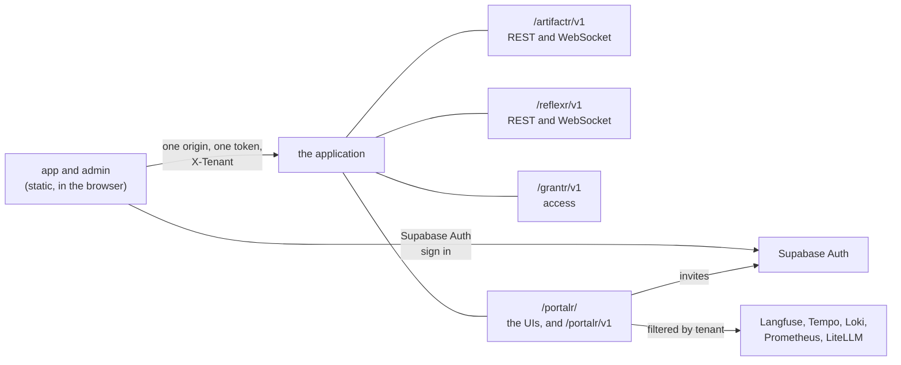

# RFC-0002: portalr, the portal

**Status:** Accepted, amended by [portalr ADR-0014](../portalr/adr/0014-the-apps-shell.md), and by [artifactr ADR-0068](../artifactr/adr/0068-an-access-token-redacted-from-span-urls.md) and [reflexr ADR-0065](../reflexr/adr/0065-an-access-token-redacted-from-span-urls.md)
**Author:** Alex Nodeland
**Created:** 2026-10-12
**Discussion:** [#44](https://github.com/alexnodeland/lattice/pull/44); accepted on 2026-10-12, with the decisions in [Decisions](#decisions)
**Siblings:**

- [lattice RFC-0001](0001-grantr-identity-and-access.md) is grantr, whose API the admin UI manages access through, and whose checks decide what each UI shows.
- [stackr RFC-0003][s-rfc-0003] fixes portalr's layout, its Bun workspace and its CI, and leaves the rest of its design to this RFC.
- [lattice ADR-0001](../adr/0001-lattices-brand.md) reserves portalr's inks and leaves its marks, for `app` and `admin`, to be drawn with its package.

## Summary

portalr is the portal into an application built on the family: an `app` UI for the people who use it, to chat with its agents and see their artifacts, proposals, rules and runs, and an `admin` UI for those who run it, to manage access and see feedback, evaluations, usage and spend. Both are static single-page apps in React, sharing a typed `client` and a `ui` kit. portalr's Python side is a router the application mounts beside the libraries': it serves the two UIs, and adds the few routes no library has. The browser calls artifactr's, reflexr's and grantr's own routes, on one origin, with one token.

## Motivation

- **The family has no face.** Every surface is an API, a WebSocket or an MCP server. docplan has a terminal client, and the template generates none, so an application built on the family has to build its own UI before anyone can use it.
- **Running one is blind without tools.** Granting access, reviewing proposals across workspaces, seeing what users thought of the agent, and seeing what each tenant spends all need an admin UI, and grantr's model is only usable through one.
- **The work codebase shows what not to build.** It grew two frontends, each with its own backend in front of the chat service:
  - **Types copied by hand.** Each backend re-declared the chat service's types, three copies in all, and they drifted: fixes for proxy parity and envelope mismatches recur in its history.
  - **A user passed on as a header.** The backends named the user in a plain header the chat service trusted.
  - **A console of its own.** The admin console had its own user file and password, and was open when the password wasn't set.
  - **A fan-out.** Per-workspace calls from the console exhausted the chat service's database pool.
  - **Permissions guessed.** The UI checked permissions against lists already filtered to what the user could see, so it offered actions the server refused.

## Design

### Overview



- **portalr's router is mounted by the application,** like the libraries' routers, and serves the two built UIs at `/portalr/app/` and `/portalr/admin/`.
- **The browser calls each package's own routes.** A chat goes to artifactr's WebSocket, a rule to reflexr's REST, a grant to grantr's API. Nothing proxies them, so nothing re-declares their types, and the user each package sees is the one the token names.
- **portalr's own routes, `/portalr/v1`, add only what no package has:** reading the stack's shared tools for a tenant, and inviting users.

### The package

```text
packages/portalr/
├── pyproject.toml          the Python package: the router, and the built UIs as package data
├── src/portalr/            the router, its settings, and the readers for Langfuse, Tempo, Loki, Prometheus and LiteLLM
├── schemas/                portalr.v1.json, its OpenAPI document, with a drift test
├── bruno/                  the collection for /portalr/v1
├── tests/
└── web/
    ├── client/             @portalr/client: generated types, the fetch client, the WebSocket stores
    ├── ui/                 @portalr/ui: the brand tokens, primitives, and chat and artifact components
    ├── app/                the people's UI
    └── admin/              the operators' and tenant admins' UI
```

One version, one tag and one changelog cover all of it, as stackr RFC-0003 decided. The web packages are private: nothing is published to npm, which settles stackr RFC-0003's open question on their names.

- **The wheel carries the two built UIs.** moon's `build` for portalr depends on `app:build` and `admin:build`, and Vite writes into `src/portalr/static/`, which git ignores and the sdist includes. The `standalone` check fails if the assets are missing.
- **Applications install portalr's released wheel,** not a git revision as they install the libraries, because a checkout has no built UIs.
- **P1 replaces "the console service".** stackr RFC-0003 calls portalr's Python side a console service; it is a router, and this RFC amends that wording.

### The router

```python
def portalr_router(
    *,
    resolve_actor: ResolveActor,
    grants: Grants,
    readers: Readers,           # Langfuse, Tempo, Loki, Prometheus and LiteLLM, each optional, with its deep-link base
    invite: Invite | None,      # Supabase Auth's admin API, from the application's settings
) -> APIRouter: ...
```

- **It serves the UIs,** with an index fallback for client-side routes, long cache headers on hashed assets, a strict Content-Security-Policy, and a small `config.json`: the application's Supabase URL and public key, its surfaces' paths, and which readers are configured. The same build serves every deployment.
- **Its reads are one per source,** for one tenant: feedback and scores, traces and sessions, logs, latency and errors, and usage and spend. Each admin card calls one of them through TanStack Query, so a tool that is down fails only its own cards, and one that isn't configured is marked so from `config.json`. There is no summary that gathers them, and nothing reads per workspace in a loop: the admin home shows what a source can answer for a whole tenant in one query.
- **`POST /portalr/v1/invites`** creates or finds the user through Supabase Auth's admin API, which returns their `sub`, then adds the membership in grantr. The secret key stays in the application. It checks `grantr:add_member`.
- **Deep links** into Langfuse and Grafana (whose Explore is Tempo's and Loki's UI), and the list of every tenant with its spend, are returned only to callers allowed `portalr:read_deployment` on the deployment, which grantr's `operator` role holds, because those tools aren't tenant-scoped.
- **portalr's actions** are `portalr:read_telemetry` (feedback, scores, traces, logs and metrics) and `portalr:read_spend` on a tenant, which its `owner` and `admin` hold, and `portalr:read_deployment` on the deployment, which `operator` holds, in a catalog like the libraries', so the template's permission matrix covers portalr too. Its OpenAPI document is committed in `schemas/`, with a drift test, and Schemathesis runs over it in the Acceptance job.

### Each tenant's observability

Langfuse, Tempo, Loki, Prometheus and LiteLLM are shared by every tenant, and none of their UIs is tenant-scoped, so tenant admins never use them. portalr reads them on the server, for one tenant at a time, and renders what it reads.

- **Storage stays shared, and every read is filtered.** The stack keeps one Langfuse project, one Tempo, one Loki and one Prometheus. portalr adds the tenant to every query it sends.
- **One attribute names the tenant.** Spans and metrics carry `artifactr.tenant.id` and `reflexr.tenant.id` today. Phase 4 adds them to log records, and the collector copies either one to `tenant.id`, so every query filters on one name. An application with a portal can't set its metric detail to `none`, which drops them.
- **Traces come from Tempo only.** The collector sends the same spans to Tempo and Langfuse, so portalr reads traces, and sessions by `session.id` (the thread), from Tempo, and only scores from Langfuse.
- **One module builds every query,** `portalr.readers`, and nothing else in portalr talks to the tools. Each reader takes a `Tenant` that portalr's router makes only after grantr's `check` allows the read, never a string from the request. Queries are built from typed parameters; no user writes TraceQL, LogQL or PromQL.

  | Source | Filter |
  |---|---|
  | Tempo (TraceQL) | `span.tenant.id = "<tenant>"` in every search. A trace is shown only if one of its spans names the tenant and none names another |
  | Loki (LogQL) | a `tenant_id="<tenant>"` filter on the structured metadata, where Loki stores the collector's `tenant.id`, in every query |
  | Prometheus (PromQL) | through prom-label-proxy, on portalr's path only, which rewrites every selector to the tenant portalr names, so no query can escape it. Grafana keeps its direct data source |
  | Langfuse | scores by the traces' `tenant:<id>` tag, filtered by Langfuse if its API allows, otherwise checked one by one through their traces |
  | LiteLLM | the tenant's team, `tenant-<id>`, with the master key, which stays on the server |

- **The filters are tested where they are built.** Each reader has a test that builds every query it can send and fails if one lacks the tenant, and a test against a stack seeded with two tenants that reads as one and never sees the other.
- **The tools' own UIs are for operators.** stackr's compose binds their ports to `STACKR_BIND`, loopback by default, and the admin UI's operator area links into them.

The admin UI renders what the readers return with open-source components it vendors and owns:

| What | With |
|---|---|
| Traces and sessions: the span tree and waterfall, inputs, outputs, tokens and timings | AgentPrism (Evil Martians, MIT), whose adapters read OpenTelemetry's shape. It is alpha and built on Tailwind 3 and Radix, so `ui` vendors its components and ports them to Tailwind 4 and Base UI, with TanStack Virtual for long traces. [portalr ADR-0030](../portalr/adr/0030-traces-and-the-trace-view.md) writes `ui`'s own view instead, with TanStack Virtual, and keeps what was said in a span behind a reveal |
| Charts: usage, spend, scores, latency and errors over time | Tremor's copied components on Recharts, and uPlot for dense time series |
| Logs | A virtualized list over LogQL results, with ANSI colours, in `ui` |

Grafana's trace view (AGPL, inside Grafana's own code), Jaeger's (unpublished components) and Arize Phoenix (Elastic License) were considered and set aside.

### Signing in, and the tenant

- **The UIs sign in through Supabase Auth,** with `@supabase/supabase-js`'s auth client only: email and password, magic links and whatever providers the deployment configures. The client keeps the session and refreshes the token. [portalr ADR-0014](../portalr/adr/0014-the-apps-shell.md) amends this: the client is `@supabase/auth-js`, which supabase-js wraps, and a password alone signs in until phase 7.
- **Every request carries the token,** as `Authorization: Bearer`, and the active tenant, as `X-Tenant`. On a WebSocket they go in the `access_token` and `tenant` query parameters (lattice RFC-0001's phase 4).
- **The token stays out of logs.** The template redacts `access_token` from its access logs and from the URL attributes on its spans, since Tempo and Loki are shared.
- **No CSRF or CORS to configure.** Tokens travel in a header, never a cookie, and the UIs share the API's origin. Vite's dev server proxies to the application. The Content-Security-Policy matters, because supabase-js keeps the session in `localStorage`.
- **The tenant picker** lists the user's memberships from grantr. A user with one tenant never sees it, and one with none sees that they have no access, not an empty app.

### Asking the server

The UIs never work out a permission themselves. They ask grantr.

- **`GET /grantr/v1/me`** returns, for the active tenant, the user's roles and the workspaces they can open. This is how the app lists workspaces, so the list is exactly what grantr would allow.
- **`POST /grantr/v1/checks`** answers a batch of `(action, resource)` questions in one call. A screen asks for the actions its buttons need, and hides or disables what is refused. The server checks each command again when it arrives, so a stale answer can never be enough.

### client

`@portalr/client` is the only code that talks to the server.

- **Types are generated, never written.** From each package's committed documents: artifactr's and reflexr's OpenAPI documents (stackr RFC-0003's phase 5 commits them), grantr's and portalr's, and the JSON Schemas of the WebSocket protocols and of rules: `artifactr.v1.json`, `reflexr.v1.json` and `reflexr.rules.v1.json`. `openapi-typescript` and `json-schema-to-typescript` write them into the package. A test regenerates them and fails if the output differs, as each Python package's drift test does for its document.
- **REST calls go through `openapi-fetch`,** typed from those documents, and through TanStack Query for caching and invalidation.
- **A WebSocket store per stream,** for artifactr's and reflexr's protocols. It says `hello`, follows the replay to `replay_complete`, applies each event to a store the components subscribe to, and resumes from its last `seq` when the connection drops. It reads a thread's tail over REST first, then says `hello` from there, as artifactr's serving guide describes. On `welcome` with `reset: true`, it discards what it holds and rebuilds from the replay. Commands carry `command_id`s, and creates carry ids the client chooses, so a create resent after a reconnect is refused as `invalid_state` rather than repeated (artifactr ADR-0045), and the store counts that as done.
- **One reducer per protocol,** written by hand over the generated discriminated unions, with exhaustiveness checked by the compiler. Every event type the schema has is handled or explicitly ignored.

### ui

`@portalr/ui` is the kit both UIs build from.

- **Tokens:** lattice's and portalr's brand tokens, as CSS custom properties in `tokens.css`, which Tailwind 4's `@theme` uses as its theme. Light and dark, from the same tokens.
- **Primitives:** Base UI's headless components, styled with the tokens, in the shape of shadcn's copied components rather than a dependency on them.
- **Chat:** the message list, streaming Markdown, the composer, tool-call and approval cards, proposal cards with accept and reject, and run status. They render what the `client` stores hold, and know nothing of the transport.
- **Artifacts:** a registry of renderers keyed by artifact kind, which an application extends with its own. A kind with no renderer shows its data as formatted JSON, so a new kind is never invisible.
- **Tables:** TanStack Table and Virtual, for runs, events, members and audit entries.
- **Tested in a browser:** Vitest's browser mode, with Playwright, for every component, including screenshots in light and dark.

### app

The people's UI: sign in, pick a tenant and a workspace, and work.

| Area | What it shows |
|---|---|
| Threads | The workspace's threads, and a chat in each: messages, the agent's streaming output, tool calls and approvals, and proposals inline |
| Artifacts | Each artifact with its renderer, its revisions and their diffs, and its open proposals |
| Proposals | Every open proposal in the workspace, to accept or reject |
| Runs | artifactr's turns and reflexr's runs, with their status, and retry, skip and cancel where allowed |
| Rules | The workspace's rules and schedules, and their status; installing and editing them where allowed |
| Feedback | Thumbs and comments on messages, artifacts and runs, as `give_feedback` commands |

Restricted threads and artifacts (lattice RFC-0001) never reach the UI, because the server never sends them. Sharing a thread is a grant through grantr's API, from the thread's menu.

### admin

The UI for a tenant's owners and admins, and the deployment's operators.

| Area | What it shows | Who |
|---|---|---|
| Home | Cards for the tenant's members and workspaces, feedback, scores, errors and spend, each from one read with its own status | tenant admins |
| Access | Members, invites, groups, roles (custom ones included), grants on workspaces, threads and artifacts, service principals and their keys | tenant admins |
| Audit | grantr's audit log, paged and filtered | tenant admins |
| Feedback and evaluations | Feedback over time, by workspace and target; evaluation scores and their trend; links from each to the run it is about | tenant admins |
| Traces and logs | The tenant's traces and sessions, their waterfalls, its logs, and latency and errors over time, searched by thread, run or time | tenant admins |
| Usage and spend | Tokens and spend from LiteLLM, by workspace where the tags allow, against the tenant's budget | tenant admins |
| Runs | Failed and dead-lettered runs in the workspace the admin picks, until a library offers a tenant-wide read | tenant admins |
| Tenants | Every tenant from grantr, with its spend from one LiteLLM team list; creating a tenant and its owner | operators |
| Tools | Deep links into Langfuse and Grafana for any run, session or tenant | operators |

The admin UI shows a tenant its own traces and logs, but doesn't rebuild Grafana's dashboards or Langfuse's analysis tools; operators open those through deep links.

### Tooling

stackr RFC-0003 fixes most of it; this RFC fills in the rest.

- **The Bun workspace** at lattice's root: `package.json` with `"workspaces": ["packages/portalr/web/*"]`, `bun.lock`, `biome.json` and `tsconfig.base.json`, and `.moon/toolchains.yml` with Bun and TypeScript, which stackr RFC-0003 held back until portalr.
- **TypeScript 7** for type checking. It has no programmatic API until 7.1, and `openapi-typescript` and knip load `typescript` as a library, so those tools get TypeScript 6 under an alias until they support 7. Phase 1 confirms each tool. This amends stackr RFC-0003, which expected nothing to need the API. Phase 1 found only `openapi-typescript` needs it ([portalr ADR-0007](../portalr/adr/0007-typescript-7-and-6-only-where-a-tool-needs-its-api.md)).
- **Vite 8,** React 19, TanStack Router (file-based routes), Query, Table and Virtual, Base UI, Tailwind 4 and `openapi-fetch`. Frames are validated only by the generated types and the reducers' exhaustive matches; there is no second schema.
- **moon's TypeScript tasks** for each web package: `lint` (Biome), `typecheck`, `test` (Vitest), `build` (Vite) and `check`. One `knip` run over the workspace from the root project. `size-limit` budgets for `app` and `admin`, set in phase 7 from what the first builds weigh.
- **The Acceptance job** starts docplan, oncall and an application with portalr. portalr is tagged `api`, so its Bruno collection runs as `portalr:api`, and Schemathesis runs over its document. Its `bdd` task runs `.feature` files through Playwright (playwright-bdd), one per row of the app's and admin's tables, against the running stack. The dev container's firewall allows Playwright's browser downloads, or the tests use the container's Chromium.
- **osv-scanner** reads `bun.lock` as well as `uv.lock`, and Renovate updates both.

### The brand

portalr and grantr get their marks with this RFC, in lattice ADR-0010, drawn from the inks lattice ADR-0001 reserved.

- **portalr** prints in cyan, magenta and yellow together, with two versions of its mark, for `app` and `admin`. ADR-0001 found no obvious working colour in that set, so ADR-0010 chooses one, for the UIs' accent.
- **grantr** prints in yellow and key, whose overprint is near-black, so ADR-0010 chooses its working colour from a key tint or within the set, as ADR-0001 asked.
- **The tokens** each mark brings become `ui`'s CSS custom properties, and the site's sections for portalr and grantr open with their banners, as every package's does.

### The template

The template gains a `portal` question, on by default when `access` is `grantr`, which this needs.

- The application mounts `portalr_router` beside the libraries', with the readers for whichever of Langfuse, Tempo, Loki, Prometheus and LiteLLM the stack runs, and installs portalr from its released wheel.
- `make tenant` creates a tenant and its owner, and `make operator EMAIL=...` grants the first operator (both lattice RFC-0001's phase 4).
- The smoke test signs in through the app, posts a message, and sees the agent's answer arrive.

### What changes in each package

| Package | Changes | Breaking |
|---|---|---|
| artifactr, reflexr | Their tenant attribute on log records as well as spans and metrics | No |
| stackr | The `portal` question; `tenant.id` in the collector; prom-label-proxy; `access_token` redacted from access logs and spans; no metric detail of `none` with a portal | No |
| grantr | `GET /grantr/v1/me` and `POST /grantr/v1/checks`, which lattice RFC-0001 defines | No |
| portalr | New | |

This amends stackr RFC-0003 twice: portalr's Python side is a router, not a console service, and TypeScript 6 stays under an alias for the tools that need its API.

### Phases

| Phase | Deliverable | Exit criteria |
|---|---|---|
| 1. The workspace | The Bun workspace, the toolchains, Biome, TypeScript, knip and moon's TypeScript tasks; empty `client`, `ui`, `app` and `admin`; the TypeScript 7 check of each tool; osv-scanner and Renovate over `bun.lock` | `moon ci` runs the web packages' `check` in CI, and an empty `app` builds |
| 2. The brand | lattice ADR-0010: portalr's and grantr's marks and working colours, and their tokens; `ui`'s tokens and primitives | `ui`'s components pass their browser tests in light and dark, and the site shows both new marks |
| 3. client | Generated types, the fetch client, and the WebSocket stores, tested against docplan and oncall | A test client resumes a stream across a dropped connection without losing or repeating an event |
| 4. The router | `portalr_router`: serving the UIs, the readers and their filters, invites; the tenant on the libraries' log records and `tenant.id` in the collector; prom-label-proxy in the stack; its OpenAPI document and drift test; its Bruno collection | The collection passes against an application on the stack, with each tool both up and down, and the readers' two-tenant test never sees the other tenant |
| 5. app | Sign-in, the tenant and workspace pickers, and the areas of [app](#app) | Each area's `bdd` scenario passes |
| 6. admin | The areas of [admin](#admin) | Each area's `bdd` scenario passes, for a tenant admin and for an operator |
| 7. Template and acceptance | The `portal` question, the smoke test, the Acceptance job's portalr steps, and the size budgets | A generated application with a portal passes its CI, and the Acceptance job is green |
| 8. Docs and ADRs | portalr's site section, its README and the ADRs for each decision | portalr's section builds, with the architecture updated |

**Prerequisites:** phase 4 needs grantr's phases 2 and 3 (`Grants`, `grantr:add_member`). Phase 3 needs artifactr's and reflexr's OpenAPI documents (stackr RFC-0003's phase 5) and grantr's (lattice RFC-0001's phase 3). Phases 5 and 6 need grantr's phases 1 to 4, and the restricted items need its phase 5. Phases 1 and 2 need nothing, and can start as soon as this is accepted.

## Decisions

The maintainer decided these on 2026-10-12.

| # | Decision | Decided | Instead of |
|---|---|---|---|
| P1 | What portalr's Python side is | A router the application mounts, serving the UIs; the browser calls each package's own routes | A separate backend in front, proxying every package |
| P2 | The frontend stack | React 19 and TanStack, as two static single-page apps on Vite | TanStack Start, with server rendering and a Node server; Svelte 5 |
| P3 | The chat | Our own, thin, in `ui`, over artifactr's protocol | assistant-ui, through its external-store runtime |
| P4 | Observability in the admin UI | Native views of a tenant's own feedback, evaluations, spend, traces and logs; deep links out to the tools, for operators | Everything native, dashboards included; links only |
| P5 | Who sees across tenants | Operators, an audited grant in grantr (lattice RFC-0001's D9); tenant admins see their own tenant | Tenant admins only, with no deep links |
| P6 | How a tenant's observability is kept apart | Shared stores; every read filtered in one module of portalr, PromQL through prom-label-proxy, traces from Tempo; rendered in the admin UI with vendored open-source components | Separate stores, split on the way in: per-tenant Tempo, Loki and Mimir tenants and a Langfuse organization per tenant, routed by the collector |

## Drawbacks

- **A second language,** with its own toolchain, lockfile, linters and tests, in a family that has been Python only.
- **The UIs depend on every package's API** directly. A breaking change in artifactr's protocol breaks the app until `client` is regenerated, which the drift test makes loud but not free.
- **Isolation rests on portalr's readers.** The stores are shared, so a reader that forgets the tenant leaks another tenant's traces or logs. One module, a `Tenant` made only after grantr allows the read, prom-label-proxy for metrics, and the tests over every query make that hard, not impossible. Splitting the stores (P6's alternative) remains the stronger fix, and the readers' interface doesn't change if it is ever made.
- **Langfuse's scores** may have to be read through their traces and checked, which costs more calls than a filtered list.
- **AgentPrism is alpha,** and vendoring it means owning its port to Tailwind 4 and Base UI.
- **Native views need each tool's API,** and Langfuse's, LiteLLM's and Tempo's change on their own schedules. Each reader is small and optional, and its status shows when it breaks.
- **Our own chat** is more to build than a kit, and chat UX is a deep problem.
- **Two UIs to keep consistent,** which the shared `ui` kit only partly solves.

## Alternatives

- **A separate backend in front (P1).** One API for the UIs to call, but every library type copied or proxied, and the user passed on as a header: the work codebase's shape, and its bugs.
- **One UI with admin routes.** Fewer builds, but the people's bundle would carry the admin's code, and the two would share a release of their routes. stackr RFC-0003 and lattice ADR-0001 already plan two.
- **Server rendering (P2).** Both UIs are behind a sign-in, with no pages to index, and the data lives in the Python application. A Node server would add a process to deploy for nothing they need.
- **Embedding Grafana and Langfuse** in the admin UI, through iframes. Their auth, styling and tenant scoping are their own, and none is tenant-scoped.
- **A generated admin,** from the OpenAPI documents. Fast to a first screen, but every screen would look like the API rather than the task.

## Unresolved questions

- **The working colours** for portalr and grantr, which ADR-0010 chooses in phase 2.
- **Spend by workspace:** requests carry a `workspace:<id>` tag already; whether LiteLLM's open-source API reports spend by tag decides whether the admin UI can show it.
- **Localization.** The UIs are English-only at first; whether strings go through a catalog from the start is for phase 1. Settled in [portalr ADR-0014](../portalr/adr/0014-the-apps-shell.md): English in the components, and a catalog with a second language.
- **Mobile.** Both UIs are responsive, but the app's chat is the only part designed for a phone first.
- **Analytics** beyond usage and spend, such as active users and threads over time, once the admin home shows what operators look for.

## Tracking

portalr's own RFC series turns these phases into its plan, with a tracking issue.

- [x] Sign-off on P1 to P6 (2026-10-12)
- [x] Phase 1: the workspace (2026-10-12)
- [x] Phase 2: the brand (2026-10-12), in lattice ADR-0014, since ADR-0010 had gone to another decision
- [x] Phase 3: client (2026-10-12)
- [x] Phase 4: the router (2026-10-12)
  - grantr places portalr's admin reads (grantr ADR-0023): `portalr:read_telemetry` and `portalr:read_spend` for a tenant's owners and admins, `portalr:read_deployment` for operators
- [ ] Phase 5: app
- [ ] Phase 6: admin
- [ ] Phase 7: template and acceptance
- [ ] Phase 8: docs and ADRs

[s-rfc-0003]: ../stackr/rfcs/0003-one-repository-lattice.md
