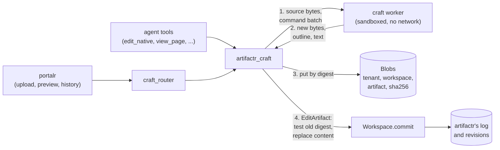

# RFC-0003: Native files as artifacts

**Status:** Draft
**Author:** Alex Nodeland
**Created:** 2026-10-16
**Discussion:** [#248](https://github.com/alexnodeland/lattice/pull/248)
**Siblings:**

- [artifactr ADR-0003][a-adr-0003] fixes the two patch kinds and keeps types from defining their own. This RFC adds none, and leaves ADR-0003 as it is.
- [artifactr ADR-0004][a-adr-0004] makes every edit name its base version and writes an immutable revision. Native files keep both.
- [artifactr ADR-0034][a-adr-0034] is ports and adapters. The new package's app and blob ports follow it.
- [lattice RFC-0002](0002-portalr-the-portal.md) is portalr, which gains a renderer for native files and their page previews.
- [stackr ADR-0035][s-adr-0035] builds the thin images. The first app's worker is built the same way.

## Summary

A new package, `artifactr-craft`, gives artifactr artifact types for files in native formats: Word documents first, then presentations, spreadsheets, PDF, SVG, images, CAD and audio. An artifact of such a type is a small Pydantic manifest that points, by SHA-256, to the file's bytes in a blob store; the file is the source of truth, and nothing parses it into Pydantic fields. Edits are made by a native application, a "craft" app, run headless in a sandbox: an agent or a person sends a batch of the app's own commands, the app produces new bytes, and the new revision is an ordinary JSON Patch on the manifest whose first operation tests the old digest. artifactr's core does not change, and lattice-core does not change. The pilot is one app, WordCraft, for `.docx`; a second app waits for the exit criteria in [Phases](#phases).

This changes artifactr's documentation, portalr and stackr as well as adding a package, so it is in lattice's series rather than artifactr's.

## Motivation

- **Work arrives as files.** The documents people and agents work on together are often a contract in `.docx`, a deck in `.pptx` or a model in `.xlsx`. artifactr's types hold JSON data and Markdown. An application today either converts the file to Markdown, losing styles, tables, comments and tracked changes, or keeps it outside artifactr, losing revisions, proposals, attribution and the log.
- **A model should edit the file, not a copy.** Converting `.docx` to Markdown and back is lossy in both directions. An app that reads and writes the format natively, and exposes its edits as commands, lets an agent change the real file.
- **The craft apps make it plausible.** [getartcraft.com/apps](https://getartcraft.com/apps) lists thirteen open-source Rust apps for native formats, each with a web build. One of them, [WordCraft](https://github.com/storytold/wordcraft), documents a headless MCP server that edits `.docx` by command. The [evidence](#evidence) records what was checked, and what was not.
- **The hard parts are artifactr's, not the app's.** Bytes that don't fit in the log, a write path that can't run an app inside a transaction, a sandbox for user files, and previews in portalr all need deciding once, before any second format repeats them differently.

## Design

### Overview



1. The package loads the artifact's current manifest and its bytes.
2. It sends the bytes and a batch of commands to the app's worker, which returns the new bytes, a bounded outline and the plain text.
3. It puts the new bytes, the batch and the text into the blob store, each under its digest.
4. It commits an `EditArtifact` through the one write path ([ADR-0002][a-adr-0002]). The patch tests the digest it started from, then replaces the content and the outline.

If anything fails before step 4, nothing is committed, and what step 3 wrote is collected as unreferenced.

### The package

```text
packages/artifactr-craft/
├── pyproject.toml           distribution artifactr-craft, import artifactr_craft
├── src/artifactr_craft/
│   ├── types.py             NativeFile, Blob, Derivation, and WordDocument
│   ├── blobs/               the Blobs port, InMemoryBlobs; sql/ behind the [sql] extra
│   ├── apps/                the CraftApp port, FakeApp, and wordcraft/ (the adapter)
│   ├── agent.py             NativeFileTools, a pydantic-ai toolset
│   ├── fastapi.py           craft_router, behind the [fastapi] extra
│   └── worker/              the job runner the worker image runs
├── schemas/                 artifactr-craft.v1.json and the router's OpenAPI document, with drift tests
└── tests/                   including test_layering.py and corpus/
```

- **A separate distribution,** released by release-please on its own version, as every package of lattice is. Applications that don't edit native files install nothing new.
- **It depends inward only.** It imports artifactr's public API, the names in `__all__`, and `lattice_core.sql`'s tenancy helpers; artifactr imports nothing of it. Its `tests/test_layering.py` holds it there, as relayr's does.
- **It lives in the monorepo.** CI runs every affected project and its dependents (lattice ADR-0002), so a change to artifactr runs this package's tests too. That is most of the compatibility story: the plugin cannot drift from the core unnoticed. Its `artifactr-ai` requirement is a lower bound, raised by hand, with an upper bound below artifactr's next minor version until artifactr reaches 1.0.

### Artifact shape

```python
class Blob(BaseModel):
    """Bytes in the blob store, named by their digest."""
    sha256: Annotated[str, Field(pattern=r"^[0-9a-f]{64}$")]
    size: int = Field(ge=0)
    media_type: str


class Derivation(BaseModel):
    """How a revision's content was made: by which app, from what, with which commands."""
    app: str                      # "wordcraft"
    app_version: str              # the app's own version
    image: str | None             # the worker image's digest, when run in one
    base: str | None              # the sha256 the commands ran on; None for a new file
    commands: Blob                # the batch, as canonical JSON


class NativeFile(Artifact, abstract=True):
    formats: ClassVar[frozenset[str]]          # the media types the type accepts
    write_policy: ClassVar[WritePolicy] = "propose"

    name: str                                   # the file name people see
    content: Blob
    text: Blob | None = None                    # the plain text, for diffs and search
    outline: str = Field("", max_length=4_000)  # what the agent sees
    pages: int | None = None
    derivation: Derivation | None = None        # None for an upload

    def render_for_agent(self) -> str:
        return f"{self.name} ({self.pages} pages)\n{self.outline}"


class WordDocument(NativeFile):  # registered as "word_document"
    formats = frozenset({DOCX})
```

- **The file is the source of truth.** The manifest holds what artifactr needs to version, show and route it, and the outline and text are derived from the file by the app when the revision is made. Nothing is parsed into Pydantic fields, so nothing is lost in a model the format doesn't fit.
- **Bytes never enter the log.** `ArtifactCreated` and `ArtifactChanged` carry the data, every revision stores the resulting data ([ADR-0004][a-adr-0004]), every WebSocket replay sends the log, and relayr bridges both events into reflexr with their data. A manifest is a few kilobytes; a `.docx` is often megabytes. Every byte in the manifest is paid per revision and per bridged event, which is why the outline is bounded and the full text is a blob.
- **`render_for_agent` is synchronous and does no IO.** The agent can't call the app when it reads an artifact, so what it sees by default is the outline the app wrote when the revision was made. Deeper reads are the toolset's (see [What the agent sees](#what-the-agent-sees)).
- **The command batch is provenance, not the change.** It is stored as its own blob and named by `derivation.commands`, so a revision says how it was made, the batch can be replayed onto a newer head ([Concurrency](#concurrency)), and the manifest stays small.
- **Write policy defaults to `propose`.** A change to a binary is harder to check by eye than a JSON diff, and an app in alpha may lose formatting. An application can choose `direct`.

### Edits: no third patch kind

The question was whether a "command batch" should become a third patch kind beside JSON Patch and anchored text edits. It should not, and ADR-0003 needs no change.

- **Core can't apply it.** `core.commit` is pure ([ADR-0001][a-adr-0001]): `apply_patch(data, patch)` must return the resulting data. A command batch's result exists only after a native app has run, which is IO, takes seconds, and depends on the app's version. It can't happen inside `commit`, and it must not happen inside the storage transaction either, which holds the workspace's row lock ([ADR-0021][a-adr-0021]).

A whole-file replace is already expressible. The revision is a JSON Patch on the manifest, which the package builds, never `Versioned.edit`'s diff:

```json
[
  {"op": "test",    "path": "/content/sha256", "value": "<the digest the batch ran on>"},
  {"op": "replace", "path": "/content",        "value": {"sha256": "...", "size": 48213, "media_type": "..."}},
  {"op": "replace", "path": "/text",           "value": {"sha256": "...", "size": 9120,  "media_type": "text/plain"}},
  {"op": "replace", "path": "/outline",        "value": "..."},
  {"op": "replace", "path": "/pages",          "value": 3},
  {"op": "replace", "path": "/derivation",     "value": {"app": "wordcraft", "base": "...", "commands": {"sha256": "...", ...}}}
]
```

The `test` operation is what makes a binary safe under artifactr's rules: a proposal accepted later is applied to the head as it is then (`core.respond` rebases by applying), and without the test a stale replace would silently discard everything committed in between. With it, the accept fails as `PatchFailed` ("… is not equal to tested value …"), checked in the [evidence](#evidence).

- **Summaries come from the batch.** The package passes `summary=` on the command, written by the agent or from the batch, so change notes don't read `test /content/sha256; replace /content; …`. The type's `describe_change` covers commits that don't.
- **What this records instead:** an artifactr ADR, "native files are manifests over JSON Patch", which confirms ADR-0003 and adds a section to the artifact types guide.

### Concurrency

Binary files don't merge. Two edits from the same version can't both apply; the second is refused, and replayed or re-planned.

| Situation | What core does | What the package does |
|---|---|---|
| Direct edit, head moved | `VersionConflict` on `base_version` | Replays the batch once onto the new head and commits again, if the app's commands are anchored (see below); otherwise returns the conflict |
| Proposal, head moved before accept | `PatchFailed` from the `test` | portalr offers "replay onto the current version", which makes a new proposal from the same batch; the old one is rejected with that reason |
| Replay fails (a command no longer applies) | Nothing is committed | The conflict reaches the agent as a tool result, with the summaries of what changed since ([ADR-0008][a-adr-0008]); a person sees both versions' pages |
| Accept with changes (`RespondToProposal.changes`) | Applies a JSON Patch to the manifest | portalr offers accept or reject only, for native kinds; edits after accepting are a new revision |

Replay is only sound if a batch names what it changes by content, not by position. WordCraft's commands act on the current selection, so a batch is positional unless it first selects by content: its MCP server has `select_text(text, occurrence)`, which is the same anchor as artifactr's text edits. So the package replays a batch only if every command that changes the document follows a `select_text` in the same batch; any other batch is refused on conflict, and the agent plans again against the new head, which is what ADR-0004 expects of it anyway. Whether this rule is enough in practice (tables, styles, images) is the pilot's first question, and an exit criterion.

### Blob storage

```python
class Blobs(Protocol):
    async def put(self, scope: Scope, artifact_id: ArtifactId, data: bytes, media_type: str) -> Blob: ...
    async def get(self, scope: Scope, artifact_id: ArtifactId, sha256: str) -> bytes | None: ...
    async def collect(self, scope: Scope, referenced: Set[tuple[ArtifactId, str]], *, older_than: datetime) -> int: ...
```

| Decision | Choice | Why |
|---|---|---|
| Where the port lives | In `artifactr_craft`, not in artifactr's `Storage` | Adding methods to `Storage` breaks every storage an application wrote itself, and nothing else in artifactr needs bytes yet. If a second package needs attachments, the port moves into artifactr then, unchanged |
| Key | `(tenant, workspace, artifact, sha256)` | Matches ADR-0021's keys, which start with the tenant and the workspace. Keying by artifact makes a blob's access the artifact's access: a manifest that names another artifact's digest finds nothing, so a restricted artifact's bytes ([ADR-0062][a-adr-0062]) can't be read through another artifact |
| Deduplication | Within one artifact only | Its revisions share unchanged bytes, and a revert costs nothing. Across tenants, deduplication would tell an uploader that someone else already has a file |
| Order of writes | Put first, by digest, idempotent; then commit | No transaction spans the two. Blobs are immutable, so a put that is never committed is only garbage, and a commit never names bytes that aren't there |
| SQL | `artifactr_craft_blobs`, `bytea` (SQLite `BLOB`), storage `EXTERNAL` so PostgreSQL doesn't try to compress zipped formats; the package's own Alembic scripts and version table, as artifactr's ([ADR-0021][a-adr-0021]) | One database, no new service |
| Tenancy | `TenantSession` and `tenant_policy` from `lattice_core.sql.tenancy`, as artifactr's adapter uses them ([ADR-0066][a-adr-0066]) | Row-level security under the scoping, with no change to lattice-core |
| In memory | `InMemoryBlobs`, a dict by key | For tests and examples |
| Size | 25 MiB per blob by default, configurable up to 100 MiB on PostgreSQL; the router refuses larger bodies before reading them | `bytea` values are read whole into memory. A larger limit needs streaming and an object store |
| Object store | Deferred | An S3-compatible adapter is the same port; it needs a service in stackr and isolation by key prefix instead of row-level security. It waits for a deployment that hits the size limit |
| Retention | Follows artifactr's revisions | Revisions are append-only, so every blob a revision names is kept. `collect` deletes what no revision and no pending proposal names, and was put more than a grace period ago (one day by default), so an upload in flight survives. Deleting a tenant deletes its rows |
| Referential integrity | Checked on read, not on write | Every surface can commit `edit_artifact` ([ADR-0002][a-adr-0002]), and core can't look in the blob store, so a hand-made patch can name a digest that isn't there. Reads then show "content unavailable", and the tools refuse to edit it until the content is replaced. No one gains access by it, because of the key |

Renders (page images) are a cache, not blobs: keyed by the content digest, the page, the scale and the worker image's digest, and evicted by age. The spike found WordCraft's renders byte-identical across processes, and fonts are the only input from the host: it uses system fonts when they are installed. The worker image installs none, so its renders depend on the image alone, and a cache miss only costs time.

### The app port

```python
class CraftApp(Protocol):
    name: str
    async def apply(self, source: bytes | None, commands: Sequence[AppCommand], *, deadline: float) -> Applied: ...
    async def inspect(self, source: bytes, *, deadline: float) -> Inspection: ...   # outline, text, pages
    async def render(self, source: bytes, page: int, *, dpi: int, deadline: float) -> bytes: ...  # PNG
    async def commands(self) -> Sequence[CommandSpec]: ...   # the app's catalog, for the agent
```

Each call is stateless: bytes in, bytes out. A document is never held open between calls, so no state carries from one tenant's file to another's, and a crash loses one call.

| Transport | Assessment |
|---|---|
| **MCP over stdio (chosen)** | WordCraft's headless surface, `wordcraft-cli mcp`, which speaks only stdio: 16 tools, of which the pilot uses `open_document`, `new_document`, `batch`, `select_text`, `get_text`, `inspect_document`, `render_page`, `save_document` and `list_commands`. Its `--automation-read-root` and `--automation-write-root` confine what it may read and write to two directories. stdio needs no listening port at all, which is what makes a no-network sandbox possible. The MCP Python SDK is already a dependency of `artifactr[mcp]` |
| The JSON control channel (`--control <port>`) | Bound to 127.0.0.1, with a key from a file, newline-delimited JSON. It belongs to the desktop app, not the CLI, and would need a listener and a key inside the sandbox for nothing stdio lacks |
| One CLI call per operation | No batches and no inspection, and output parsed from a terminal |
| Linking the Rust crates | A Python extension built from young crates, inside the application's process: no isolation from a hostile file, and a Rust toolchain in every build |

Two adapters implement the port for each app:

- **`Subprocess`** spawns the app's CLI per call, over stdio, with a deadline and a kill. It is for tests and development, on trusted files, and its documentation says it is not a sandbox.
- **`Worker`** sends the call to a worker container, below.

### The sandbox

Opening a user's `.docx` runs a young parser on hostile input: a zip bomb, XML nested a million deep, a 40,000-pixel image, a link to a remote template. Rust's memory safety removes one class of bug, not panics, runaway allocation or slow paths. The worker treats every file as hostile.

- **A worker per app, in stackr's compose,** on an internal network (`internal: true`) that only the application joins: no route out, no published port. The application reaches it by service name. Nothing listens on the host; a developer who wants to call it from outside the stack goes through the application.
- **One process per call, in a long-lived container.** The worker's runner, a small program in `artifactr_craft.worker`, accepts one job on the internal network, spawns the app's CLI over stdio in a fresh temporary directory given as its read and write roots, and returns its result. It never runs two jobs in one process. Starting the CLI took about 4 ms in the spike, against 0.4 to 8 s to start a container, which is why the container lives on and the process doesn't.
- **Limits on every call:** a wall-clock deadline (30 s for an edit, 10 s for a render by default), CPU time, address space and file size by `setrlimit`, a cap on the size of what comes back. A breach kills the process and is a typed failure: `timeout`, `crashed`, `too_large`, `refused`.
- **The container:** non-root, read-only root file system, a size-limited `tmpfs`, all capabilities dropped, `no-new-privileges`, the runtime's default seccomp profile, and memory, CPU and PID limits. These are compose settings, so the template, the single host and the AWS stack carry them the same way.
- **stackr owns the policy,** because it owns the network, the limits and the image. The package documents what it needs and ships the runner; it doesn't choose the limits for a deployment.
- **Tested with hostile files.** The phase that adds the worker adds a corpus of hostile inputs, and a test that each one ends in a typed failure within its deadline, and a test from inside the worker that a connection out fails.

### What the agent sees

| Need | Tool or hook | Budget |
|---|---|---|
| What the file is | `render_for_agent`: name, pages and the outline the app wrote at the revision | The outline's 4,000 characters, which is the capability's `max_render_chars` |
| Its words | `read_native(artifact_id, pages)`: the text blob, cut to the pages asked for | 8,000 characters a call, with how much remains |
| Its look | `view_page(artifact_id, page)`: one rendered page, as an image, for models that take images | One page a call, at a fixed resolution; off unless the application turns it on |
| What it can do | `find_commands(query)`: the app's commands that match, through its `list_commands` | Ten a call; the full catalog (617 commands in WordCraft 0.7.0) is never in the prompt |
| To change it | `edit_native(artifact_id, base_version, commands, summary)` | One batch a call; returns `Applied`, `Proposed`, or the conflict |
| To start one | `create_native(kind, name)` | |

WordCraft describes each command's parameters as a free-text signature, such as `{"rows": n, "cols": n, "style"?: string}`, not as JSON Schema, so neither the model nor the package can validate a batch before the app runs it. A refused command comes back as the tool's error, and the batch commits nothing.

The toolset is `NativeFileTools`, registered on the agent beside the application's own, as [ADR-0017][a-adr-0017] has it. External agents over MCP get the same tools on artifactr's MCP server. Everything they read is artifact-scoped, so authorization is artifactr's: the tools open workspaces through `Workspaces`, whose `authorize` hook grantr answers.

### Discovery and compatibility

- **Explicit, as types already are.** A type registers when its class is defined, and `Workspaces(storage, types=[...])` is an allowlist ([ADR-0019][a-adr-0019]). An application imports `WordDocument`, lists it, and gives the toolset a `CraftApp`. Nothing is activated by being installed.
- **No entry points.** A `artifactr.types` entry-point group would load code because a package is on the path, which is a supply-chain door with no benefit: the application still has to list the type.
- **Compatibility** is the monorepo's CI and the lower bound above, and the layering test that imports only `__all__` names.

### Events, feedback and telemetry

- **No new events.** A native edit is an `artifact_changed` like any other, with the manifest patch, its summary and the trace it was committed in ([ADR-0033][a-adr-0033]). relayr bridges it unchanged, so a reflexr rule can react to a Word document changing, and sees the manifest, never the bytes.
- **Feedback** targets an artifact version, as it does today ([ADR-0028][a-adr-0028], [ADR-0038][a-adr-0038]). A score on a revision of a native file attaches to the trace that made it.
- **Spans** for `apply`, `inspect` and `render`, children of the tool call or request, with the app, its version, the image digest, the command count, the bytes in and out and the outcome. Digests, never content: a document's text never reaches a span.
- **Metrics:** a duration histogram per operation and a count of failures by kind, through the same SDK views as artifactr's metrics ([ADR-0036][a-adr-0036]), with the tenant attribute artifactr uses, so portalr's per-tenant readers see them.

### portalr

- **A renderer for native files** in `ui`'s registry: a page strip of previews, the file's name and size, a download link, and the outline. Its `text(data)` is the outline, so revision diffs work before any preview loads; the full text diff reads the text blob.
- **Revision history** is artifactr's revisions, as for every kind. A diff between two revisions shows the changed text and, side by side, the pages whose renders differ.
- **Routes in `craft_router`,** mounted by the application beside artifactr's, with the same `resolve_actor` and authorization: upload a file as a new artifact or a new revision, download a revision's content, and fetch a revision's page. Every route names the artifact and the revision, never a bare digest, so the check is artifactr's read or edit of that artifact.
- **Editing in the browser is deferred.** The craft apps have web builds, but embedding one means multi-megabyte WebAssembly in the app bundle, a Content-Security-Policy that allows `wasm-unsafe-eval`, a second renderer whose output can differ from the worker's, and an editor whose every change must still become a command through the one write path. Previews and command-based edits come first; embedding is its own RFC, after the pilot.

### stackr

- **A recipe, not a default.** The template gains a `native_files` question, off by default. On, it adds the worker service, its internal network and its limits, and wires `Worker` into the application.
- **The image is stackr's thin image.** WordCraft publishes no image the spike could find, and its Linux CLI comes only inside the full app's tarball. stackr builds an image from that tarball's `wordcraft-cli`, checked against the release's `SHA256SUMS.txt`, in the way and with the provenance of [ADR-0035][s-adr-0035], pinned by version and digest. The CLI needs only the C library, so the image is a slim base, the CLI, the runner and no fonts. Upstream signs nothing and publishes no SBOM, so the checksum is the whole chain of custody from upstream, and stackr's attestation starts at its own build.
- **Notices.** The image carries the app's licence files and a `NOTICE` naming its source and version, and the template's licence notes list it. A recipe is added only for an app whose licence is verified.

### Fidelity and what "supported" means

A format is supported when its corpus round-trips through the app without loss in the features its row claims, and when edits do what they say.

- **The corpus** lives in `tests/corpus/<format>/`: files generated by our own scripts, each covering one feature, plus a few public-domain or permissively licensed real documents with their provenance recorded.
- **Loss is measured on the format, not the bytes.** For `.docx`, open and save with no edits, then compare the normalized OOXML of the input and the output, feature by feature: text, paragraph styles, run properties, tables, lists, images, headers and footers, footnotes, comments, tracked changes, section properties. Each feature is preserved, changed or dropped.
- **Saving twice is a fixpoint:** saving what was saved changes nothing, after normalization.
- **A feature matrix per format,** published in the package's docs from the nightly run: supported, changed on save, or dropped. "Supported" is per feature, never per format.
- **Determinism decides what is compared.** The spike found WordCraft's `.docx` output identical across runs except `docProps/core.xml`, where every save stamps the clock as `dcterms:modified`, adds one to `cp:revision` and writes `--author` as `lastModifiedBy`, with no way to fix the clock. Tests therefore compare with `core.xml` normalized. The package passes the acting participant's name as `--author`, so the file records who made a revision as artifactr does, and accepts that saves of unchanged content make new blobs.
- **Where it runs:** the fake app on every pull request; the real worker image in the Acceptance job and nightly, since it needs a container runtime and the release binary.

### What changes in each package

| Package | Changes | Breaking |
|---|---|---|
| artifactr | An ADR and a section of the artifact types guide: native files are manifests over JSON Patch, with a `test` on the content digest | No |
| artifactr-craft | New | |
| portalr | The native file renderer in `ui`, previews and the revision page diff in `app` | No |
| stackr | The `native_files` question, the worker service and network, the worker's thin image | No |
| lattice-core | Nothing | |

### Phases

| Phase | Deliverable | Exit criteria |
|---|---|---|
| 0. Spike | This RFC's [evidence](#evidence) | Done |
| 1. The package | `NativeFile`, `Blob`, `Derivation`; the `Blobs` port with in-memory and SQL adapters, migrations and row-level security; the `CraftApp` port and `FakeApp`; the layering test | 100% coverage; the blob contract suite passes on memory, SQLite and PostgreSQL; a two-tenant test reads nothing across tenants; `collect` keeps every referenced blob, pending proposals' included |
| 2. WordCraft | The `Subprocess` adapter over stdio MCP; the `.docx` corpus and the fidelity report; determinism measured | The report runs nightly; the feature matrix is published; whether commands are anchored is answered |
| 3. The agent | `NativeFileTools`; the outline and text at every revision; conflicts, and replay if phase 2 allows it | Scripted-model tests (`FunctionModel`) for an edit, a proposal, a conflict and a replay |
| 4. The worker | The runner, stackr's image and recipe, the hostile corpus | Every hostile file ends in a typed failure within its deadline; egress from the worker fails; the template with `native_files` passes its CI |
| 5. portalr | The renderer, previews, the revision page diff, upload and download | Each `bdd` scenario passes |
| 6. Docs and ADRs | The package's site section, its guide, the ADRs this RFC leads to | The section builds |

**Before a second app:**

- WordCraft's feature matrix has held across two of its releases, with no feature moving from supported to dropped.
- No hostile input has escaped its limits.
- The second app's licence is verified from its repository, and it has a headless surface with the four operations of `CraftApp`, tagged releases with Linux binaries, and checksums.
- Its adapter needs no change to `CraftApp`, `Blobs` or `NativeFile`. If it does, the port was WordCraft-shaped, and is fixed before the app is added.

## Decisions

Recommended, for the maintainer to decide.

| # | Question | Recommended | Instead of |
|---|---|---|---|
| D1 | Artifact shape | A small manifest and content-addressed blobs; the file is the source of truth | Parsing the file into Pydantic fields; bytes inline in the data |
| D2 | Edits | JSON Patch on the manifest, testing the old digest; the command batch as a provenance blob. ADR-0003 unchanged | A third patch kind, "command batch", which pure core can't apply |
| D3 | Blob storage | A `Blobs` port in the package, keyed by tenant, workspace, artifact and digest; PostgreSQL `bytea` with a 25 MiB default limit; put first, collect what is unreferenced | Methods on artifactr's `Storage`; an object store first; deduplication across artifacts or tenants |
| D4 | Concurrency | Refuse a stale edit; replay the batch only if the app's commands are anchored | Last write wins; locks across app calls; merging binaries |
| D5 | The app port | Stateless calls over MCP on stdio, one process per call | The control channel's TCP port; the CLI per operation; linking the crates |
| D6 | The sandbox | A worker per app on an internal network, with no published port and no egress, under rlimits and container limits; stackr owns the policy | The app's CLI in the application's own container; a long-lived app server shared by tenants |
| D7 | Agent perception | A bounded outline in the manifest; text, pages and the command catalog through tools | Calling the app from `render_for_agent`; the whole catalog in the prompt |
| D8 | Discovery | Explicit: import the type, list it, give the toolset an app | An entry-point group |
| D9 | Events and telemetry | No new events; spans and metrics on the package's own calls, digests only | New event types for native edits |
| D10 | portalr | Server-rendered previews and page diffs; artifact-scoped routes | Embedding the apps' WebAssembly builds now; routes by digest |
| D11 | stackr | An opt-in recipe; a thin image built from the release binary, pinned by digest, with its notices | A worker in every generated application; an upstream image, if one appears, unpinned |
| D12 | Fidelity | A corpus, measured on normalized parts, and a feature matrix per format | Byte comparison; "supported" for a format as a whole |
| D13 | Scope | WordCraft only until the exit criteria hold | Several apps at once |

## Drawbacks

- **A young dependency on the critical path.** WordCraft's repository is nine days old, with six releases in seven days, and calls itself alpha. Its own documents disagree on how many commands it has (422, "over 270", and 617 in the binary). Its commands, tools and output can change in any release, and the adapter has to follow.
- **Two stores to keep consistent.** The manifest is transactional and the bytes are not; put-first and collection make the gap safe, not absent, and a hand-made patch can still name missing content.
- **No merging.** Two people editing the same document concurrently means one of them replays or re-plans. Collaboration stays turn-based, as ADR-0004 chose, but the turns are coarser than in a Markdown document.
- **Seconds per edit.** Every edit spawns a process and round-trips the file. The evidence measures what that costs.
- **A worker service to run,** with its own image to build, pin and patch, in every deployment that turns it on.
- **The name.** `artifactr-craft` borrows the apps' brand, and WordCraft's `NOTICE` says the ArtCraft name, wordmark and logos are trademarks, outside the open-source licence. The neutral parts (manifest, blobs, sandbox) don't depend on the apps, so a neutral name costs nothing; see the unresolved questions.

## Alternatives

- **Convert to Markdown and back.** Uses what exists, and loses styles, comments, tracked changes and layout on every round trip.
- **Keep files outside artifactr,** with a link in an artifact. No revisions, no proposals, no attribution, and nothing for the agent to perceive.
- **LibreOffice headless** as the app. Mature, with every office format, but a large C++ process whose edits are UNO calls rather than commands, MPL-licensed, and harder to sandbox per call. It remains the obvious fallback if the craft apps don't mature, and the `CraftApp` port admits it.
- **Format libraries in Python** (`python-docx`, `openpyxl`, `python-pptx`). In-process, so no isolation from hostile files, and each format would grow its own edit model in the application's code: the scattered per-type behaviour ADR-0003 exists to prevent.
- **A CRDT per format.** True simultaneous editing, and a research project per format.

## Unresolved questions

- **Is "select by content first" enough to make replay sound** for tables, styles and images, or only for text (D4)?
- **The name** of the package. `artifactr-files`, with `wordcraft` as an adapter module, avoids the apps' trademark; `artifactr-craft` was the working name.
- **Upstream's supply chain.** Checksums only, no signatures, SBOM or attestations, and a very young organization whose repositories gathered tens of thousands of stars in days. Whether to wait for signed releases before phase 4, or build the CLI from a pinned source commit in CI instead of taking the binary.
- **Quotas.** A per-workspace or per-tenant limit on blob bytes, beyond the per-blob limit, and where it is enforced.
- **Text extraction** for search across native files, which the text blob makes possible and nothing here builds.
- **When the blob port moves into artifactr,** if another package needs attachments, such as images in Markdown documents.

## Evidence

The spike that grounds this RFC, on 2026-10-16. Everything downloaded was treated as untrusted data, in a scratch directory outside the repository, and nothing was built from source.

### artifactr

- **The `test` operation guards a stale replace.** Against artifactr at `a267cf16`, `apply_patch` with `[{"op": "test", "path": "/content/sha256", "value": "aaa"}, {"op": "replace", "path": "/content", "value": {...}}]` applies to data whose digest is `aaa`, and on data whose digest has moved to `ccc` raises `PatchFailed: the JSON patch does not apply: ccc (<class 'str'>) is not equal to tested value aaa (<class 'str'>)`.
- **Proposals rebase by applying.** `core.rules._apply_change` applies an accepted edit's stored patch to the current version; only proposing checks `base_version`. Without the `test`, a stale whole-file replace would be accepted over newer revisions.
- **`render_for_agent(self) -> str`** is synchronous on the model (`core/artifacts.py`), and `read_artifact` and the capability's instructions call it directly.
- **Every revision stores its resulting data,** and `artifact_created` and `artifact_changed` carry data or a patch into relayr's bridged events.

### WordCraft

Read from a shallow clone of `main` at `eae24217` (2026-10-15) and the v0.7.0 release (2026-10-14, tag at `fc419188`), on 2026-10-16. "Verified" means read in the repository or seen running; "unverified" means not checked.

| Claim | Finding | |
|---|---|---|
| Licence | `LICENSE-MIT` and `LICENSE-APACHE`; `Cargo.toml` says `MIT OR Apache-2.0`. `NOTICE`: the ArtCraft name, wordmark and logos are trademarks, under `LICENSE-brand.txt`. Bundled fonts are OFL-1.1 | Verified |
| Releases | v0.1.0 to v0.7.0 between 2026-10-07 and 2026-10-14. Linux x86_64, aarch64 and riscv64 tarballs, packages and AppImages; macOS, Windows, FreeBSD; a web build; `SHA256SUMS.txt` | Verified |
| A Linux CLI | Only inside the full app's tarball (`bin/wordcraft-cli`, 69.6 MB, beside the 98.6 MB app); a standalone CLI archive exists for macOS only. Dynamically linked against the C library, `libm` and `libgcc_s` | Verified (aarch64) |
| Signatures, SBOM, attestations | None: nothing in `release.yml`, and GitHub's attestation API has none for the x86_64 tarball | Verified absent |
| Container image | None found: no Dockerfile in the repository, no registry references | Unverified (the registry's API wasn't readable with the token used) |
| Published crates | None on crates.io; the name `wordcraft` there is an unrelated crate. Using the crates as a library means a git dependency | Verified |
| MCP server | `wordcraft-cli mcp`, stdio only, line-delimited JSON-RPC, protocol `2025-06-18`. 16 tools; `--automation-read-root` and `--automation-write-root` confine file access | Verified, live |
| Control channel | In the desktop app: binds 127.0.0.1, a 256-bit key from a 0600 file, newline-delimited JSON, 1 MiB lines, 30 s to authorize | Verified in code, not run |
| Commands | 617 in `wordcraft-cli commands --json` for v0.7.0 (389 change the document), 629 `CommandSpec`s at `eae24217`; the README says 422 and `docs/mcp.md` "over 270". Parameters are free-text signatures, not JSON Schema. Commands serialize as `{command, params}`; macros exist in memory | Verified |
| Undo | Whole-document snapshots | Verified in code |
| Formats | Opens docx, doc (import only), odt, rtf, html, md, tex, txt, json, xml. Saves docx, pdf, odt, rtf, html, md, tex, txt, png, json, xml; all ten conversions of one test file succeeded | Verified, live |
| Network | No HTTP client in `Cargo.lock`, no telemetry or update checks. Sockets only in the control server, MCP's `--connect`, and a local Zotero client | Verified in code |
| Fonts | Bundled first, then user fonts, then system fonts from `/usr/share/fonts` | Verified in code |

### Running it

In a container on Docker 29.4.0, on an aarch64 host, from `debian:bookworm-slim` at `sha256:7c7b2c966bc9ee8cedfeef67e0e279108992c77681fa595db4a9d65c06ccc587`, with the release's aarch64 tarball (its checksum matched):

```sh
docker run --rm -i --platform linux/arm64 --network none --read-only \
  --memory 1g --cpus 1 --pids-limit 256 --tmpfs /tmp \
  -e HOME=/tmp -e WORDCRAFT_NO_PREFS=1 -e TZ=UTC \
  -v "$BIN":/app:ro -v "$CORPUS":/in:ro -v "$OUT":/out \
  debian@sha256:7c7b2c96... \
  /app/wordcraft-cli mcp --author "Spike Agent" \
    --automation-read-root /in --automation-write-root /out
```

A script of our own drove it over stdio. The corpus was six `.docx` files generated with Python's `zipfile`: headings, run formatting, lists and a bordered table; a footnote; an image; a comment; tracked insertions and deletions; and all of them together. No real-world documents were tested.

| Measure | Result |
|---|---|
| Start-up | About 4 ms for `--version` and 6 ms for MCP's `initialize`, inside the container. Starting a container took 0.4 to 8 s |
| Calls on the small files | `open_document` 1 to 12 ms, `inspect_document` 1 to 41 ms, `render_page` 3 to 18 ms, `save_document` 2 to 18 ms. Every call succeeded, `batch` and `edit.undo` included |
| `render_page` | A PNG as MCP image content, with the page's size and count; US Letter at scale 1 is 612 × 792 |
| Open and save, no edits | Kept exactly: paragraph count, styles, numbering, text, run properties (bold, italic, underline, colour, size, font), table borders and widths, the footnote, the comment and its author and date, the tracked changes' authors and dates, the image's bytes |
| Changed on save | Adds `docProps/app.xml`, `word/settings.xml`, `word/theme/theme1.xml`, and `word/commentsExtended.xml` where there are comments; renumbers tracked changes' ids; in `core.xml`, sets `dcterms:modified` to the clock, adds one to `cp:revision` and writes `--author` as `lastModifiedBy` |
| Determinism, two processes | PNG renders identical. `.docx` identical except `docProps/core.xml`'s dates; zip entries carry a fixed 1980 time. PDF differs in its dates and `/ID` |
| Failure | The first run used an amd64 image, because the host's Docker defaults to `linux/amd64`, and failed with `exec /app/wordcraft-cli: no such file or directory`. `--platform linux/arm64` fixed it. x86_64 was not run |

### The other apps

From [getartcraft.com/apps](https://getartcraft.com/apps) on 2026-10-16 and each repository under `github.com/storytold`. Each repository exists, has `LICENSE-MIT` and `LICENSE-APACHE` and a `MIT OR Apache-2.0` badge, and documents MCP in `docs/`. Formats are the READMEs' claims, not tested. Nothing but WordCraft was run.

| App | Site's maturity | Latest release | Formats claimed | Surface documented | Licence files | Run |
|---|---|---|---|---|---|---|
| WordCraft | In development (README: alpha) | v0.7.0 | docx, odt, rtf, md, tex, pdf | stdio MCP, control channel | Verified | Verified |
| DeckCraft | In development | v0.7.0 | pptx; pdf, png, jpeg, gif export | MCP, control channel | Verified | Unverified |
| GridCraft | In development | v0.7.0 | xlsx; csv, tsv; xls, xlsb, ods import | MCP, control channel | Verified | Unverified |
| PdfCraft | Early alpha | v0.8.0 | pdf: combine, redact, sign, forms, OCR | MCP, CLI | Verified | Unverified |
| PhotoCraft | Early alpha | v0.9.0 | psd | MCP, control channel | Verified | Unverified |
| VectorCraft | In development | v0.12.0 | svg, pdf, ai; raster export | MCP, control channel | Verified | Unverified |
| FigCraft | Early alpha | v0.6.0 | its own; svg, png, pdf; fig (best effort) | MCP, control channel | Verified | Unverified |
| DesignCraft | In development | v0.8.0 | its own; idml; indd import; pptx, pdf, epub export | MCP, control channel | Verified | Unverified |
| CADCraft | In development | v0.7.0 | dxf; dwg; svg, png, pdf export | MCP, control channel | Verified | Unverified |
| SoundCraft | In development | v0.7.0 | wav, aiff, flac; mp3, ogg, aac import; MIDI | MCP, control channel | Verified | Unverified |
| LightCraft | In development | v0.8.0 | camera raw, jpeg, png, tiff, webp, psd, jxl | MCP, control channel | Verified | Unverified |
| EffectCraft | In development | v0.10.0 | Lottie; video codecs; exr, psd | MCP, control channel | Verified | Unverified |
| FilmCraft | In development | v0.8.0 | video codecs; FCP7 XML, AAF, OTIO; subtitles | MCP, control channel | Verified | Unverified |

Every repository was created between 2026-09-30 and 2026-10-09, all thirteen were pushed to on 2026-10-16, and their stars run from about 1,900 to 64,700. A fourteenth repository, AniCraft, isn't on the page and has no licence GitHub detects.

[a-adr-0001]: ../artifactr/adr/0001-python-library-with-sans-io-core.md
[a-adr-0002]: ../artifactr/adr/0002-single-write-path.md
[a-adr-0003]: ../artifactr/adr/0003-artifact-types-as-pydantic-subclasses.md
[a-adr-0004]: ../artifactr/adr/0004-optimistic-concurrency-and-revisions.md
[a-adr-0008]: ../artifactr/adr/0008-agent-perception-and-steering.md
[a-adr-0017]: ../artifactr/adr/0017-application-toolsets-and-capability-events.md
[a-adr-0019]: ../artifactr/adr/0019-storage-protocol-and-workspace-handles.md
[a-adr-0021]: ../artifactr/adr/0021-sql-storage.md
[a-adr-0028]: ../artifactr/adr/0028-typed-feedback-as-events.md
[a-adr-0033]: ../artifactr/adr/0033-trace-links-on-runs-and-revisions.md
[a-adr-0034]: ../artifactr/adr/0034-ports-and-adapters-for-integrations.md
[a-adr-0036]: ../artifactr/adr/0036-metric-cardinality-through-sdk-views.md
[a-adr-0038]: ../artifactr/adr/0038-feedback-as-scores.md
[a-adr-0062]: ../artifactr/adr/0062-restricted-items-left-out-of-every-read.md
[a-adr-0066]: ../artifactr/adr/0066-row-level-security-under-the-scoping.md
[s-adr-0035]: ../stackr/adr/0035-the-thin-images.md
