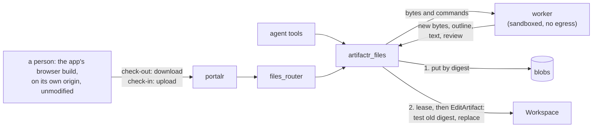

# RFC-0003: Native files as artifacts

**Status:** Draft
**Author:** Alex Nodeland
**Created:** 2026-10-16
**Discussion:** [#248](https://github.com/alexnodeland/lattice/pull/248)
**Siblings:**

- [artifactr ADR-0003][a-adr-0003] fixes the two patch kinds. This RFC adds none.
- [artifactr ADR-0004][a-adr-0004] makes every edit name its base version, and rejects pessimistic locks. This RFC keeps the first and narrows the second, for native files only.
- [lattice RFC-0002](0002-portalr-the-portal.md) is portalr, which gains a renderer, previews and check-out for native files.

## Summary

A new package, `artifactr-files`, gives artifactr artifact types for files in native formats: Word documents first, then presentations, spreadsheets, PDF, SVG, images, CAD and audio. An artifact of such a type is a small Pydantic manifest that names the file's bytes, by SHA-256, in a blob store. The file is the source of truth; nothing parses it into Pydantic fields.

- **Agents** edit through a native application run headless in a sandboxed worker, by batches of its own commands. The pilot's application is WordCraft, one of the open-source Rust "craft" apps.
- **People** check the file out, edit it in the app's unmodified browser build, which the deployment hosts, and check it in.
- **Every revision** is an ordinary JSON Patch on the manifest that first tests the content digest it was made from.
- **A check-out is a lease.** While someone holds it, an agent's edit is refused as busy, and the agent plans again after the check-in.

artifactr gains a lease on an artifact, an addition to its workspace API; its patch kinds and its core rules don't change, and lattice-core doesn't change. The pilot is WordCraft and `.docx` only. This changes artifactr, portalr and stackr as well as adding a package, so it is in lattice's series.

## Motivation

- **Work arrives as files.** The documents people and agents share are often a contract in `.docx`, a deck in `.pptx` or a model in `.xlsx`. artifactr's types hold JSON and Markdown. Today an application either converts the file to Markdown, losing styles, tables, comments and tracked changes, or keeps it outside artifactr, losing revisions, proposals, attribution and the log.
- **A model should edit the file, not a copy.** Converting to Markdown and back is lossy both ways. An app that reads and writes the format natively, and exposes its edits as commands, lets an agent change the real file.
- **The craft apps make it plausible.** [getartcraft.com/apps](https://getartcraft.com/apps) lists thirteen open-source Rust apps for native formats, each with a browser build. WordCraft has a headless MCP server that edits `.docx` by command; the [evidence](#evidence) records what was checked.

## Design

### Overview



An agent's edit and a person's check-in end the same way: the package puts the bytes, text and review (comments and tracked changes) in the blob store, then commits an `EditArtifact` through the one write path ([ADR-0002][a-adr-0002]). A failure before the commit commits nothing, and what was put is collected.

### The package

`packages/artifactr-files/` holds the types, the `Blobs` port with in-memory and SQL adapters, the `App` port with `FakeApp` and the WordCraft adapter, `NativeFileTools` (a pydantic-ai toolset), `files_router` (behind a `fastapi` extra), and the worker's job runner, with drift-tested schemas for the manifest and the router.

- **A separate distribution, as a deliberate departure from [ADR-0034][a-adr-0034].** ADR-0034 puts each adapter in an extra of the package whose port it implements. This is not an adapter of an artifactr port. It is a domain extension with its own tables and migrations, a worker program, a router, and a dependency on an external application in alpha. Keeping it out of artifactr leaves artifactr's dependencies and migration chain untouched for every application that doesn't edit native files. relayr is the precedent for a package that builds on artifactr from outside.
- **It depends inward only.** It imports only names in `__all__` of `artifactr`, `artifactr.core` and `artifactr.workspace`, plus `lattice_core.sql.tenancy`; artifactr imports nothing of it. Its `tests/test_layering.py` holds it there, as relayr's does.
- **It lives in the monorepo,** so CI runs its tests on every change to artifactr (lattice ADR-0002). Its `artifactr-ai` requirement is a lower bound, raised by hand.
- **Its PyPI name is `artifactr-files-ai`,** with the suffix artifactr's own distribution has; it is imported as `artifactr_files`. Both `artifactr-files` and `artifactr-files-ai` were free on PyPI on 2026-10-16.

### The artifact

```python
class Blob(BaseModel):
    sha256: Annotated[str, Field(pattern=r"^[0-9a-f]{64}$")]
    size: int = Field(ge=0)
    media_type: str


class Provenance(BaseModel):   # how the content was made; who made it is the revision's actor
    source: Literal["upload", "check_in", "commands"]
    app: str | None = None          # "wordcraft"
    app_version: str | None = None
    build: str | None = None        # the worker image's digest
    base: str | None = None         # the content digest it was made from; None for a new file
    commands: Blob | None = None    # the batch, as canonical JSON


class NativeFile(Artifact, abstract=True):
    formats: ClassVar[frozenset[str]]
    write_policy: ClassVar[WritePolicy] = "propose"

    name: str
    content: Blob
    fingerprint: str                # the digest of the content, normalized (below)
    text: Blob | None = None        # plain text, for diffs and the agent
    review: Blob | None = None      # comments and tracked changes, as JSON
    outline: str = Field("", max_length=4_000)
    pages: int | None = None
    provenance: Provenance        # render_for_agent: the name, the pages if known, the outline


class WordDocument(NativeFile):   # "word_document", for .docx
    formats = frozenset({DOCX})
```

- **Bytes never enter the log.** Every revision stores its resulting data ([ADR-0004][a-adr-0004]), events carry it, WebSocket replays send it, and relayr bridges it into reflexr. A manifest is about a kilobyte plus the outline; a `.docx` is often megabytes.
- **`render_for_agent` is synchronous and does no IO,** so the agent sees, by default, the outline the worker wrote when the revision was made.
- **The fingerprint makes a no-op save no revision.** WordCraft stamps `docProps/core.xml` with the time on every save (see the evidence). The fingerprint is the digest of the archive's other parts, computed by the worker. A check-in whose fingerprint equals the head's commits nothing.
- **Provenance is a claim.** `edit_artifact` over REST or MCP can write anything, so only the revision's actor is trusted, and nothing authorizes by provenance.
- **Write policies bind agents only:** `propose` makes an agent's edit a proposal; a person's check-in commits directly.

### Edits: JSON Patch with a test

A third patch kind, a "command batch", was the obvious alternative. It can't work: `core.commit` is pure ([ADR-0001][a-adr-0001]), and a batch's result exists only after a native app has run, for seconds, outside the transaction that holds the workspace's row lock ([ADR-0021][a-adr-0021]). The package builds the revision as JSON Patch instead:

```jsonc
[
  {"op": "test",    "path": "/content/sha256", "value": "<the digest it was made from>"},
  {"op": "replace", "path": "/content",        "value": {"sha256": "...", "size": 48213, "media_type": "..."}},
  {"op": "replace", "path": "/provenance",     "value": {"source": "commands", "base": "...", "commands": {...}}},
  // and replaces of /fingerprint, /text, /review and /outline
]
```

- **A stale direct edit** fails first on `base_version`, as `VersionConflict`.
- **The `test` matters when a proposal is accepted.** Acceptance re-applies the stored patch to the head as it is then, and checks no version, so without the test a proposal made against an old version would silently replace everything since. With it, accepting a stale proposal fails as `PatchFailed`, which the evidence shows.
- **A stale proposal is outdated, never rebased.** portalr shows it as outdated, and its author makes a new one, with `base_version` at the head and a test on the head's digest.
- **Accepting with changes** (`RespondToProposal.changes`) isn't offered for native kinds. That is portalr's choice, not enforced: artifactr applies such changes to the manifest as it would any edit.
- **Summaries come from the batch or the check-in.** The package passes `summary=`, so change notes don't read `test /content/sha256; replace /content`.

### Check-out: a lease on the artifact

`lock` is the only merge strategy in the pilot. One writer at a time, through a lease on the artifact:

```python
@dataclass(frozen=True)
class ArtifactLease:
    artifact_id: ArtifactId
    holder: str
    expires_at: datetime

class Workspace:
    async def lease_artifact(self, artifact_id: ArtifactId, *, holder: str, ttl: timedelta) -> ArtifactLease: ...
    async def artifact_lease(self, artifact_id: ArtifactId) -> ArtifactLease | None: ...
    async def release_artifact(self, artifact_id: ArtifactId, *, holder: str) -> None: ...

class ArtifactBusy(InvalidState):   # exported beside ThreadBusy
    lease: ArtifactLease | None     # None if the lease ended between the refusal and the read
```

- **In artifactr's `Workspace`, as an addition,** as `claim_thread`'s lease is, since a lease taken straight on `Storage` would skip the access check and ADR-0062's hiding of restricted artifacts.
- **Its access checks.** `lease_artifact` and `release_artifact` ask `artifactr:edit_artifact` for the artifact. `artifact_lease` is a read, which portalr shows to viewers, so it asks `artifactr:read_artifacts`. A restricted artifact is answered as a missing one. `ACTIONS`, the complete catalog, doesn't grow, so grantr's catalog and its drift tests are unchanged.
- **Its storage.** The key is `artifact:<id>`, which can't collide with `claim_thread`'s `thread:<id>`. `Storage` gains one read, `lease(scope, key)`, for the holder and expiry, and artifactr's two storages implement it. A storage an application wrote must add it; the owner accepted that (D6), and the PR is marked breaking if `scripts/breaks.py` reports it.
- **Its semantics are `acquire_lease`'s.** The same holder acquiring again renews, and that is how a check-out is extended. Another holder may take a lease once `expires_at <= now`. `now` is each process's clock, as it already is for thread claims, so the seconds-long leases below assume clocks agree to well under a second.

**A check-out is a record in the package**, `artifactr_files_checkouts`: its id, the artifact, the base version and digest, the actor, and the expiry. The lease's holder is `checkout:<id>:<actor id>`, which names that record, so two tabs are two holders, and a refusal can name who has the file. The check-in reads the base from the record, never from the upload, for its `test` and its `provenance.base`.

- **A check-out lasts eight hours by default.** Its expiry is shown on the artifact, and the person extends it by acquiring again. Nothing renews it in the background, because the browser build can't tell the portal it is still open.
- **An agent's edit takes a lease of its own,** with the holder `edit:<uuid>`, unique per call, for the worker call and the commit. Its ttl is the worker's deadline plus the commit, 45 seconds by default, with no renewal: an edit that outlives its lease is still refused at commit, by `base_version` and the test, if anyone else committed meanwhile.
- **A busy agent re-plans.** If someone else holds the lease, the tool returns `ArtifactBusy` with the lease, or none if it ended in the meantime, in which case the agent may try at once. Otherwise it plans again against the new head after the check-in, with the change note ADR-0008 gives it. It never queues a proposal that would be stale on arrival.
- **A check-in isn't atomic with the lease check.** A lease can expire between the check and the commit; the test and `base_version` are the guard. If the check-in is stale, because its lease lapsed and someone committed, it is kept as a proposal against the head: `base_version` at the head, and a test on the head's digest. It is the one proposal from a person, and the reviewer sees both versions' pages.
- **A retried check-in is idempotent.** If the head's fingerprint already equals the upload's, the check-in succeeds and makes nothing new.
- **The lease is advisory.** Core doesn't know about it, so `edit_artifact` over REST or MCP isn't stopped. The test makes such a write fail or makes the next check-in stale, never silent.

This narrows ADR-0004's rejection of pessimistic locks (its option C) for native files. ADR-0004 feared that an agent could hold a lock across seconds of model latency, and that locks leak on crashes. Here, an agent never holds a lease across model calls, only across one worker call, and a person's lease expires on its own. Proposals stay the path for review. The decision is recorded in an artifactr ADR, "a lease on an artifact", beside "native files are manifests over JSON Patch".

### Blob storage

```python
class Blobs(Protocol):
    async def put(self, scope: Scope, artifact_id: ArtifactId, data: AsyncIterable[bytes], media_type: str) -> Blob: ...
    async def get(self, scope: Scope, artifact_id: ArtifactId, sha256: str) -> bytes | None: ...
    async def collect(self, scope: Scope, referenced: Set[tuple[ArtifactId, str]], *, before: datetime) -> int: ...
```

| Decision | Choice |
|---|---|
| Where the port lives | In the package. Adding methods to `Storage` for bytes would break every storage an application wrote, and nothing else in artifactr needs bytes yet |
| Key | `(tenant, workspace, artifact, sha256)`, as ADR-0021's keys start. A blob's access is its artifact's: a manifest that names another artifact's digest finds nothing |
| Deduplication | Within one artifact: its revisions share unchanged bytes. Never across tenants, which would tell an uploader that someone else has a file |
| SQL | `artifactr_files_blobs`, `bytea` (SQLite `BLOB`) with storage `EXTERNAL`, since zipped formats don't compress; the package's own Alembic scripts and version table (ADR-0021); row-level security through `lattice_core.sql.tenancy`, as artifactr's adapter has it ([ADR-0066][a-adr-0066]) |
| Size | 25 MiB a blob by default, configurable to 100 MiB; the router refuses a larger body before buffering it |
| Object store | Deferred. stackr already has an S3 port, with MinIO by default ([stackr ADR-0005][s-adr-0005]); an adapter for it is the same port, with isolation by key prefix instead of row-level security. It waits for a deployment that hits the size limit |
| Order of writes | Put first, idempotent by digest, then commit; a put never committed is only garbage. Digests and byte counts are computed on the server as the upload streams to a size-limited spool; a client's digest is never used |
| Collection | `put` sets `last_put`, including on a blob that already exists. `collect` deletes, in one statement, the artifact's blobs with `last_put` before the cutoff (a day ago by default) that aren't referenced. Referenced means named by any revision's data, archived artifacts included, or by a pending proposal's patch. It runs per tenant, as the application's role, so row-level security holds |
| Missing content | Every surface can commit `edit_artifact`, so a hand-written patch can name a digest that isn't there. Reads then show "content unavailable", and the tools refuse to edit until the content is replaced |

**Renders are a cache with the same key.** A page image is keyed by tenant, workspace and artifact, then by the content digest, page, scale and the worker's build. It is never keyed by digest alone, which would let one tenant's cache answer another's.

**Every route that serves bytes resolves the artifact first,** through `Workspace.artifact(...)`, which asks the access hook and hides restricted artifacts. Only then does it check that the revision names the digest. A hidden artifact is answered exactly as a missing one.

### The app port and the worker

```python
class App(Protocol):
    async def apply(self, source: bytes | None, commands: Sequence[AppCommand], *, deadline: float) -> Applied: ...
    async def inspect(self, source: bytes, *, deadline: float) -> Inspection: ...  # outline, text, review, pages, fingerprint
    async def render(self, source: bytes, page: int, *, scale: float, deadline: float) -> bytes: ...  # PNG
    async def commands(self, query: str) -> Sequence[CommandSpec]: ...
```

- **Stateless calls over MCP on stdio.** WordCraft's `wordcraft-cli mcp` speaks only stdio, and confines file access to a read root and a write root. stdio needs no listening port, which is what makes a sandbox with no network possible. Each call is bytes in and bytes out, so no document stays open between calls.
- **One adapter per app,** since the apps' control channels and MCP tools differ. WordCraft's has two: `Subprocess` spawns the CLI locally, for tests and trusted files, and is not a sandbox; `Worker` sends the call to the worker.

The worker treats every file as hostile: a zip bomb, deeply nested XML, an enormous image.

- **A service on an internal network** (`internal: true`) that only the application joins: no route out, no published port.
- **The application talks to it over HTTP:** one request per call, the file as the body and the call as JSON, authenticated by a token the deployment generates. The worker runs one job at a time. It spawns a fresh `wordcraft-cli` process per job, in an empty temporary directory given as its read and write roots, and wipes the directory afterwards. It scales by adding containers, never by running jobs side by side in one.
- **Limits on every call:** a deadline (30 s for an edit, 10 s for a render by default), and CPU time, address space and file size set by `setrlimit`. A limit on the reply's size too. A breach is a typed failure: `timeout`, `crashed`, `too_large` or `refused`.
- **The container:** not root, a read-only root file system, a `tmpfs` with a size limit, every capability dropped, `no-new-privileges`, the default seccomp profile, and memory, CPU and PID limits. No fonts are installed, so its renders depend on the image alone.
- **stackr owns the policy,** because it owns the network, the limits and the image.

### What the agent sees

| Need | Tool or hook | Budget |
|---|---|---|
| What the file is | `render_for_agent`: name, pages, outline | 4,000 characters, the capability's `max_render_chars` |
| Its words | `read_native(artifact_id, pages)`, from the text blob | 8,000 characters a call |
| Its comments and tracked changes | `read_review(artifact_id)`, with each comment's id | 50 items a call |
| Its look | `view_page(artifact_id, page)`, one rendered page | One page a call; off unless the application turns it on |
| What it can do | `find_commands(query)`, through the app's `list_commands` | Ten a call; WordCraft has 617 commands |
| To change it | `edit_native(artifact_id, base_version, commands, summary)` | One batch a call |

### People: check-out and check-in

People edit in WordCraft's browser build, unmodified and as released, served by the deployment. Today it is a standalone page with no host channel: it opens files through a picker, drag and drop or paste, and saves through `showSaveFilePicker` or a download.

1. **Check-out.** portalr creates the check-out and its lease, downloads the head revision, and opens the hosted editor in a new tab, showing the expiry.
2. **Editing.** The person opens the downloaded file in the editor, edits it, and saves it to disk.
3. **Check-in.** The person uploads the file in portalr. The router streams it, computing its digest and fingerprint. The worker reads its outline, text and review. The router then commits a revision as the person, with `source: "check_in"`, and releases the lease.

The editor's origin:

- **An origin of its own:** its own registrable domain, or a host name for which portalr sets no cookies, so the editor never sees a token. Its CSP is `default-src 'self'`, plus the inline script's hash, `'wasm-unsafe-eval'` and `blob:`, with `frame-ancestors 'none'`. Nothing calls out.
- **Shared browsers:** the editor stores preferences and fonts, not documents, and the check-in page reminds the person that their downloaded copy stays on disk. Hostile files now also open in the browser's sandbox; the server still reads every revision in the worker.

**How much an app can talk** is a capability of each `App` adapter, as merge strategy is:

| Level | Meaning | Who has it |
|---|---|---|
| 1. Save only | Bytes when the person saves | WordCraft's browser build: its JavaScript exports only its initializer (verified) |
| 2. Host to app | Commands, with replies | WordCraft headless, over MCP (verified); FilmCraft, EffectCraft and LightCraft through same-page JavaScript APIs; GridCraft, PdfCraft and CADCraft through a `?host=parent` bridge offering open, save and dirty only, to a same-origin parent |
| 3. Polled | Changes found by asking | WordCraft's desktop app, through its undo history or a recorded macro (verified in code) |
| 4. Pushed | Changes, selections or commands as they happen | No app: nothing pushes more than `dirty` |

Apart from WordCraft's, these rows come from research on 2026-10-16, unverified here.

The pilot stays at level 1. A later phase may embed WordCraft through a host bridge, if one lands upstream and ships unmodified; we neither fork nor contribute. Until an app pushes events, events are polled or synthesized from revisions. A same-origin iframe is a stand-in only for the three apps with JavaScript APIs.

**Watching upstream.** Today there is no roadmap, spec or shared crate, and requests for pushed events (`photocraft#4939`, `vectorcraft#2188`) have no maintainer reply. What would change this: `gridcraft#1466` (a full control channel over `postMessage`), `photocraft#2263`, or WordCraft's `#405` and `#1655` (host bridges) merging; a shared `craft-embed` or `craft-control` crate; release notes mentioning `host=`, `window.` or `postMessage`.

**Next, a streamed session, evaluated in phase 5.** The unmodified desktop app runs under a virtual display, in a fixed pool of sandboxed containers, pre-started, one session at a time each (D7), streamed to the browser as noVNC or Kasm do. The agent reaches the live document through the app's control channel, which listens on 127.0.0.1 inside the container, with its key in a file there. The application sends the call to a runner in the session container over the internal network. The runner runs `wordcraft-cli mcp --connect` inside the container, so the channel and its key never leave it. Events come by polling.

The spike measures the cost per session and how many a host holds; the input-to-pixel delay; the security of the stream (authenticated per session through the portal), the clipboard, and wiping the document at the end; and how large a pool a host holds. Whether the desktop build runs under a virtual display at all is unverified.

### The log, feedback and telemetry

- **No new events.** An edit or a check-in is an `artifact_changed` like any other, so relayr bridges it and a reflexr rule can react to it, seeing the manifest, never the bytes. Feedback targets an artifact version, as today ([ADR-0028][a-adr-0028]).
- **Spans** for `apply`, `inspect` and `render`, carrying the app, version, build, command count, byte counts and outcome, as digests and never content. **Metrics:** a duration histogram per operation and failures by kind, through [ADR-0036][a-adr-0036]'s views, with artifactr's tenant attribute.

### portalr

- **A renderer for native kinds** in `ui`: page previews, the name, size and outline, a download, and the lease's holder and expiry. Its `text(data)` is the outline. A revision diff shows the changed text, from the text blob, and the pages whose renders differ, side by side.
- **Check-out and check-in,** with the lease's expiry, extending it, and a stale check-in shown as a proposal with both versions.
- **Routes in `files_router`,** mounted beside artifactr's with the same `resolve_actor` and access hook: check out, check in, extend, download a revision, and fetch a page. Each route names an artifact and a revision, never a bare digest.

### stackr

- **A recipe, off by default.** The template's `native_files` question adds the worker, its internal network, limits and token, and the editor's host name.
- **One release, two artifacts, one pin.** The worker's thin image is built from the release tarball's `wordcraft-cli`, and the editor is the same release's `wordcraft-web` archive, served as static files by the stack's edge. Both are checked against `SHA256SUMS.txt`, and the image is built as [stackr ADR-0035][s-adr-0035] has it and pinned by digest. A check, like `check-config`'s, fails CI if the two pins differ. Upstream signs nothing and publishes no SBOM. Phase 3 doesn't wait for it (D8): the checksum and digest are verified in CI, and stackr records the provenance itself, until upstream signs.
- **Notices and marks.** Both carry WordCraft's licence files and `NOTICE`. The marks stay as supplied, in the unmodified build only, and nothing of lattice's uses the ArtCraft name or implies its endorsement, as the brand licence requires.

### What changes in each package

| Package | Changes | Breaking |
|---|---|---|
| artifactr | `Workspace.lease_artifact`, `artifact_lease`, `release_artifact` and `ArtifactBusy`; `Storage.lease`; two ADRs and a section of the artifact types guide | Only for a storage an application wrote, which must add `lease` |
| artifactr-files | New | |
| portalr | The native renderer, previews, page diffs, check-out and check-in | No |
| stackr | The `native_files` question, the worker, the editor's hosting, the release pin check | No |
| lattice-core | Nothing | |

### Phases

| Phase | Deliverable | Exit criteria |
|---|---|---|
| 1. Foundations | artifactr's lease; the package, its types and check-out record, `Blobs` with memory and SQL adapters, `App` and `FakeApp` | 100% coverage; the blob suite on memory, SQLite and PostgreSQL; a two-tenant test reads nothing across tenants; `collect` keeps every referenced blob; accepting a stale native proposal fails with `PatchFailed`, and the proposal rebuilt at the head applies; lease tests for renewal, takeover after expiry, and a lease that vanishes before `ArtifactBusy` reads it |
| 2. WordCraft headless | The `Subprocess` adapter; inspection, fingerprint and render; a corpus in `tests/corpus/docx/`, one generated file per feature, plus documents whose licences allow it | A nightly report compares normalized OOXML after an open and a save, feature by feature (text, styles, run properties, tables, lists, images, headers and footers, footnotes, comments, tracked changes, sections), and publishes a matrix where "supported" is per feature; saving twice is a fixpoint |
| 3. Worker and agent | The worker, stackr's image and recipe, the hostile corpus; `NativeFileTools` | Every hostile file ends in a typed failure within its deadline; egress from the worker fails; scripted-model tests for an edit, a proposal, a busy refusal and a conflict |
| 4. Check-out pilot | The hosted editor, portalr's renderer, previews, diffs, check-out and check-in | `bdd` scenarios for a check-in, a stale check-in, an idempotent retry and a busy agent; the editor's origin serves nothing that calls out |
| 5. Streamed session spike | The evaluation above | A person types in the streamed document while an agent inserts a paragraph, and both see both; a save becomes one revision; p95 input delay under 150 ms on a LAN; a session starts in under five seconds from a pool; no egress, nothing left behind; no Docker socket reachable from any container the application can reach. Then a written recommendation |

`FakeApp` runs on every pull request; the real worker image runs nightly and in the Acceptance job. **Before a second app,** WordCraft's matrix has held for two releases, no hostile file has escaped, the second app's licence is read, and its adapter needs no change to `App`, `Blobs` or `NativeFile`.

### Future work

- **Comments that start a turn** and **the desktop sync bridge** go to a follow-up RFC. The bridge commits as the person, with the device in the provenance, and needs a token per person and device that grantr doesn't have. The comment trigger's requirements, from this RFC's review, carry over: who may trigger, loop control, idempotent message ids, `on_behalf_of` ([grantr ADR-0004][g-adr-0004]), and evaluation in the package's commit path.
- **Other merge strategies.** `rebase` suits apps whose commands name their targets by stable id: batches ordered by the server, refused when stale, replayed by their author. WordCraft's commands act on positions and the selection, so it doesn't qualify. `crdt` suits only an app whose own model is a CRDT, and none is. Each waits for an app that needs it, with its own ADR.

## Decisions

Recommended, for the maintainer to decide.

| # | Question | Recommended | Instead of |
|---|---|---|---|
| D1 | Edits | JSON Patch on a manifest, testing the old digest; the batch as a provenance blob | A third patch kind, which pure core can't apply |
| D2 | Blobs | A port in the package, keyed by tenant, workspace, artifact and digest, on PostgreSQL | Methods on `Storage`; an object store first; deduplication across artifacts |
| D3 | Concurrency | A lease on the artifact, in `Workspace`: a person's check-out for hours, an agent's edit for seconds; a busy agent re-plans | Proposals queued against a lease, stale on arrival; a CRDT; last write wins |
| D4 | People's editing | Check-out and check-in through the unmodified browser build; a streamed native session evaluated next | Reaching into the browser build's internals from a same-origin page |
| D5 | Packaging | A separate distribution, `artifactr-files` | An extra of artifactr; a name built on the apps' brand |

Decided by the owner on 2026-10-16:

| # | Question | Decided | Instead of |
|---|---|---|---|
| D6 | `Storage.lease()` | Accepted, though it breaks a storage an application wrote; the PR is marked breaking if `scripts/breaks.py` reports it | A lease read kept outside `Storage` |
| D7 | Streamed sessions | A fixed pool of pre-started containers; no Docker socket reachable from the application | A container per session, on demand |
| D8 | Upstream's supply chain | Phase 3 doesn't wait for signed releases: pin by checksum and digest, verify in CI, record provenance ourselves; revisit if upstream signs | Waiting for signed releases |

## Drawbacks

- **A young dependency on the critical path.** WordCraft's repository is nine days old, with six releases in seven days, and calls itself alpha. Its own documents disagree on how many commands it has. Commands, tools and output can change in any release.
- **One writer at a time,** and coarse turns: a check-out lasts hours, and an agent waits for it.
- **Check-out is clunky:** download, edit in another tab, save, upload. It proves the hosting, the lease and the check-in, not the experience.
- **More to run:** two stores to keep consistent (put-first and collection make the gap safe, not absent), a worker image to build, pin and patch, and a 40 MB editor to serve.

## Alternatives

- **Convert to Markdown and back,** which loses styles, comments, tracked changes and layout every time.
- **An embedding API upstream,** or **our own build of the browser editor** over WordCraft's crates. Either would allow an editor inside portalr. The owner's constraint rules both out: no fork, no upstream contribution.
- **Reaching into the browser build from a same-origin page,** through its WebAssembly memory or its DOM. That depends on internals that change every release, and putting it on portalr's origin would need `wasm-unsafe-eval` in portalr's CSP.
- **A CRDT, chosen by lattice.** lattice already has what a CRDT exists to do without: a server that orders every write and numbers each workspace's log ([ADR-0005][a-adr-0005]). Its collaboration is turn-based, through revisions and proposals ([ADR-0009][a-adr-0009]). A CRDT guarantees convergence, not a valid file. No craft app uses one, so `.docx` would have to be converted into a generic CRDT, which is lossy. It becomes worth it only for offline editing over hours, or several people typing at once.
- **A session container started on demand** (D7). It needs the Docker API, or an orchestrator holding it, and that is root on the host, reachable from what the application can reach.
- **LibreOffice headless.** Mature, but its edits are UNO calls rather than commands, and it is a large process to sandbox per call. It stays the fallback, and the `App` port admits it.
- **Python format libraries** (`python-docx` and the like): no isolation from hostile files, and an edit model per format in application code.

## Unresolved questions

- **Large documents:** where the worker's round trip stops being cheap, which phase 2 measures.
- **Quotas** on blob bytes per workspace or tenant, and where they are enforced.

## Tracking

- [x] artifactr: the lease on `Workspace` and `Storage`, `ArtifactBusy`, its ADR, and the ADR on native files as JSON Patch
- [x] artifactr-files: the package, its `pyproject.toml`, a `moon.yml` that depends on artifactr and lattice-core, and its entry in `release-please-config.json` and the manifest
- [x] artifactr-files: blobs, check-outs, migrations and row-level security
- [ ] artifactr-files: the WordCraft adapter, the corpus and the nightly fidelity report
- [ ] artifactr-files and stackr: the worker, its image, the recipe and the release pin check
- [ ] artifactr-files: `NativeFileTools`
- [ ] portalr and artifactr-files: the renderer, `files_router`, check-out and check-in
- [ ] The streamed session spike and its recommendation
- [x] Docs: the package's section and guide

## Evidence

Gathered on 2026-10-16. Everything downloaded was treated as untrusted data, in a scratch directory outside the repository; nothing was built from source. WordCraft was read at `main` `eae24217` and v0.7.0.

### artifactr

- **The test guards a stale replace.** At artifactr `a267cf16`, `apply_patch` with a `test` on `/content/sha256` and a `replace` of `/content` applies to data whose digest matches. On moved data it raises `PatchFailed: the JSON patch does not apply: ccc (<class 'str'>) is not equal to tested value aaa (<class 'str'>)`. Verified.
- **Accepting re-applies.** `core.rules._apply_change` applies an accepted edit's stored patch to the current version, and only proposing checks `base_version`. Verified in code.
- **`render_for_agent(self) -> str` is synchronous,** and `claim_thread` is `Workspace`'s only lease, asking `artifactr:claim_thread` first. Verified in code.

### WordCraft

| Claim | Finding | |
|---|---|---|
| Licence | `LICENSE-MIT` and `LICENSE-APACHE`; `MIT OR Apache-2.0` in `Cargo.toml`; fonts under OFL-1.1 | Verified |
| Brand licence | `docs/brand/LICENSE-brand.txt`: the ArtCraft name, wordmark and mark are trademarks, not open source. They may be used only as part of copies of the repository, and within WordCraft and its official builds, to identify it, and exactly as supplied. They must not suggest that the ArtCraft team endorses any other product. Neither they nor the ArtCraft name may appear in the name of anything else. A modified version must remove them. So serving the unmodified official build keeps its marks lawfully; a fork wouldn't; and the package's name must not use the brand. "WordCraft" itself is not among the marks the file lists | Verified (text read; not legal advice) |
| Releases | v0.1.0 to v0.7.0, 2026-10-07 to 2026-10-14; `SHA256SUMS.txt`, but no signatures, SBOM or attestations, and no container image found. The CLI comes only inside the full Linux tarball, and needs only the C library | Verified; the image unverified |
| MCP | `wordcraft-cli mcp`: stdio only, 16 tools, read and write roots; never sends notifications | Verified, live |
| Control channel | In the desktop app: 127.0.0.1, a 256-bit key, newline-delimited JSON, request and response only | Verified in code |
| Commands | 617 in the v0.7.0 binary (389 change the document); the README says 422; parameters are free-text signatures. They act on positions and the selection; paragraphs and cells have no ids; comments have durable ids | Verified |
| Comments and tracked changes | `inspect_document` gives counts only; `review.comments` and `review.changes` give author, date, anchor, text and id | Verified, live |
| Saves and network | Saves are atomic (a temporary file and a rename); outside changes go unnoticed. No HTTP client in `Cargo.lock`, no telemetry | Verified in code |
| Browser build | `wordcraft-web-0.7.0.zip`, checksum matched: 39.8 MB of WebAssembly (14.9 MB gzipped; its `HOSTING.md` says 13 and 5). No JavaScript API, no `postMessage`. No COOP or COEP, no workers, no remote URLs. It shares the CLI's engine crates | Verified from the files; not served or run |
| CRDT | No CRDT or OT library in any of the thirteen apps' lock files | Verified |
| The other apps | All thirteen have public repositories under `github.com/storytold`, with `LICENSE-MIT` and `LICENSE-APACHE`. Their control channels differ, and DeckCraft's and GridCraft's have no authentication. Their formats are their READMEs' claims | Licences verified; nothing else run |

**Running it.** On Docker 29.4.0 on aarch64, in `debian:bookworm-slim` at `sha256:7c7b2c96…c587`, with the release's checksummed tarball: `docker run --rm --network none --read-only --memory 1g --cpus 1 --pids-limit 256 --tmpfs /tmp`, read-only mounts for the binary and corpus, running `wordcraft-cli mcp --automation-read-root /in --automation-write-root /out`, driven over stdio by a script of our own.

- **The corpus:** six generated `.docx` files covering headings, run formatting, lists, a table, a footnote, an image, a comment and tracked changes. No real-world documents were tested.
- **Start-up:** about 4 ms inside the container, against 0.4 to 8 s to start one. Calls took 1 to 41 ms, and all succeeded. The host's Docker defaults to amd64, so the aarch64 binary needed `--platform linux/arm64`; x86_64 wasn't run.
- **Round trip:** text, styles, run properties, lists, the table, the footnote, the comment, the tracked changes and the image's bytes were kept exactly. Saving added `app.xml`, `settings.xml`, a theme and `commentsExtended.xml`, and renumbered the tracked changes' ids. Across two processes, renders were identical, and so were the `.docx` files except `docProps/core.xml`, where every save sets `dcterms:modified` to the time, increments `cp:revision` and writes `--author`.

[a-adr-0001]: ../artifactr/adr/0001-python-library-with-sans-io-core.md
[a-adr-0002]: ../artifactr/adr/0002-single-write-path.md
[a-adr-0003]: ../artifactr/adr/0003-artifact-types-as-pydantic-subclasses.md
[a-adr-0004]: ../artifactr/adr/0004-optimistic-concurrency-and-revisions.md
[a-adr-0005]: ../artifactr/adr/0005-one-event-log-per-workspace.md
[a-adr-0009]: ../artifactr/adr/0009-write-policies-and-non-blocking-proposals.md
[a-adr-0021]: ../artifactr/adr/0021-sql-storage.md
[a-adr-0028]: ../artifactr/adr/0028-typed-feedback-as-events.md
[a-adr-0034]: ../artifactr/adr/0034-ports-and-adapters-for-integrations.md
[a-adr-0036]: ../artifactr/adr/0036-metric-cardinality-through-sdk-views.md
[a-adr-0066]: ../artifactr/adr/0066-row-level-security-under-the-scoping.md
[g-adr-0004]: ../grantr/adr/0004-an-agent-turn-acts-for-its-user.md
[s-adr-0005]: ../stackr/adr/0005-ports-and-adapters-for-the-stack.md
[s-adr-0035]: ../stackr/adr/0035-the-thin-images.md
