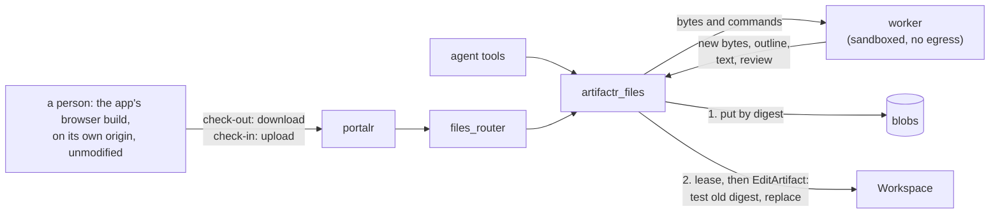

# RFC-0003: Native files as artifacts

**Status:** Draft
**Author:** Alex Nodeland
**Created:** 2026-10-16
**Discussion:** [#248](https://github.com/alexnodeland/lattice/pull/248)
**Siblings:**

- [artifactr ADR-0003][a-adr-0003] fixes the two patch kinds. This RFC adds none.
- [artifactr ADR-0004][a-adr-0004] makes every edit name its base version, and rejects pessimistic locks. This RFC keeps the first and narrows the second, for native files only.
- [artifactr ADR-0034][a-adr-0034] is ports and adapters. The new package's ports follow it, and its packaging departs from it, for the reasons below.
- [lattice RFC-0002](0002-portalr-the-portal.md) is portalr, which gains a renderer, previews and check-out for native files.
- [stackr ADR-0035][s-adr-0035] builds the thin images; the worker's is built the same way.

## Summary

A new package, `artifactr-files`, gives artifactr artifact types for files in native formats: Word documents first, then presentations, spreadsheets, PDF, SVG, images, CAD and audio. An artifact of such a type is a small Pydantic manifest that names the file's bytes, by SHA-256, in a blob store. The file is the source of truth; nothing parses it into Pydantic fields.

- **Agents** edit through a native application run headless in a sandboxed worker, by batches of its own commands. The pilot's application is WordCraft, one of the open-source Rust "craft" apps.
- **People** check the file out, edit it in the app's unmodified browser build, which the deployment hosts, and check it in.
- **Every revision** is an ordinary JSON Patch on the manifest that first tests the content digest it was made from.
- **A check-out is a lease.** While someone holds it, an agent's edit is refused as busy, and the agent plans again after the check-in.

artifactr gains a lease on an artifact, an addition to its workspace API; its patch kinds and its core rules don't change, and lattice-core doesn't change. The pilot is WordCraft and `.docx` only.

This changes artifactr, portalr and stackr as well as adding a package, so it is in lattice's series.

## Motivation

- **Work arrives as files.** The documents people and agents share are often a contract in `.docx`, a deck in `.pptx` or a model in `.xlsx`. artifactr's types hold JSON and Markdown. Today an application either converts the file to Markdown, losing styles, tables, comments and tracked changes, or keeps it outside artifactr, losing revisions, proposals, attribution and the log.
- **A model should edit the file, not a copy.** Converting to Markdown and back is lossy both ways. An app that reads and writes the format natively, and exposes its edits as commands, lets an agent change the real file.
- **The craft apps make it plausible.** [getartcraft.com/apps](https://getartcraft.com/apps) lists thirteen open-source Rust apps for native formats, each with a browser build. WordCraft has a headless MCP server that edits `.docx` by command; the [evidence](#evidence) records what was checked.
- **The hard parts are artifactr's, not the app's:** bytes that don't fit in the log, a write path that can't run an app inside a transaction, a sandbox for hostile files, and a lock that doesn't break turn-based collaboration. They need deciding once, before a second format repeats them differently.

## Design

### Overview



An agent's edit and a person's check-in end the same way. The package puts the bytes, the text and the review (comments and tracked changes) in the blob store under their digests, then commits an `EditArtifact` through the one write path ([ADR-0002][a-adr-0002]). If anything fails before the commit, nothing is committed, and what was put is collected as unreferenced.

### The package

```text
packages/artifactr-files/
├── src/artifactr_files/
│   ├── types.py        NativeFile, Blob, Provenance, WordDocument
│   ├── blobs/          the Blobs port, InMemoryBlobs; sql/ behind the [sql] extra
│   ├── apps/           the App port, FakeApp, wordcraft/
│   ├── agent.py        NativeFileTools, a pydantic-ai toolset
│   ├── fastapi.py      files_router, behind the [fastapi] extra
│   └── worker/         the job runner the worker image runs
├── schemas/            the manifest's JSON Schema and the router's OpenAPI document, with drift tests
└── tests/              test_layering.py, corpus/, hostile/
```

- **A separate distribution, as a deliberate departure from ADR-0034.** ADR-0034 puts each adapter in an extra of the package whose port it implements. This is not an adapter of an artifactr port. It is a domain extension with its own tables and migrations, a worker program, a router, and a dependency on an external application in alpha. Keeping it out of artifactr leaves artifactr's dependencies and migration chain untouched for every application that doesn't edit native files. relayr is the precedent for a package that builds on artifactr from outside.
- **It depends inward only.** It imports only names in `__all__` of `artifactr`, `artifactr.core` and `artifactr.workspace`, plus `lattice_core.sql.tenancy`; artifactr imports nothing of it. Its `tests/test_layering.py` holds it there, as relayr's does.
- **It lives in the monorepo,** so CI runs its tests on every change to artifactr (lattice ADR-0002). Its `artifactr-ai` requirement is a lower bound, raised by hand.

### The artifact

```python
class Blob(BaseModel):
    sha256: Annotated[str, Field(pattern=r"^[0-9a-f]{64}$")]
    size: int = Field(ge=0)
    media_type: str


class Provenance(BaseModel):
    """How the content was made, as the server recorded it. Who made it is the revision's actor."""
    source: Literal["upload", "check_in", "commands"]
    app: str | None = None          # "wordcraft"
    app_version: str | None = None
    build: str | None = None        # the worker image's digest
    base: str | None = None         # the content digest it was made from; None for a new file
    commands: Blob | None = None    # the batch, as canonical JSON


class NativeFile(Artifact, abstract=True):
    formats: ClassVar[frozenset[str]]
    write_policy: ClassVar[WritePolicy] = "propose"

    name: str
    content: Blob
    fingerprint: str                # the digest of the content, normalized (below)
    text: Blob | None = None        # plain text, for diffs and the agent
    review: Blob | None = None      # comments and tracked changes, as JSON
    outline: str = Field("", max_length=4_000)
    pages: int | None = None
    provenance: Provenance

    def render_for_agent(self) -> str:
        pages = f", {self.pages} pages" if self.pages is not None else ""
        return f"{self.name}{pages}\n{self.outline}"


class WordDocument(NativeFile):  # "word_document"
    formats = frozenset({DOCX})
```

- **Bytes never enter the log.** Every revision stores its resulting data ([ADR-0004][a-adr-0004]), events carry it, WebSocket replays send it, and relayr bridges it into reflexr. A manifest is about a kilobyte plus the outline; a `.docx` is often megabytes.
- **`render_for_agent` is synchronous and does no IO,** so the agent sees, by default, the outline the worker wrote when the revision was made.
- **The fingerprint makes a no-op save no revision.** WordCraft stamps `docProps/core.xml` with the time on every save (see the evidence). The fingerprint is the digest of the archive's other parts, computed by the worker. A check-in whose fingerprint equals the head's commits nothing.
- **Provenance is a claim.** The package writes it on the server, but `edit_artifact` over REST or MCP can write anything, so only the revision's actor is trusted. Nothing reads provenance to authorize anything.
- **Write policies bind agents only,** as everywhere in artifactr. `propose` makes an agent's edit a proposal. A person's check-in always commits directly.

### Edits: JSON Patch with a test

A third patch kind, a "command batch", was the obvious alternative. It can't work: `core.commit` is pure ([ADR-0001][a-adr-0001]), and a batch's result exists only after a native app has run, for seconds, outside the transaction that holds the workspace's row lock ([ADR-0021][a-adr-0021]). The package builds the revision as JSON Patch instead:

```json
[
  {"op": "test",    "path": "/content/sha256", "value": "<the digest it was made from>"},
  {"op": "replace", "path": "/content",        "value": {"sha256": "...", "size": 48213, "media_type": "..."}},
  {"op": "replace", "path": "/fingerprint",    "value": "..."},
  {"op": "replace", "path": "/text",           "value": {"sha256": "...", "size": 9120, "media_type": "text/plain"}},
  {"op": "replace", "path": "/outline",        "value": "..."},
  {"op": "replace", "path": "/provenance",     "value": {"source": "commands", "base": "...", "commands": {...}}}
]
```

- **A stale direct edit** fails first on `base_version`, as `VersionConflict`.
- **The `test` matters when a proposal is accepted.** Acceptance re-applies the stored patch to the head as it is then, and checks no version, so without the test a proposal made against an old version would silently replace everything since. With it, accepting a stale proposal fails as `PatchFailed`, which the evidence shows.
- **A stale proposal is outdated, never rebased.** portalr shows it as outdated, and its author makes a new one, with `base_version` at the head and a test on the head's digest. Accepting with changes (`RespondToProposal.changes`) isn't offered for native kinds.
- **Summaries come from the batch or the check-in.** The package passes `summary=`, so change notes don't read `test /content/sha256; replace /content`.

### Check-out: a lease on the artifact

`lock` is the only merge strategy in the pilot. One writer at a time, through a lease:

```python
class Workspace:
    async def lease_artifact(self, artifact_id: ArtifactId, *, holder: str, ttl: timedelta) -> ArtifactLease: ...
    async def artifact_lease(self, artifact_id: ArtifactId) -> ArtifactLease | None: ...
    async def release_artifact(self, artifact_id: ArtifactId, *, holder: str) -> None: ...

class ArtifactBusy(InvalidState):    # names the lease's holder and when it expires
    holder: str
    expires_at: datetime
```

- **It belongs to artifactr's `Workspace`, an additive change.** `claim_thread` is the only lease `Workspace` exposes today, and it asks for access before it takes one. A lease taken straight on `Storage` would skip that check and ADR-0062's filtering of restricted artifacts. So `Workspace` gains these three methods. They ask `artifactr:edit_artifact` for the artifact, and answer a restricted artifact exactly as a missing one. `Storage` gains one read, `lease(scope, key)`, for the holder and expiry. artifactr's two storages implement it, and a storage an application wrote itself must add it, which the release notes say.
- **A check-out is a long lease, eight hours by default.** Its expiry is shown on the artifact, and the person can extend it. Nothing renews it in the background, because the browser build can't tell the portal it is still open.
- **The holder is the check-out, not the person.** It is `checkout:<id>:<actor id>`, so two tabs are two holders and the refusal can name who has the file.
- **An agent's edit takes a short lease** for the worker call and the commit, seconds long. If someone else holds the lease, the tool returns `ArtifactBusy` with the holder and expiry. The agent plans again against the new head after the check-in, with the change note ADR-0008 gives it. It never queues a proposal that would be stale on arrival.
- **A check-in isn't atomic with the lease check.** A lease can expire between the check and the commit; the test and `base_version` are what keep a stale check-in from overwriting anything. If the check-in is stale, because its lease lapsed and someone committed, it is kept as a proposal against the head: `base_version` at the head, and a test on the head's digest. It is the one proposal from a person, and the reviewer sees both versions' pages.
- **A retried check-in is idempotent.** If the head's fingerprint already equals the upload's, the check-in succeeds and makes nothing new.
- **The lease is advisory.** Core doesn't know about it, so `edit_artifact` over REST or MCP isn't stopped. The test makes such a write fail or makes the next check-in stale, never silent.

This narrows ADR-0004's rejection of pessimistic locks (its option C) for native files. ADR-0004 feared that an agent could hold a lock across seconds of model latency, and that locks leak on crashes. Here, an agent never holds a lease across model calls, only across one worker call. A person's lease expires on its own. Proposals stay the path for review. The decision is recorded in an artifactr ADR, "a lease on an artifact", beside "native files are manifests over JSON Patch".

### Blob storage

```python
class Blobs(Protocol):
    async def put(self, scope: Scope, artifact_id: ArtifactId, data: AsyncIterable[bytes], media_type: str) -> Blob: ...
    async def get(self, scope: Scope, artifact_id: ArtifactId, sha256: str) -> bytes | None: ...
    async def collect(self, scope: Scope, referenced: Set[tuple[ArtifactId, str]], *, before: datetime) -> int: ...
```

| Decision | Choice |
|---|---|
| Where the port lives | In the package. Adding methods to `Storage` for bytes would break every storage an application wrote, and nothing else in artifactr needs bytes yet |
| Key | `(tenant, workspace, artifact, sha256)`, as ADR-0021's keys start. A blob's access is its artifact's: a manifest that names another artifact's digest finds nothing |
| Deduplication | Within one artifact: its revisions share unchanged bytes. Never across tenants, which would tell an uploader that someone else has a file |
| Digests | Computed on the server, with the byte count, as the upload streams to a spool with a size limit. A digest a client gives is never used |
| SQL | `artifactr_files_blobs`, `bytea` (SQLite `BLOB`) with PostgreSQL storage `EXTERNAL`, since zipped formats don't compress; the package's own Alembic scripts and version table, as ADR-0021 has artifactr's |
| Tenancy | `TenantSession` and `tenant_policy` from `lattice_core.sql.tenancy`, as in artifactr's adapter ([ADR-0066][a-adr-0066]) |
| Size | 25 MiB a blob by default, configurable to 100 MiB; the router refuses a larger body before buffering it |
| Object store | Deferred. stackr already has an S3 port, with MinIO by default ([stackr ADR-0005][s-adr-0005]); an adapter for it is the same port, with isolation by key prefix instead of row-level security. It waits for a deployment that hits the size limit |
| Order of writes | Put first, idempotent by digest, then commit. A put that is never committed is only garbage |
| Collection | `put` sets `last_put`, including on a blob that already exists. `collect` deletes, in one statement, the artifact's blobs with `last_put` before the cutoff (a day ago by default) that aren't referenced. Referenced means named by any revision's data, archived artifacts included, or by a pending proposal's patch. It runs per tenant, as the application's role, so row-level security holds |
| Missing content | Every surface can commit `edit_artifact`, so a hand-written patch can name a digest that isn't there. Reads then show "content unavailable", and the tools refuse to edit until the content is replaced |

**Renders are a cache with the same key.** A page image is keyed by tenant, workspace and artifact, then by the content digest, page, scale and the worker's build. It is never keyed by digest alone, which would let one tenant's cache answer another's.

**Every route that serves bytes resolves the artifact first,** through `Workspace.artifact(...)`, which asks the access hook and hides restricted artifacts. Only then does it check that the revision names the digest. A hidden artifact is answered exactly as a missing one.

### The app port and the worker

```python
class App(Protocol):
    async def apply(self, source: bytes | None, commands: Sequence[AppCommand], *, deadline: float) -> Applied: ...
    async def inspect(self, source: bytes, *, deadline: float) -> Inspection: ...  # outline, text, review, pages, fingerprint
    async def render(self, source: bytes, page: int, *, scale: float, deadline: float) -> bytes: ...  # PNG
    async def commands(self, query: str) -> Sequence[CommandSpec]: ...
```

- **Stateless calls over MCP on stdio.** WordCraft's `wordcraft-cli mcp` speaks only stdio, and confines file access to a read root and a write root. stdio needs no listening port, which is what makes a sandbox with no network possible. Each call is bytes in and bytes out, so no document stays open between calls.
- **One adapter per app.** The apps' control channels and MCP tools differ, in authentication, method names and tool names, so `App` is the common shape and each app has its own adapter.
- **Two adapters for WordCraft.** `Subprocess` spawns the CLI locally; it is for tests and development, on trusted files, and is not a sandbox. `Worker` sends the call to the worker.

The worker treats every file as hostile: a zip bomb, deeply nested XML, an enormous image.

- **A service on an internal network** (`internal: true`) that only the application joins: no route out, no published port.
- **The application talks to it over HTTP:** one request per call, the file as the body and the call as JSON, authenticated by a token the deployment generates. The worker runs one job at a time. It spawns a fresh `wordcraft-cli` process per job, in an empty temporary directory given as its read and write roots, and wipes the directory afterwards. It scales by adding containers, never by running jobs side by side in one.
- **Limits on every call:** a deadline (30 s for an edit, 10 s for a render by default), and CPU time, address space and file size set by `setrlimit`. A limit on the reply's size too. A breach is a typed failure: `timeout`, `crashed`, `too_large` or `refused`.
- **The container:** not root, a read-only root file system, a `tmpfs` with a size limit, every capability dropped, `no-new-privileges`, the default seccomp profile, and memory, CPU and PID limits. No fonts are installed, so its renders depend on the image alone.
- **stackr owns the policy,** because it owns the network, the limits and the image.

### What the agent sees

| Need | Tool or hook | Budget |
|---|---|---|
| What the file is | `render_for_agent`: name, pages, outline | 4,000 characters, the capability's `max_render_chars` |
| Its words | `read_native(artifact_id, pages)`, from the text blob | 8,000 characters a call |
| Its comments and tracked changes | `read_review(artifact_id)`, with each comment's id | 50 items a call |
| Its look | `view_page(artifact_id, page)`, one rendered page | One page a call; off unless the application turns it on |
| What it can do | `find_commands(query)`, through the app's `list_commands` | Ten a call; WordCraft has 617 commands |
| To change it | `edit_native(artifact_id, base_version, commands, summary)` | One batch a call |

WordCraft describes each command's parameters as a free-text signature, not JSON Schema. A batch can't be checked before it runs; a command the app refuses comes back as the tool's error, and nothing is committed.

### People: check-out and check-in

People edit in WordCraft's browser build, unmodified, as released, and served by the deployment. The build is a standalone page: it opens files through a picker, drag and drop or paste, and saves through `showSaveFilePicker` or a download. It has no API for a page to drive.

1. **Check-out.** portalr takes the lease and downloads the head revision. It then opens the hosted editor in a new tab, showing the lease's expiry.
2. **Editing.** The person opens the downloaded file in the editor, edits it, and saves it to disk.
3. **Check-in.** The person uploads the file in portalr. The router streams it, computes its digest and fingerprint, has the worker read its outline, text and review, and commits a revision as the person, with `source: "check_in"`. It then releases the lease.

The editor's hosting:

- **An origin of its own.** stackr serves the release's `wordcraft-web` files, checked against `SHA256SUMS.txt`, from their own registrable domain, or a host name for which portalr sets no cookies. The editor never sees a token. Its CSP is `default-src 'self'`, plus the inline module script's hash, `'wasm-unsafe-eval'` and `blob:` for downloads. It also sends `frame-ancestors 'none'`. Nothing calls out.
- **The same release as the worker.** stackr pins the browser build and the worker image to one WordCraft version, and a check, like `check-config`'s, fails CI if they differ.
- **Shared browsers.** The editor keeps preferences in `localStorage` and user fonts in IndexedDB, not documents. The check-in page reminds the person that the downloaded copy stays on their disk.
- **Hostile files open in the person's own browser too,** inside the browser's sandbox. The server still opens every revision in the worker.

**Next for people, a streamed session, evaluated in phase 5.** The unmodified desktop app runs under a virtual display, in a sandboxed container per session, streamed to the browser as noVNC or Kasm do. The agent attaches to the same live document through the app's control channel, with `wordcraft-cli mcp --connect`. Events come by polling the undo history and `document.inspect`, since the app pushes none.

| Question | What the spike must find out |
|---|---|
| Cost | Memory and CPU per idle and per active session; how many a host holds; start time from a warm pool |
| Latency | Input-to-pixel delay at p50 and p95, on a LAN and across a region |
| Security | The stream authenticated through the portal, per session; the container with no egress; the clipboard; the document wiped when the session ends; the control key inside the container only |
| stackr | Starting a container per session needs the Docker API, which is root on the host. A fixed pool of session containers needs no socket. Which one, and on AWS, which service |
| Unverified so far | Whether the desktop build runs under a virtual display, with software rendering |

**The spike's exit test.** A person types in the streamed document while an agent, attached through `--connect`, inserts a paragraph. Both see both edits. A save becomes one revision. The container has no route out, and the session leaves nothing behind. It passes at a p95 input delay under 150 ms on a LAN, and a session that starts in under five seconds from the pool.

### The log, feedback and telemetry

- **No new events.** An edit or a check-in is an `artifact_changed` like any other. relayr bridges it, so a reflexr rule can react to a Word document changing, and sees the manifest, never the bytes.
- **Feedback** targets an artifact version, as it does today ([ADR-0028][a-adr-0028]).
- **Spans** for `apply`, `inspect` and `render`, with the app, its version, the build, the command count, the byte counts and the outcome. They carry digests, never content.
- **Metrics:** a duration histogram per operation and failures by kind, through the SDK views of [ADR-0036][a-adr-0036], with artifactr's tenant attribute.

### portalr

- **A renderer for native kinds** in `ui`: a strip of page previews, the name, size and outline, a download, and the lease's holder and expiry. Its `text(data)` is the outline; the full text diff reads the text blob.
- **Revision history and diffs:** the changed text, and side by side the pages whose renders differ.
- **Check-out and check-in,** with the lease's expiry, extending it, and a stale check-in shown as a proposal with both versions.
- **Routes in `files_router`,** mounted beside artifactr's with the same `resolve_actor` and access hook: check out, check in, extend, download a revision, and fetch a page. Each route names an artifact and a revision, never a bare digest.

### stackr

- **A recipe, off by default.** The template's `native_files` question adds the worker, its internal network and limits, its token, and the editor's host name.
- **One release, two artifacts.** The worker's thin image is built from the release tarball's `wordcraft-cli`, checked against `SHA256SUMS.txt`, in the way and with the provenance of ADR-0035. It is pinned by version and digest. The editor is the same release's `wordcraft-web` archive, served as static files by the stack's edge. Upstream signs nothing and publishes no SBOM, so the checksum is the whole chain of custody until stackr's own attestation.
- **Notices and marks.** Both carry WordCraft's licence files and `NOTICE`. The marks stay exactly as supplied, in the unmodified build only. Nothing of lattice's uses the ArtCraft name or marks, or suggests that the ArtCraft team endorses it, as the brand licence requires (see the evidence).

### Fidelity

- **A corpus** in `tests/corpus/docx/`: one generated file per feature, plus a few documents whose licences allow it, with their provenance recorded.
- **Loss is measured on the format.** Open and save with no edits, then compare normalized OOXML, feature by feature: text, styles, run properties, tables, lists, images, headers and footers, footnotes, comments, tracked changes and sections. Each is preserved, changed or dropped. Saving twice is a fixpoint.
- **"Supported" is per feature,** in a matrix that the nightly run publishes, never for a format as a whole.
- **Where it runs:** `FakeApp` on every pull request; the real worker image nightly and in the Acceptance job.

### What changes in each package

| Package | Changes | Breaking |
|---|---|---|
| artifactr | `Workspace.lease_artifact`, `artifact_lease`, `release_artifact` and `ArtifactBusy`; `Storage.lease`; two ADRs and a section of the artifact types guide | Only for a storage an application wrote, which must add `lease` |
| artifactr-files | New | |
| portalr | The native renderer, previews, page diffs, check-out and check-in | No |
| stackr | The `native_files` question, the worker, the editor's hosting, the release pin check | No |
| lattice-core | Nothing | |

### Phases

| Phase | Deliverable | Exit criteria |
|---|---|---|
| 1. Foundations | artifactr's lease; the package, its types, `Blobs` with memory and SQL adapters, `App` and `FakeApp` | 100% coverage; the blob suite on memory, SQLite and PostgreSQL; a two-tenant test reads nothing across tenants; `collect` keeps every referenced blob |
| 2. WordCraft headless | The `Subprocess` adapter; inspection, fingerprint, render; the corpus and fidelity report | The nightly report publishes the feature matrix |
| 3. Worker and agent | The worker, stackr's image and recipe, the hostile corpus; `NativeFileTools` | Every hostile file ends in a typed failure within its deadline; egress from the worker fails; scripted-model tests for an edit, a proposal, a busy refusal and a conflict |
| 4. Check-out pilot | The hosted editor, portalr's renderer, previews, diffs, check-out and check-in | `bdd` scenarios for a check-in, a stale check-in, an idempotent retry and a busy agent; the editor's origin serves nothing that calls out |
| 5. Streamed session spike | The evaluation above | Its exit test, and a written recommendation |

**Before a second app,** WordCraft's matrix has held for two releases, no hostile file has escaped, the second app's licence is read, and its adapter needs no change to `App`, `Blobs` or `NativeFile`.

### Future work

- **Comments that start a turn** and **the desktop sync bridge** go to a follow-up RFC. A bridge commits as the person, with the device in the provenance, and needs a token per person and device, which grantr doesn't have. A comment trigger has these requirements:
  - only a revision by a `UserActor` can trigger one;
  - loops are prevented, and triggers are rate-limited;
  - an upload's existing comments never trigger;
  - the message id is derived from the artifact, a hash of the author, the date, the text and the anchor, so a retry posts nothing twice;
  - the turn acts `on_behalf_of` the person, as [grantr ADR-0004][g-adr-0004] has it;
  - the trigger is evaluated in the package's commit path, not in a reflexr rule.
- **Other merge strategies.** `rebase` suits apps whose commands name their targets by stable id: batches ordered by the server, refused when stale, and replayed by their author. WordCraft's commands act on positions and the selection, so it doesn't qualify. `crdt` suits only an app whose own model is a CRDT, and none is. Each waits for an app that needs it, and gets its own ADR.

## Decisions

Recommended, for the maintainer to decide.

| # | Question | Recommended | Instead of |
|---|---|---|---|
| D1 | Edits | JSON Patch on a manifest, testing the old digest; the batch as a provenance blob | A third patch kind, which pure core can't apply |
| D2 | Blobs | A port in the package, keyed by tenant, workspace, artifact and digest, on PostgreSQL | Methods on `Storage`; an object store first; deduplication across artifacts |
| D3 | Concurrency | A lease on the artifact, in `Workspace`: a person's check-out for hours, an agent's edit for seconds; a busy agent re-plans | Proposals queued against a lease, stale on arrival; a CRDT; last write wins |
| D4 | People's editing | Check-out and check-in through the unmodified browser build; a streamed native session evaluated next | Reaching into the browser build's internals from a same-origin page |
| D5 | Packaging | A separate distribution, `artifactr-files` | An extra of artifactr; a name built on the apps' brand |

## Drawbacks

- **A young dependency on the critical path.** WordCraft's repository is nine days old, with six releases in seven days, and calls itself alpha. Its own documents disagree on how many commands it has. Commands, tools and output can change in any release.
- **One writer at a time,** and coarse turns: a check-out lasts hours, and an agent waits for it.
- **Check-out is clunky:** download, edit in another tab, save, upload. It proves the hosting, the lease and the check-in, not the experience.
- **Two stores to keep consistent.** Put-first and collection make the gap safe, not absent.
- **A worker to run,** with its own image to build, pin and patch, and a 40 MB editor to serve.

## Alternatives

- **Convert to Markdown and back,** which loses styles, comments, tracked changes and layout every time.
- **An embedding API upstream,** or **our own build of the browser editor** over WordCraft's crates. Either would allow an editor inside portalr. The owner's constraint rules both out: no fork, no upstream contribution.
- **Reaching into the browser build from a same-origin page,** through its WebAssembly memory or its DOM. That depends on internals that change every release, and putting it on portalr's origin would need `wasm-unsafe-eval` in portalr's CSP.
- **A CRDT, chosen by lattice.** lattice already has what a CRDT exists to do without: a server that orders every write and numbers each workspace's log ([ADR-0005][a-adr-0005]). Its collaboration is turn-based, through revisions and proposals ([ADR-0009][a-adr-0009]). A CRDT guarantees convergence, not a valid file. No craft app uses one, so `.docx` would have to be converted into a generic CRDT, which is lossy. It becomes worth it only for offline editing over hours, or several people typing at once.
- **LibreOffice headless.** Mature, and covers every office format, but its edits are UNO calls rather than commands, and it is a large process to sandbox per call. It stays the fallback, and the `App` port admits it.
- **Python format libraries** (`python-docx` and the like). They run in-process, with no isolation from hostile files, and each format would grow its own edit model in application code.

## Unresolved questions

- **Large documents:** where the worker's round trip stops being cheap, which phase 2 measures.
- **Quotas** on blob bytes per workspace or tenant, and where they are enforced.
- **Upstream's supply chain:** whether to wait for signed releases before phase 3.

## Tracking

- [ ] artifactr: the lease on `Workspace` and `Storage`, its ADR, and the ADR on native files as JSON Patch
- [ ] artifactr-files: the package, with `pyproject.toml`, `moon.yml`, its entry in `release-please-config.json` and the manifest, and its name known to the Title check and `scripts/breaks.py`
- [ ] artifactr-files: blobs, migrations and row-level security
- [ ] artifactr-files: the WordCraft adapter, the corpus and the nightly fidelity report
- [ ] artifactr-files and stackr: the worker, its image, the recipe and the release pin check
- [ ] artifactr-files: `NativeFileTools`
- [ ] portalr and artifactr-files: the renderer, `files_router`, check-out and check-in
- [ ] The streamed session spike and its recommendation
- [ ] Docs: the package's section and guide

## Evidence

Gathered on 2026-10-16. Everything downloaded was treated as untrusted data, in a scratch directory outside the repository; nothing was built from source. WordCraft was read at `main` `eae24217` and v0.7.0.

### artifactr

- **The test guards a stale replace.** At artifactr `a267cf16`, `apply_patch` with a `test` on `/content/sha256` and a `replace` of `/content` applies to data whose digest matches. On moved data it raises `PatchFailed: the JSON patch does not apply: ccc (<class 'str'>) is not equal to tested value aaa (<class 'str'>)`. Verified.
- **Accepting re-applies.** `core.rules._apply_change` applies an accepted edit's stored patch to the current version, and only proposing checks `base_version`. Verified in code.
- **`render_for_agent(self) -> str` is synchronous,** and `claim_thread` is `Workspace`'s only lease, asking `artifactr:claim_thread` first. Verified in code.

### WordCraft

| Claim | Finding | |
|---|---|---|
| Licence | `LICENSE-MIT` and `LICENSE-APACHE`; `MIT OR Apache-2.0` in `Cargo.toml`; fonts under OFL-1.1 | Verified |
| Brand licence | `docs/brand/LICENSE-brand.txt`: the ArtCraft name, wordmark and mark are trademarks, not open source. They may be used only as part of copies of the repository, and within WordCraft and its official builds, to identify it, and exactly as supplied. They must not suggest that the ArtCraft team endorses any other product. Neither they nor the ArtCraft name may appear in the name of anything else. A modified version must remove them. So serving the unmodified official build keeps its marks lawfully; a fork wouldn't; and the package's name must not use the brand. "WordCraft" itself is not among the marks the file lists | Verified (text read; not legal advice) |
| Releases | v0.1.0 to v0.7.0, 2026-10-07 to 2026-10-14; `SHA256SUMS.txt`; no signatures, SBOM or attestations; no container image found | Verified; the image unverified |
| The CLI | Only inside the full Linux tarball (`bin/wordcraft-cli`, 69.6 MB); needs the C library only | Verified (aarch64) |
| MCP | `wordcraft-cli mcp`: stdio only, 16 tools, read and write roots; never sends notifications | Verified, live |
| Control channel | In the desktop app: 127.0.0.1, a 256-bit key, newline-delimited JSON, request and response only | Verified in code |
| Commands | 617 in the v0.7.0 binary (389 change the document); the README says 422; parameters are free-text signatures. They act on positions and the selection; paragraphs and cells have no ids; comments have durable ids | Verified |
| Comments and tracked changes | `inspect_document` gives counts only; `review.comments` and `review.changes` give author, date, anchor, text and id | Verified, live |
| Saves | Atomic: a temporary file and a rename. No lock files, and outside changes go unnoticed | Verified in code |
| No network | No HTTP client in `Cargo.lock`, no telemetry | Verified in code |
| Browser build | `wordcraft-web-0.7.0.zip`, checksum matched: 39.8 MB of WebAssembly (14.9 MB gzipped; its `HOSTING.md` says 13 and 5). No JavaScript API, no `postMessage`. No COOP or COEP, no workers, no remote URLs. It shares the CLI's engine crates | Verified from the files; not served or run |
| CRDT | No CRDT or OT library in any of the thirteen apps' lock files | Verified |

**Running it.** On Docker 29.4.0, on an aarch64 host, `debian:bookworm-slim` at `sha256:7c7b2c96…c587`, with the release's aarch64 tarball, whose checksum matched:

```sh
docker run --rm -i --platform linux/arm64 --network none --read-only \
  --memory 1g --cpus 1 --pids-limit 256 --tmpfs /tmp -e HOME=/tmp -e TZ=UTC \
  -v "$BIN":/app:ro -v "$CORPUS":/in:ro -v "$OUT":/out debian@sha256:7c7b2c96... \
  /app/wordcraft-cli mcp --author "Spike Agent" --automation-read-root /in --automation-write-root /out
```

- **The corpus:** six `.docx` files generated with Python's `zipfile`, covering headings, run formatting, lists, a table, a footnote, an image, a comment and tracked changes. No real-world documents were tested.
- **Start-up:** about 4 ms inside the container, against 0.4 to 8 s to start a container. Calls took 1 to 41 ms on these files, and every one succeeded.
- **Round trip:** text, styles, run properties, lists, the table, the footnote, the comment, the tracked changes and the image's bytes were kept exactly. Saving added `app.xml`, `settings.xml`, a theme and `commentsExtended.xml`, and renumbered the tracked changes' ids.
- **Determinism:** across two processes, renders were identical, and `.docx` files were identical except `docProps/core.xml`, where every save sets `dcterms:modified` to the time, increments `cp:revision` and writes `--author`.
- **One failed run:** the host's Docker defaults to amd64, and the first run failed with `exec /app/wordcraft-cli: no such file or directory` until `--platform linux/arm64` was given. x86_64 wasn't run.

### The other apps

All thirteen apps on the page have public repositories under `github.com/storytold`, with `LICENSE-MIT` and `LICENSE-APACHE` and documentation for MCP. All were created between 2026-09-30 and 2026-10-09. Their control channels differ: DeckCraft's and GridCraft's have no authentication. Only WordCraft was run; every other app's formats are its README's claims, unverified.

[a-adr-0001]: ../artifactr/adr/0001-python-library-with-sans-io-core.md
[a-adr-0002]: ../artifactr/adr/0002-single-write-path.md
[a-adr-0003]: ../artifactr/adr/0003-artifact-types-as-pydantic-subclasses.md
[a-adr-0004]: ../artifactr/adr/0004-optimistic-concurrency-and-revisions.md
[a-adr-0005]: ../artifactr/adr/0005-one-event-log-per-workspace.md
[a-adr-0009]: ../artifactr/adr/0009-write-policies-and-non-blocking-proposals.md
[a-adr-0021]: ../artifactr/adr/0021-sql-storage.md
[a-adr-0028]: ../artifactr/adr/0028-typed-feedback-as-events.md
[a-adr-0034]: ../artifactr/adr/0034-ports-and-adapters-for-integrations.md
[a-adr-0036]: ../artifactr/adr/0036-metric-cardinality-through-sdk-views.md
[a-adr-0066]: ../artifactr/adr/0066-row-level-security-under-the-scoping.md
[g-adr-0004]: ../grantr/adr/0004-an-agent-turn-acts-for-its-user.md
[s-adr-0005]: ../stackr/adr/0005-ports-and-adapters-for-the-stack.md
[s-adr-0035]: ../stackr/adr/0035-the-thin-images.md
