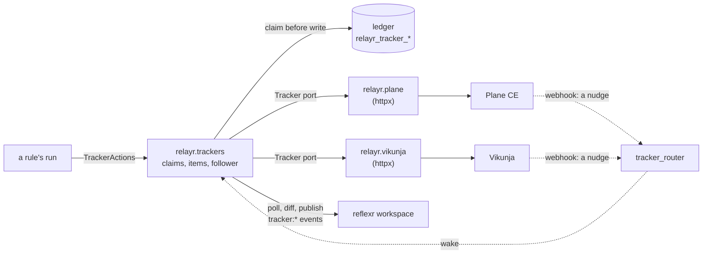

# RFC-0004: relayr and task trackers

**Status:** Draft, amended by [lattice ADR-0027](../adr/0027-integrations-switched-per-workspace-through-one-port.md)
**Author:** Alex Nodeland
**Created:** 2026-10-16
**Discussion:** [#260](https://github.com/alexnodeland/lattice/pull/260)
**Siblings:**

- [stackr RFC-0002][s-rfc-0002] is the bridge this extends: followers with leases and cursors, runs that act once, and chains that continue across it.
- [artifactr ADR-0034](../artifactr/adr/0034-ports-and-adapters-for-integrations.md) is the shape: a small port owned by the inner layer, adapters in extras, each tested against a fake, and one contract test where it is cheap.
- [reflexr ADR-0057](../reflexr/adr/0057-reserved-publishers.md) reserves the tracker's event namespace to the source that publishes it.

## Summary

relayr gains a tracker connector: reflexr's runs file and update work items in a task tracker, and changes people make there come back into reflexr as events. It sits behind one port, `relayr.trackers.Tracker`, with two adapters built together to prove it: Plane's Community edition and Vikunja. Writes are made once through keys the ledger claims before anything is sent. Reads are polled, per tracker project, with a lease and a cursor in the ledger as artifactr's followers are; a webhook only wakes the poll. Each lattice tenant has its own tracker workspace and its own tracker user.

## Motivation

- **Runs fail where nobody looks.** A dead-lettered run is a `reflexr:run_dead_lettered` event and a row in portalr. Teams triage work in a tracker, and today a person copies it there by hand.
- **Rules can't see the team's work.** "When the incident's follow-up is closed, propose the postmortem" needs the tracker's changes as events, with the same loop safety and exactly-once publishing the artifactr bridge has.
- **Self-hosted trackers are awkward integration targets.** Neither Plane CE nor Vikunja takes an `Idempotency-Key`, and neither sends a stable event id: Plane's `X-Plane-Delivery` is a new UUID on every attempt, and Vikunja's payload has none. Plane deactivates a webhook after five failed deliveries; Vikunja keeps its delivery queue in memory. An integration that trusts webhooks loses or repeats events, so this one trusts only what it can read back.

## Design

> **Amended (2026-10-17) by [lattice ADR-0027](../adr/0027-integrations-switched-per-workspace-through-one-port.md):** Each tracker is an integration, `tracker:plane` and `tracker:vikunja`, and relayr's `Enabled` takes the port's bound `is_enabled`. The switch is the shared `Integrations` port in lattice-core, `is_enabled(tenant_id, workspace_id, key)`, answered by grantr per deployment, tenant and workspace, audited, and set from portalr's admin.

### Overview



- **Outbound is a rule's run,** as it is for artifactr ([relayr ADR-0019][r-adr-0019]). A run gets `TrackerActions` from `Trackers.acting(reaction)`, or its agent gets `TrackerCapability`, and files, comments and changes state within its rule's allowlist.
- **Inbound is a follower per bound tracker project,** which polls, diffs and publishes. A webhook makes it poll now rather than at its next interval, and carries no data relayr uses.
- **The connector lives in relayr,** not in an artifactr plugin. It moves events between reflexr and another system, which is relayr's job, and it reuses relayr's ledger, leases and loop control.

### The port

`relayr.trackers` owns the port, the core and an in-memory fake. Adapters are thin: they speak one tracker's REST, and know nothing of ledgers, runs or chains.

```python
class Tracker(Protocol):
    """One tenant's tracker workspace."""

    async def find(self, project: ProjectId, key: ItemKey) -> ItemRef | None: ...
    async def create(self, project: ProjectId, key: ItemKey, draft: ItemDraft) -> ItemRef: ...
    async def item(self, ref: ItemRef) -> Item | None: ...          # None: deleted
    async def update(self, ref: ItemRef, fields: ItemFields) -> None: ...
    async def comment(self, ref: ItemRef, key: CommentKey, body: str) -> CommentRef: ...
    async def items(self, project: ProjectId, after: Cursor | None) -> Page[Item]: ...
    async def comments(self, ref: ItemRef, after: CommentRef | None) -> list[Comment]: ...
    def nudge(self, headers: Mapping[str, str], body: bytes) -> Nudge | None: ...
    def link(self, ref: ItemRef) -> str: ...
```

- **An `Item` is a snapshot,** in the port's own vocabulary: title, description, a `State` (`backlog`, `todo`, `started`, `done`, `cancelled`), a priority (`none` to `urgent`), label names, assignees, `updated_at`, `updated_by` if the tracker says, and the external key if it carries one. Plane's state groups map one to one; Vikunja's `done` flag maps to `done` or `todo`.
- **`items` pages a project by `updated_at`, then id,** after a cursor, oldest first, over what the tracker lists. Plane's list and its item read leave out archived, draft and triage items; its external-id lookup doesn't, so its adapter reads an item lattice filed through that lookup, and an archived item is never taken for a deleted one. A page boundary never splits one timestamp's items.
- **`nudge` checks a webhook's signature** against the tenant's secret and says which project to poll. It returns None for anything it can't verify.
- **Errors are typed:** `RateLimited(retry_after)`, `Unavailable`, `NotFound`, `Refused(reason)` and `Unauthorized`. Each adapter maps its own; Plane's errors are `{"error": str}`.
- **Adapters live in `relayr.plane` and `relayr.vikunja`,** behind the `[plane]` and `[vikunja]` extras, on plain async `httpx`. Plane's `plane-sdk` (0.3.1) is sync and built on `requests`; neither tracker's client is worth a dependency.
- **One contract test** runs against the fake on every pull request, against recorded fixtures of both trackers on every pull request, and against both trackers live (below).

### Writing once

Neither tracker deduplicates a retried request, so the ledger does, for both adapters alike.

- **A key per write,** derived as relayr ADR-0019 derives ids: from the run, its last checkpoint, the operation and a digest of what it writes, by `RunActions._derive`, moved where both can share it. A rule may pass its own key instead, such as `dead-letter/<run id>`, so that a later run files into the same item rather than a new one.
- **The claim comes first.** `ensure_item(key, draft)` inserts the key into `relayr_tracker_items` with the filing run's correlation id, then asks `find`, then `create`. A claim older than 30 s whose holder never recorded an item is retaken with another `find`, so a process that died between `create` and the record makes nothing twice. Every request has a 10 s timeout, well inside the claim, so a retaken claim never overlaps a request still in flight from relayr; a request the tracker itself finishes more than 30 s late could still make a second item on Vikunja, where `find` is a text search. On Plane the 409 catches it.
- **The row keeps only the correlation id,** because nothing that comes back through a tracker is published with causation ([Echoes and loops](#echoes-and-loops)): joining a chain without causation needs only its correlation id, as the follower already does for a person's answer to a proposal. It is looked up by the item's id on the row, not through an ADR-0021 cause kind, and it lives outside `relayr_causes`, so the causes' week ([relayr ADR-0025](../relayr/adr/0025-counters-and-how-long-causes-are-kept.md)) deliberately doesn't apply: it lasts as long as the item. With a key a rule shares across runs, such as `dead-letter/<rule>`, the item stays in the chain of the run that filed it first, which is the item's story; later runs' comments don't move it.
- **Plane's external ids are the second guard.** relayr sends `external_id` (the key) and `external_source` (`lattice:<tenant>/<workspace>`) on every item, comment and label. `find` is `GET ?external_id=&external_source=`, and a `POST` with a used pair returns 409 with the existing id, which `create` returns as found. Plane enforces the pair in code, not in the database, so it can't stop two racing creates; the claim does. A race that slipped through anyway would make Plane's lookup raise `MultipleObjectsReturned`, which it answers with a 500.
- **Vikunja has no external ids.** Its `find` looks for a marker, `lattice-key: <key>`, at the end of the description, searched within the bound project; the ledger's record is what normally answers. The marker survives the REST API, which stores the description as sent; whether Vikunja's editor keeps it when a person edits the description is unverified.
- **A comment is claimed the same way,** with Plane's external id on the comment and Vikunja's marker in its body.
- **State and fields are keyed edits:** read the item, and update only the fields that differ, as relayr ADR-0019's edits do. The values relayr sets are recorded on the item's row, field by field, before the update, so the follower can tell its own change from a person's. A write the tracker refuses clears its record.
- **An item a person deleted stays deleted.** Plane frees an external id when an item is soft-deleted, so a lookup alone would file it again. `ensure_item` reads a recorded item before it returns it, and the item's row is marked deleted when that read or the follower finds it gone, and `ensure_item` on that key returns `Deleted` and makes nothing. A rule that wants a new item uses a new key. A closed or archived item is not deleted: `ensure_item` returns it, and the rule decides whether to reopen it.

### What a rule does

```python
actions = trackers.acting(reaction)               # the attempt's TrackerActions
item = await actions.ensure_item(
    key=f"dead-letter/{event.run_id}",
    draft=ItemDraft(title=..., description=..., priority="high", labels=("lattice", "run-failed")),
)
await actions.comment(item, body=f"Retried {event.attempts} times: {event.reason}")
await actions.set_state(item, "todo")
```

- **What to file is the rule's to say:** title, body, priority and labels, as arguments. Where it goes is the binding's: each reflexr workspace is bound to one tracker project, with that project's defaults. There is no separate mapping table to keep in step with the rules.
- **Labels are found or created by name,** each with its own external id on Plane.
- **The allowlist gains `trackers: bool`,** false by default. That amends [relayr ADR-0020](../relayr/adr/0020-allowlists.md), whose `Allowlist` has four fields and says what a rule may do in artifactr; a frozen model with a default stays compatible. The allowlist is relayr's alone, since reflexr has none. A rule that may not write to its tracker gets `NotAllowed`. A bool doesn't tell reading from writing, which v1 doesn't need: rules read the tracker through its events.
- **Refusals are handled as relayr ADR-0019 handles artifactr's.** `RateLimited` and `Unavailable` fail the attempt, to be retried on reflexr's backoff. `Refused` and `NotFound` go back to an agent's model, or fail a function action's attempt. `Unauthorized` is permanent. reflexr's retries are the outbox: nothing is queued in relayr, and a tracker that is down never blocks reflexr, only the runs that file.
- **The template ships one example:** a rule on `reflexr:run_dead_lettered` that files the failed run, and comments on each later failure of the same rule. It never fires on its own dead letters.

### Reading back

A follower per binding polls its project, diffs what it finds against the ledger, and publishes `tracker:*` events into the bound reflexr workspace.

- **Lease and cursor in the ledger,** in `relayr_tracker_followers`, as [relayr ADR-0015][r-adr-0015] keeps them for artifactr's followers: a 30 s lease renewed every third of that, and a cursor of `(updated_at, id)` saved only after a page is published.
- **Started on open and at startup.** A tracker follower starts when its bound workspace is opened ([relayr ADR-0016](../relayr/adr/0016-followers-start-on-open.md)), and `Ledger.tracker_followed()` lists the bindings to resume when the application starts, so a project is polled even if no one opens its workspace. That is a second read across tenants, on the owner's engine, beside `followed`; it amends [relayr ADR-0027](../relayr/adr/0027-row-level-security-under-the-scoping.md), whose test pins that engine to one function.
- **A new binding starts silently.** Its first poll records a snapshot of every item and publishes nothing, unless the binding names a `since`, from which items are published as created. Binding a project of 2000 items doesn't publish 2000 events. A row lost from the ledger is seeded the same way.
- **Each poll looks back.** It reads from two minutes before its cursor, since a row can commit with an `updated_at` older than one already read; the snapshots and the derived ids drop what was seen. The daily sweep below also compares every item's `updated_at` with its row's, and diffs any that a poll missed.
- **Changes are level-triggered.** For each item on the page, the follower compares the snapshot with the one on the item's row and publishes one event per field that differs. Two changes between polls show as one; a change undone between polls shows as none. Plane's activity log would give every edge, but only per item, at a request per changed item; it stays an option (Decision T1).
- **Ids are derived, so publishing is exactly once:** `trk_` and the first 16 hex digits of a SHA-256 over the tenant, binding, tracker, item id, field, the new value as canonical JSON and the item's `updated_at`, joined by NUL bytes, as `_derive` joins its parts. A comment's is the same over the tenant, binding, tracker and the comment's id. The tenant and binding are there because Vikunja's ids are integers per instance. reflexr's `publish` appends an id once, so a page read again publishes nothing new, and the ids don't depend on the item's row: a lost row, reseeded, publishes nothing twice.
- **Comments are read per changed item,** after the last comment the row has seen.
- **Removals are found by the sweep.** Plane v1.4.2 sends no webhook when a work item or a comment is deleted ([relayr ADR-0035](../relayr/adr/0035-what-phase-1-settled-of-the-trackers-unknowns.md), confirmed live in [ADR-0037](../relayr/adr/0037-what-a-live-plane-settled.md)), so a daily sweep lists every item in the project, 1000 to a page on Plane and 50 on Vikunja, and publishes `tracker:item_removed` for rows whose item is gone. For an item lattice filed, Plane's external-id lookup then tells deleted from archived, and only a deleted one is marked so; for others, the event says only that the item left the list.
- **Dead letters,** for a change whose projection raises, go in `relayr_tracker_dead_letters`, once per event id; anything else stops the follower until it is started again, as artifactr's followers do. `DepthExceeded` can't happen here: nothing is published with causation.
- **What comes back is untrusted text.** Titles, descriptions and comments are written by whoever can reach the tracker, and reach rules and their agents as artifactr's messages do; agents' requests carry the gateway's `prompt-injection` guardrail as they do for chat. The item rows store titles and descriptions for the diff, so offboarding deletes them.

| Event | When | Carries |
|---|---|---|
| `tracker:item_created` | An item appears in the project | The item, its link, `key` if lattice filed it, `actor` if known |
| `tracker:item_changed` | A field differs from the last snapshot | `field`, `old`, `new`, `actor` if known |
| `tracker:item_commented` | A new comment | The comment's text and author |
| `tracker:item_removed` | The item left the project's list | The item's id, `key`, and `deleted` when known |

Every event carries `tracker` (`plane` or `vikunja`), the project and the item's id, number and link, so rules are written once for both trackers.

- **The types are relayr's,** declared as the bridged types are ([relayr ADR-0006](../relayr/adr/0006-bridged-types-in-the-artifactr-namespace.md)): under `TrackerEvent(Event, abstract=True, event_namespace="tracker")` in `relayr.trackers.events`, with `TRACKED` listing them for reflexr's `Workspaces(events=...)`, as `BRIDGED` does.
- **Projections** from a diff to these events are relayr's; an application may give its own per binding, returning its own event or None, as [relayr ADR-0018](../relayr/adr/0018-bridged-events-their-fields-ids-and-projections.md)'s `Projections` do for an artifact kind. Its event keeps the derived id.
- **Reserved to `SourceActor(name="tracker")`** through reflexr's `publishers=`, which relayr's wiring passes. reflexr checks the key against its registry at startup, so the types must be registered with the workspaces. As reflexr ADR-0057 warns, the application must never resolve a client to `source:tracker`.

### Echoes and loops

- **relayr's own writes are dropped by value,** not by actor: a field whose new value is the one the row says relayr wrote last, and an item whose creation the row claimed. A snapshot shows only an item's last updater, so a person's change made just before relayr's would be lost if the actor decided. The value is recorded before each write, so every write relayr makes is recognised, whichever process polls first. The run's own events already say what it did.
- **Anything else is a person's,** whether or not the tracker names them: Vikunja's items carry no `updated_by`, and Plane's is empty on a new item. `actor` is set when the tracker names someone other than relayr's user.
- **A person's change on an item a run filed joins that run's chain without causation,** as a person's answer to a rule's proposal does ([relayr ADR-0021][r-adr-0021]), with the correlation id on the item's row. Items lattice didn't file start chains of their own.
- **So depth never grows through a tracker,** and reflexr's depth limit can't end a loop through one. A person's edit is never dead-lettered for depth, which matters on Vikunja, where no edit names its author. The loop ends at the echo filter instead, which is complete for relayr's own writes by construction. Its backstop is a cap: relayr makes at most 20 writes to one item in an hour, and the next is a permanent `RunFailure` (`tracker_loop`), counted (Decision T7). The cap catches what the filter can't see: the tenant's tracker key used by something other than relayr, which the guide forbids.
- **The filter's one false drop:** a person who sets a field to the value relayr last wrote there, when relayr's write didn't land. That loses one event, never makes a loop.

### Nudges

- **`tracker_router(trackers)`** is a FastAPI router the application mounts beside the libraries': `POST /relayr/v1/trackers/{tenant}/{tracker}`. It verifies the signature with that tenant's secret, checks Plane's `workspace_slug` against the tenant's, wakes the binding's follower if this process holds its lease, and answers 204.
- **It is unauthenticated, so it gives nothing away.** Bodies over 1 MB are refused before they are read. Signatures are compared with `hmac.compare_digest` over the raw bytes. Secrets come from the resolver's cache, refreshed on its own schedule, never fetched for a request, so a flood of requests can't amplify into the secrets store. An unknown tenant and a bad signature get the same 401, counted together. A replayed nudge only wakes a poll, debounced by 2 s.
- **A nudge reaches one replica.** If that replica doesn't hold the binding's lease, the nudge is dropped, and the change waits for the holder's next poll: latency, accepted, rather than a signal shared between replicas.
- **The signatures:** Plane's `X-Plane-Signature` is HMAC-SHA256, hex, over `json.dumps(payload)`; Vikunja's `X-Vikunja-Signature` is the same over the exact bytes it sends. Plane's signed bytes are its body, as a live Plane showed ([relayr ADR-0037](../relayr/adr/0037-what-a-live-plane-settled.md)).
- **A nudge lost is latency, never data.** Plane retries only `requests` exceptions (timeouts and connection errors), five times from 600 s, and then deactivates the webhook and emails its creator; it logs any status as sent. Vikunja retries any status above 399 five times, from memory. Either way the next poll finds the change. `relayr.trackers.unnudged` counts changes a poll found that no nudge announced, so an operator sees a webhook Plane switched off, or one Plane refuses to send because `WEBHOOK_ALLOWED_HOSTS` is wrong: Plane logs that refusal, and neither retries nor deactivates.

### Budget

Plane's API allows 60 requests a minute per key by default (`API_KEY_RATE_LIMIT`), and one key is one tenant here.

- **One budget per key in each process,** 40 a minute by default, set per tracker. Writes go first; polls take what is left. Replicas don't coordinate: one process polls each binding, by the lease, and writes come from whichever replica runs a rule, so the tracker's 429 is the control between them.
- **A poll costs one request per project,** plus one per changed item for its comments. A follower polls every 30 s while it has budget, sooner after a nudge, and stretches its interval when writes use the budget: a tenant with three projects and no writes spends six requests a minute.
- **A 429 never sleeps in a run.** It fails the attempt, as `RateLimited`, and reflexr's retry backs off; an attempt that waited would hold its slot. A follower, which holds nothing else, waits out `Retry-After` with jitter. Plane's throttle is Django REST framework's, which sends it. Its `X-RateLimit-*` values are set on the request, not the response, so relayr doesn't rely on them.
- **stackr's recipe sets the limit,** since the deployment runs Plane: 300 a minute, with relayr's budget raised to match.

### Tenancy, provisioning and credentials

Each lattice tenant has one Plane workspace, and a Plane user of its own for relayr.

- **A user per tenant, not one for the deployment.** Plane's API keys belong to a user and work in every workspace that user belongs to, so one bot user would let one tenant's key reach every tenant, and share one rate limit (Decision T4).
- **Provisioning is a checklist, with a checker.** Plane CE creates workspaces, users, API keys and webhooks only through its web app's session API, so none of it can be scripted with an API key. For each tenant, an operator: creates the workspace; creates the user `relayr-<tenant>`, a member of the workspace and of every bound project; signs in as it and creates an API key; registers the webhook to the application's route, for work items and comments; and stores the key and the secret. `make tracker-check TENANT=...` then checks each step through the API and says which is missing; it changes nothing. It also checks isolation: `relayr-<tenant>` belongs to exactly one workspace, the tenant's, and to the bound projects only. And it reads `relayr.trackers.unnudged`, so a webhook that never arrives is found at set-up.
- **Vikunja's provisioning is scriptable:** a top-level project per tenant, owned by the tenant's user, and its webhook registered by relayr through the API, since Vikunja's API tokens can hold the `webhooks` scope.
- **Credentials come from a resolver,** `credentials(tenant) -> TrackerCredentials` (the tracker's base URL, the API key, the webhook secret, and Plane's workspace slug), as artifactr's LiteLLM adapter resolves a tenant's key. Bindings, from workspace to project, are configuration beside it, not secrets. The template's default reads `TRACKER_CREDENTIALS`, a JSON object by tenant, as it reads `LITELLM_TENANT_KEYS`; a deployment on AWS points it at its secrets. Keys and secrets never reach the ledger, logs or spans.
- **Rotation without a gap:** create a second key for the same user, update the secret, and revoke the first once `make tracker-check` passes. The resolver's answer is cached for five minutes and asked again after a 401. Vikunja's tokens must have an expiry, so the checker warns 14 days before it. A webhook secret changed in the tracker before it is stored costs only nudges.
- **Offboarding:** stop the tenant's followers, deactivate its tracker user, delete its webhook, and delete its rows from the `relayr_tracker_*` tables, titles and descriptions included. relayr never deletes tracker data; the workspace is the tenant's, exported and deleted by the operator under the deployment's retention policy.

### stackr

- **Two opt-in recipes,** in their own compose files under `packages/stackr/trackers/`, joining the `stackr` network: `plane` (13 services: web, space, admin, live, API, worker, beat, migrator, PostgreSQL, Valkey, RabbitMQ, object storage and the proxy; 4 to 8 GB of memory) and `vikunja` (one binary and PostgreSQL).
- **Bound to `STACKR_BIND`.** Plane's own compose publishes its proxy on 80 and 443 on every interface; the recipe publishes it in long syntax with `host_ip` ([stackr ADR-0006](../stackr/adr/0006-networks-and-published-ports.md)).
- **Pinned by tag and digest,** inlined so Renovate moves them. Plane's compose defaults `APP_RELEASE` to `stable`, a moving tag; the recipe pins a release, v1.4.2 today.
- **Webhooks to the application.** Plane refuses private targets unless allowed: the recipe sets `WEBHOOK_ALLOWED_HOSTS` to the application's service name. Vikunja's equivalent is `VIKUNJA_OUTGOINGREQUESTS_ALLOWNONROUTABLEIPS=true`; the older `webhooks.allownonroutableips` is deprecated.
- **The tracker guide** lists the checklist, re-enabling a deactivated Plane webhook, and the licences.
- **The template** gains a `tracker` question (`none`, `plane` or `vikunja`; `none` by default) that wires the binding, the router, the credentials setting and the example rule.

### Licences

Plane CE is AGPL-3.0-only and Vikunja AGPL-3.0-or-later. lattice stays MIT: it runs their unmodified images and calls their REST APIs, and never vendors, patches or links their code. This is the posture stackr already has with Grafana, Loki and Tempo. The recipes' notices name each image, its licence and its source, as portalr's notices do for bundled code ([portalr ADR-0033](../portalr/adr/0033-third-party-notices-for-the-bundled-javascript.md)). A deployment that modifies either tracker takes on AGPL's obligations for it. This is a reading, not legal advice.

### portalr, later

A run's page shows "filed as" with the item's link, and a tracker event's page links to its item. Links come from the port's `link`: `<base>/<workspace slug>/browse/<PROJECT>-<number>/` for Plane and `<base>/tasks/<id>` for Vikunja, both read from their routers. Opening one needs no record, unlike [portalr ADR-0035](../portalr/adr/0035-tools-and-the-record-of-opening-them.md)'s tools: the tracker checks its own access.

### What changes in each package

| Package | Changes | Breaking |
|---|---|---|
| relayr | `relayr.trackers` (port, core, fake, router) and `relayr.trackers.events` (the `tracker:` types, `TRACKED`, projections), `relayr.plane`, `relayr.vikunja`, the `[plane]` and `[vikunja]` extras; `TrackerActions`, `TrackerCapability`, counters | No |
| relayr's ledger | The `Ledger` protocol grows the claims, items, tracker cursors and leases, tracker dead letters and `tracker_followed()`, in `InMemoryLedger`, `SqlLedger` and `tests/ledger/test_contract.py`; three `relayr_tracker_*` tables, keyed by `WorkspaceKey` and the binding, in one migration with their row-level security policies and grants, as migration `0004` gives the others | Only for a ledger an application wrote, which must add the methods |
| relayr's ADRs | Amended: ADR-0006 and ADR-0018 (a second namespace of relayr's types, and its projections), ADR-0020 (`Allowlist.trackers`), ADR-0027 (a second read across tenants) | |
| reflexr | Nothing: `publishers=` and `events=` exist; relayr registers its types and passes the entry | |
| stackr | The two recipes, the tracker guide, the `tracker` question, `make tracker-check` | No |
| portalr | The "filed as" link (phase 3) | No |

### Phases

| Phase | Deliverable | Exit criteria |
|---|---|---|
| 1. Outbound | The port, core, fake and contract test; both adapters with recorded fixtures; claims and items; `TrackerActions`, `TrackerCapability` and `Allowlist.trackers`; both recipes, the checklist and `make tracker-check`; the template's example rule | The contract test passes on the fake, on fixtures and live on both trackers; a run killed between `create` and its record, then retried, makes one item; a deleted item isn't filed again; and each item of [Unverified](#unverified) is settled, its fixture recorded, and the result written in an ADR |
| 2. Inbound | Followers, `tracker:*` events and the publisher entry, echoes and loops, nudges and `tracker_router`, the sweep, the budget, dead letters and counters | Two rules that answer each other through the tracker make no loop, and stop at the write cap with the echo filter turned off; a relayr stopped for six hours (Plane's webhook deactivated) loses no change and publishes none twice; a two-tenant test never reads across tenants; a tenant's polls stay within its budget under a write burst; a new binding over existing items publishes nothing; a change committed with an `updated_at` older than the cursor is still published, once; a person's edit on Vikunja, of an item a run filed at the depth limit, is published and joins its chain; a rule writing to one item in a loop stops at the cap |
| 3. portalr | "Filed as" on a run; links on tracker events | Each link's `bdd` scenario passes |
| 4. Docs | relayr's guide and ADRs, stackr's tracker guide, the architecture | The site builds; the ADRs record T1 to T7 and the amendments |

Vikunja runs live in CI on every change to `relayr.trackers` or its adapter; Plane, at 4 to 8 GB, runs live nightly, and from fixtures on pull requests.

## Decisions

Decided by the owner on 2026-10-16:

| # | Question | Decided | Instead of |
|---|---|---|---|
| O1 | Plane edition | Community, self-hosted | Commercial or Cloud, whose v2 webhooks differ |
| O2 | Plane tenancy | One Plane workspace per lattice tenant | Projects per tenant in a shared workspace |
| O3 | Adapters | Plane and Vikunja, built together to prove the port | Plane alone |
| O4 | Where it lives | relayr: a source inbound, idempotent actions outbound | An artifactr plugin |

Recommended, for the maintainer to decide:

| # | Question | Recommended | Instead of |
|---|---|---|---|
| T1 | Inbound changes | Snapshots diffed by relayr, the same for both trackers: one request per poll | Plane's per-item activity log: every edge, but a request per changed item, and Plane only |
| T2 | Event namespace | One `tracker:` namespace, with a `tracker` field, so rules are written once | `plane:` and `vikunja:`, one per source |
| T3 | Idempotency | A claim in the ledger for both trackers, with Plane's external ids as a second guard | Plane's external ids alone, and a marker lookup for Vikunja |
| T4 | Tracker identity | A tracker user and key per tenant | One bot user for the deployment, whose key reaches every workspace |
| T5 | What a run files | The rule's arguments, with the binding's project and defaults | A mapping table from events to projects, priorities and labels |
| T6 | Vikunja tenancy | A top-level project per tenant on one instance | An instance per tenant: stronger isolation, one more service per tenant |
| T7 | Loops through a tracker | Echoes dropped by the value relayr recorded before writing; people's changes join chains without depth; a cap of 20 writes per item an hour as the backstop | Unattributed changes published with the last writer's causation, so the depth limit is the backstop, at the cost of dead-lettering people's edits on Vikunja, where none is attributed |

## Drawbacks

- **Two trackers, both AGPL, both young as integration targets.** Plane's behaviour had to be read from its code (pages go up to 1000, for one), and its webhooks are v1 on CE. `plane-sdk` is at 0.3.1. Vikunja's MCP server is new in v2.7.0, released on 2026-10-02.
- **Plane is heavy:** 13 services and 4 to 8 GB for one tracker, and a manual checklist per tenant, since its session API alone creates workspaces, users, keys and webhooks.
- **Level-triggered reads lose edges.** A state changed twice between polls is one event. Rules that need every transition can't have it without T1's alternative.
- **Latency is the poll's when nudges fail,** 30 s by default, longer under a busy tenant's budget.
- **Vikunja's isolation is weaker** under T6: its users are instance-wide. It suits a deployment with one tenant, or a few that trust each other.
- **Loops through a tracker rest on relayr's own filter and cap,** not on reflexr's depth limit (T7).
- **Three more tables,** and the item table grows with every item in a bound project, not only those lattice filed.

## Alternatives

- **Webhooks as the source of truth.** Lower latency, but no stable event ids, no ordering, data newer than the change it reports, and deliveries lost to restarts and deactivation.
- **An artifactr plugin (O4).** Trackers would become artifacts, edited by proposal. A work item isn't a lattice artifact, and two-way artifact sync is a harder problem than moving events.
- **Plane's MCP server, or Vikunja's,** as the adapter. Built for agents choosing tools, not for keyed, retried writes; an agent can still be given either directly.
- **`plane-sdk`.** Sync, on `requests`, with its own models to map; the adapter needs a dozen calls.
- **Vikunja's CalDAV `UID`** as its external id. It isn't exposed over REST.

## Unresolved questions

### Unverified

Each is a phase 1 exit criterion, settled against the pinned releases and recorded as a fixture. Vikunja's were settled in [relayr ADR-0035](../relayr/adr/0035-what-phase-1-settled-of-the-trackers-unknowns.md), and Plane's on a live Plane in [ADR-0037](../relayr/adr/0037-what-a-live-plane-settled.md), all but those it lists as still unverified; phase 2's departures are in [ADR-0036](../relayr/adr/0036-reading-a-tracker-back.md).

- **Plane's signature:** whether `json.dumps(payload)` equals the body `requests` sends. If it doesn't, relayr verifies against the re-serialized parsed body, which is still safe for a nudge.
- **What moves an item's `updated_at`,** on each tracker: a change of state, priority, title, description, labels or assignees, and a new comment. A field that doesn't is diffed by the daily sweep only, and comments, if they don't, are polled for open items lattice filed, within the budget.
- **Plane's `updated_by`** is set to the key's user on an API write; it only fills in `actor`.
- **Plane's bot users on CE:** whether `is_bot` users can be made there; otherwise `relayr-<tenant>` is an ordinary user.
- **Plane's activities' response shape,** if T1's alternative is chosen.
- **Vikunja's filter `updated > <time>`** with `sort_by=updated`, its marker surviving an edit in its editor, its bot users, and an API token registering a webhook.

Not in scope: two-way sync of artifacts, Plane's Commercial edition and its v2 webhooks, other trackers, and a tenant with more than one tracker.

## Tracking

- [ ] Sign-off on T1 to T7
- [x] relayr: the port, core, fake and contract test; the ledger's new methods, its contract test, and the migration with row-level security ([relayr ADR-0033](../relayr/adr/0033-the-tracker-port-and-runs-that-write-to-it-once.md): the items table only, the followers' two with phase 2)
- [x] relayr: the Plane and Vikunja adapters, with recorded fixtures (both recorded from the pinned releases: [relayr ADR-0035](../relayr/adr/0035-what-phase-1-settled-of-the-trackers-unknowns.md) and [ADR-0037](../relayr/adr/0037-what-a-live-plane-settled.md))
- [x] relayr: `TrackerActions`, `TrackerCapability` and `Allowlist.trackers` ([relayr ADR-0034](../relayr/adr/0034-an-allowlist-for-the-tracker.md))
- [x] stackr: the two recipes, the checklist and `make tracker-check`; the template's `tracker` question and example rule ([stackr ADR-0039](../stackr/adr/0039-the-task-trackers-recipes-checker-and-question.md))
- [x] The unverified items settled, in an ADR ([relayr ADR-0035](../relayr/adr/0035-what-phase-1-settled-of-the-trackers-unknowns.md) and, on a live Plane, [ADR-0037](../relayr/adr/0037-what-a-live-plane-settled.md); Vikunja's editor and its bot users remain)
- [x] relayr: followers and their resume, `tracker:*` events and projections, nudges, the sweep and the budget ([relayr ADR-0036](../relayr/adr/0036-reading-a-tracker-back.md): snapshots in a table of their own, and resumed from the bindings)
- [ ] portalr: "filed as" and tracker links
- [ ] Docs: relayr's guide and ADRs, stackr's tracker guide

## Evidence

Gathered on 2026-10-16. Sources were read as untrusted data in a scratch directory outside the repository; nothing was built or run. Plane was read at `main` `4e0e4038` and its v1.4.2 release (the latest, 2026-08-23); Vikunja at `main` `de610f2b` and its v2.7.0 release (2026-10-02). Paths are under Plane's `apps/api/plane/` and Vikunja's `pkg/`.

| Claim | Where | |
|---|---|---|
| Plane CE is AGPL-3.0-only | `LICENSE.txt`; SPDX headers | Verified |
| 60 a minute per key, keyed on `X-Api-Key`, set by `API_KEY_RATE_LIMIT` | `settings/common.py`, `api/rate_limit.py` | Verified, v1.4.2 |
| Rate-limit values set on `request.META`, not the response | `api/rate_limit.py` | Verified |
| Pages: `per_page` up to 1000, cursor pagination | `utils/paginator.py` `get_per_page` | Verified, v1.4.2 |
| `pql` and `filters` refused with 400 on this edition | `api/views/issue.py` | Verified, v1.4.2 |
| `order_by=updated_at` allowed for items and activities | `utils/order_queryset.py` | Verified |
| A used `external_id` and `external_source` on `POST` is 409 with the existing id, for items and comments | `api/views/issue.py` | Verified, v1.4.2 |
| `GET ?external_id=&external_source=` and `PUT` upsert by the pair | `api/views/issue.py` | Verified |
| No uniqueness on the pair; a duplicate makes lookup raise `MultipleObjectsReturned`, answered 500 | `db/models/issue.py`, `api/views/base.py` | Verified in code |
| Soft deletion frees the pair | `db/mixins.py` `SoftDeletionManager` | Verified in code |
| The list and the item read use `issue_objects`, which leaves out archived, draft and triage items; the external-id lookup uses `objects`, which keeps them | `db/models/issue.py` `IssueManager`, `api/views/issue.py` | Verified in code |
| Activities are per item, exclude comments, and need project membership | `api/views/issue.py` `IssueActivityListAPIEndpoint` | Verified |
| An activity's actor is nulled when its user is deleted | `db/models/issue.py` `IssueActivity` | Verified |
| An API key works in every workspace its user belongs to | `api/middleware/api_authentication.py` | Verified in code |
| Webhooks: `{event, action, webhook_id, workspace_id, workspace_slug, data, activity}`; a delete's `data` is `{"id"}`; `data` read at send time | `bgtasks/webhook_task.py` | Verified, v1.4.2 |
| `X-Plane-Delivery` is a new UUID per attempt | `bgtasks/webhook_task.py` | Verified |
| Retries only on `requests` exceptions (network errors and timeouts), five, backoff from 600 s; then deactivated and its creator emailed; any status logged as sent | `bgtasks/webhook_task.py` | Verified, v1.4.2 |
| `X-Plane-Signature`: HMAC-SHA256 hex over `json.dumps(payload)`; the body sent with `json=` | `bgtasks/webhook_task.py`, `utils/url_security.py` | Verified; byte equality unverified |
| Private targets refused unless `WEBHOOK_ALLOWED_HOSTS` or `WEBHOOK_ALLOWED_IPS`; a refused target is logged, not retried, not deactivated | `settings/common.py`, `utils/url_security.py`, `bgtasks/webhook_task.py` | Verified |
| Webhooks registered only through the session API | `app/urls/webhook.py`; none in `api/urls/` | Verified |
| No workspace creation in the API-key API | `api/urls/` | Verified |
| CE compose: 13 services, `APP_RELEASE` defaults to `stable`, proxy on 80 and 443 on every interface | `deployments/cli/community/docker-compose.yml` | Verified at `main`; memory from Plane's docs, unverified |
| Work item links: `/<workspace>/browse/<PROJECT>-<number>/` | `apps/web/app/(all)/[workspaceSlug]/(projects)/browse/[workItem]/page.tsx` | Verified, v1.4.2 |
| `plane-sdk` 0.3.1 on `requests`; `plane-mcp-server` MIT | PyPI; GitHub | Verified |
| Vikunja is AGPL-3.0-or-later | `LICENSE`, `code-header-template.txt` | Verified |
| `X-Vikunja-Signature`: HMAC-SHA256 hex over the bytes sent | `models/webhooks.go` | Verified |
| Payload `{event_name, time, data}`, with `doer` in `data` | `models/listeners.go`, `models/events.go` | Verified |
| Deliveries retried five times, 100 ms to 1 h, on any status above 399, from an in-memory channel | `events/events.go`, `models/webhooks.go` | Verified |
| `outgoingrequests.allownonroutableips`; `VIKUNJA_` environment prefix | `config/config.go` | Verified |
| Webhooks are a token scope; tokens must expire | `models/api_routes.go`, `models/api_tokens.go` | Verified in code |
| `updated` sortable and filterable; 50 a page by default | `models/task_collection_sort.go`, `config/config.go` | Verified in code; the filter unverified live |
| No external id; `UID` not exposed over JSON; no `updated_by` | `models/tasks.go` | Verified |
| Bot users and the MCP server in v2.7.0 | `user/bot_identity.go`, `modules/mcp/` | Present in code; behaviour unverified |
| Task links: `/tasks/<id>` | `frontend/src/router/index.ts` | Verified |

[s-rfc-0002]: ../stackr/rfcs/0002-the-combined-system.md
[r-adr-0015]: ../relayr/adr/0015-cursors-leases-and-dead-letters-in-the-ledger.md
[r-adr-0019]: ../relayr/adr/0019-runs-act-once-through-derived-ids-and-keyed-edits.md
[r-adr-0021]: ../relayr/adr/0021-chains-continue-across-the-bridge.md
