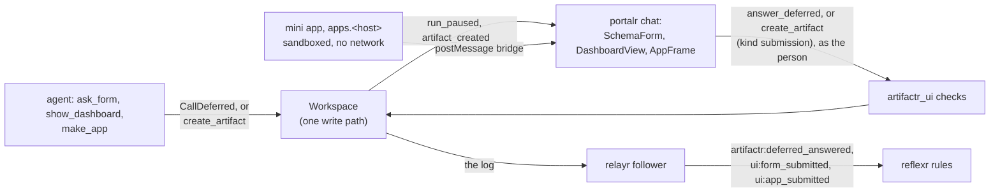

# RFC-0005: Forms, dashboards and mini apps in the chat

**Status:** Draft
**Author:** Alex Nodeland
**Created:** 2026-10-17
**Discussion:** [#334](https://github.com/alexnodeland/lattice/pull/334)
**Siblings:**

- [artifactr ADR-0010][a-adr-0010] is the pause this builds on: a deferred tool, its requests recorded in `run_paused`, an answer from any surface, and one run across the pause.
- [artifactr ADR-0003][a-adr-0003] is the extension point: forms, submissions, dashboards and apps are artifact types of a package outside artifactr.
- [relayr ADR-0018][r-adr-0018] is the bridge's shape: one event per envelope, its id kept, and `Projections` that map a kind to the application's own events.
- [lattice RFC-0003](0003-native-files-as-artifacts.md) is the precedent for a separate distribution beside artifactr, and for an editor on an origin of its own.

## Summary

A new package, `artifactr-ui`, lets an agent put interactive UI in the chat: forms richer than `ask_user`, dashboards, and sandboxed mini apps. Forms and dashboards are data, a JSON Schema 2020-12 subset with UI hints and a panel list, which portalr renders with its own components. Only a mini app is HTML, and it runs in a sandboxed frame on a cookie-less origin of its own, with no network. Whatever a person does in any of them is one artifactr command, as that person, so it lands in the workspace's log and relayr carries it to reflexr. A form is asked two ways: `ask_form` pauses the run until it is answered, and a form artifact takes submissions without a run waiting. relayr bridges `deferred_answered`, which it leaves out today. The shapes are borrowed from MCP Apps (SEP-1865), so `artifactr.mcp` can later serve the same UI to other hosts as `ui://` resources. This is in lattice's series because it adds a package and changes artifactr, relayr, portalr and stackr. It is built after v0.1.

## Motivation

- **`ask_user` asks one question at a time.** It takes a string and a few suggested answers, and portalr renders it as one text field ([portalr ADR-0015][p-adr-0015]). An agent that needs a date, a severity, three checkboxes and a note asks four times, and parses free text each time.
- **Agents report in prose.** A run that measured something says so in Markdown. portalr has charts with one theme, a colour-blind mode and "Show the figures" ([portalr ADR-0036][p-adr-0036]), but an agent can't use them in the chat.
- **Some interaction isn't a form.** A calculator, a layout to arrange, or a small game needs code. Today an agent can only describe it.
- **Answers don't reach reflexr.** relayr's `BRIDGED` has eight types, and `deferred_answered` is not one of them, so a rule can't react to what a person answered.
- **A standard has settled.** MCP Apps (SEP-1865, extension `io.modelcontextprotocol/ui`) has been stable since 2026-01-26, and MCP-UI is now an SDK for it. Its shapes are worth borrowing now; its transport is not portalr's.

## Non-goals

- **No code from a model in portalr's origin.** Forms and dashboards are data; portalr's components render them. Only mini apps run code, and never on portalr's origin.
- **No full JSON Schema,** no generic schema-form library, and no layout language: the subset below, and hints that name the kit's components.
- **No network from a mini app,** and no app that calls a model, a tool or a server. What it does is through the host, as the person viewing it.
- **No MCP client in lattice.** portalr doesn't render MCP Apps from other servers. Exporting lattice's UI over `artifactr.mcp` is phase 3.
- **No plugin loader.** The application registers the package's types, toolset, checks and projections, as it registers everything else.
- **No published TypeScript package.** The renderers live in `@portalr/ui`, which stays private.
- **`ask_user` stays** for a plain question.

## Design

### Overview



- **One loop for all three.** A person acts; portalr sends one artifactr command as them; a check in the package refuses what doesn't fit the form; the command commits through the one write path ([artifactr ADR-0002][a-adr-0002]); relayr's follower bridges the event; a rule or the resumed turn reacts.
- **The browser never talks to relayr.** The log is the outbox, and the follower is the hop, as for every other bridged event.
- **The frame never talks to the server.** A mini app asks the host, through `postMessage`; the host sends the command over portalr's existing connection, with the viewer's own credentials.

### The package

*Amendment (2026-10-17): by the owner's packaging decision, lattice's integrations are not distributions of their own. The package below is `artifactr.ui`, a layer of artifactr installed by its `forms` extra, `artifactr-ai[forms]` ([artifactr ADR-0074](../artifactr/adr/0074-forms-and-dashboards-in-artifactr-ui-behind-the-forms-extra.md)), and its `[relayr]` extra is relayr's `relayr.ui`, behind `relayr-ai[forms]` ([relayr ADR-0033](../relayr/adr/0033-one-event-for-both-ways-of-asking.md)). Where this RFC names `artifactr-ui`, `artifactr-ui-ai` or `artifactr_ui`, including O1, read those; the wire schema is `packages/artifactr/schemas/artifactr_ui.v1.json`.*

`packages/artifactr-ui/` holds the schema subset and its validator, the artifact types, the agent toolset, the checks, and two extras: `[relayr]`, the projections, and later `[mcp]`, the export.

- **A separate distribution,** for RFC-0003's reasons: it is a domain extension with its own types, tools and a hosted origin, and artifactr's dependencies stay as they are for an application that shows no UI. It is not an adapter of an artifactr port, so [artifactr ADR-0034][a-adr-0034]'s extras don't apply.
- **It depends inward only.** It imports names in `__all__` of `artifactr`, `artifactr.core`, `artifactr.agent` and `artifactr.workspace`; its `[relayr]` extra imports `relayr`. Nothing imports it. Its `tests/test_layering.py` holds that, as relayr's does.
- **Its PyPI name is `artifactr-ui-ai`,** with the suffix artifactr's and `artifactr-files-ai`'s carry, imported as `artifactr_ui`. `artifactr-ui`, `artifactr-ui-ai` and `artifactr-forms-ai` were free on PyPI on 2026-10-16. It is a release-please component of its own, first released as 0.1.0 ([lattice ADR-0006](../adr/0006-release-please-first-versions-pre-1-0-bumps-and-what-releases.md)).
- **Its wire schema is committed,** as `packages/artifactr-ui/schemas/artifactr_ui.v1.json`, drift-tested as artifactr's is, and added to `SCHEMAS` in portalr's `web/client/scripts/generate.ts`, which writes `client/src/generated/artifactr_ui.v1.ts`. portalr's Python doesn't depend on it, as it doesn't depend on artifactr.

```python
from artifactr_ui import UI_TYPES, ui_checks
from artifactr_ui.agent import ui_tools

workspaces = Workspaces(storage, types=[*app_types, *UI_TYPES], checks=ui_checks(), ...)
agent = Agent(
    model,
    toolsets=[ui_tools(forms=True, dashboards=True, apps=False)],
    capabilities=[ArtifactWorkspace(types=[*app_types, *UI_TYPES])],
)
```

### The schema subset and UI hints

A form is a `FormSchema`: a JSON Schema 2020-12 object with a separate `ui` object. Models write JSON Schema well, Pydantic emits it, and `json-schema-to-typescript` reads it.

| Keyword | Allowed |
|---|---|
| The root | `type: "object"`, `title`, `description`, `properties`, `required`; `additionalProperties` is false whether or not it is written |
| `string` | `minLength`, `maxLength` (at most 10,000), `format` of `date`, `date-time`, `email` or `uri`, `default` |
| Choices | `enum` of strings, or `oneOf` of `{const, title}` for labelled choices |
| `number`, `integer` | `minimum`, `maximum`, `exclusiveMinimum`, `exclusiveMaximum`, `multipleOf`, `default` |
| `boolean` | `default` |
| `array` | Of choices only: `items` with `enum` or `oneOf`, `uniqueItems`, `minItems`, `maxItems` |
| Every property | `title`, `description` |

- **Refused, with the keyword named:** `$ref`, `$defs`, nested objects, `pattern`, `if`/`then`/`else`, `allOf`, `anyOf`, `not`, and `format: "password"`. The validator is an allow-list, so a keyword not in the table is refused, not ignored.
- **Limits:** 50 properties, 64 choices a property, 32 KB of schema, and 64 KB of submitted values.
- **`ui` hints** name how each property is shown and nothing else: `widget`, `placeholder`, `help`, `order`, `sections` (titled groups of property names), and the form's `submit_label`. A hint names a component; it never carries a colour, a class, HTML or a URL.
- **Validation is the package's,** in Python with no third-party validator: it compiles a `FormSchema` to a Pydantic model once, and validates values with it. The TypeScript side validates the same subset before sending, so a person sees errors at once; the server's check is the one that counts.

### The artifact types

| Kind | Holds | Write policy |
|---|---|---|
| `form` | `title`, `schema` (a `FormSchema`), `submissions`: `once`, `per_person` or `many`, `closed` | The default |
| `submission` | `form_id` or `app_id`, the target's `version`, `values` | The default; created by a person |
| `dashboard` | `title`, `panels`, `as_of` | The default |
| `app` | `title`, `summary` (its text fallback), `html`, `state` | The default; no review gate (Decision O6) |

- **A submission's id is derived,** so the policy is held by artifactr's refusal of an id that exists (the pattern of [artifactr ADR-0045][a-adr-0045] and [relayr ADR-0019][r-adr-0019]): `sub_` and a digest of the form's id with nothing more for `once`, with the person's principal for `per_person`, and with a `nonce` the client makes once per submit and stores in the submission's data for `many`, so a retried submit is one artifact and the check can recompute the id. The check below refuses a submission whose id isn't its derivation.
- **A submission names the version it was made against.** A form edited since is "changed": the check refuses it, and portalr shows "This form changed" with the new one.
- **Submissions are as visible as their thread,** or their workspace ([grantr ADR-0003][g-adr-0003]). A form asking for anything sensitive belongs in a restricted thread ([artifactr ADR-0062][a-adr-0062]).

### The agent's tools

`ui_tools` makes an application toolset, registered on the agent ([artifactr ADR-0017][a-adr-0017]).

- **`ask_form(title, schema, ui=None)`** checks the schema, then raises `CallDeferred`, so the run pauses with a `DeferredRequest` whose `args` are the tool's own: no core change, since `args` already carry any JSON. The answer is the values, already checked, and the run resumes with them as the tool's result. A schema the subset refuses goes back to the model as a retry, before anything pauses.
- **`create_form(title, schema, ui=None, submissions="once")`** makes a form artifact in the thread and returns its id, for a poll, a sign-up or a form that outlives the run. The agent reads its submissions as artifacts, or a rule reacts to them.
- **`show_dashboard(title, panels)`** and **`update_dashboard(id, panels)`** make and replace a dashboard, a new version each time.
- **`make_app(title, summary, html)`** and **`update_app(id, html)`** exist only in phase 2, and only when the application turns apps on.

### Checks: refusing at the boundary

Core may not import a schema validator, and an answer or a new artifact is recorded as given today: `_answer` checks that the run is paused, the request exists and is unanswered, and its kind matches, and nothing about the answer itself. The package refuses a bad submission before it is recorded, through one additive hook in artifactr.

- **`Workspaces(checks=...)`:** a mapping from a command type to an async check, `(workspace, actor, command) -> None`, run after `authorize` and before the commit. It may read the workspace as the actor and raise `ValidationFailed` or `InvalidState`. A check that raises anything else fails the command, as a hook's error does.
- **`ui_checks()`** checks `answer_deferred` on a request whose `tool_name` is `ask_form`, against the schema in its `args`; and `create_artifact` of kind `submission`, by reading the form at its head as the submitter: the form exists and the submitter may read it, it isn't closed, the version is the head's, the values are valid, and the id is its derivation.
- **A refusal is typed and goes back to the person.** portalr shows a field's refusal under the field, through `FormField`, and moves the focus to the first. A second answer to the same request is `InvalidState`, as today, and portalr shows "Already answered", with who answered.
- **Edits are checked too.** A person's `edit_artifact` on a `submission` is refused, so no one rewrites another's values; a form's `closed` and `schema` change only by its author or a workspace admin; and a person's edit of an `app` is allowed under `/state` only, so the `html` that runs is always an agent's.
- **A chat message doesn't answer an `ask_form`.** Today the runner's `_reply` turns a message posted while a run is paused into an answer to every open question, and catches only `InvalidState`. It skips requests whose tool is `ask_form`, so the run stays paused until the form is sent, and the check's `ValidationFailed` never reaches the planner.
- **A check is not a lock.** A form closed between the check and the commit takes one late submission; whoever reads submissions keeps the form's `closed` in mind.

### Who submits, and attribution

- **Any person with access to the thread may submit,** attributed to them: their actor is the envelope's (Decision O5). Access is the command's own action, `artifactr:answer_deferred` for `ask_form` and `artifactr:create_artifact` for a submission, both editors' today, granted on the workspace or on a shared thread ([grantr ADR-0002][g-adr-0002], [portalr ADR-0022][p-adr-0022]). A viewer reads a form and doesn't submit it (see the unresolved questions).
- **A resumed run acts for whoever answered** ([artifactr ADR-0057][a-adr-0057]). So the person who submits an `ask_form` starts the run's next segment, with their own access: a person who may not start a turn has their answer refused before it is posted, as today.
- **A submission is untrusted text** to the model and to rules, as a message or a tracker's comment is. Agents' requests carry the gateway's `prompt-injection` guardrail, as they do for chat.

### relayr

- **`deferred_answered` is bridged,** as `artifactr:deferred_answered` in `BRIDGED`, with `turn_id` (from the event's `run_id`, since a person's envelope has none), `tool_call_id`, `tool_name`, `answer`, `approved` and the author, its id the envelope's ([relayr ADR-0018][r-adr-0018]). When a rule's run asked, the follower maps the run through the ledger, and the answer joins that run's chain without causation, as a person's answer to a proposal does ([relayr ADR-0021][r-adr-0021]); an answer to a chat turn starts no chain. `run_paused` stays unbridged: a rule reacts to what a person did, not to a run waiting.
- **artifactr's `DeferredAnswered` gains `tool_name`,** additively, copied from the request by `_answer`. Without it the bridged event can't tell an `ask_form` answer from an `ask_user` reply or an approval, and the follower would have to keep `run_paused` to join them.
- **`Projections` gains a mapping per deferred tool name,** beside its mappings per artifact kind and `app_event` name, amending relayr ADR-0018. A mapped answer replaces `artifactr:deferred_answered` for that tool, as a kind's mapping replaces its artifact events.
- **The `[relayr]` extra ships `UI_PROJECTIONS`:** `ask_form` answers and `submission` artifacts both become `ui:form_submitted`, and a submission to an app `ui:app_submitted`, under `UiEvent(Event, abstract=True, event_namespace="ui")`, with `UI_EVENTS` for reflexr's `Workspaces(events=...)`. A kind's mapping sees its `artifact_changed` and `artifact_archived` as well, and returns None for a submission's. A rule is written once for both ways of asking:

| Event | From | Carries |
|---|---|---|
| `ui:form_submitted` | An `ask_form` answer, or a `submission` to a form | `values`, `author`, `thread_id`, and `form_id` and `version`, or `turn_id` and `tool_call_id` |
| `ui:app_submitted` | A `submission` to an app | `values`, `author`, `thread_id`, `app_id`, `version` |

- **`ui:` is reserved** to the publisher relayr's follower publishes as, through reflexr's `publishers=` ([reflexr ADR-0057][x-adr-0057]), so no client can publish a form's submission itself. The follower publishes every envelope, projected ones included, as `SourceActor(name="artifactr")`, so the entry is `publishers={"ui": [SourceActor(name="artifactr")]}`.

### The component catalogue

Every renderer is in `@portalr/ui`, built from the kit's components and tokens. portalr's renderer registry by kind (lattice RFC-0002) gains `form`, `submission`, `dashboard` and `app`; the chat renders a paused `ask_form` request through `SchemaForm` where `tool_name` is `ask_form`, and every other request as it does today.

| Schema | Default | `widget` may say | Component |
|---|---|---|---|
| `string` | One line | `textarea` | `TextField`; a `TextArea` the kit gains on `FormField` |
| `string`, `format` `date` or `date-time` | Date | | `TextField` with the browser's date input |
| `string`, `format` `email` or `uri` | One line | | `TextField` of that input type |
| Choices, up to five, required or with a default | Segments | `select` | `SegmentedFilter` |
| Other choices | Select | | `SelectField` |
| Array of choices | Checkboxes | | `CheckboxGroup` |
| `boolean` | Switch | `checkbox` | `Switch` |
| `number`, `integer` | Number | | `TextField`, `inputmode` numeric |

Dashboard panels, each a component that exists today:

| Panel | Holds | Component |
|---|---|---|
| `stat` | A label, a value, a unit, a change | `StatCard` |
| `bar`, `line`, `donut` | Rows and up to three series (`MAX_SERIES`), the rest folded into "Other" | `BarChart`, `LineChart`, `DonutChart` |
| `table` | Columns and up to 500 rows | `Table` |
| `text` | Markdown | `Markdown`, no raw HTML ([portalr ADR-0015][p-adr-0015]) |
| `form` | A form artifact's id | `SchemaForm` |

- **A button is a form with no fields,** so a dashboard's actions are submissions, and reach a rule as `ui:form_submitted`.
- **Dashboards are snapshots in phase 1.** The agent writes the figures into the artifact, and `as_of` says when they were true. Panels that query portalr's readers live, as the viewer, are later: they tie the schema to the readers' names, and a snapshot needs nothing new in portalr's server. A dashboard is capped at 256 KB, since every version is in the log and relayr bridges it.

### Mini apps

A mini app is one HTML file, written by the agent, run for anyone who opens the thread. There is no review gate (Decision O6): the sandbox and the policy carry the whole weight, so each layer assumes the one before it failed.

- **An origin of its own: `apps.<host>`.** stackr's edge serves a static sandbox proxy there, the same release's build, with no cookies set or read for that name and nothing else served from it, as RFC-0003's editor is served. `apps.<host>` is the same site as portalr, so portalr and the edge set host-only cookies alone, never with `Domain=`, and portalr's session stays in `localStorage`, which another origin can't read. portalr's CSP gains `frame-src` for that origin alone, from `Site`, and `frame-ancestors 'none'` stays on portalr's own pages.
- **Two frames, as MCP Apps requires of web hosts.** The outer frame is the proxy, on `apps.<host>`, with `sandbox="allow-scripts allow-same-origin"`, which is safe only because the origin holds nothing. It loads the app into an inner frame with `sandbox="allow-scripts"` and nothing more: an opaque origin, no forms, popups, modals, downloads or top navigation.
- **No network.** The proxy is served with `default-src 'none'` and its own script's hash, and prepends a `<meta>` policy to the app's HTML; an inner `srcdoc` frame inherits the proxy's policy as well, and policies only add restrictions, so the app can't loosen either. The inner document's policy is `default-src 'none'`, with inline script and style, `data:` images and fonts, and `connect-src 'none'`, `form-action 'none'` and `base-uri 'none'`. The package refuses an app whose HTML names an external URL, as a first filter; the policy is the guard. Phase 2's exit includes a test that `fetch`, `WebSocket`, `EventSource`, an image or CSS beacon, `<a ping>`, prefetch and WebRTC all fail.
- **Limits:** the HTML at most 256 KB, `state` at most 64 KB, one file, a bridge message at most 64 KB, and 60 bridge calls a minute per frame, after which the host stops answering it.
- **The bridge is MCP Apps' methods,** JSON-RPC over `postMessage`: `ui/initialize`, `tools/call`, `ui/open-link`, `ui/notifications/size-changed`, and `ui/notifications/host-context-changed` from the host. The host checks `event.source` and the origin of every message and drops anything else. `tools/call` reaches three tools only, each marked `visibility: ["app"]`: `get_state`, `set_state` (a JSON Patch on the app's own `state`, an `edit_artifact` as the viewer, versioned) and `submit` (a `submission` to the app). An app reaches no other artifact, thread or tool. `set_state` is coalesced to at most one version every five seconds, and refused for a viewer who may not edit the artifact.
- **A submission is confirmed by the person.** The host shows what will be sent, as text, in its own dialog outside the frame, before it sends. A link is opened only after the host's own confirmation, with the full URL shown.
- **Labelled by the host, outside the frame:** "Made by the agent. Runs sandboxed and can't reach the network", with the run and version that made it, and a border the app can't draw over. The `summary` is always beside it.
- **A kill switch at three levels.** The deployment's setting turns apps off everywhere, the tenant's for one tenant, and archiving an app's artifact for one app. Off, the chat shows the label and the summary, and nothing runs. The toolset offers `make_app` only when apps are on.

### Accessibility

Forms and dashboards are held to portalr's standard because they are portalr's components.

- **The kit's tests apply:** in Chromium in both schemes, text at 4.5:1, the focus ring at 3:1 on every surface ([portalr ADR-0009][p-adr-0009]); the controls' keyboard as [portalr ADR-0037][p-adr-0037] has it; nothing told by colour alone, no icon without its word, and colours that settle under reduced motion ([portalr ADR-0019][p-adr-0019]).
- **A form is a form:** a label per field, a hint and a refusal described by `FormField`, required fields said in words, errors announced and the focus moved to the first. A paused request takes the focus once as it appears ([portalr ADR-0015][p-adr-0015]).
- **Every chart has its figures** under "Show the figures", the keyboard's and the screen reader's equivalent, and keeps its text alternative ([portalr ADR-0036][p-adr-0036]).
- **A mini app can't be held to it.** The host gives its frame a title, keeps the label and summary as a text equivalent, and keeps the frame reachable and leavable by the keyboard. Phase 2 runs an automated accessibility pass on the example apps; it can't for an agent's.

### Theming and colour-blind mode

- **Native renderers take tokens only.** A hint carries no colour, so a form and a dashboard follow the scheme, the brand roles and the density as the rest of portalr does.
- **Colour-blind mode needs nothing new** for dashboards: `data-cvd` sets the chart's custom properties, and the charts write no literal colour ([portalr ADR-0036][p-adr-0036]).
- **A mini app is given the tokens.** The host sends `host-context-changed` with the scheme, `data-cvd`, reduced motion, and portalr's roles as CSS variables under both portalr's names (`--paper`, `--fg`, `--accent`, `--chart-1`) and MCP Apps' (`--color-background-primary` and the like), again whenever any of them changes. An app that ignores them still runs; its label says what it is.

### MCP Apps, now and later

- **Borrowed now:** the bridge's method names and its host context, `visibility` on tools, a declared policy per app, and the two-frame proxy. portalr speaks them over its own `postMessage` host, not over MCP, and depends on neither `@modelcontextprotocol/ext-apps` nor `@mcp-ui/client` in phase 2: the bridge is a few hundred lines, and the spec is young.
- **Exported later:** `artifactr_ui.mcp`, behind `[mcp]`, serves form, dashboard and app artifacts from `artifactr.mcp` as `ui://` resources of type `text/html;profile=mcp-app`, through the `mcp` SDK's `mcp.server.apps`. A form or dashboard is served as a small generated page; an app as its own HTML with its policy in `_meta.ui.csp`. A submission from an external host lands as the same command. `ArtifactrMcp` builds its `MCPServer` itself today, so it needs an `extensions=` argument first.

### What changes in each package

| Package | Changes | Breaking |
|---|---|---|
| artifactr-ui | New | |
| artifactr | `Workspaces(checks=...)`; `DeferredAnswered.tool_name`; `_reply` skips `ask_form` requests; `ArtifactrMcp(extensions=...)` in phase 3 | No: each is additive |
| artifactr's ADRs | New: the checks hook. Amended: ADR-0010 (an answer may be refused by the application's check) and ADR-0055 (a message doesn't answer a form) | |
| relayr | `DeferredAnswered` in `BRIDGED`, its run mapped to a chain through the ledger; `Projections` per deferred tool name | No |
| relayr's ADRs | Amended: ADR-0006 and ADR-0018 (a ninth bridged type, and a third kind of mapping) | |
| reflexr | Nothing: `events=` and `publishers=` exist | |
| grantr | Nothing in phase 1; a respondent's action only if the unresolved question below says so | |
| portalr | `SchemaForm`, `TextArea`, `DashboardView`, `AppFrame` and the bridge host in `ui`; renderers for the four kinds; `ask_form` in the chat; `frame-src` from `Site`; `artifactr_ui.v1` in `generate.ts` | No |
| stackr | The template's `ui` question, wiring the types, toolset, checks and projections; in phase 2, `apps.<host>` at the edge and the apps setting | No |
| lattice-core | Nothing | |

### Phases

Built after v0.1, which artifactr, reflexr, evalr and grantr have reached.

| Phase | Deliverable | Exit criteria |
|---|---|---|
| 1. Forms and dashboards | The package: schema subset and validator, the four types (`app` defined, not offered), `ask_form`, `create_form`, `show_dashboard`, the checks; artifactr's hook and `tool_name`; relayr's bridged type and projections; portalr's `SchemaForm`, `DashboardView`, renderers and `TextArea`; the template's `ui` question | A `bdd` scenario asks a form, has it refused with a field's error, answers it and resumes; a rule fires once on `ui:form_submitted` from each way of asking; a retried submit is one artifact and one event; a stale tab gets "This form changed" and "Already answered"; a poll in a shared thread takes one submission per person; a two-tenant test reads nothing across tenants; the kit's tests pass in both schemes and colour-blind mode; and each item of [Unverified](#unverified) is settled in an ADR |
| 2. Mini apps | `make_app`; the proxy, the policy and `apps.<host>` in stackr; `AppFrame` and the bridge host; the label, the limits and the kill switch | Every network path listed above fails from the frame in Chromium; a forged or foreign `postMessage` is dropped; an app reaches no artifact but its own; a submission needs the person's confirmation; a person's edit of an app's `html` is refused; the kill switch stops a running app at each level; portalr's own pages still refuse framing |
| 3. MCP export | `artifactr.mcp`'s `extensions=`; `artifactr_ui.mcp` | A form and a dashboard render in one external host, and its submission lands as the same command and event |

## Decisions

Decided by the owner on 2026-10-17:

| # | Question | Decided | Instead of |
|---|---|---|---|
| O1 | Packaging | A new distribution, `artifactr-ui-ai`, imported as `artifactr_ui` | `artifactr-forms-ai`; tools beside `ask_user` in artifactr's agent layer |
| O2 | Phase 1 | Forms and dashboards together | Forms alone first |
| O3 | Rendering | portalr's own components for forms and dashboards; sandboxed HTML for mini apps only | Sandboxed HTML for everything, as MCP Apps renders it |
| O4 | Schema | A JSON Schema 2020-12 subset with separate UI hints | A form language of our own; full JSON Schema through a generic renderer |
| O5 | Who submits | Any person with access to the thread, attributed to them | Only the person the turn acts for |
| O6 | Mini apps' review | The sandbox and the policy, hardened: an origin of its own with no cookies, no network, sandbox attributes, limits, a kill switch, labels | A person accepting each version, through the `propose` write policy |
| O7 | Where a form lives | `ask_form` on the pause, and form artifacts | Only one of them |
| O8 | Reaching reflexr | relayr bridges `deferred_answered` | The resumed tool recording an `app_event` |
| O9 | MCP Apps | Borrow its shapes now; export `ui://` over `artifactr.mcp` later | Adopting its iframes and SDKs in portalr now |
| O10 | Timing | This RFC now; building after v0.1 | Building now |

Recommended, for the maintainer to decide:

| # | Question | Recommended | Instead of |
|---|---|---|---|
| U1 | Refusing a bad submission | A check hook on `Workspaces`, which the package fills | A core `submit` command, a core release and a schema validator in core; or recording anything and leaving every consumer to re-check |
| U2 | One event for both ways of asking | `ui:form_submitted`, through a projection per deferred tool name | Rules that listen for both `artifactr:deferred_answered` and `artifactr:artifact_created` |
| U3 | Dashboards' data | Snapshots in the artifact in phase 1 | Live panels over portalr's readers |
| U4 | The bridge host | portalr's own, on MCP Apps' methods | `@modelcontextprotocol/ext-apps`'s `AppBridge` or `@mcp-ui/client`'s `AppRenderer` |

## Drawbacks

- **An agent's code runs for others without a person approving it** (O6). A flaw in the sandbox, a browser bug, or a policy that slips reaches every viewer of the thread. The origin holds nothing to steal and the frame can reach no network, so the worst left is a misleading app, which the label and the confirmation answer, and a denial of service in one tab.
- **Mini apps can't be held to portalr's accessibility,** and a summary is a weaker equivalent than a form.
- **`deferred_answered` bridged by default widens what rules see:** every answer, including free text to `ask_user`.
- **A pause has no deadline.** A form nobody answers leaves its run waiting, as `ask_user` does today.
- **A check reads before it commits,** so a form closed in between takes one late submission.
- **One more origin to host,** with its certificate, and a policy whose tests are the only proof it holds.
- **A model can still phish.** `format: "password"` is refused and every form is labelled as the agent's, but a text field labelled "API key" is not.

## Alternatives

- **MCP Apps for everything.** One renderer and the same UI in other hosts, but every form an iframe: theming, accessibility and the policy paid for each, and portalr tied to a young spec. Kept as the export (phase 3).
- **remote-dom,** host components driven by a script in a worker. Native looks, but it still runs a model's code, and adds a protocol of its own.
- **A generic schema-form library** (rjsf) over full JSON Schema. Covers more, renders less like the kit, and opens keywords no model needs.
- **Apps in `srcdoc` on portalr's origin.** One origin less, and RFC-0003's lesson: a sandbox mistake there reaches portalr's cookies.
- **An origin per tenant or per app,** as some hosts give each app a hashed subdomain of its own. Stronger isolation between apps, at the cost of wildcard DNS and certificates; nothing an app could take from another is on `apps.<host>`.
- **An extra of artifactr,** or tools beside `ask_user` (O1). Fewer packages, and artifactr's dependencies and docs grow for everyone.
- **AG-UI, Adaptive Cards or Slack's Block Kit** as the format. Block Kit's lesson, data and limits rather than code, is taken; neither format is what models already write.

## Unresolved questions

- **Should a viewer be able to submit?** Today both commands are an editor's, so a thread shared read-only shows a form its reader can't send. A `artifactr_ui:submit` action, held by a respondent role, would answer it, at the cost of an action of its own in grantr's catalog.
- **A deadline for `ask_form`,** as a reflexr schedule that answers "expired", never a timer in memory.
- **Live dashboard panels,** over portalr's readers as the viewer, once a snapshot proves too stale.

### Unverified

Each is a phase 1 or phase 2 exit criterion, settled and recorded in an ADR.

- **pydantic-ai keeps a 32 KB schema** in a `CallDeferred` call's arguments through `run_paused`, storage and resume, unchanged.
- **Reserving `ui:`** to the follower's actor refuses every client's attempt to publish one.
- **The browser's behaviour:** a `sandbox="allow-scripts"` frame inside the proxy, under portalr's `frame-src`, blocks every network path listed above in Chromium, and the inherited and declared policies combine as intended.
- **`mcp.server.apps`** in the `mcp` SDK serves `text/html;profile=mcp-app` resources with `_meta.ui`, and one external host renders them.

## Tracking

- [ ] Sign-off on U1 to U4
- [x] artifactr: `Workspaces(checks=...)` and `DeferredAnswered.tool_name`, with an ADR
- [x] relayr: `artifactr:deferred_answered` in `BRIDGED`, and projections per deferred tool name
- [x] artifactr-ui: the package, schema subset and validator, types, toolset, checks, `[relayr]` extra, committed schema
- [ ] portalr: `SchemaForm`, `TextArea`, `DashboardView`, the renderers and `ask_form` in the chat; `generate.ts`
- [x] stackr: the template's `ui` question
- [x] Phase 1's unverified items settled, in an ADR
- [ ] Mini apps: the proxy, `apps.<host>`, `AppFrame`, the bridge, the kill switch
- [ ] The MCP export
- [x] Docs: the package's guide and ADRs, and the architecture

*2026-10-17: the items above that name the package are met in `artifactr.ui` and `relayr.ui`, as the amendment under [The package](#the-package) says; its guide, ADRs and architecture are artifactr's and relayr's.*

## Evidence

Gathered on 2026-10-16 and 2026-10-17. lattice was read at `origin/main`; the web sources were read as untrusted data.

| Claim | Where | |
|---|---|---|
| `ask_user` raises `CallDeferred` with `kind`, `question` and `choices` | `artifactr/agent/tools.py` | Verified |
| A `DeferredRequest`'s `args` are the call's own arguments; `kind` is `question` or `approval` | `artifactr/agent/capability.py` `_requests`, `artifactr/core/events.py` | Verified |
| `_answer` refuses a second answer, a run not paused and a mismatched kind, and checks nothing else | `artifactr/core/rules.py` | Verified |
| A resume passes each answer as the tool's result | `artifactr/agent/runner.py` | Verified |
| `DeferredAnswered` has no `tool_name` | `artifactr/core/events.py` | Verified |
| Creating an artifact whose id exists is `InvalidState` | `artifactr/core/rules.py` `_apply_create` | Verified |
| `BRIDGED` has eight types, without `deferred_answered` | `relayr/events/types.py` | Verified |
| `answer_deferred` and `create_artifact` are editors' commands | `grantr/core/roles.py` `EDITOR_COMMANDS` | Verified |
| The chat renders a question from `request.args.question` | `portalr/web/ui/src/chat.tsx` | Verified |
| portalr's policy has no `frame-src` and `frame-ancestors 'none'` | `portalr/fastapi/ui.py` | Verified |
| `generate.ts` writes types from a list of committed schemas | `portalr/web/client/scripts/generate.ts` | Verified |
| A chart holds at most three series | `portalr/web/ui/src/chart-theme.tsx` `MAX_SERIES` | Verified |
| MCP Apps is stable since 2026-01-26 as `io.modelcontextprotocol/ui`; `ui://`, `text/html;profile=mcp-app`, `_meta.ui`, the two-frame proxy for web hosts, and the bridge's methods | `modelcontextprotocol/ext-apps`, `specification/2026-01-26/apps.mdx` | Verified |
| MCP-UI 6.0.0 moved onto MCP Apps; `@mcp-ui/client` 7.1.1; `@modelcontextprotocol/ext-apps` 2.0.3, its licence metadata inconsistent | Its changelog; npm | Verified |
| The `mcp` SDK 2.3.0 has `mcp.server.apps` | Its documentation | Verified; behaviour unverified |
| The follower publishes every envelope, projected ones included, as `SourceActor(name="artifactr")` | `relayr/inbound/followers.py` | Verified |
| A message posted while paused answers every open question; only `InvalidState` is caught | `artifactr/agent/runner.py` `_reply` | Verified |
| `artifactr-ui-ai` was free on PyPI | PyPI, 2026-10-16 | Verified |

[a-adr-0002]: ../artifactr/adr/0002-single-write-path.md
[a-adr-0003]: ../artifactr/adr/0003-artifact-types-as-pydantic-subclasses.md
[a-adr-0010]: ../artifactr/adr/0010-pausing-with-deferred-tools.md
[a-adr-0017]: ../artifactr/adr/0017-application-toolsets-and-capability-events.md
[a-adr-0034]: ../artifactr/adr/0034-ports-and-adapters-for-integrations.md
[a-adr-0045]: ../artifactr/adr/0045-a-message-id-is-used-once.md
[a-adr-0057]: ../artifactr/adr/0057-a-turn-acts-for-one-author.md
[a-adr-0062]: ../artifactr/adr/0062-restricted-items-left-out-of-every-read.md
[g-adr-0002]: ../grantr/adr/0002-grants-down-to-threads-and-artifacts.md
[g-adr-0003]: ../grantr/adr/0003-visible-to-the-workspace-unless-restricted.md
[p-adr-0009]: ../portalr/adr/0009-ui-tested-in-chromium-in-both-schemes-under-bun.md
[p-adr-0015]: ../portalr/adr/0015-the-chat-components-and-streamdown.md
[p-adr-0019]: ../portalr/adr/0019-the-kits-look.md
[p-adr-0022]: ../portalr/adr/0022-restricting-and-sharing-a-thread.md
[p-adr-0036]: ../portalr/adr/0036-the-chart-theme-and-colour-blind-mode.md
[p-adr-0037]: ../portalr/adr/0037-form-controls-and-row-actions.md
[r-adr-0018]: ../relayr/adr/0018-bridged-events-their-fields-ids-and-projections.md
[r-adr-0019]: ../relayr/adr/0019-runs-act-once-through-derived-ids-and-keyed-edits.md
[r-adr-0021]: ../relayr/adr/0021-chains-continue-across-the-bridge.md
[x-adr-0057]: ../reflexr/adr/0057-reserved-publishers.md
