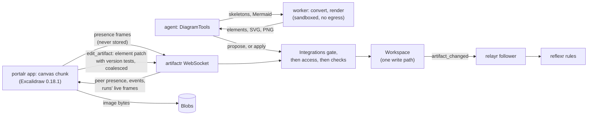

# RFC-0006: Excalidraw diagrams, drawn live by people and agents

**Status:** Draft, amended by [lattice ADR-0026](../adr/0026-a-distribution-needs-a-reason-integrations-are-extras.md)
**Author:** Alex Nodeland
**Created:** 2026-10-17
**Discussion:** [#356](https://github.com/alexnodeland/lattice/pull/356)
**Siblings:**

- [artifactr ADR-0003][a-adr-0003] asks that collections an agent edits be id-keyed mappings. An Excalidraw scene already is one, so a diagram is an ordinary JSON artifact.
- [artifactr ADR-0004][a-adr-0004] makes every edit name its base version and rejects locks. This RFC keeps both: [artifactr ADR-0071][a-adr-0071]'s lease stays a tool for opaque native files only.
- [lattice RFC-0003](0003-native-files-as-artifacts.md) gives this its `Blobs` port and its sandboxed worker. Its refusal of `'wasm-unsafe-eval'` on portalr's origin is amended by [portalr ADR-0041][p-adr-0041], for first-party, pinned WebAssembly only.
- [lattice RFC-0005](0005-forms-dashboards-and-mini-apps.md) proposes the check hook this extends, and keeps mini apps on their own origin, with no WebAssembly.

## Summary

A new package, `artifactr-excalidraw-ai`, makes an Excalidraw diagram an artifact that people and agents draw on together, live. A diagram is plain JSON, `elements: {id: element}`, and every edit is a JSON Patch scoped to the elements it touches, each guarded by a `test` of that element's `version`. Concurrent edits to different shapes never conflict after a cheap rebase, and nothing is locked. People draw on Excalidraw's canvas inside portalr's app, on its own origin, with its session and its WebSocket. They see each other's and the agents' cursors, selections and strokes as they happen, through new presence frames that are never stored. Their finished strokes commit as coalesced revisions, which every canvas merges with Excalidraw's own `reconcileElements`. Agents draw from Mermaid or from shape skeletons, which a headless worker converts, and propose by default. Images go to `Blobs`. A diagram's text alternative is computed from its elements, for the agent and for assistive technology alike. Every surface consults one shared `Integrations` port before access, so a workspace's admin can turn diagrams off and existing ones stay readable. This RFC changes artifactr, artifactr-files, portalr, grantr, lattice-core and stackr as well as adding a package, so it is in lattice's series.

## Motivation

- **People think in pictures, and agents can't draw with them.** A system's design, a flow or an incident timeline is a diagram. Today an agent can only describe one in prose, or emit Mermaid that portalr shows as text.
- **Excalidraw's model fits lattice's.** Its scene is JSON whose elements have stable ids and per-element versions. That is what ADR-0003 asks of a type, and what RFC-0003's future work says `rebase` needs: commands that name their targets by stable id. Unlike a `.docx`, a diagram needs no lease and no native application to be edited by an agent.
- **Drawing together is the point.** A diagram drawn by one person while another waits isn't how whiteboards are used. A person sketches, a colleague adjusts, and an agent tidies, in one scene, at the same time.
- **The pieces exist.** RFC-0003's phase 1 built `Blobs` and the worker's shape. artifactr's WebSocket already carries a workspace's events, commands with idempotent ids, and runs' live frames. Excalidraw exports `reconcileElements` and the collaborator API its own collaboration uses.

## Non-goals

- **No excalidraw.com, excalidraw-room, Excalidraw+ or the official Excalidraw MCP server,** which uploads to excalidraw.com. Nothing leaves the deployment (O8). Tool shapes are borrowed, not code.
- **No fork of Excalidraw.** The released `@excalidraw/excalidraw` 0.18.1, pinned, configured through its props.
- **No CRDT and no third patch kind.** The server orders every write ([ADR-0005][a-adr-0005]), and per-element tests do the rest.
- **No Mermaid in portalr.** Mermaid runs only in the worker; it is aliased out of portalr's build.
- **No model-authored code on portalr's origin.** RFC-0005's non-goal stands. ADR-0041 admits first-party, pinned WebAssembly only.
- **No comments drawn as elements.** Feedback anchors to an element by id, outside the drawing.

## Design

### Overview



There are two lanes. **The durable lane** is artifactr's: a commit is an `edit_artifact`, ordered by the server, kept as a revision, bridged by relayr. **The live lane** is new and ephemeral: pointers, selections and in-progress elements, fanned out to whoever has the diagram open and then forgotten. A person sees another's stroke as it is drawn, on the live lane, and the stroke lands in the log when it ends, on the durable lane.

### The package

`packages/artifactr-excalidraw/` holds the `Diagram` type, its element model, the patch builder, `render_for_agent`, `DiagramTools`, the package's checks, the `Converter` port with `FakeConverter` and the worker's client, `diagrams_router` (behind a `fastapi` extra) for images and export, and a `[relayr]` extra with projections.

- **A separate distribution (O2),** for RFC-0003's and RFC-0005's reasons. It depends inward on `artifactr` and on `artifactr-files` for `Blobs` and `Blob` only; nothing imports it. Its `tests/test_layering.py` holds that.
- **It is not a `NativeFile`.** A manifest over a blob would lose element-level patches and make every edit a check-out.
- **Its PyPI name is `artifactr-excalidraw-ai`,** imported as `artifactr_excalidraw`. Both it and `artifactr-excalidraw` were free on PyPI on 2026-10-17. A release-please component of its own, first released as 0.1.0.
- **Its wire schema is committed,** as `schemas/artifactr_excalidraw.v1.json`, drift-tested, and added to portalr's `generate.ts`, as RFC-0005's is.

> **Amended (2026-10-17) by [lattice ADR-0026](../adr/0026-a-distribution-needs-a-reason-integrations-are-extras.md):** diagrams are not a distribution of their own. O2 is decided as an extra of `artifactr-ai`, in the artifactr distribution, with their code a subpackage of `artifactr` that the rest of it never imports, turned on per workspace by the shared Integrations switch this RFC proposes. `artifactr-excalidraw-ai` and its release-please component are dropped; the extra's name and import path are settled where it is built. `artifactr-files` is now artifactr's `files` extra, `artifactr.files`, so `Blobs` and `Blob` come from there, within the same distribution. What else this section says holds.

> **Decided (2026-10-22):** the extra is `artifactr-ai[excalidraw]`, imported as `artifactr.excalidraw` (artifactr ADR-0086). Until images land, a diagram's images keep `Blob`'s shape, as its own `DiagramFile`, so that the data layer doesn't import the `files` extra.

### The artifact (O1)

```python
class Element(BaseModel):            # one Excalidraw element, as 0.18.1 writes it
    model_config = ConfigDict(extra="allow")
    id: Annotated[str, Field(pattern=r"^[A-Za-z0-9_-]{1,64}$")]
    type: str                        # any string: a newer type is kept, not refused
    version: int = Field(ge=1)
    versionNonce: int
    isDeleted: bool = False
    index: str | None = None         # fractional; never sort-validated
    updated: int | None = None


class Scene(BaseModel):              # what viewers share; zoom, scroll and tool are each viewer's
    view_background_color: str = "#ffffff"
    grid_size: int | None = None


class Diagram(Artifact):             # "excalidraw_diagram"
    write_policy: ClassVar[WritePolicy] = "propose"

    name: str = Field(max_length=200)
    elements: dict[str, Element]     # keyed by the element's own id
    files: dict[str, Blob] = {}      # keyed by the image's SHA-256, which is its fileId
    scene: Scene = Scene()
```

- **Permissive by design.** Only `id`, `type`, `version`, `versionNonce`, `isDeleted`, `index` and `updated` are validated; every other field is kept as written. Excalidraw's unreleased `main` already changes every arrow binding to `FixedPointBinding{elementId, fixedPoint, mode}`; a stored scene survives that, and the client's `restoreElements` migrates it on load. It is committed back only when someone edits it.
- **A key is its element's id.** The package's check refuses an element stored under another key.
- **Limits,** to be measured in phase 0: 5,000 elements and 1 MiB of data a diagram, since every revision stores its full data ([ADR-0004][a-adr-0004]) and relayr bridges it.
- **Tombstones are kept for a day.** A deleted element stays, with `isDeleted: true` and its version bumped, as Excalidraw keeps them. Removing it at once would let a client that was mid-edit resurrect it with an `add`. Purging is one server-side step, never the canvas's: a sweep, run as the application's actor, removes tombstones whose deleting revision is more than 24 hours old, aged by the revision's time on the server, never by the client's `updated`. A canvas treats a merged `remove` as final and drops the element locally rather than reconciling it back.
- **Bytes never enter the log.** `files` names `Blob`s, never data URLs.
- **No core change for the data (O1).** artifactr's data model, patch kinds and commit rules are untouched. What artifactr gains, the watch commands, presence frames and the gate, is O5's and O9's, at its transport and workspace layers.

### Edits: element-scoped JSON Patch with version tests

Every writer, person or agent, sends the same shape, which the package builds from a diff of the base and the new elements:

```jsonc
[
  {"op": "test",    "path": "/elements/r1/version", "value": 7},
  {"op": "replace", "path": "/elements/r1",         "value": {"id": "r1", "version": 8, ...}},
  {"op": "add",     "path": "/elements/a9",         "value": {"id": "a9", "version": 1, ...}},
  {"op": "add",     "path": "/files/3f1c...e2",     "value": {"sha256": "3f1c...e2", "size": 48213, "media_type": "image/png"}}
]
```

- **A stale direct edit fails on `base_version`,** as `VersionConflict`, since artifactr checks the version of the whole artifact. Its writer rebases: it already has the newer revisions, so it runs `reconcileElements(local, head)` and diffs the result against the head. Where its local element won, it sends it with `version` one above the head's and a new nonce; where the head's won, it drops its change. An empty diff is not sent, since an edit that changes nothing is `PatchFailed`. It resends with a new `command_id`. This is cheap because ids are stable.
- **The tests matter when a proposal is accepted.** Acceptance re-applies the stored patch to the head and checks no version, so a proposal whose tested element moved since fails whole, as `PatchFailed`. One that touched other elements applies. The agent therefore splits unrelated edits into separate proposals.
- **An element's version only grows.** The package's check refuses a `replace` whose element's `version` is not greater than the head's, on every surface. Excalidraw's reconciliation depends on it.
- **A new element is an `add`.** JSON Patch's `add` replaces a member that exists, so the check refuses an `add` of an id the head already has.
- **Files are added, never replaced,** since a file's key is its digest.
- **Summaries come from the diff:** "moved 3, relabelled 'DB'", passed as `summary=`.

### Live collaboration (O5)

Full live collaboration ships with the first release that portalr offers. It has five parts.

**1. Opening a diagram.** A new command, `WatchArtifact`, beside `WatchRun`, sent in an ordinary `CommandFrame` and handled by the transport, never by core's rules:

```python
class WatchArtifact(BaseModel):      # WebSocket only, as WatchRun is
    type: Literal["watch_artifact"] = "watch_artifact"
    artifact_id: ArtifactId

class UnwatchArtifact(BaseModel):
    type: Literal["unwatch_artifact"] = "unwatch_artifact"
    artifact_id: ArtifactId
```

The server answers `command_result` with a new outcome, `Watching`, carrying the caller's rights on it (`view` or `edit`), where `WatchRun` answers `Recorded`. It then sends the presence of everyone already there.

**2. Presence, client to server.** `ClientFrame` grows from `Hello | CommandFrame` to include a third frame:

```python
class Presence(BaseModel):
    type: Literal["presence"] = "presence"
    artifact_id: ArtifactId
    seq: int = Field(ge=0)                    # per connection, increasing
    base_version: int = Field(ge=1)           # the revision `editing` is relative to
    pointer: Pointer | None = None            # x, y, tool ("pointer" | "laser"), button
    selection: tuple[str, ...] = Field((), max_length=500)
    editing: tuple[dict[str, JsonValue], ...] = Field((), max_length=100)
```

`editing` is the elements a person is changing right now: the arrow mid-drag, the text mid-typing. Each is a full element, so a peer draws it as it is. A frame is at most 64 KB.

**3. Presence, server to client.** `ServerFrame` gains `PeerPresence`, the same fields plus `peer` (an opaque id per connection) and `actor` (the principal, stamped by the server, never taken from the client), and `PeerLeft`. portalr maps each peer to Excalidraw's `Collaborator` (`pointer`, `selectedElementIds`, `username`, `color`) through `updateScene({collaborators})`, and draws `editing` as an overlay of the peer's elements. A peer's last `editing` stays drawn until the local head reaches the version that peer committed, so a stroke doesn't flicker out between pointer-up and the revision's arrival.

**4. Agents are peers too, with no new frame.** An agent's tool emits the run's existing live frames: a `Draft` with `kind: "excalidraw_diagram"` and the `artifact_id`, holding the elements it is about to propose, as the worker returns them. The canvas already watches the runs of its workspace's threads, and shows the agent as a collaborator named after it, with the elements drawn as a labelled ghost until the proposal lands. Live frames share the connection's event queue, so the toolset emits at most one `Draft` a second per diagram, capped at 256 KB. An agent's ghost shows on connections whose `hello` covers its thread.

**5. From live to durable.** The canvas commits its own changes as `edit_artifact`, as the person:

- **Cadence.** On pointer-up, and after one second idle while there are unsaved changes, at most one commit a second per person and diagram; a flush when the tab is hidden or closed; a badge while anything is unsaved. Phase 0 measures the revision volume this makes and may lengthen it.
- **Ordering.** The server orders commits, and the transport runs each frame as its own task, so a canvas keeps one `edit_artifact` in flight per diagram. A commit's `base_version` is the head the canvas last merged. A `VersionConflict` is rebased as above, at most three times; after that the edit stays local under the unsaved badge and is retried on the next event, so nothing is lost. Phase 0 measures the conflict rate on a busy diagram. After a reconnect, a commit whose result never came is resent with its original `command_id`, which the server deduplicates.
- **Merging.** A foreign revision is merged with `reconcileElements(local, remote, appState)` and applied with `updateScene({elements, captureUpdate: CaptureUpdateAction.NEVER})`, so it never enters the local undo stack. In 0.18.1, reconcile keeps a local element that is being edited, resized or created, or that has a higher `version`, or the same version and a lower `versionNonce`, and takes the remote one otherwise. It then orders by fractional index and repairs invalid indices itself.
- **Echoes.** `command_result` carries `Applied.version`, so the canvas knows which revisions are its own and doesn't re-merge them. The event can arrive before the result. That is harmless, because merging one's own revision is idempotent: the local elements' versions are equal or higher, so reconcile keeps them.
- **Attribution.** A revision's actor is whoever committed it, as everywhere. Presence carries the server's stamp of the actor. "Last changed by" per element is derived from revisions, never stored in the element.

**Back-pressure.** Presence must never slow or close a connection that carries events.

- **Inbound:** a connection may send at most 30 presence frames a second across its watched diagrams, and the canvas sends at most 20. More are dropped, with one `error` frame. A frame for a diagram the connection isn't watching is dropped.
- **Outbound:** presence doesn't enter the connection's event queue, whose overflow closes the connection with 4429 today. Each watcher keeps one slot per peer and diagram, holding only the latest frame, older ones replaced by `seq`. The writer sends events first and presence after.
- **Liveness:** a canvas sends a frame at least every five seconds while open. A peer silent for ten seconds, or whose connection closes, is announced as `PeerLeft`.

**Authorisation, per frame:**

| Frame | Needs | Refused as |
|---|---|---|
| `watch_artifact` | The integration on (below); then `artifactr:read_artifacts` on it | `NotEnabled`; `NotFound` for a hidden or restricted artifact, exactly as a missing one |
| `presence` with a pointer or selection | A watch accepted on this connection | Dropped |
| `presence` with `editing` | A watch accepted with `edit` | Dropped, with one `error` frame |
| `edit_artifact` | The integration on; `artifactr:edit_artifact`; the package's checks | As today, and `NotEnabled` |
| Receiving a peer's presence | The same watch | |

Rights are read when the watch is accepted, and again every 30 seconds, which bounds how long a lost grant or a turned-off integration takes to end a watch, since both live in grantr, not in the log. A restriction in the workspace's log ends it at once. A watcher who loses read is sent `PeerLeft` for everyone and an `error`, and its watch ends.

**Replicas.** Presence goes through a new port, `PresenceChannel`, keyed by tenant, workspace and artifact, as `LiveChannel` is keyed by run. Its default is in-process, like `FanoutChannel`, so a deployment with one application process, stackr's default, needs nothing. A deployment with several processes adds the PostgreSQL adapter, over `LISTEN`/`NOTIFY` on the database it already runs, so no new infrastructure is needed. A notification's payload is at most 8,000 bytes by default, so a larger frame is written to a short-lived table and only its reference is notified. Commits from another process already arrive within the SQL storage's `poll_interval`, 0.5 s by default.

**The protocol stays `artifactr.v1`.** The new frames are additive. A server sends presence only to a connection that asked with `watch_artifact`, so an existing client never sees one. The committed schema and portalr's generated types are regenerated.

### Agents (O6)

`DiagramTools`, a pydantic-ai toolset ([ADR-0017][a-adr-0017]):

| Tool | Does |
|---|---|
| `render_for_agent` | Synchronous, no IO, at most 4,000 characters: frames, shapes with their labels, arrows as `A --label--> B`, free text, counts and the bounding box, computed from `elements`, never stored |
| `read_diagram(id, frame=None)` | Elements as compact JSON (id, type, label, x, y, w, h, bindings), paged |
| `draw_mermaid(id?, mermaid, summary)` | The worker runs `parseMermaidToExcalidraw`. Flowchart, sequence, class, ER and state diagrams become shapes; other kinds become one SVG image in `Blobs`. The default way to draw, as Excalidraw's own text-to-diagram has models write Mermaid |
| `draw(id?, skeletons, summary)` | Skeleton elements (type, x, y, `label`, `start` and `end` by id), which the worker turns into elements with `convertToExcalidrawElements` |
| `edit_elements(id, base_version, ops)` | Domain operations by id: move, restyle, relabel, connect, delete, group, put in a frame. Never raw JSON Patch ([ADR-0003][a-adr-0003]) |
| `view_diagram(id, frame=None)` | A PNG from the worker, cached; off unless the application turns it on, as RFC-0003's `view_page` |

- **Proposals by default, with a switch per application to apply** (O6). An application builds its type with `diagram_type(write_policy="apply")` for scratch diagrams; the default is `propose`. People's edits always commit directly, as write policies bind agents only ([ADR-0009][a-adr-0009]).
- **The package mints agents' elements' versions:** `version` one above the head's, a random `versionNonce`, and fractional indices after the head's last.
- **A refused edit goes back to the model:** `PatchFailed` names the elements that moved, so it re-reads them and tries again. A `VersionConflict` on an applied edit is rebased in the tool, at most three times.
- **The proposal is shown as an overlay** on the canvas, which is read-only while it shows: added elements outlined, removed ones struck, moved ones ghosted, each with a pattern and a word as well as a colour.

### The worker (O7)

Conversion and export need a DOM. In 0.18.1, `exportToSvg` calls `document.createElementNS`, PNG export draws on a `<canvas>`, and Mermaid renders into `document.body`. So agents and rules work with no browser open through a headless worker, shaped as RFC-0003's is.

```python
class Converter(Protocol):
    async def convert(self, source: Skeletons | Mermaid, *, deadline: float) -> Converted: ...  # elements, files
    async def render(self, diagram: Diagram, files: Mapping[str, bytes], fmt: Literal["svg", "png"],
                     *, scale: float, deadline: float) -> bytes: ...
```

- **RFC-0003's sandbox:** an internal network with no route out, one job at a time, a token, deadlines, `setrlimit`, not root, a read-only root file system and dropped capabilities, owned by stackr.
- **Headless Chromium by default,** for fidelity, since it also runs Mermaid. jsdom with `@resvg/resvg-js` is the lighter alternative. Phase 0 measures both. The worker's Excalidraw and fonts come from the same lockfile and pin as portalr's.
- **Mermaid runs only here.** CVE-2025-54881, Mermaid's, is why 0.18.1 exists.
- **Renders are a cache** keyed by tenant, workspace, artifact, version, format, scale and the worker's build, never by content alone.

### Images and `Blobs`

- **`fileId` is the image's SHA-256.** The canvas passes `generateIdForFile`, computing the digest with SubtleCrypto. It uploads the bytes to `diagrams_router` before the commit that names them: put first, as RFC-0003 does. The server recomputes the digest and refuses a mismatch.
- **The canvas loads an image** from the router, by artifact and digest after resolving the artifact through the access hook, and hands Excalidraw a `data:` URL, which `img-src` already allows.
- **Collection must learn diagrams.** `digests()` finds any `{sha256, size, media_type}` at any depth, so it finds a diagram's `files`. But `NativeFiles.collect` scans only `NativeFile` artifacts, so today it would delete a diagram's images. The collector takes the kinds to scan, and the application passes both. Scanning every revision of a diagram is costly, so the package indexes the digests each revision names when it is written, and the collector reads that index for diagrams.

### Feedback, relayr and reflexr

- **Comments are feedback** on an artifact version ([ADR-0028][a-adr-0028]), anchored by `element_id` in their payload. A rule can then "propose a fix for the commented shape".
- **Events need nothing new.** A commit is `artifact_changed`, whose patch is already element-scoped. The `[relayr]` extra adds a projection to `excalidraw:elements_changed` (added, changed and removed ids, with labels), reserved to the follower's publisher ([reflexr ADR-0057][x-adr-0057]). Presence is never bridged.
- **Loops** are relayr's existing controls: an actor per rule, an allow-list and a depth.

### One `Integrations` port, shared (O9)

The same port is proposed for native files (RFC-0003), trackers (RFC-0004), forms and mini apps (RFC-0005), rich Markdown, and this; those RFCs don't name it yet and are amended to. It is built once, by whichever lands first, and this section is its proposal. If another RFC's ADR settles it first, this RFC follows that ADR.

```python
class Integrations(Protocol):                     # lattice_core.integrations
    async def enabled(self, tenant_id: str, workspace_id: str, name: str) -> bool: ...
    async def settings(self, tenant_id: str, workspace_id: str | None) -> Mapping[str, Setting]: ...
    async def set(self, tenant_id: str, workspace_id: str | None, name: str, on: bool, *, by: str) -> None: ...
```

- **Effective is deployment and tenant and workspace.** The deployment installs an integration in its configuration, as stackr's template question does. A tenant's admin and a workspace's admin each turn it on or off for their level in portalr's admin. An unset level inherits the one above.
- **The protocol lives in lattice-core;** the adapter, its table, row-level security and audit live in grantr. Admin already writes through grantr's API, and grantr's log records who turned what on or off ([grantr ADR-0007][g-adr-0007]). Turning a workspace's integration on or off needs a new action, `grantr:manage_integrations`, held by workspace and tenant admins. It is the one addition to the catalog this RFC asks for.
- **Checked before access.** artifactr's `Workspaces` gains a gate, `gate=`, run before `authorize`: `(workspace, actor, command) -> None`, raising a new typed rejection, `NotEnabled(integration)`. Off answers "not available in this workspace", never `Forbidden`, so it tells nothing about a person's grants. The order is: the workspace's membership, as today; then the command's target resolved, answering `NotFound` if it is hidden, so `NotEnabled` never reveals that a hidden diagram exists; then the gate; then `authorize`; then RFC-0005's `checks=`. This is a second hook, at a different stage, not a change to that one.
- **What off means for diagrams:**

| Surface | Off |
|---|---|
| The agent | No `DiagramTools`: the toolset is filtered per run through a resolver, as the template's `for_workspace` resolves guardrails, with pydantic-ai's `FilteredToolset` |
| REST, MCP, relayr runs | `create_artifact`, `edit_artifact`, proposing, and accepting a proposal of kind `excalidraw_diagram` are refused with `NotEnabled`; so are image uploads and `watch_artifact` |
| portalr | No "New diagram". An existing diagram opens read-only, with "Diagrams are off in this workspace" |
| Reads | Kept: the preview, the description, history, revisions' diffs and export. Pending proposals stay, and can't be accepted until it is on again |

### portalr

**The renderer** for `excalidraw_diagram`, in `@portalr/ui`: `render` is an SVG preview, from the worker's cached render or the canvas chunk's `exportToSvg`; `text(data)` is the same description as `render_for_agent`, ported to TypeScript and held equal to it by a shared fixture test; `title` is the name; `diff` is `"lines"` on that text. In the chat, a diagram is a preview card with "Open canvas", never an inline canvas.

**The canvas lives in `app` (O3),** as a lazily loaded route chunk, on portalr's origin, with its session and its one WebSocket. It is configured as follows:

- `theme` from `data-theme`; `viewModeEnabled` for viewers, while a proposal shows, and when the integration is off.
- `validateEmbeddable={false}`, and the embeddable tool hidden, so no third-party frame can load.
- No `TTDDialog` and no trigger for it. `@excalidraw/mermaid-to-excalidraw`, which 0.18.1 imports dynamically for that dialog, is aliased in Vite to a stub, and a build test fails if Mermaid's code is in the output.
- Saving and opening files replaced by portalr's own import and export: `.excalidraw` (`application/vnd.excalidraw+json`, through `restoreElements`), SVG and PNG.
- English only, as the app is ([portalr ADR-0014][p-adr-0014]).
- Fonts self-hosted: `window.EXCALIDRAW_ASSET_PATH` is set by a file script, as `scheme.js` is, since the policy forbids inline script. Without it, 0.18.1 fetches fonts from esm.sh.

**The policy** gains `'wasm-unsafe-eval'` in `script-src`, across `app` (O4) and, by the owner's later decision, admin too: both UIs share one policy, as [portalr ADR-0041][p-adr-0041] records with its guardrails. In 0.18.1, the WebAssembly is two modules, harfbuzz and woff2, inlined as base64 in one 743 kB (gzip) chunk. Only font subsetting reaches that chunk, through two dynamic imports, for SVG export with embedded fonts. Nothing in the static graph of `index.js` imports it. So plain editing likely never compiles WebAssembly, and phase 0 confirms it in Chromium under a policy without `'wasm-unsafe-eval'`. Subsetting runs in a module worker (`new Worker(url, {type: "module"})`, same origin, so `worker-src` falls back to `'self'`) and falls back to the main thread if the worker fails. `connect-src` stays `'self'`.

**A budget of its own.** `size-budget.json` gains a `canvas` entry, and `check_size.py` measures the chunks reachable only through the canvas's dynamic import under it, read from Vite's build manifest (`build.manifest`), since today it only globs files and reads `index.html`, leaving them out of `app`'s `total` and `largest`. `app`'s `initial` is unchanged, since the canvas is lazy. Two ceilings: `canvas.total` for editing, and `canvas.export` for the subsetting chunk. The package's own chunks are about 330 kB gzip without the subsetting chunk and 1.06 MB with it. Its dependencies (React aside, `roughjs`, `jotai`, Radix, `pako` and others) are external to the package and come on top; phase 0 measures the built total and sets the ceilings 10% above it. Fonts are not counted, as today: 0.18.1 ships 13 MB of them, 12 MB of which is Xiaolai, its CJK face, split by Unicode range and loaded only when used. Excalidraw and its dependencies are in the generated third-party notices and held to their licence allow-list ([portalr ADR-0033][p-adr-0033]). Its fonts' licences sit beside them in the wheel, as the kit's typefaces' do ([portalr ADR-0019][p-adr-0019]); which faces ship is an unresolved question.

### Accessibility

A canvas has no document semantics, and Excalidraw's screen-reader support covers its toolbar, not the drawing. So the canvas can't meet portalr's bar alone; what surrounds it must.

- **"Show the description":** a disclosure under the canvas with the computed text alternative, as charts have "Show the figures" ([portalr ADR-0036][p-adr-0036]). The frame's accessible name is the diagram's name and its element count.
- **The element list:** a `Table` of every shape, with its type, its label and what it connects to, and row actions to add, relabel, connect, move to a frame and delete ([portalr ADR-0037][p-adr-0037]). Every diagram can be edited with no pointer, through the list or by asking the agent.
- **Keyboard:** the canvas is one tab stop, and Escape leaves it to the list. Excalidraw's own shortcuts work inside it.
- **Who is here, in words:** the participants, people and agents, listed by name beside the canvas, and announced politely as they join or leave. A revision by someone else is announced as its summary, at most once every ten seconds.
- **The kit's tests** apply to everything outside the canvas, in both schemes and colour-blind mode ([portalr ADR-0009][p-adr-0009]).

### Theming and colour

- **Dark mode is a filter in 0.18.1:** `--theme-filter: invert(93%) hue-rotate(180deg)` over the canvas (verified in its stylesheet). So the colours seen aren't the colours stored, and a contrast check on stored colours means little.
- **Element colours are the author's,** so portalr's tokens and `data-cvd` can't reach inside the drawing. The canvas offers a colour-blind-safe palette, from ADR-0036's colour-blind hues, as its stroke and background presets.
- **Peers' colours** come from portalr's chart tokens, so `data-cvd` changes them. Each cursor always carries its name, so colour is never the only cue.
- **The overlay** marks a proposal's changes with a pattern and a word as well as a colour.
- **Under `forced-colors`,** the canvas keeps its own colours, so the description and the list are the equivalent there. The chrome around it follows system colours, as the kit does.

### stackr

- **The template's `excalidraw` question** adds the package, the worker service on its internal network with fonts in its image, and the deployment's installation of the integration.
- **One pin.** A check fails CI if the worker's and portalr's Excalidraw versions differ.

### What changes in each package

| Package | Changes | Breaking |
|---|---|---|
| artifactr-excalidraw | New | |
| artifactr | `WatchArtifact`, `UnwatchArtifact`, the `Watching` outcome, `Presence`, `PeerPresence`, `PeerLeft`; `PresenceChannel` with in-process and PostgreSQL adapters; `Workspaces(gate=...)` and `NotEnabled`; RFC-0005's `checks=` if not yet built | No: each is additive |
| artifactr-files | The collector takes the kinds to scan | No |
| lattice-core | The `Integrations` protocol | No |
| grantr | The `Integrations` adapter, its table and audit, `grantr:manage_integrations` | No |
| relayr | Nothing; the package's `[relayr]` extra uses `Projections` | |
| reflexr | Nothing | |
| portalr | The renderer, the canvas chunk, the element list, the overlay, presence, the policy (ADR-0041), the `canvas` budget, the WebAssembly allow-list test, notices; admin's Integrations page | No |
| stackr | The `excalidraw` question, the worker, the pin check | No |

### Phases

| Phase | Deliverable | Exit criteria |
|---|---|---|
| 0. Spike | A throwaway branch: the canvas chunk in `app`; the worker with Chromium, then jsdom and resvg; a scene-size probe in artifactr; three scripted clients and an agent on one diagram | Written in an ADR of the package: whether editing loads the subsetting chunk, under today's policy and under ADR-0041's; every directive Chromium needs (`style-src`, `img-src blob:`, `worker-src` are unverified); the canvas's built gzip sizes and its ceilings; export and conversion times on both runtimes; where artifactr slows as a scene grows; presence latency and CPU for 10 peers at 20 Hz on one process; revisions an hour per active person at the chosen cadence; every [Unverified](#unverified) item settled or carried |
| 1. The shared gate | `Integrations` in lattice-core and grantr, `manage_integrations`, `Workspaces(gate=...)`, `NotEnabled`, admin's Integrations page | Off refuses every write on REST, MCP and a relayr run with `NotEnabled` before any grant is read; a person with no grants hears "not available", never "forbidden"; reads still work; each toggle is in grantr's audit; a two-tenant test leaks nothing |
| 2. Data, agent and worker | The package, its type, patch builder, checks, `render_for_agent`, `DiagramTools`, the worker, images in `Blobs`, the collector change | Two proposals on different elements both accept; on the same element, the second is `PatchFailed`; a stale direct edit rebases; a version that doesn't grow is refused on REST; every hostile Mermaid source and skeleton ends in a typed failure within its deadline, with no egress; `collect` keeps a diagram's images |
| 3. Canvas and live collaboration | The canvas chunk, ADR-0041's policy and allow-list test, the renderer, the list, the overlay, the new frames, `PresenceChannel` and its PostgreSQL adapter, the cadence, reconcile, echoes, accessibility and theming | Three people and an agent edit one diagram at once in `bdd` scenarios: each sees the others' cursors and strokes within 250 ms on a LAN; no stroke is lost or resurrected; a viewer's `editing` is dropped; losing access ends a watch within 30 s; a flood of presence never closes the connection with 4429; two processes share presence; the kit's tests pass around the canvas; the build holds no Mermaid. **The first release portalr offers** |
| 4. Events and feedback | `excalidraw:elements_changed`, feedback anchored by element | A rule fires once per commit, and proposes a fix for a commented shape |

## Decisions

Decided by the owner on 2026-10-17:

| # | Question | Decided | Instead of |
|---|---|---|---|
| O1 | What a diagram is | An ordinary JSON artifact, `elements: {id: element}`, edited by JSON Patch scoped to elements with `test /elements/<id>/version`; no lease, no core change; leases stay for opaque native files | A `NativeFile` over a `.excalidraw` blob, checked out under a lease |
| O2 | Packaging | A new distribution, `artifactr-excalidraw-ai`, depending on `artifactr-files` for `Blobs` only | An extension of `artifactr-files` or `artifactr-ui`; an artifactr extra |
| O3 | Where the canvas runs | Directly in portalr's `app`, on its origin | A third UI, `canvas`, with its own policy (the brainstorm's recommendation); an origin of its own |
| O4 | The policy | `'wasm-unsafe-eval'` in the policy both UIs share, for first-party pinned WebAssembly only, with [ADR-0041][p-adr-0041]'s guardrails; amends RFC-0003's refusal; the spike still settles whether editing needs it | Holding RFC-0003's line, with the canvas on a separate origin |
| O5 | Live collaboration | Full, from the first release: presence and live sync between people and agents | Coalesced commits first, presence later (the brainstorm's recommendation) |
| O6 | Agents' edits | Proposals by default, with a switch per application to apply | Every edit applied; every edit proposed, always |
| O7 | Conversion and export | A headless worker, so agents and rules work with no browser open | In the browser only |
| O8 | Outside services | None: no excalidraw.com, excalidraw-room or external infrastructure | Their relay, their storage, their MCP server |
| O9 | Turning it off | Deployment and tenant and workspace, audited, switched per workspace from portalr's admin, through one `Integrations` port shared by every integration; checked before grants; off hides tools and refuses writes everywhere, and keeps diagrams readable | A flag per integration; template configuration; a grant |

Recommended, for the maintainer to decide, and signed off by the owner on 2026-10-22 as written. U6 holds as stated: headless Chromium, unless phase 0 shows jsdom and resvg faithful enough.

| # | Question | Recommended | Instead of |
|---|---|---|---|
| U1 | Where `Integrations` lives | The protocol in lattice-core; the adapter, table and audit in grantr; `grantr:manage_integrations` | A settings artifact per workspace, which people could edit as data; a module of portalr's |
| U2 | Checking before grants | A new `Workspaces(gate=...)` before `authorize`, raising `NotEnabled` | Running RFC-0005's `checks=` before `authorize`, which would let a check read before access is known |
| U3 | Deleted elements | Tombstones kept a day, then removed by a later commit | Removed at once, which lets a mid-edit client resurrect them |
| U4 | Cadence | Pointer-up and one second idle, at most one commit a second per person, tuned by phase 0 | Every change, which floods the log; only on leaving, which loses work |
| U5 | Presence across processes | In-process by default; a PostgreSQL `LISTEN`/`NOTIFY` adapter for several | Redis or NATS, which stackr doesn't run; sticky routing alone |
| U6 | The worker's runtime | Headless Chromium, unless phase 0 shows jsdom and resvg faithful enough | jsdom first |

## Drawbacks

- **A heavy dependency on a moving target.** About 330 kB gzip of the package's own JavaScript to edit, 1.06 MB with export, before its dependencies, and 13 MB of fonts. Excalidraw's `main` carries an unreleased breaking rework: `excalidrawAPI` becomes `onExcalidrawAPI`, `restore()` is no longer exported, and arrow bindings change. Upgrading from 0.18.1 will be a migration of its own.
- **Revision volume.** Live drawing makes many revisions, each holding the whole scene. An hour of drawing by three people can be thousands of revisions. The cadence and the size limits bound it; nothing compacts it.
- **`'wasm-unsafe-eval'` for everyone** in both UIs, to serve a feature some workspaces turn off. ADR-0041's guardrails narrow it, but a policy is now looser than it was.
- **The canvas can't meet portalr's accessibility bar.** The description, the list and the agent are equivalents, not the same experience.
- **Last writer wins per element.** Two people moving the same shape in the same second see one move survive, as on excalidraw.com.
- **A new protocol surface** with its own abuse cases: presence floods, oversized `editing`, a watcher who keeps seeing after losing access. Each has a limit or a re-check, and each is a test.

## Alternatives

- **A native file under a lease** (RFC-0003's model). It reuses `artifactr-files` whole, and throws away the format's best property: one writer for hours, and an agent busy whenever a person has the canvas open.
- **Live collaboration through relayr events.** That is a category error: relayr bridges the durable log to reflexr through polled followers, and the browser never talks to relayr (RFC-0005). Every stroke would be a reflexr event.
- **excalidraw-room,** Excalidraw's own relay: a small socket.io server passing encrypted scenes, with the key in the URL's fragment. It is another service with its own protocol and no notion of lattice's access, and its scenes would bypass the log.
- **A CRDT (Yjs) under the scene.** Excalidraw's model is per-element last-writer-wins, not a CRDT, and lattice already orders writes on the server. A CRDT would add a second source of truth.
- **A third UI or an origin of its own for the canvas** (O3). Its own policy would keep `'wasm-unsafe-eval'` off `app` and admin, at the cost of a second session handover and a second WebSocket. The owner chose one origin.
- **Conversion in the browser only** (O7). It needs no worker, but an agent couldn't draw unless someone had the diagram open.
- **The official Excalidraw MCP server** as the agent's tools. It is an MCP App whose export uploads to excalidraw.com (O8). Its tool shapes, and `yctimlin/mcp_excalidraw`'s, informed `DiagramTools`.

## Unresolved questions

Still open on 2026-10-22, since none has an obvious default: each waits for phase 0's numbers or the owner.

- **CJK fonts:** ship Xiaolai's 12 MB in portalr's wheel, or let CJK text fall back to a system face.
- **Revision growth:** whether diagrams need a retention rule for old revisions, which artifactr has for none of its types.
- **Viewers' cursors:** whether a viewer's pointer is shown to editors, or only listed.

### Unverified

Each is settled in phase 0's ADR or carried as an exit criterion.

- Plain editing in 0.18.1 never compiles WebAssembly in Chromium, and works under a policy without `'wasm-unsafe-eval'`. The chunk graph says so; nothing was run.
- The directives 0.18.1 needs beyond `'wasm-unsafe-eval'`: whether it writes a `<style>` element (`style-src`), uses `blob:` images, or needs `worker-src` named.
- Excalidraw's canvas lets Escape move focus out, and exposes nothing to a screen reader beyond its toolbar. Its open issues on this (#5759, #7492, #8088) were not read here.
- `UIOptions` hides the embeddable tool, and stroke and background presets can be replaced with a palette of ours.
- Excalidraw's own collaboration sends a pointer about every 33 ms, and excalidraw-room keeps tombstones for 24 hours.
- `customData` survives `restoreElements`. Not relied on: attribution comes from revisions.
- jsdom and resvg render 0.18.1's scenes faithfully enough for previews.
- Vite rebuilds 0.18.1's `new URL("./subset-worker.chunk.js", import.meta.url)` worker from inside `node_modules`, perhaps needing `optimizeDeps.exclude`; the worker script gets `app`'s policy from its own response header.
- PostgreSQL `LISTEN`/`NOTIFY`, with its 8,000-byte payload, carries 10 peers at 20 Hz across processes within the latency budget.
- pydantic-ai 2.55's `FilteredToolset` filters per run with the run's dependencies. It exists; its use here was not run.

## Tracking

- [ ] Phase 0: the spike and its ADR
- [x] RFC-0003, RFC-0004 and RFC-0005 amended to name the shared `Integrations` port
- [x] Sign-off on U1 to U6 (2026-10-22)
- [x] lattice-core and grantr: `Integrations`, its adapter, audit and action ([lattice ADR-0027](../adr/0027-integrations-switched-per-workspace-through-one-port.md))
- [ ] artifactr: `Workspaces(gate=...)` and `NotEnabled` (done, [artifactr ADR-0081](../artifactr/adr/0081-a-gate-before-access-integrations-switched-off-answer-not-enabled.md)); the watch commands, presence frames and `PresenceChannel`, with ADRs
- [ ] artifactr-files: the collector's kinds
- [ ] artifactr's `excalidraw` extra: its type, patches, checks and `render_for_agent` (done: artifactr ADR-0086, with the limits still RFC-0006's placeholders until phase 0 measures them, and `excalidraw` off by default); its toolset, converter and router
- [ ] stackr: the worker, its image and the `excalidraw` question
- [ ] portalr: ADR-0041's policy and allow-list test, the `canvas` budget, the renderer, the canvas, presence, the list, the overlay, admin's Integrations page
- [ ] The `[relayr]` projections and feedback anchors
- [ ] Docs: the package's guide, its ADRs, and the architecture

## Evidence

Gathered on 2026-10-17. lattice was read at `origin/main` (`c61165b3`). The `@excalidraw/excalidraw@0.18.1` tarball was fetched from npm into a scratch directory and read as untrusted data; nothing in it was run. Other Excalidraw claims come from an earlier brainstorm's reading of its repository at `4c37956` and are marked as such.

| Claim | Where | |
|---|---|---|
| `ClientFrame` is `Hello \| CommandFrame`; `FrameCommand` holds `StopRun` and `WatchRun`, which the transport handles | `artifactr/core/protocol.py` | Verified |
| `LiveFrame` is a run's (`run_id`), with `Draft` and `AppLive` among its events | `artifactr/core/live.py` | Verified |
| `FanoutChannel` is in-process, keyed by run; ADR-0007 names Redis or NATS for replicas | `artifactr/agent/live.py`, ADR-0007 | Verified |
| A full outbox closes the connection with 4429 | `artifactr/fastapi/stream.py` | Verified |
| SQL `subscribe` sees another process's commits within `poll_interval`, 0.5 s by default | `artifactr/sql/storage.py` | Verified |
| `EditArtifact.base_version` must equal the head, or `VersionConflict` | `artifactr/core/commands.py`, `core/rules.py` | Verified |
| `command_result`'s `Applied` carries the new `version` | `artifactr/core/state.py` | Verified |
| `Workspaces(checks=...)` is not built | `artifactr/workspace/` | Verified |
| `digests()` finds any `{sha256, size, media_type}`; `NativeFiles.collect` scans only `NativeFile` artifacts | `artifactr_files/files/native.py` | Verified |
| portalr's policy, before ADR-0041 amended it: `script-src 'self'`, `style-src 'self'`, `img-src 'self' data:`, `font-src 'self'`, `connect-src 'self'` and Supabase, one policy for both UIs | `portalr/fastapi/ui.py` | Verified |
| `app`'s ceilings are 202 / 520 / 160 kB gzip (initial / total / largest; updated 2026-10-21, #524); `check_size.py` counts every script and stylesheet, not typefaces | `portalr/size-budget.json`, `scripts/check_size.py` | Verified |
| `Renderer` is `render`, `text`, `title`, `diff` | `portalr/web/ui/src/artifacts.tsx` | Verified |
| No `Integrations` port, and no per-workspace settings, exist; the template's `for_workspace` resolves guardrails per workspace | lattice, `stackr/template` | Verified |
| pydantic-ai 2.55.0 has `FilteredToolset` and `prepare_tools` | `uv.lock`, its package | Verified |
| 0.18.1 is MIT; exports `reconcileElements`, `restoreElements`, `exportToSvg`, `convertToExcalidrawElements`, `CaptureUpdateAction` (`IMMEDIATELY`, `NEVER`, `EVENTUALLY`) | its `package.json`, `types/excalidraw/index.d.ts`, `store.d.ts` | Verified |
| Props `generateIdForFile`, `validateEmbeddable`, `viewModeEnabled`, `isCollaborating`, `onPointerUpdate`, `UIOptions`; `Collaborator` has `pointer`, `selectedElementIds`, `username`, `color` | `types/excalidraw/types.d.ts` | Verified |
| An element has `version`, `versionNonce`, `index` (fractional), `updated`, `customData` | `types/excalidraw/element/types.d.ts` | Verified |
| Reconcile keeps local if edited, resized or new, a higher version, or an equal version with a lower nonce; then orders by fractional index and repairs indices | `dist/prod/index.js`, the minified `reconcileElements` and its keep-local predicate | Verified, read from the bundle |
| WebAssembly is two base64 modules in `chunk-EIO257PC.js` (743 kB gzip), reached only through the subsetting chunks' dynamic imports; `index.js` doesn't import it | `dist/prod/` | Verified |
| `index.js` 155 kB and `chunk-K2UTITRG.js` 152 kB gzip; CSS 23 kB; dependencies external | `dist/prod/`, `package.json` | Verified |
| Subsetting runs in a module worker and falls back to the main thread | `chunk-K2UTITRG.js` | Verified |
| Fonts fall back to esm.sh unless `EXCALIDRAW_ASSET_PATH` is set; 13 MB, 12 MB of it Xiaolai | `chunk-K2UTITRG.js`, `dist/prod/fonts/` | Verified |
| Dark mode is `invert(93%) hue-rotate(180deg)` | `dist/prod/index.css` | Verified |
| `index.js` dynamically imports `@excalidraw/mermaid-to-excalidraw` for the text-to-diagram dialog | `dist/prod/index.js` | Verified |
| `exportToSvg` needs `document`; Mermaid conversion needs `document.body` | The brainstorm's reading of `excalidraw` `4c37956` | Unverified here |
| `main`'s breaking changes: `onExcalidrawAPI`, `setViewport`, `restore()` unexported, `FixedPointBinding` | The brainstorm's reading of `main` | Unverified here |
| `artifactr-excalidraw-ai` and `artifactr-excalidraw` are free on PyPI | PyPI's JSON API, 404 for both | Verified |

[a-adr-0003]: ../artifactr/adr/0003-artifact-types-as-pydantic-subclasses.md
[a-adr-0004]: ../artifactr/adr/0004-optimistic-concurrency-and-revisions.md
[a-adr-0005]: ../artifactr/adr/0005-one-event-log-per-workspace.md
[a-adr-0009]: ../artifactr/adr/0009-write-policies-and-non-blocking-proposals.md
[a-adr-0017]: ../artifactr/adr/0017-application-toolsets-and-capability-events.md
[a-adr-0028]: ../artifactr/adr/0028-typed-feedback-as-events.md
[a-adr-0071]: ../artifactr/adr/0071-a-lease-on-an-artifact.md
[g-adr-0007]: ../grantr/adr/0007-an-append-only-audit-log.md
[p-adr-0009]: ../portalr/adr/0009-ui-tested-in-chromium-in-both-schemes-under-bun.md
[p-adr-0014]: ../portalr/adr/0014-the-apps-shell.md
[p-adr-0019]: ../portalr/adr/0019-the-kits-look.md
[p-adr-0033]: ../portalr/adr/0033-third-party-notices-for-the-bundled-javascript.md
[p-adr-0036]: ../portalr/adr/0036-the-chart-theme-and-colour-blind-mode.md
[p-adr-0037]: ../portalr/adr/0037-form-controls-and-row-actions.md
[p-adr-0041]: ../portalr/adr/0041-first-party-webassembly-in-the-apps-policy.md
[x-adr-0057]: ../reflexr/adr/0057-reserved-publishers.md
