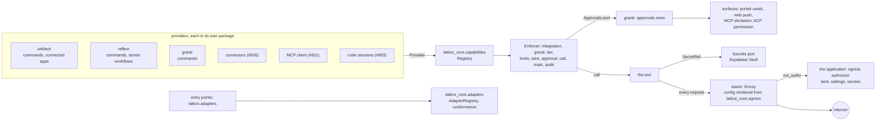

# RFC-0011: The v0.3 platform: capabilities, approvals, secrets, egress and adapters

**Status:** Discussion
**Author:** Alex Nodeland
**Created:** 2026-10-30
**Discussion:** the pull request that adds this file
**Siblings:**

- [lattice ADR-0018](../adr/0018-lattice-core-what-the-libraries-share.md) is the boundary every part keeps: artifactr, reflexr and grantr import none of one another, and lattice-core imports no lattice package.
- [lattice ADR-0027](../adr/0027-integrations-switched-per-workspace-through-one-port.md) and [lattice ADR-0030](../adr/0030-settings-typed-declared-in-lattice-core-and-only-narrowed-below.md) are the shape: a port and a registry declared in lattice-core, answered by grantr's store, composed by the application.
- [artifactr ADR-0034](../artifactr/adr/0034-ports-and-adapters-for-integrations.md) is the adapters' pattern: a small port owned by the inner layer, adapters in extras, each tested against a fake.

## Summary

v0.3 adds five shared pieces, each built once, before the features that use them ([#939](https://github.com/alexnodeland/lattice/issues/939)): a **capability registry**, through which every tool an agent can call is offered and enforced on one path ([#940](https://github.com/alexnodeland/lattice/issues/940)); an **approval object**, asked once and answered on whichever surface answers first ([#941](https://github.com/alexnodeland/lattice/issues/941)); a **secrets port**, with Supabase Vault as its first adapter, so that everything else holds references ([#942](https://github.com/alexnodeland/lattice/issues/942)); **one egress policy and one proxy** for everything that calls out, narrowed by taint ([#943](https://github.com/alexnodeland/lattice/issues/943), [#903](https://github.com/alexnodeland/lattice/issues/903)); and **one adapter registry**, discovered through entry points, checked by one conformance harness and shown in one admin view ([#944](https://github.com/alexnodeland/lattice/issues/944)). The contracts live in lattice-core as types and ports; each library registers its providers through them without importing another library; grantr stores what needs a tenant's store and audit; stackr runs the proxy. Each contract carries a version under [#946](https://github.com/alexnodeland/lattice/issues/946)'s rules. Tracked by #939.

## Motivation

- **Five epics specify the same building blocks five ways.** Tools are defined by stored workflows ([#843](https://github.com/alexnodeland/lattice/issues/843)), connectors' action side ([#926](https://github.com/alexnodeland/lattice/issues/926)), the MCP client ([#921](https://github.com/alexnodeland/lattice/issues/921)), code session tools ([#888](https://github.com/alexnodeland/lattice/issues/888)) and portr's command catalog ([#916](https://github.com/alexnodeland/lattice/issues/916)). Approvals by connected apps, code sessions, portr's elicitation ([#918](https://github.com/alexnodeland/lattice/issues/918)) and phones ([#898](https://github.com/alexnodeland/lattice/issues/898)). Credentials by forges ([#886](https://github.com/alexnodeland/lattice/issues/886)), coding agents ([#887](https://github.com/alexnodeland/lattice/issues/887)), connectors ([#927](https://github.com/alexnodeland/lattice/issues/927)), webhooks ([#842](https://github.com/alexnodeland/lattice/issues/842)) and MCP servers. Egress by the sandbox ([#885](https://github.com/alexnodeland/lattice/issues/885)), the reader ([#879](https://github.com/alexnodeland/lattice/issues/879)), connectors and MCP servers. Adapters by #893, #926 and #878.
- **They are security boundaries.** Two versions of a boundary is how gaps happen (#939). Taint (#903) needs one place to narrow what leaves; an approval answered on a phone must resolve the same object the chat card shows.
- **Why now:** #940 must come before #915, #926 and #893 fix their tool shapes, and #941 before #918 and #952. The v0.3 plan puts this RFC in Wave 0, beside the spike [#899](https://github.com/alexnodeland/lattice/issues/899), and M2 builds it.
- **What exists is a start, in one package each.** artifactr's connected apps vet tools by `Risk` (`read`, `edit`, `code`, `network`, `host`) and gate them by integration and `authorize` (`artifactr.connect`). artifactr's runner pauses on pydantic-ai's deferred tools (`requires_approval=True`, `DeferredToolRequests`) and resumes on `answer_deferred` from any surface, which portalr renders as a `Request` and relayr bridges as `deferred_answered`. Secrets are a gitignored `.env` (stackr). The sandbox's egress proxy, the reader's SSRF guards and connectors' clients don't exist yet.

## Non-goals

- **Slack.** Out of 0.3.0 by the owner's decision (2026-10-30). The approval object has a surface port Slack implements in 0.3.x with the other chat connectors; nothing here needs it.
- **Cloud secrets adapters.** AWS Secrets Manager, GCP Secret Manager and HashiCorp Vault / OpenBao follow Supabase Vault in 0.3.x, behind the same port and conformance suite. #942 asks for one cloud adapter; this RFC proposes it after M2 (Decision T7).
- **Knowledge, data spaces and quantr,** which ship in a 0.3.x knowledge release. Their capabilities register here when they come.
- **Where portr and the code sessions package live.** This RFC settles how they register and read capabilities without importing the libraries; their homes are #915's and #893's to decide.

## Design

### Overview



- **lattice-core holds the contracts:** the types, the ports, the registries and the enforcement path, all pure Python on pydantic, as `Integrations` and `Settings` are. It holds no store and no domain.
- **Each library declares its providers and adapters** in its own code, against those types, and exposes them through an entry point. No library imports another to register.
- **The application composes them,** at its composition root, as it composes `registry(*KNOWN.values(), mine)` today: stackr's template, docplan and oncall. portr, wherever it lives, reads the composed registry, never a library's internals.
- **grantr stores what is per tenant and audited:** approvals, secrets' metadata, the egress allowlists' narrowing (as settings), and the adapters a tenant enables (as integrations).
- **stackr runs what is a service:** the egress proxy, an established one (Envoy, Decision O9), and Supabase Vault in the stack it already has.

### The capability registry (#940)

`lattice_core.capabilities`, at the top level, so it imports only the standard library and pydantic.

```python
Tier = Literal["read", "write", "run_code", "outbound"]
Effect = Literal["reads_private", "reads_untrusted", "sends_out"]
Reversibility = Literal["none", "undoable", "compensable", "irreversible"]

class Gate(BaseModel, frozen=True):
    integration: str | None          # an ADR-0027 key, or None for always installed
    action: str                       # a grantr action, such as "artifactr:edit_artifact"
    different_approver: bool = False  # an approval must come from someone other than the caller

class Capability(BaseModel, frozen=True):
    name: str                         # "<provider>.<tool>", one dot: "artifactr.edit_text", "mcp.github.create_issue"
    version: str                      # the tool's own semver; a new input field is minor
    description: str
    input_schema: dict[str, JsonValue]
    output_schema: dict[str, JsonValue] | None
    provider: ProviderKind            # "command", "connector_action", "mcp_tool", "code_session", "workflow", "builtin"
    tier: Tier
    effects: frozenset[Effect]
    reversibility: Reversibility
    gate: Gate
    limits: tuple[str, ...] = ()      # Setting keys (ADR-0030), such as "calls-per-hour:mcp-github"
    risk_class: RiskClass | None = None  # "admin_high" for #918's confirmations

class Provider(Protocol):
    kind: ProviderKind
    def capabilities(self, scope: Scope, /) -> Iterable[Capability]: ...
    async def call(self, capability: Capability, arguments: JsonObject, context: CallContext, /) -> ToolResult: ...
```

- **One tier, not two.** The tier is what decides who may offer a tool; `effects` are what taint reads. artifactr's `Risk` maps onto them: `read` and `edit` are `read` and `write`; `code` is `run_code`; `network` is `outbound` with `sends_out`; `host` is never registered, as today. `artifactr.connect` keeps `Risk` as its vetting vocabulary and maps it when it registers (Decision T1).
- **`Scope` is a tenant and a workspace;** `capabilities(scope)` is asked per scope because a tenant's remote MCP servers (#921) and connections (#926) differ. A static provider ignores it.
- **`CallContext`** carries the caller (a person, an agent's run, a code session), the run's taint, its correlation id and the surface it came from. It is the same type the approval and egress parts read.
- **The registry** is `Registry(*providers)`. It refuses two capabilities of one name in a scope, lists by scope, finds by name, and searches by text for portr's tool search ([#919](https://github.com/alexnodeland/lattice/issues/919)). Agents and stored workflows name capabilities; the chat agent's tools and portr's MCP tools are views of it.

**One enforcement path.** `Enforcer.call(name, arguments, context)` is the only way a capability is called. Its steps are #940's, in order, each a port the application injects:

1. **Integration on?** `Integrations.is_enabled` on `gate.integration`; off is `NotEnabled`, never `Forbidden` (artifactr ADR-0081's order).
2. **grantr allows?** An `Authorize` callable, `(subject, action, scope) -> bool`, which grantr's `Grants` answers; lattice-core never imports grantr.
3. **Tier allowed for this agent?** The agent's or workflow's tier ceiling, a `Subset` setting `tiers:<agent>` narrowed per workspace (ADR-0030).
4. **Limits:** each key in `limits`, read through `Settings` and counted by a `Counter` port; a store that can't be read refuses (fails closed, as ADR-0030 does).
5. **Taint:** `TaintPolicy.decide(capability, context.taint, scope)` answers `allow`, `ask`, `narrow` or `deny` (#903).
6. **Approval needed?** `ApprovalPolicy` (below); if so, the call is deferred until the approval resolves.
7. **Call** the provider.
8. **Mark taint** from `effects`: `reads_untrusted` taints the turn, run or session, with the capability's name as the cause.
9. **Audit:** one `capability_called` entry, with the outcome of each step, through an `Audit` port grantr answers.

- **Under pydantic-ai,** a capability is offered to an agent through `lattice_core.agents.toolset(registry, enforcer, scope)`, a `FunctionToolset` whose tools call `Enforcer.call`. Step 6 raises `CallDeferred`, so artifactr's runner pauses as it does today and nothing waits in memory. It lives behind a new `agents` extra (pydantic-ai-slim), as `lattice_core.litellm` lives behind `litellm`.
- **Nothing bypasses it,** which a test asserts across packages (Testing, below).

**How each library registers.** Each library ships its providers in its own module and names them in its `pyproject.toml`:

```toml
[project.entry-points."lattice.capabilities"]
artifactr = "artifactr.capabilities:provider"
```

`lattice_core.capabilities.discover()` reads the group with `importlib.metadata`, which is the standard library, so deptry and `standalone` see no new dependency. The application may instead pass providers by hand; tests always do. An installed provider is only offered where its gate's integration is on, so installing an extra never turns anything on by itself (ADR-0027).

| Provider | Where it registers | Issue |
|---|---|---|
| lattice commands | each library's command catalog, as `command` capabilities, in the shape #915 settles; this RFC requires only that a command is a `Capability` | #916 |
| connector actions | the connector package's provider, one capability per action, its tier and effects declared by the connector | #926 |
| MCP tools | the MCP client, per server and tenant, tiers from the operator's catalog; every result `reads_untrusted` | #921 |
| code session tools | the code sessions package: delegate, steer, push, open a change request | #888 |
| stored workflows | reflexr: a stored workflow is itself a `workflow` capability, and its tool list names capabilities | #843, #966 |
| built-ins | the package that runs them: web search and fetch (#877, #880), `run_code` | #876 |

### The approval object (#941)

`lattice_core.approvals` declares the object, its policy and its ports; grantr stores it (Decision T2).

```python
State = Literal["pending", "approved", "denied", "expired", "withdrawn"]

class Approval(BaseModel, frozen=True):
    id: ApprovalId
    tenant_id: str
    workspace_id: str
    capability: str                   # the capability's name and version
    rendering: Rendering              # exactly what would happen: a title, a summary, a diff or the arguments
    arguments_digest: str             # SHA-256 of the canonical arguments; an answer binds to it
    asked_by: Asker                   # agent, run, session, and the person on whose behalf
    answerers: Answerers              # a grantr action, named subjects or groups, and different_approver
    deadline: datetime
    state: State
    answer: Answer | None             # who, on which surface, when, approved or not, a reason

class Approvals(Protocol):
    async def ask(self, request: ApprovalRequest, /) -> Approval: ...
    async def answer(self, id: ApprovalId, answer: Answer, *, subject: Subject) -> Approval: ...
    async def withdraw(self, id: ApprovalId, reason: str) -> Approval: ...
    async def pending(self, scope: Scope, subject: Subject) -> list[Approval]: ...
    def watch(self, id: ApprovalId) -> AsyncIterator[Approval]: ...
```

- **One policy.** `ApprovalPolicy.needed(capability, context, scope) -> Answerers | None` decides from the tier, the taint step's `ask`, the capability's `risk_class`, and settings: `approve:<tier>` is a `Subset` of tiers that need a person, whose floor the operator sets. A tenant or workspace may require approval on more tiers, never on fewer (Decision O5): asking more is the narrower direction ADR-0030 allows, so the setting is resolved as a union down the layers, where other `Subset` settings intersect. `different_approver` comes from the gate, or from a tainted outbound call, and is always set for `risk_class="admin_high"`.
- **First answer wins.** `answer` is a compare-and-set on `state = 'pending'` in grantr's store, in one transaction with its audit entry. The second answer gets `AlreadyAnswered` with the first's answer, surface and time, which every surface shows. A test runs answers from many tasks at once against SQLite and PostgreSQL and finds exactly one.
- **Bound to what was shown.** An answer carries the `arguments_digest` it saw; one for other arguments is refused. A replanned call is a new approval.
- **Delegation.** `answerers` names a grantr action, so anyone who holds it may answer, and grantr's grants are how a person delegates. A named delegation, "Sam answers mine this week", is a grant with an expiry, not a field of the approval (Decision T3). A service principal may answer only if granted the action specifically, and never an `admin_high` one (#918).
- **Expiry and reminders.** A sweep moves a pending approval past its deadline to `expired`, with a reason, and the waiting step fails with it. Reminders are notifications at fractions of the deadline (#952). The default deadline is a setting, `approve-within`, an `IntRange` in minutes.
- **Withdrawn** when its run is stopped, its session ends or its capability's arguments change.
- **On artifactr's deferred tools.** artifactr keeps `requires_approval` and `answer_deferred`. A deferred call that the enforcer asked for has an `Approval`; `answer_deferred` from the chat becomes `Approvals.answer(surface="portalr")`, and the approval's resolution resumes the run through the same `deferred_answered` fact relayr already bridges. A run paused on one approval resumes whichever surface answered.

**Surfaces.** A surface implements `ApprovalSurface`: `offer(approval, to=subjects)`, `resolved(approval)`. The approvals store fans each new approval out to the surfaces of the subjects who may answer, and each resolution to every surface it was offered on.

| Surface | Offers by | Answers by | In 0.3.0 |
|---|---|---|---|
| portalr | the `Request` card in the thread, and the approvals list in the activity view ([#902](https://github.com/alexnodeland/lattice/issues/902)) | the card's buttons, through grantr's `answer` | Yes |
| Web push on a phone | a notification with Approve and Deny actions ([#952](https://github.com/alexnodeland/lattice/issues/952)); the action opens portalr's approval page, signed in, which answers | portalr, so the answer is a person's with a session, never a bare push action | Yes |
| MCP elicitation | portr asks the client that made the call, if it supports elicitation (#918) | the elicitation's result | Yes (M4) |
| ACP permission request | portr, for ACP clients and coding agents (#918, #888) | the permission response | Yes (M4) |
| Slack | a modal through the Slack connector (#932) | the modal | No: 0.3.x |

- **Different-approver approvals never reach the caller's surfaces:** the fan-out leaves out every surface of the subject who asked, and portr's tool returns a pending status with a link instead (#918). A test asserts it for each surface.
- **A client without elicitation** gets the pending status and a link, and the ask stays in portalr.

### The secrets port (#942)

`lattice_core.secrets` declares the port and the reference; adapters are extras.

```python
class SecretRef(BaseModel, frozen=True):
    id: SecretId                       # opaque: "sec_" and 16 hex digits
    owner: Owner                       # tenant, optional workspace, optional connection
    purpose: str                       # "forge:token", "connector:oauth", "mcp:oauth", "litellm:key", "webhook:signing"

class Secrets(Protocol):
    async def put(self, owner: Owner, purpose: str, value: SecretStr, *, rotate_every: timedelta | None = None) -> SecretRef: ...
    async def read(self, ref: SecretRef, *, reader: Reader) -> SecretStr: ...
    async def rotate(self, ref: SecretRef, value: SecretStr, *, grace: timedelta) -> SecretVersion: ...
    async def revoke(self, ref: SecretRef, *, reason: str) -> None: ...
    async def list(self, owner: Owner) -> list[SecretMetadata]: ...   # never values
    async def delete_owned_by(self, owner: Owner) -> int: ...
```

- **References, not values.** Everything else stores a `SecretRef`. A value is read only by the component that uses it, at the moment of use: the credential proxy, the egress proxy, a connector's follower. `SecretStr` keeps it out of reprs and logs; `lattice_core.otel`'s redaction gains the `sec_` form.
- **Scoped by owner.** A ref is valid only in its owner's tenant; a workspace's ref only in that workspace; a connection's only for that connection. `read` checks the reader's scope against the owner before it touches the store, and the store checks again by row-level security.
- **Reads are audited:** every `read` records the `Reader` (component, connection or session, purpose), never the value, through the `Audit` port. Operators see them in portalr's admin.
- **Rotation.** `rotate` makes a new version current and keeps the previous one readable until `grace` ends, so a follower holding the old one finishes. Scheduled where a provider supports it (OAuth refresh, App keys), on demand from admin, and on leak: `revoke` ends every version at once.
- **Deletion follows the owner:** deleting a connection, workspace or tenant calls `delete_owned_by`, under retention ([#904](https://github.com/alexnodeland/lattice/issues/904)).
- **Supabase Vault first** (confirmed by the owner, 2026-10-30), in `lattice_core.secrets.supabase`, behind the `sql` extra. Vault holds the encrypted values; a `lattice_secrets` table holds each ref's owner, purpose, versions and Vault ids, with row-level security by tenant through `lattice_core.sql`'s tenant session. Values are read through a function that checks the caller's tenant before it reads Vault's decrypted view, so no role an application holds can read the view directly (Unverified, below).
- **An in-memory fake** with the same semantics, and one contract suite every adapter runs.

### Egress: one policy and one proxy (#943)

`lattice_core.egress` holds the policy as pure functions, so the proxy and the in-process guards (the reader's, the sandbox's) decide the same way from one implementation.

```python
class Purpose(BaseModel, frozen=True):
    key: str                           # "sandbox:registries", "connector:github", "mcp:<server>", "litellm", "reader"
    hosts: frozenset[HostPattern]      # the operator's universe for this purpose

def decide(request: Destination, purpose: Purpose, allowed: frozenset[HostPattern], taint: Taint, /) -> Verdict: ...
```

- **Always refused,** whatever the purpose: private, loopback, link-local, CGNAT and tailnet ranges, and metadata endpoints, checked on every resolved address, again after each redirect, and pinned for the connection so DNS rebinding can't swap it.
- **Allowlists per purpose.** The operator's configuration holds each purpose's hosts. A tenant or workspace narrows them as an ADR-0030 `Subset` setting, `egress:<purpose>`, over that universe; never wider. In 0.3.0 only the operator adds hosts (Decision O6): a remote MCP server a tenant adds (#921) is reachable only where its host is in the operator's catalog. Hosts a connection declares are revisited with the connector RFC (#926).
- **Narrowed by taint.** For a tainted turn, run or session, `decide` allows only hosts that appeared in what was read (the taint's recorded `seen_hosts`) and are also allowlisted, and refuses a URL with a query or path built from private data, which the caller marks as such (#903's "narrow").
- **Limits** on size, time and rate per purpose, as settings.
- **Credentials injected at the proxy.** A caller sends `X-Lattice-Secret: <ref>`; the authorizer reads the value through the `Secrets` port, the proxy sets the header the purpose names, and the reference is stripped. Callers, sandboxes and models never hold model keys or forge tokens. Injection needs the proxy to originate TLS, so a purpose with credentials is called as a plain-HTTP forward-proxy request to the proxy, which opens TLS upstream; a purpose without them, such as package registries, may tunnel with CONNECT.
- **Every credential header the caller sends is stripped,** not only the one replaced: `Authorization`, `x-api-key` and the forge's own. The #899 spike's egress proxy had to strip `x-api-key` as well as `Authorization` ([#1222](https://github.com/alexnodeland/lattice/pull/1222)).
- **Logged:** each request's tenant, workspace, purpose, caller, destination host, verdict, size and duration; never bodies or headers. Operators see egress by purpose and destination, and refusals, in portalr's admin.

**The proxy is an established one, not lattice's own** (Decision O8). It runs as a stackr service, `egress`, on the network every outbound caller sits on, and is the only service on that network with a route out. Compose marks the callers' networks `internal: true`, as stackr already does for its databases, so nothing else can reach the internet, which `make validate` and a smoke test check. Each caller is identified by a token the stack issues per purpose (a sandbox's per session), sent as `Proxy-Authorization`. The reader and the sandbox's proxy become clients of it, and keep their own guards as defence in depth.

Two candidates were compared against what this design needs:

| Need | Envoy | smokescreen |
|---|---|---|
| Allowlists per purpose, from the shared policy | A route per purpose with an RBAC filter on the host, rendered from the policy | An ACL role per purpose, rendered as its YAML |
| Private ranges on the resolved address, rebinding | Not built in for the dynamic forward proxy: the authorizer resolves and checks, and Envoy must connect to the address it checked (Unverified) | Built in: it is Stripe's SSRF proxy, and denies private ranges after resolution by default |
| Narrowing by taint, which changes during a run | `ext_authz`: Envoy asks an authorizer on every request, which reads the session's taint | Not expressible: an ACL is static per role, so a taint would need a reload or a fork of its Go hooks |
| Credential injection | The authorizer's allow response adds headers to the upstream request (or the `credential_injector` filter), where Envoy originates TLS | None: HTTPS passes through CONNECT tunnels it can't open, so injection needs a second proxy beside it |
| Per-tenant attribution | The authorizer returns tenant, workspace, purpose and caller as dynamic metadata, written by Envoy's JSON access log to Loki; per-purpose counters as stats, per-tenant counts from logs, to keep stats' cardinality bounded | Its JSON log names the role, so a tenant appears only with a role per tenant and purpose; statsd metrics |
| stackr's Compose and AWS recipes | One pinned image; an ECS service as stackr's others are (ECS Service Connect is itself Envoy) | One image, built by stackr if no official one is published (Unverified); an ECS service |

**Envoy** (Decision O9, confirmed by the owner on 2026-10-30). It is the only one that meets taint narrowing and injection without a second proxy; smokescreen's strength, resolved-address checks, is the one thing Envoy needs help with, and the authorizer supplies it. Squid, with `external_acl_type` helpers and `request_header_add`, could meet the same needs, but its configuration and operation suit stackr less well than Envoy's.

**How the shared policy becomes Envoy's configuration,** in two layers:

- **Static, rendered:** `lattice_core.egress.envoy(policy) -> dict` renders the operator's purposes, their host universes, limits and the always-refused ranges into Envoy's listeners, routes, RBAC filters and clusters, as plain data, with no Envoy dependency. stackr's `scripts/egress-config` writes it to `deploy/egress/` when the stack starts, and Envoy reads it as file-based xDS, so a change of the operator's configuration is picked up without a restart. A drift test holds the committed example to the renderer. This layer holds even if the authorizer errs: nothing outside the operator's universe is ever reachable.
- **Dynamic, asked:** `ext_authz` calls `lattice_core.egress.fastapi`'s authorizer, a router behind the `fastapi` extra that the application mounts, not a service of its own. It identifies the caller, applies the tenant's and workspace's narrowing, taint and `decide`, reads any credential through `Secrets`, and answers allow with headers and metadata, or deny with a reason. Envoy is configured with `failure_mode_allow: false`, so an authorizer that can't answer refuses.

### A sandbox with its own vault and egress

The #899 spike ([#1222](https://github.com/alexnodeland/lattice/pull/1222)) found that OpenSandbox 1.2, the confirmed sandbox, has both: a `credential-vault`, which injects credentials into requests matched by host, path and method, and a `networkPolicy`, ordered egress rules enforced by a sidecar and chainable to an upstream proxy. They overlap #942 and #943. As the spike recommends:

- **lattice keeps the policy and the audit.** The egress policy and every decision about it stay in `lattice_core.egress` and its proxy, whatever the sandbox offers.
- **Egress rules are translated** into OpenSandbox's `networkPolicy` by the sandbox adapter, where it has one, as an inner layer, with lattice's proxy as its upstream. A sandbox without one relies on the proxy alone.
- **Credentials stay in lattice's proxies,** never in OpenSandbox's vault: matching by host and path can't say "only this branch", which git's credential proxy must.

How the credential proxy polices git is the ports RFC's: lattice RFC-0015 (#893), being drafted. That covers force-pushes, which the spike's proxy let through, since refusing a history rewrite needs a mirror in the proxy or the forge's branch protection. It also covers refusals answered in git's `report-status` format, since a plain 403 confuses git.

### Taint, as these parts read it (#903)

#903 is its own piece of work; this RFC fixes only its contract, because three parts read it. `lattice_core.taint.Taint` is `clean`, or `tainted` with its causes (capability, event, time) and `seen_hosts`. It is carried on `CallContext`, set by the enforcer's step 8, carried to runs and sessions started from a tainted one, and cleared only by a person, audited. `TaintPolicy` is per workspace, may tighten but never loosen the operator's, and maps each `Tier` and `Effect` to `allow`, `ask`, `narrow` or `deny`.

### Adapters (#944)

`lattice_core.adapters` declares what an adapter is, how it is found and how it is checked.

```python
class AdapterSpec(BaseModel, frozen=True):
    kind: AdapterKind                  # "secrets", "sandbox", "forge", "coding_agent", "ide", "connector", "search", "mcp_server"
    name: str                          # "supabase-vault", "opensandbox", "forgejo"
    version: str                       # the distribution's version
    implements: dict[str, str]         # port name to the port versions supported: {"secrets": ">=1,<2"}
    integrations: tuple[Integration, ...]  # the ADR-0027 declarations it adds
    settings: tuple[Setting, ...]      # the ADR-0030 settings it adds
    config_schema: dict[str, JsonValue]
    egress: tuple[Purpose, ...]        # what it needs to reach
    factory: Callable[[JsonObject], object]
```

- **Discovery through entry points,** group `lattice.adapters`, read with `importlib.metadata`, so installing an extra registers its adapter and removing it removes it. The application composes `KNOWN` with the installed adapters' `integrations`, so an adapter's integrations exist only when it is installed, and ADR-0027 already makes one that isn't installed off everywhere ("not installed in this deployment").
- **Enabled by the operator.** The deployment's configuration names which installed adapter answers each port (`secrets: supabase-vault`), validated against its `config_schema` at startup; a tenant switches the integrations it adds. Switching an adapter is a configuration change and a restart. Secrets are switched by a copy command (Decision O7): an operator command, `lattice secrets copy --to <adapter>`, copies every secret, with its current and grace versions, to the new store and rewrites each reference's store id in `lattice_secrets`, in batches, each read and write audited; the deployment is then pointed at the new store, and the old one is retired once the command reports every reference moved.
- **One conformance harness,** `lattice_core.conformance`: a suite per port, written as plain async checks that take a factory and return results, so it runs under pytest in each adapter's CI (a thin plugin behind a `conformance` extra) and from `make validate` against a running deployment. Each suite also checks the adapter's `implements` against the port's version.
- **One admin view, "Adapters",** in portalr's admin: each installed adapter by kind, its version, its conformance result from the last `make validate`, its configuration (secrets shown as refs) and its integrations, linking to each kind's own page. portalr reads it through an endpoint the composed registry answers, never by importing the adapters.
- **Pinned and updated** like any dependency: an adapter is an extra, so `uv.lock` pins it and Renovate updates it.

### Where each part lives

ADR-0018 moves code into lattice-core "when two or more packages have it word for word", and keeps domain out. These contracts are new rather than moved, so they follow ADR-0027's and ADR-0030's precedent instead: a port and a registry that every library must agree on, declared in lattice-core, answered elsewhere. A short ADR records that reading of ADR-0018 (Tracking).

| Part | lattice-core module | Extra | Answered by | Who imports it |
|---|---|---|---|---|
| Capabilities, enforcer | `capabilities` | none | each library's provider; grantr's `Authorize` and `Audit` | artifactr's agent and connect layers, reflexr's agent layer, grantr's catalog, portr |
| Agent toolset bridge | `agents` | `agents` (pydantic-ai-slim) | | artifactr's and reflexr's agent layers |
| Approvals | `approvals` | none | grantr's store (`grantr[sql]`) | artifactr's agent layer, portalr, portr |
| Secrets | `secrets` | none | `secrets.supabase` (`sql`), the fake | the credential and egress proxies, connectors, the MCP client |
| Egress policy | `egress`; its authorizer in `egress.fastapi` | `fastapi` for the authorizer | stackr's Envoy, with the static layer rendered from it and the dynamic one asked of the authorizer | the application, stackr's config script, the reader, the sandbox's proxy |
| Taint | `taint` | none | | everything above |
| Adapters, conformance | `adapters`, `conformance` | `conformance` (pytest) for the plugin | each adapter's entry point | the application, `make validate`, portalr's endpoint |

- **Each top-level module imports only the standard library and pydantic,** as `test_layering.py` requires; `agents` and `secrets.supabase` are extra subpackages, added to its `EXTRAS`.
- **Each library's layering test grows** by the lattice-core modules its layers may import, as artifactr's lists `lattice_core.integrations` and `lattice_core.settings` today.
- **No library imports another to register.** artifactr's provider never imports grantr: grantr's `Authorize` reaches it through the enforcer the application builds. portalr, which already depends on grantr, reads approvals through grantr and capabilities through the composed registry.

### Versioning (#946)

- **Each contract has a version,** `CONTRACT = "1.0.0"` in its module: capabilities, approvals, secrets, egress and adapters, plus each port an adapter implements. A removed field or changed meaning is major; an optional field, a new `Effect`, `ProviderKind` or `AdapterKind` is minor, and consumers treat an unknown one as the strictest (an unknown effect taints and asks).
- **Each publishes a JSON Schema** into `packages/lattice-core/schemas/`, regenerated by `lattice-core:schema` and checked for drift, and for breaks against the last release by `lattice:breaks` (ADR-0012), as #946 extends it.
- **Adapters declare** the port versions they support (`implements`); the harness refuses one that doesn't match, and startup refuses to enable it.
- **lattice-core changes only by addition and deprecation** (ADR-0018), so a library on an older floor keeps working.

### Testing at 100% branch coverage

- **Every port has an in-memory fake and one contract suite,** run against the fake and each adapter, as RFC-0004's trackers are: `Secrets` against the fake, against Supabase Vault on a PostgreSQL with Vault installed, and live in the stack's smoke job.
- **The enforcer is tested step by step** with fakes for every port: each step's refusal, the order (off before forbidden), fail-closed on an unreadable limit, and taint marked after a call that raised.
- **One suite for all providers:** a parametrized test runs tiers, approvals, limits, taint and audit against a fake provider of each `ProviderKind`, and then against each library's real provider, in root `tests/`, since it spans libraries.
- **Nothing bypasses the enforcer:** a root test builds the template's composed agents and asserts that every tool an `Agent` holds is the bridge's, and an AST check fails on a `FunctionToolset` built in a library's `src/` outside an allowlist of the bridge's own.
- **First answer wins under races,** on SQLite and PostgreSQL; different-approver approvals never offered to the caller; expiry by a fake clock, never by waiting.
- **Egress:** `decide` and the authorizer against #879's SSRF cases and injection fixtures; the Envoy renderer against golden configurations; Envoy in stackr's smoke job, with a container on an internal network that can reach only it.
- **Adapters:** the harness tested against a fake adapter that passes and one that fails each check; installing and removing an extra in `standalone` adds and removes its integrations.

### What changes in each package

| Package | Changes | Breaking |
|---|---|---|
| lattice-core | `capabilities`, `approvals`, `secrets`, `egress`, `taint`, `adapters`, `conformance`; the `agents` and `conformance` extras; `secrets.supabase` under `sql`; schemas and their drift tests | No: additions |
| grantr | The approvals store and its commands (`grantr:answer_approval`, `grantr:read_approvals`), the secrets metadata table and its RLS, `Authorize` and `Audit` for the enforcer, `capability_called` and `secret_read` audit events | No |
| artifactr | A provider for its commands and connected apps; `Risk` mapped to tiers; deferred approvals backed by `Approval` | Only if `requires_approval` tools must now be capabilities (T5) |
| reflexr | A provider for its commands and stored workflows; workflows' tool lists name capabilities | No: stored workflows are new (#843) |
| relayr | `deferred_answered` carries the approval's id and surface | No: an optional field |
| portalr | Approvals list and page, web push actions, the Adapters and Egress admin views | No |
| stackr | The `egress` service (Envoy) with its rendered configuration and internal networks, Vault enabled, the template composing registries | Callers without the proxy lose the internet: an upgrade note (#946) |

### Phases

M2 in the v0.3 plan builds these, in this order, each a pull request or two:

| Phase | Deliverable | Exit criteria |
|---|---|---|
| 1. Contracts | `capabilities`, `taint`, `approvals`, `secrets`, `egress`, `adapters` as types, ports and fakes; versions and schemas | 100% coverage; schemas checked by `lattice:breaks` |
| 2. Enforcer | The nine steps and the `agents` bridge; one provider from artifactr | The enforcement suite passes on a fake and on artifactr's provider |
| 3. Stores | grantr's approvals (first answer wins, expiry, audit) and secrets metadata; Supabase Vault adapter | The race test finds one answer on both databases; the secrets contract suite passes on Vault with RLS isolation tested across two tenants |
| 4. Egress | Envoy in stackr, its rendered configuration, the authorizer and internal networks; the secrets copy command | The SSRF suite passes at Envoy; a tainted session reaches only hosts it has seen; an injected credential never reaches the caller; a caller off the proxy reaches nothing; the authorizer down refuses everything |
| 5. Adapters | Entry-point discovery, the harness and its pytest plugin, `make validate` running it | Supabase Vault and the fake pass through the harness; installing an extra adds its integrations |
| 6. One provider per library | reflexr's and grantr's providers; the bypass test | M2's exit: one provider registered from each library, and nothing bypasses the enforcer |

The portalr views and the surfaces beyond portalr's card come with M3 and M4 (#902, #952, #918).

## Decisions

Decided by the owner on 2026-10-30:

| # | Question | Decided | Instead of |
|---|---|---|---|
| O1 | How many RFCs | One for #940 to #944 | Five, one per piece |
| O2 | Slack | Not in 0.3.0; designed for as a surface | Required for phone approvals |
| O3 | Phone approvals | portalr's web push | Slack or a native app |
| O4 | The first secrets store | Supabase Vault | Own envelope encryption, or a cloud KMS first |
| T1 | Tiers | #940's four tiers and three effects, with artifactr's `Risk` mapped onto them | `Risk`'s five values everywhere, which mixes what a tool does (`edit`) with what it reaches (`network`) |
| T2 | Where approvals are stored | grantr: its subjects define who may answer, and it already keeps audited stores per tenant | artifactr, beside deferred tools (reflexr and portr couldn't reach it); a new package (one more release for one table) |
| T3 | Delegation | A grantr grant with an expiry | A delegate field on each approval, which grantr couldn't check |
| T5 | Approvals on artifactr's own tools | `requires_approval` stays as the mechanism, and the enforcer sets it from the policy | Every tool's approval declared on the tool, as today, beside a policy that disagrees |
| T6 | Registration | Entry points, with explicit composition always allowed | Explicit composition only: no discovery, but every application lists every provider |
| T7 | The second secrets adapter | In 0.3.x, after the port is stable | In 0.3.0, as #942's acceptance asks |
| O5 | Approval policy's direction | The operator sets the floor; a tenant or workspace may require approval on more tiers, never fewer | Operator-only approval policy in 0.3.0 |
| O6 | Egress hosts | The operator's alone in 0.3.0; tenants and workspaces only narrow them; revisited with connectors (#926) | Tenants adding hosts through a connection's declared hosts |
| O7 | Switching secrets stores | An operator command copies every secret to the new store and rewrites the references; the old store is then retired | Old references resolving through the old store beside new ones on the new |
| O8 | The egress proxy | An established proxy (T4 rejected) | A small Python proxy of lattice's own on `lattice_core.egress`, as T4 recommended |
| O9 | Which established proxy | Envoy: its configuration rendered from the shared policy, and `ext_authz` to an authorizer the application mounts for taint, tenants' narrowing and credentials ([The proxy](#egress-one-policy-and-one-proxy-943)). Two conditions: a purpose that carries credentials is called as a plain-HTTP forward-proxy request, so Envoy originates TLS and can inject them; and pinning the checked address against DNS rebinding is verified in M2, with smokescreen behind Envoy as the fallback if it can't be | smokescreen: SSRF checks built in, but static per-role ACLs can't narrow by taint, and it can't inject credentials without a second proxy; Squid: could, through helpers, but suits stackr less well |

## Drawbacks

- **lattice-core grows a great deal,** from shared helpers to most of the platform's contracts, and every library takes a higher floor of it.
- **One enforcement path is one place to get wrong:** a bug there is a bug in every tool. It is also one place to test, which is the point.
- **An approval store in grantr couples approvals to grantr,** so an application without grantr has the fake only. Today every governed deployment has grantr.
- **Entry points are global to an environment:** an extra installed for one application registers for every one in it. Composition stays explicit in tests.
- **A proxy for everything** adds a hop and a service that must stay up; when it, or the authorizer it asks, is down, nothing calls out.
- **Envoy is large and its configuration is verbose.** Rendering it from the policy keeps people out of it, but a renderer is one more thing to test, and an Envoy upgrade can change what it accepts.

## Alternatives

- **Five RFCs** (O1). Easier to review one at a time; the cross-references (taint in egress, approvals in the enforcer, secrets in the proxy) would be settled five times.
- **A new `lattice-platform` package** for the contracts. Keeps lattice-core small, but every library would depend on two shared packages, and ADR-0027 and ADR-0030 already put ports in lattice-core.
- **The registry in portr.** portr reads every library's catalog anyway, but the libraries would then need portr to enforce their own tools.
- **Per-feature approvals, egress and secrets.** The drift #939 replaces.
- **A Python proxy of lattice's own** (T4, rejected as O8). One implementation of the policy, but lattice would own a proxy's security, performance and protocol corner cases, which established proxies have already met.
- **smokescreen with a header-injecting sidecar.** Keeps smokescreen's SSRF checks, at the cost of two proxies in series and taint still unexpressed (O9).

## Unresolved questions

As of 2026-10-30, approval policy's direction (O5), egress hosts (O6), switching secrets stores (O7) and the egress proxy (O8, O9) are decided.

- **Hosts a connection declares,** revisited with the connector RFC (#926), after O6.
- **Force-pushes through the credential proxy,** and refusals in `report-status`: for lattice RFC-0015 (#893), after the spike (#1222).
- **The bypass check's strength:** an AST rule over `src/` catches the obvious; a runtime assertion in the bridge catches the rest only where tests run the agent.
- **Where portr and the code sessions package live** (#915, #893): this RFC requires only that they read the composed registry.

### Unverified

Each is settled in phase 3, 4 or 5, or carried as an exit criterion.

- Supabase Vault's current API (`vault.create_secret`, `vault.update_secret`, the `vault.decrypted_secrets` view) in the stack's pinned Supabase, and whether a security-definer function can keep every application role off the view while checking the tenant first.
- Vault's encryption key stays outside the database dump in the self-hosted stack.
- pydantic-ai's `CallDeferred` from inside a `FunctionToolset` tool pauses artifactr's runner exactly as `requires_approval` does.
- MCP elicitation and ACP permission requests can carry the rendering and an answer bound to the digest.
- Web push actions on iOS and Android open portalr signed in.
- Compose's `internal: true` networks leave no route out but the proxy's, under Docker and gVisor alike.
- Envoy's dynamic forward proxy can be made to connect only to the address the authorizer resolved and checked, so DNS rebinding can't swap it between the check and the connection; if not, a cluster addressed by the authorizer's answer, or smokescreen behind Envoy for those checks.
- `ext_authz`'s allow response sets upstream headers on a forward-proxy request Envoy originates TLS for, and its dynamic metadata reaches the access log.
- File-based xDS picks up a re-rendered configuration without dropping connections, in Compose and on ECS.

## Tracking

- [ ] ADR: lattice-core holds the platform's contracts, reading ADR-0018 with ADR-0027 and ADR-0030
- [ ] lattice-core: the contracts, fakes, versions and schemas (#940, #941, #942, #943, #944, #946)
- [ ] lattice-core: the enforcer and the `agents` bridge (#940)
- [ ] artifactr: its provider, `Risk` mapped to tiers, deferred approvals backed by `Approval` (#940, #941)
- [ ] grantr: the approvals store, first answer wins, expiry and audit (#941)
- [ ] lattice-core and grantr: the Supabase Vault adapter and secrets metadata with RLS (#942)
- [ ] stackr and lattice-core: Envoy as the egress proxy, its rendered configuration, the authorizer and internal networks (#943, O9), with DNS-rebinding pinning verified, or smokescreen behind Envoy
- [ ] lattice-core and grantr: the secrets copy command (#942, O7)
- [ ] lattice-core and stackr: adapter discovery, the harness and `make validate` (#944)
- [ ] reflexr and grantr: their providers; the cross-package bypass test (#940)
- [ ] Taint's first cut on these contracts (#903)
- [ ] portalr: approvals list and page, web push, the Adapters and Egress views (#902, #952, #944)
- [ ] portr: elicitation and ACP permission surfaces (#918)
- [ ] Decisions T1 to T3, T5 to T7 and O5 to O9, each recorded in an ADR as it is built
- [ ] Docs: each part's guide, `docs/lattice-core/`, and the architecture docs it changes

## Evidence

Gathered on 2026-10-30, with lattice read at `origin/main` (`3b5fad8e`).

| Claim | Where | |
|---|---|---|
| lattice-core's shipped modules import only the standard library and pydantic; extras' subpackages what their extra installs | `packages/lattice-core/tests/test_layering.py` | Verified |
| Each library's layering test lists the lattice-core modules each layer may import | `packages/artifactr/tests/test_layering.py` | Verified |
| artifactr, reflexr, grantr, portalr and relayr each depend on `lattice-core-ai`; portalr also on grantr; none of artifactr, reflexr or grantr on another | each `pyproject.toml` | Verified |
| No package declares an entry point today | each `pyproject.toml` | Verified |
| `Risk = Literal["read", "edit", "code", "network", "host"]` | `artifactr/connect/registry.py` | Verified |
| Runs pause on `DeferredToolRequests` and resume on `answer_deferred`; relayr bridges `deferred_answered` | `docs/artifactr/architecture.md`, `docs/relayr/architecture.md` | Verified |
| `Integrations.is_enabled` and `KNOWN`; `Settings` with `IntRange` and `Subset` | `lattice_core/integrations.py`, ADR-0030 | Verified |
| stackr's compose already has an `internal: true` network | `packages/stackr/compose.yaml` | Verified |
| OpenSandbox 1.2 has a `credential-vault` (by host, path and method) and a `networkPolicy`; the spike's proxy let a force-push through and had to strip `x-api-key` | `spikes/0899-code-session/README.md`, [#1222](https://github.com/alexnodeland/lattice/pull/1222) | Read, as the spike reports it |
| Supabase Vault's API and isolation | Supabase's documentation, not read here | Unverified |
