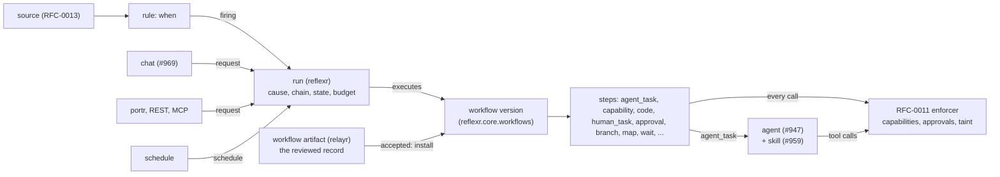

# RFC-0012: The six primitives and the workflow spec

**Status:** Discussion
**Author:** Alex Nodeland
**Created:** 2026-10-30
**Discussion:** [#1225](https://github.com/alexnodeland/lattice/pull/1225)
**Siblings:**

- [lattice RFC-0011](https://github.com/alexnodeland/lattice/pull/1217), the v0.3 platform (in Discussion), owns capabilities, approvals, secrets, egress, taint and adapters. This RFC uses them and redefines none; where it needs more of one, it says so as an addition for RFC-0011 to agree.
- [reflexr RFC-0003](../reflexr/rfcs/0003-managing-rules-at-runtime.md) and [relayr ADR-0028](../relayr/adr/0028-rules-from-chat.md) are the shape stored workflows follow: typed data checked by core, installed through a workspace handle, drafted in chat as an artifact a person accepts.
- [relayr ADR-0003](../relayr/adr/0003-a-thread-is-never-a-chain.md): a thread is never a chain, so a run started from chat begins a chain of its own.
- lattice RFC-0013, event sources (#839), is written beside this one and cites it for what runs when a rule fires.

## Summary

lattice has six primitives, one job each: a **capability** is one governed action, a **skill** is know-how inside one agent's turn, an **agent** is who acts, a **workflow** is who does what in what order over time, an **automation** is when it happens on its own, and a **run** is one execution of a workflow, whatever started it ([#965](https://github.com/alexnodeland/lattice/issues/965)). This RFC fixes their boundaries and the workflow spec: a typed, versioned document of steps, with typed references between them, conditions in reflexr's own filter language, and static checks a workflow must pass before it can run ([#966](https://github.com/alexnodeland/lattice/issues/966)). reflexr runs every workflow, and its runs are decoupled from rules: a run's cause is a firing, a request, a schedule or a parent run ([#968](https://github.com/alexnodeland/lattice/issues/968)). Approving a plan pre-approves exactly the actions it lists, recorded on RFC-0011's approval object. The spec lives in `reflexr.core`, the `workflow` artifact in relayr, and nothing of it in lattice-core. **0.3.0 ships only a one-step `agent_task` workflow and decoupled runs,** which the flagship [#898](https://github.com/alexnodeland/lattice/issues/898) needs; the rest of the vocabulary, plan approval, stored workflows and scopes come in 0.3.x. Tracked by #965.

## Motivation

- **"Workflow" means three things today.** reflexr calls whatever a rule runs a workflow (an agent, a graph or a function, [reflexr ADR-0008](../reflexr/adr/0008-actions-agents-graphs-and-functions.md)); #843 made "stored workflows" stored agent actions; #947 then made those agents. Multi-step, multi-actor work lives in one agent's head, and nothing can plan and delegate from chat durably (#965).
- **Everything in v0.3 that runs builds on the spec.** Automations (#972), planning from chat (#969), the `/` menu and workflows as code (#970), portalr's renderer and portr (#971), and the gallery's bundles (#957) each need it. Grown feature by feature, each would bend it its own way (#966).
- **reflexr's runs exist only for firings.** `Run` requires a `rule`, a `scope_key`, a `fired_seq` and `matched` (`reflexr/core/runs.py`), and a run can't pause for a person: the architecture lists "pausing runs for a person" as an open question. The flagship's approval from a phone (#898, step 7) needs exactly that.
- **Why now:** RFC-0013 (#839) decides what a source triggers, and must not decide stored workflows a second time. The owner decided on 2026-10-30 that this RFC is accepted in M1 so that #839 builds on it.

## Non-goals

- **Run semantics in TLA+** (#967). The spec is a Tracking item, written before 0.3.x's multi-step executor; this RFC states the properties it must check.
- **The capability, approval, secrets, egress and taint contracts** (RFC-0011). Plan approval needs one optional field and one port added to RFC-0011's approvals; nothing else there changes.
- **Sources, trust levels, bindings and quotas** (RFC-0013, #839). This RFC says only how a run receives what a source and a rule give it.
- **The agent object** (#947) and **skills** (#959), beyond where their boundaries meet workflows'.
- **Knowledge, data spaces and quantr,** which ship in a 0.3.x knowledge release. Slack, out of 0.3.0: approvals reach a phone by web push (RFC-0011).

## Design

### Overview



- **reflexr owns the spec and runs it.** The models, references, conditions and static checks are pure, in `reflexr.core.workflows`, beside `conditions` and `stored`. The executor is in `reflexr.agent`, on reflexr's graph machinery.
- **relayr owns the artifact.** A `workflow` artifact is the reviewed record, drafted in chat and accepted by a person, as relayr's `rule` artifact is ([relayr ADR-0005](../relayr/adr/0005-where-a-rules-source-of-truth-lives.md), [ADR-0028](../relayr/adr/0028-rules-from-chat.md)); reflexr's stored workflows hold the running definition.
- **Every step acts through RFC-0011's enforcer.** A workflow holds no credentials and defines no tools; tiers, approvals, taint, limits and audit apply to every call a step makes.

### The six primitives

| Primitive | Is | Isn't | Example | Defined by |
|---|---|---|---|---|
| **Capability** | One governed action: a name, input and output schemas, a tier, effects, a gate. Called once, through the enforcer. | Multi-step, durable or stateful. It holds no instructions and chooses nothing. | `forge.mark_ready`, `search.web`, `artifactr.edit_text` | RFC-0011, #940 |
| **Skill** | Know-how an agent loads into one turn: instructions, files and scripts (run in the sandbox). | A source of capabilities, a schedule or a wait. It never outlives the turn and adds no capability the agent lacks. | "Our incident write-up", "triage a Sentry issue our way" | #959 |
| **Agent** | Who acts: instructions, a model group, the capabilities and skills it may use, limits, the trust levels it accepts. | An order of steps or a trigger. A turn ends with the agent's answer; anything durable is a run's. | `@triage`, `@researcher` | #947 |
| **Workflow** | Who does what, in what order, over time: typed steps across agents, capabilities, people and code, with declared actions and a budget. Versioned. | A trigger, an execution or a tool. It holds no credentials and grants nothing. | The ops loop; the weekly report | This RFC |
| **Automation** | When a workflow runs on its own: a trigger (a source and a rule), a workflow reference, and a mapping from the trigger to the workflow's inputs. | The work itself. Its rule decides; its workflow does. | "On an error-rate alert, run `ops:incident`" | #972, RFC-0013 |
| **Run** | One execution of one workflow version: its cause, chain, step states and outputs, checkpoints, approvals and spend. | A definition, or a firing: a firing is one of a run's causes. | The run that fixed `auth` on 30 October | #968, this RFC |

The boundary tests, in the order to apply them:

1. **Is it one call with typed arguments?** A capability. A workflow that would be a single `capability` step is just that call.
2. **Does it survive interruption, wait on a person, an event or a time, involve more than one actor, or need its outbound actions listed and approved in advance?** A workflow. Otherwise it is an agent's turn, with a skill if the know-how is reusable.
3. **Skill or workflow?** A skill changes *how* one agent does its turn; a workflow changes *who* does *what*, and *when*. "Write the postmortem our way" is a skill. "Draft the postmortem, have the incident lead review it, and post it on Friday" is a workflow whose `agent_task` names that skill.
4. **Agent or workflow?** An agent never names another agent and never waits. Delegation between agents is a workflow (#969), even when an agent drafted it.
5. **Automation or workflow?** Anything about *when* (the source, the rule, the throttle) is the automation's; anything about *what* is the workflow's. The same workflow runs from a rule, from chat and from portr unchanged.

Not primitives: a **tool** is a capability as an agent sees it; a **rule** is an automation's trigger; reflexr's **actions** (functions, agents, graphs) are code a one-step workflow runs ([Compatibility](#compatibility)); a **session** (#884) is a capability's long-lived effect, which a `code_session` step waits on.

### The spec

A workflow is a Pydantic model in `reflexr.core.workflows`, with a JSON Schema generated into `packages/reflexr/schemas/reflexr.workflows.v1.json` by `reflexr:schema` and checked for drift and breaks as the rule schema is. Shown here as Python; stored as JSON, and shown as YAML in the examples.

```python
StepId = Annotated[str, Field(pattern=r"^[a-z][a-z0-9_]{0,62}$")]
Ref = Annotated[str, Field(pattern=_FIELD_PATH)]    # reflexr's dotted path: "steps.triage.output.service"

class Budget(BaseModel, frozen=True):
    tokens: int | None = None                        # integers, as ADR-0030's IntRange settings are
    cost_cents: int | None = None
    seconds: int | None = None
    steps: int | None = None                         # step attempts, across loops and maps

class Workflow(BaseModel, frozen=True):
    name: WorkflowName                               # qualified like a rule's: "ops:incident"
    title: str
    description: str
    inputs: JsonSchema                               # an object schema; the `/` menu's form (#970)
    outputs: dict[str, Ref] = {}                     # named outputs, each a reference
    steps: tuple[Step, ...] = Field(min_length=1)    # in order; control steps nest their own
    emits: tuple[EventName, ...] = ()                # the event types `emit` steps may publish
    budget: Budget
    timeout: timedelta                               # the whole run, waits included
    retry: RetryPolicy = RetryPolicy()               # reflexr's, per step attempt

class StepBase(BaseModel, frozen=True):
    id: StepId                                       # unique in the workflow
    title: str | None = None                         # the checklist's words (#971)
    when: Condition | None = None                    # the step is skipped unless it holds
    timeout: timedelta | None = None
    retry: RetryPolicy | None = None
    budget: Budget | None = None
```

- **Versions are the store's:** a draft has none; an installed workflow has a version from 1 and a **digest**, SHA-256 of its canonical JSON. A run records the name, version and digest it started on, and never changes them except by replanning.
- **`Step`** is a discriminated union on `kind`. Every kind is listed below; 0.3.0's schema holds only `agent_task` (Decision W4), and each later kind is a minor version of the contract.

#### References: typed data flow

A reference is a dotted path into the **run document**, a JSON object the executor keeps in the run's state and checkpoints after every step:

| Root | Holds | Typed by |
|---|---|---|
| `inputs.<path>` | The run's inputs, validated on start | `Workflow.inputs` |
| `trigger.event.<path>`, `trigger.events` | For a firing: the latest matched event, and all of them | The event types the rule admits ([Rule.check](../reflexr/architecture.md#conditions)) |
| `steps.<id>.output.<path>` | A finished step's output | The step kind's output schema |
| `steps.<id>.status` | `succeeded`, `failed`, `skipped`, `timed_out` | Fixed |
| `item`, `index` | Inside a `map`: the element and its position | The mapped array's item schema |
| `iteration` | Inside a `loop`: the count from 0 | Fixed |
| `run.id`, `run.started_at` | The run | Fixed |

- **A reference is never mistaken for a literal.** Fields that take only references (`with`, `inputs`, `fields`, `outputs`, `over`, and a rule's input mapping) hold a path as a plain string. Fields that take values (`capability.arguments`, `code_session.repository`, `wait.until`, `approval.rendering`) hold a literal, unless the value is exactly `{"ref": "<path>"}`, which is a reference; any other string, `"steps.fix.output.change_request"` included, is that string. A capability whose argument is itself an object with one `ref` key is passed it as `{"literal": {...}}`. The checker types every field by this rule (Decision W7).
- **Paths use reflexr's syntax,** `_FIELD_PATH` in `reflexr/core/conditions.py`, which already admits `steps.triage.output.service`: identifiers joined by dots, with no indexing. A step that needs one element of an array is a `map`, or a `code` step.
- **References are checked against schemas on save** (below): the producer's schema at the path must be assignable to the consumer's, conservatively. A check that can't prove it refuses, with `type_unproven`, and the author narrows a schema or adds a `code` step.
- **A reference to a step that may not have run** (behind `when`, a branch, or `on_failure: continue`) is typed as nullable, and the consumer must accept null.
- **Data never enters instructions.** An `agent_task`'s `task` is literal text from the workflow's author; values reach the agent only through `with`, as a typed data part of the prompt, and carry their taint (RFC-0011). Nothing is interpolated into a prompt, so an alert's text can't become an instruction ([#843](https://github.com/alexnodeland/lattice/issues/843)'s prompt-injection rule, kept). Decision W7.

#### Conditions, shared with rules

`branch`, `loop` and `when` take a **condition**: reflexr's own stateless filter models, `where`, `all`, `any` and `not`, evaluated over the run document instead of an event (Decision W2). The JSON is the rule's:

```json
{"kind": "all", "of": [
  {"kind": "where", "field": "steps.triage.output.severity", "op": "ge", "value": 7},
  {"kind": "where", "field": "steps.triage.output.service", "op": "eq", "to_field": "inputs.service"}
]}
```

- **One implementation.** `evaluation.matches` already compares a `WhereFilter` with `_compare(filter, envelope.data)`, a JSON object. It gains `holds(condition, document)`, the same comparison over the run document, so the operators (`eq`, `ne`, `lt`, `le`, `gt`, `ge`, `in`, `contains`, `matches`, `exists`), ordering only of like types, and "a missing field matches nothing but `exists=False`" mean the same in a rule and a workflow, by construction.
- **One addition to the shared language:** `WhereFilter.to_field`, a path compared with instead of `value`, exclusive with it. Rules gain it too (`F.a.eq(F.b)` for two fields of one event); `value` is unchanged, so every stored rule reads as before. A minor, additive change to `reflexr.rules.v1.json`.
- **Not in workflows' conditions:** `on`, which only an event filter needs (`wait` takes a whole rule `Filter`, where it belongs); `predicate`, a Python escape hatch that isn't data; and, in stored workflows, `matches`, which stored rules already refuse (`check_stored`). A `code` step computes what a condition can't, and a condition tests its output.
- **Field types are checked** as `Rule.check` checks event fields, against the referenced schema: an ordering operator on a string field, or `in` against a field of another type, is a problem at save.

#### The step vocabulary

Each kind's fields beyond `StepBase`, its output, and how it fails. Every failure is a `RunFailure` reason ([reflexr ADR-0036](../reflexr/adr/0036-typed-run-failures.md)); a failed step fails the run unless it declares `on_failure: continue`, which makes its output null. In 0.3.0 only `agent_task` exists.

| Kind | Fields | Output | Fails with |
|---|---|---|---|
| **`agent_task`** | `agent` (a handle), `task` (literal text), `with` (name to reference), `may` (the outbound capabilities it may call, each with a target and bounds), `skill` (0.3.x), `output` (a JSON Schema, default `{summary: string}`) | The agent's typed output | `agent_unavailable`, `invalid_output`, `usage_exceeded`, `guardrail_blocked`, `approval_denied`, `approval_expired` |
| **`capability`** | `capability` (`name@major`), `arguments` (per field, a literal or `{"ref": ...}`) | The capability's output schema | RFC-0011's refusals (`not_enabled`, `forbidden`, `limited`, `tainted`, `denied`), and the provider's error |
| **`code_session`** | `repository`, `task`, `agent` (the coding agent), `may` (push, change request), `until` (`done`, `change_request_open`) | The session's result: branch, change request, checks | The session's failure; `timed_out` |
| **`research`** | `question`, `depth` (`quick`, `deep`), `with` | A report artifact's reference and its citations | The research run's failure |
| **`workflow`** | `workflow` (`name@version` or `@latest`), `inputs` (name to reference) | The child's `outputs` | The child's failure; `depth_exceeded` |
| **`code`** | `language` (`python`, `javascript`, `typescript`, `rust`), `source`, `dependencies`, `input` (name to reference), `output` (a JSON Schema), `grants` (egress purposes), `limits` | Its stdout's JSON, validated | `invalid_output`, `timed_out`, `memory_exceeded`, `exit_nonzero`, `compile_failed` (on save) |
| **`human_task`** | `assignee` (a person, group or role in grantr), `ask` (a form schema as RFC-0005's forms, a review of an artifact, a choice, or text), `deadline`, `remind`, `escalate` (reassign, notify, or fail) | The answer, and who gave it | `escalated_out`, `timed_out` |
| **`approval`** | `rendering` (references), `answerers` (RFC-0011's `Answerers`), `deadline` | `{approved, by, surface, at}` | `approval_denied`, `approval_expired` |
| **`branch`** | `cases` (each a condition and steps), `otherwise` (steps) | `{case}`, the index taken | What its steps fail with |
| **`parallel`** | `branches` (name to steps), `join` (`all`, `any`, or a count) | Each branch's last output, by name | `join_failed` |
| **`map`** | `over` (a reference to an array), `max_items` (required), `concurrency`, `steps` | An array of each item's last output | `too_many_items`, its steps' |
| **`loop`** | `steps`, `until` (a condition), `max_iterations` (required) | The last iteration's output and the count | `iterations_exhausted` |
| **`wait`** | One of `duration`, `until` (a time, or a reference to one), `event` (a rule `Filter`, without `predicate`); `timeout` (required for `event`) | The matched envelope, or `{timed_out: true}` | `timed_out`, only with `on_timeout: fail` |
| **`emit`** | `event` (a type in `emits`), `fields` (name to reference) | The event's id | `invalid_event` |
| **`action`** | `action` (a code-registered reflexr action), `params` | The action's output | As the action does (compatibility only, never in stored workflows) |

- **Actor steps that run elsewhere are a capability call and a wait.** `code_session` calls the code sessions package's `delegate` capability (#888) and waits on its completion event; `research` calls research's capability (#883) the same way. reflexr imports neither package; RFC-0011's registry and the run's event waits connect them.
- **`may` narrows the agent.** An `agent_task`'s toolset is the agent's read-tier capabilities plus the entries of `may`, a subset of its write, `run_code` and outbound ones (Decision W8). An undeclared outbound capability isn't offered in that step, so the actions a plan lists are the only ones it can take.
- **Bounds are explicit:** `map.max_items` and `loop.max_iterations` are required and at most their settings; a `wait` on an event has a timeout; the run has one, which contains every wait.

### Static checks

`check_workflow(workflow, catalog) -> list[Problem]` lists every problem, as `check_stored` does for rules, so a drafting agent gets them all at once (#969). It is pure: `Catalog` is a protocol in `reflexr.core` that the workspace layer answers from RFC-0011's composed `Registry`, the `Agents` port and settings, for the scope the workflow is saved in.

| Check | Problem codes |
|---|---|
| The document validates; step ids are unique; every kind is known and available in this deployment | `invalid`, `duplicate_step`, `step_kind_unavailable` |
| Every reference resolves to a root, or to a step that comes before it on every path | `unknown_ref`, `forward_ref` |
| Types flow: each reference's schema is assignable to its consumer's; nullable where a producer may not run; conditions' operators fit their fields | `type_mismatch`, `type_unproven`, `nullable_ref`, `bad_operator` |
| Agents, capabilities (`name@major`), skills and sub-workflows exist and are available in scope: the integration on, the capability in the agent's list, the skill equipped | `unknown_agent`, `unknown_capability`, `not_enabled`, `not_equipped`, `unknown_workflow` |
| Bounds: `max_items`, `max_iterations`, waits' and the run's timeouts within settings; sub-workflow depth acyclic and within `workflows:max-depth`; step count within `workflows:max-steps` | `unbounded`, `over_limit`, `cycle` |
| Approvals and human tasks are reachable: someone in scope holds the answering action, a different-approver rule can be met, and each deadline ends before the run's timeout | `unanswerable`, `deadline_after_timeout` |
| The budget covers the estimates, and is within the settings' caps | `budget_short`, `over_cap` |
| Declared actions match the steps: `actions` is derived from the steps (below), and a stored workflow's saved `actions` equal it | `actions_mismatch` |
| `emit` types are in `emits`, registered and permitted; `code` steps compile (Rust) and their grants are known purposes | `unknown_event`, `compile_failed`, `unknown_purpose` |

- **Estimates are per kind:** an `agent_task`'s is its step budget or the agent's limits; a `capability`'s is zero tokens and its settings' time; a `map` multiplies its body by `max_items`, a `loop` by `max_iterations`; a `branch` takes its costliest case; `parallel` sums. An estimate is an upper bound, which is what "the budget covers it" needs.
- **Checked three times,** as stored rules are: by the drafting tool, which hands problems back to the model; at install; and when a run starts, against the catalog as it is then, since a capability can be switched off after save. A run that fails the start check is refused with its problems, before any step.
- **The type check is lattice's own,** over the JSON Schema subset Pydantic generates (objects, arrays, scalars, enums, `anyOf` with null, `$ref` into `$defs`). Anything outside the subset is `type_unproven` (Unverified: that the subset covers RFC-0011's capability schemas).

### Runs, decoupled from rules

A run is one execution of one workflow version (Decision W3). `Run` gains a cause and a workflow, and the firing's fields become the firing cause's:

```python
class FiringCause(BaseModel, frozen=True):
    kind: Literal["firing"] = "firing"
    rule: RuleName
    scope_key: ScopeKey
    scope: dict[str, JsonValue]
    fired_seq: int
    matched: tuple[int, ...]

class RequestCause(BaseModel, frozen=True):
    kind: Literal["request"] = "request"
    requester: Actor                     # a person, or an external agent acting for one
    surface: Literal["portalr", "portr", "api", "mcp"]
    thread: ThreadLink | None = None     # for a chat request: thread and message ids (#969)

class ScheduleCause(BaseModel, frozen=True):
    kind: Literal["schedule"] = "schedule"
    schedule: str
    tick: str                            # the tick's event id

class ParentCause(BaseModel, frozen=True):
    kind: Literal["parent"] = "parent"
    run_id: RunId
    step: StepId

class Run(BaseModel):                    # fields added beside today's
    cause: FiringCause | RequestCause | ScheduleCause | ParentCause
    workflow: WorkflowPin                # name, version, digest
    inputs: JsonObject
    status: RunStatus                    # gains "waiting"
    waiting_on: Wait | None = None       # an approval, a human task, a time or an event filter
    spent: Budget                        # so far, saved at each checkpoint
    rule: RuleName | None                # kept, None unless the cause is a firing
```

| Cause | Run id | Chain | Ordering | Started by |
|---|---|---|---|---|
| Firing | The firing's id, as today | Joins its latest matched envelope's ([reflexr ADR-0024](../reflexr/adr/0024-causal-chains-and-operator-actions.md)) | The rule's `ordering`, by scope, as today | The reactor's evaluation |
| Request | `run_` and 16 hex digits of SHA-256 over the tenant, workspace, participant and `command_id`, so a retried request starts one run ([reflexr ADR-0047](../reflexr/adr/0047-commands-carried-out-once-per-id.md)) | A new chain whose first event is the run's `reflexr:run_requested`; from chat, it carries the thread's id as a field and a `thread:` tag (relayr ADR-0003) | None: independent runs, under the reactor's concurrency | `Workspace.start_run` |
| Schedule | Derived from the schedule and the tick | A new chain, from the tick | One at a time per schedule | A schedule that names a workflow |
| Parent | Derived from the parent run, its step, and the `map` index | The parent's chain, one deeper, so `max_depth` bounds nesting ([reflexr ADR-0010](../reflexr/adr/0010-loop-and-spend-safety.md)) | The parent's step | The executor |

- **`Workspace.start_run(workflow, inputs, *, command_id)`** validates the inputs and runs the start check, then creates the run and appends `reflexr:run_requested` in one transaction. It is a command on every surface: REST, MCP and the WebSocket, which portr reads (#917). It asks `reflexr:start_run`.
- **A run waits without holding an executor.** `waiting` releases the lease and sets `next_attempt_at` to the wait's deadline. A run waiting under `ordering="scope"` still holds its scope, as a retrying one does, so a firing's runs keep their order. Its facts are `reflexr:run_waiting` and `reflexr:run_resumed`.
- **Resuming on an approval.** When RFC-0011's approvals store resolves an approval a run waits on, the application calls `Workspace.resume_run(run_id, approval_id)`, with the approval's id as the `command_id`. It re-reads the approval through the `Approvals` port and never trusts the call, as relayr's installer re-reads artifactr (ADR-0028). A lost call is caught by a backstop: the reactor re-reads each waiting run's approval every `workflows:wait-check-seconds`, and at its deadline, which an expired approval fails. It asks `reflexr:resume_run`, which only the application's approvals bridge holds.
- **Event waits** are matched in the evaluator's pass, as a rule's filter is, over envelopes after the wait began, scoped to the run; a match appends `reflexr:run_resumed` in the pass's transaction, so each envelope resumes a wait at most once.
- **`Reaction`** keeps its fields; `rule` and `matched` are None and empty for a run that isn't a firing's, and it gains `cause` and `document`, the run document at the step.
- **Cancelling** a run stops its step, withdraws its pending approvals (RFC-0011's "withdrawn when its run is stopped"), cancels its sub-runs, and starts no new step.

### How reflexr executes a spec

- **Compiled to a pydantic-graph graph** per workflow version, cached by digest: a node per step, decisions for `branch` and `loop`, forks and joins for `parallel` and `map`. A run is driven step by step on reflexr's graph actions, with the run document as the graph's state.
- **Checkpointed after every step,** through `Reaction.checkpoint` and `reflexr:run_progressed`, which gains the step's id and status. A retry or another executor resumes after the last finished step, fenced by the run's epoch ([reflexr ADR-0043](../reflexr/adr/0043-graph-checkpoints.md), [ADR-0066](../reflexr/adr/0066-an-epoch-fences-each-attempt.md)).
- **Each step attempt has an idempotency key,** derived from the run, the step's id, the map index or loop iteration, and the step's digest, and passed to every capability it calls on RFC-0011's `CallContext`. Effects happen at least once, never twice beyond what the key deduplicates.
- **Retries are per step,** under the step's or the workflow's policy; a step that exhausts them fails the run, which is dead-lettered as runs are today.
- **Inside a fork,** reflexr today resumes from before the fork (its architecture's open question). `parallel` and `map` need each finished branch's output kept across a crash; until that is proven, a crash inside one re-runs its unfinished branches only if finished branches' outputs were checkpointed (Unresolved).
- **Steps call through the enforcer,** with a `CallContext` whose caller is the run and step, and whose taint is the run's. An `agent_task`'s agent gets `lattice_core.agents.toolset(...)`, narrowed by `may`; a capability that needs approval raises `CallDeferred`, the agent's messages are checkpointed, the run waits on the approval, and resumes the agent with the answer as `DeferredToolResults`, as artifactr's runner does for chat.

### Budgets

- **Per run and per step:** tokens, cents, seconds and step attempts. Checked on save against the estimates, enforced live: tokens through pydantic-ai's `UsageLimits` set to what is left, cents from each model response's reported cost (Unverified: LiteLLM's response cost reaches the gateway), seconds by the timeouts, attempts by the executor. Requests carry `workflow:<name>` and its version as LiteLLM tags, bounded as `rule:` is ([lattice ADR-0022](../adr/0022-litellm-requests-carry-the-propagated-trace-tags.md)).
- **Exceeded:** in 0.3.0 the run fails permanently with `budget_exceeded`. In 0.3.x it asks instead: an approval of reflexr's `reflexr.extend_budget` capability, rendering what was spent, what is left to do, and the extension asked; approved, the run continues within the new budget; denied or expired, it stops.
- **Caps are settings** ([lattice ADR-0030](../adr/0030-settings-typed-declared-in-lattice-core-and-only-narrowed-below.md)), declared in lattice-core's `KNOWN_SETTINGS`, each an `IntRange` the operator sets and tenants and workspaces may only lower:

| Setting | Bounds (default) | In |
|---|---|---|
| `workflows:max-run-cents` | 0 to 100000 (500) | 0.3.0 |
| `workflows:max-run-minutes` | 1 to 43200 (1440) | 0.3.0 |
| `workflows:wait-check-seconds` | 10 to 3600 (60) | 0.3.0 |
| `workflows:max-steps`, `workflows:max-depth` | 1 to 500 (50); 1 to 8 (3) | 0.3.x |
| `workflows:max-items`, `workflows:max-iterations` | 1 to 1000 (100); 1 to 100 (10) | 0.3.x |
| `workflows:review-above-cents` | 0 to 100000 (50): a plan estimated above it waits for approval | 0.3.x |

### Plan approval

A plan is a workflow version with inputs, shown before it runs (#969). Its **listed actions** are what it may do beyond reading, derived from its steps on save:

```python
class ListedAction(BaseModel, frozen=True):
    step: StepId                   # the step that may call it; a map's body step stands for each item
    capability: str                # "forge.mark_ready@1": name and major version
    tier: Tier                     # RFC-0011's, at save: write, run_code or outbound
    target: Condition | None       # over the call's `arguments` and references; None: any arguments
    max_calls: int                 # per run; a map's body is counted per item, up to max_items
    digest: str                    # SHA-256 of all the above, and the capability's definition
```

- **Where they come from:** a `capability` step lists its call, with `target` the equality of each argument to its literal or reference; an `agent_task` lists each `may` entry as written; a `code_session` lists its push and change request; a `code` step with grants lists `run_code` with its purposes. Reads are never listed.
- **Review by policy:** a plan with no listed actions and an estimate within `workflows:review-above-cents` runs at once; any other waits for its plan approval.

**On RFC-0011's approval object.** A plan approval is one `Approval`, asked as any other, with these values:

| `Approval` field | For a plan |
|---|---|
| `capability` | `reflexr.start_run@1`, the capability reflexr's provider registers for starting a run |
| `rendering` | The checklist (#971): steps, listed actions highlighted, budget, time window, and the actions that will still ask |
| `arguments_digest` | SHA-256 of the canonical workflow digest, inputs, covered actions, budget and time window, so an answer binds to what was shown ("Bound to what was shown") |
| `asked_by` | The planning agent's turn, or the person, and on whose behalf |
| `answerers` | Those who may start the run (`reflexr:start_run`); each listed action is covered only if the answerer would also be a valid answerer of that action's own approval |
| `deadline` | When the plan's offer lapses; the covers last until the run's time window ends |
| **`covers`** (new) | The listed actions this approval pre-approves, each by its `digest` |

Two additions to RFC-0011's `lattice_core.approvals`, both minor under its versioning rules (Decision W6):

- **`covers: tuple[ListedAction, ...] = ()`** on `ApprovalRequest` and `Approval`, with `ListedAction` declared there. `reflexr.core.workflows` produces it; grantr stores it as part of the approval.
- **A `Coverage` port** the enforcer asks at its step 6, before asking a new approval: `async def cover(context: CallContext, capability: Capability, arguments: JsonObject) -> ApprovalId | None`. reflexr answers it, inside the run's transaction: it finds the run's current version and step, the approved plan approvals of the run whose `covers` hold an entry for that step with the current digest, checks the arguments against `target`, the calls left, the budget and the window, records the use, and returns the approval's id, which the `capability_called` audit entry names. No answer means ask, as today.

What a pre-approval never covers, so it asks at the step:

- **anything not listed,** or a call whose arguments fall outside its `target`, or past its `max_calls`;
- **a call after the run's budget or time window** is exceeded;
- **an action whose capability changed** (another major, tier or effects), since the digest includes its definition;
- **anything changed or added by replanning** (below);
- **an ask that comes from taint** (RFC-0011's step 5 answering `ask`): the person approved before the untrusted content was read;
- **an action that needs a different approver** than the one who approved the plan (`different_approver`, `admin_high`), which the rendering lists as "will ask at step".

**Replanning** (0.3.x) makes a new version of a running run's workflow, applied at the next checkpoint. Steps are compared by id: a step is **unchanged** if its digest and those of every step it references, transitively, are; unchanged finished steps keep their outputs, and changed and later steps run again. Listed actions whose digest is unchanged stay covered by the approval that covered them; new and changed ones are asked in one new plan approval, rendering the diff, and the run waits for it before any step that needs them. Nothing approved is ever widened.

### Code steps (0.3.x)

- **Languages:** Python and JavaScript/TypeScript first, through the code interpreter (#900) in the sandbox (#885, OpenSandbox on gVisor, confirmed); Rust next, as #966's comment specifies: a `Cargo.toml` dependency list limited to the operator's crate allowlist, fetched through the egress proxy, with a `Cargo.lock` stored in the workflow version.
- **Typed in and out:** input as JSON on stdin, output as JSON on stdout, validated against the step's `output`; anything else is `invalid_output`, permanent.
- **No network unless granted,** by egress purpose (RFC-0011), and **no capabilities at all:** code computes; steps act.
- **Limits** on time, memory and output size, and for Rust build time and binary size, as settings.
- **Determinism is expected, not enforced:** a code step may run more than once and should give the same output for the same input; its output is what the checkpoint keeps.
- **Rust is compiled when the version is saved** (a compile error fails the save), cached by content hash. Two targets, native in the sandbox and `wasm32-wasip2` under Wasmtime for pure glue: Decision W11.

### Scopes and lifecycle (0.3.x)

- **Scopes:** thread (ephemeral, a generated plan's default), personal, workspace, tenant, and the gallery (lattice's, read-only). Saving to personal is immediate; to workspace or tenant, a proposal accepted by someone who holds `reflexr:install_workflow` (#970).
- **The record and the running definition** follow relayr ADR-0005: the `workflow` artifact is the reviewed record; reflexr's stored workflows, installed, updated and archived as stored rules are ([reflexr ADR-0054](../reflexr/adr/0054-installing-updating-and-archiving-stored-rules.md)), with versions, provenance, optimistic concurrency and a limit per workspace, hold what runs. relayr's installer acts on accepted proposals only, and only a person puts one live.
- **Pinning:** a reference is `name@<version>` or `name@latest`. A run resolves `@latest` when it is created and records the exact version and digest; an automation pinned to a version runs it until changed, with shadow mode and rollback on the pinned version (#949, #972).
- **grantr's actions** are reflexr's, in its `ACTIONS` naming: `reflexr:start_run`, `reflexr:resume_run`, `reflexr:install_workflow`, `reflexr:update_workflow`, `reflexr:archive_workflow` and `reflexr:read_workflows`, rather than #970's `workflows:*` (Decision W9).
- **Where personal and tenant workflows are stored** is open: artifactr's artifacts belong to a workspace, and there is no personal or tenant scope today (Unresolved, Q1).

### Automations and stored workflows: what RFC-0013 defers here

RFC-0013 cites this section for everything about what a rule runs. The chain of re-scoping is: #843's stored workflows became agents (#947, owner's comment), and automations now run workflows (#965, #972), so "stored workflows" in #839 means **stored workflows as this RFC defines them**, run by **agents** as #947 defines them.

A rule's `then` names an action as today, or one of these two:

```json
{"workflow": "ops:incident", "version": 3, "inputs": {"service": "trigger.event.service", "alert": "trigger.event"}}
{"agent_task": {"agent": "triage", "task": "Find the cause of this alert.", "with": {"alert": "trigger.event"}}}
```

- **The first names a workflow** and maps the trigger to its inputs, checked against the rule's admitted event types and the workflow's `inputs` when the rule is checked. Without `version`, it follows the latest.
- **The second is the one-step shorthand:** an inline, unnamed workflow of one `agent_task`, so a simple automation needs no separate workflow (#972).
- **Trust** is drawn at three lines. RFC-0013 sets each envelope's trust level, never from the payload. The **agent** (#947) declares the levels it accepts, and an `agent_task` whose trigger is below them fails with `untrusted_trigger` before it runs. A run whose cause includes an untrusted envelope **starts tainted** under RFC-0011, so its outbound calls narrow or ask. The workflow itself declares no trust levels.
- **The catalog** (RFC-0013's REST and MCP contract) lists workflows as actions with the entry this RFC defines: name, version, digest, title, description, `inputs`, `outputs`, listed actions and budget.
- **Dry runs and shadow mode** are run modes RFC-0013 and #949 may define; the run model reserves `mode: live | dry_run | shadow` for them, with emits captured and listed actions stubbed in the two that aren't live.
- **RFC-0013 decides, and this RFC doesn't:** the `Source` protocol, trust levels' names, bindings, quotas, backfill, stored event types and the catalog's endpoints. **This RFC decides, and RFC-0013 cites:** `then`'s forms, the shorthand, input mapping, pinning, run causes, and stored workflows' model and lifecycle.

### Compatibility

- **Code actions** (functions, agents, graphs) keep working unchanged: `{"action": "triage"}` is read as an implicit one-step workflow of one `action` step, so every run has a workflow and appears the same in the run view. The `action` kind is only for code-registered workflows; a stored one can't name it, as stored rules may name only allowlisted actions.
- **Stored rules** keep their JSON; a stored rule's `then` may name a stored workflow once they exist (0.3.x), checked by `check_stored` against the stored workflows of its workspace.
- **Existing runs** migrate with a firing cause built from their columns, and an implicit workflow named after their action.

### The 0.3.0 slice

The owner's decision: 0.3.0 ships a one-step `agent_task` workflow and decoupled runs, for #898.

| Ships in 0.3.0 | Waits for 0.3.x |
|---|---|
| `reflexr.core.workflows` with `agent_task` only, and `reflexr.workflows.v1.json` | Every other step kind, each a minor version with its runner (#968, #953, #900) |
| References from `inputs` and `trigger`; `with`; `may` as narrowing | `steps.*` references across steps; `branch`, `loop`, `map` conditions and bounds |
| `check_workflow` for one step: document, kinds, references, agent and capabilities available, `may` within the agent's, budget within caps | Checks of reachability, step order, depth, `actions_mismatch` |
| Code-registered workflows, `Workspaces(workflows=[...])`; agents from code through an `Agents` port the application answers | Stored workflows, the `workflow` artifact, scopes, versions and pinning (#970, #972); stored agents answering the same port (#947) |
| Causes `firing` and `request` (REST, MCP and WebSocket, so portr can start one); the `thread` field, unused | `schedule` and `parent` causes; chat-started runs from relayr (#969); a schedule today reaches a workflow through a tick and a rule |
| `waiting` and `resume_run` on an approval, with the backstop; `run_requested`, `run_waiting`, `run_resumed` | Waits on time, events and human tasks; step-level facts for the live view (#971) |
| The executor: one-node graph, `agent_task` through RFC-0011's toolset, deferred approvals | Forks, joins, maps and loops, and their resume (#967 first) |
| `then` as `workflow` or the shorthand; code actions as implicit one-step workflows | Stored rules naming stored workflows |
| Budgets that stop: `budget_exceeded`; three settings | The "continue or stop" ask; the other settings |
| `reflexr:start_run`, `reflexr:resume_run`, `reflexr:read_workflows` | `install_workflow`, `update_workflow`, `archive_workflow` |
| | Plan approval, `covers` and `Coverage`, replanning (#969); code steps; the renderer and run view (#971); as code and `lattice workflows check` (#970) |

In #898, the triage agent is an `agent_task`; its code session, web search and the change request it marks ready are **capabilities the agent calls** (#888, #880), not `code_session` or `capability` steps. "Mark ready" needs approval under RFC-0011's policy, so the run waits, the person answers from their phone, and the run resumes: that is the only wait 0.3.0 needs. CI red steering the session (#890) is a second rule's run, a one-step workflow of its own.

### The scenario bundles, in the spec

The test of the vocabulary #966 asks for. The ops loop in its 0.3.0 form, a rule and the shorthand:

```yaml
name: ops:error-rate
when: {filter: {kind: on, types: ["alertmanager:alert_firing"]}, throttle: {at_most: 1, per: PT15M}}
scope: {fields: [labels.service]}
then:
  agent_task:
    agent: triage
    task: Find the cause of this alert, fix it in a code session, and open a draft change request.
    with: {alert: trigger.event}
    may:
      - {capability: code_sessions.delegate@1, max_calls: 1}
      - {capability: forge.mark_ready@1, max_calls: 1}
```

The same in 0.3.x, as a gallery workflow:

```yaml
name: gallery:ops-loop
inputs: {type: object, required: [service, alert], properties: {service: {type: string}, alert: {type: object}}}
budget: {cost_cents: 300, seconds: 7200}
timeout: PT4H
steps:
  - {id: triage, kind: agent_task, agent: triage, task: Find the cause and write it up with citations., with: {alert: inputs.alert}, output: {$ref: "#/$defs/Triage"}}
  - id: fix
    kind: code_session
    when: {kind: where, field: steps.triage.output.fixable, op: eq, value: true}
    repository: {ref: steps.triage.output.repository}
    task: Fix the cause triage found.
    until: change_request_open
  - {id: ready, kind: approval, rendering: {change_request: {ref: steps.fix.output.change_request}}, answerers: {action: "forge:mark_ready"}, deadline: PT2H}
  - {id: mark, kind: capability, capability: forge.mark_ready@1, arguments: {change_request: {ref: steps.fix.output.change_request}}}
```

The others, compactly (Slack arrives in 0.3.x):

| Bundle | Trigger | Steps |
|---|---|---|
| Morning brief | A weekday schedule | `map` over `inputs.people` (max 50): `parallel` of `capability` reads (mentions, calendar, tickets, reviews, alerts), then `agent_task` (summary), `capability` (`artifactr.create`, the report), `emit` (notification) |
| Support triage | An email or Slack message | `agent_task` (classify) → `capability` (open ticket) → `parallel` of `research` and `agent_task` (codebase question, #901) → `agent_task` (draft reply) → `approval` → `capability` (send) |
| CRM updates | A meeting ended, or a customer named in Slack | `agent_task` (extract) → `branch` on `steps.extract.output.customer` `exists` → `human_task` (confirm the next step, a form) → `capability` (CRM activity) |
| Weekly report | A Monday schedule | `parallel` of `capability` reads → `code` (Python, compute the numbers) → `agent_task` (narrative) → `capability` (dashboard artifact) → `emit` |

### Where each part lives

ADR-0018 moves code into lattice-core when two packages have it word for word, and keeps domain out; RFC-0011 reads it with ADR-0027 and ADR-0030 for contracts every library must agree on. The workflow spec is neither: only reflexr runs it and checks it in Python, relayr wraps it as an artifact as it wraps `Rule`, and portalr reads it as generated JSON Schema and TypeScript types. So it is reflexr's domain, in `reflexr.core` (Decision W1).

| Part | Where | Imports |
|---|---|---|
| Spec, references, conditions, `check_workflow`, `ListedAction` derivation, run causes | `reflexr.core.workflows`, `reflexr.core.runs`, `reflexr.core.conditions` | pydantic, `lattice_core.schema` |
| `start_run`, `resume_run`, waits, stored workflows, the `Catalog` and `Agents` ports | `reflexr.workspace` | adds `lattice_core.capabilities`, `lattice_core.approvals`, `lattice_core.settings` to its layer |
| The executor, step runners, `Coverage` | `reflexr.agent` | adds `lattice_core.agents` (RFC-0011's bridge) |
| `reflexr.start_run` and stored workflows as `workflow` capabilities | reflexr's provider (RFC-0011) | the `lattice.capabilities` entry point |
| The `workflow` artifact, its drafting tool, the installer, chat-started runs, progress notices | `relayr.workflows` | reflexr and artifactr, as relayr already does |
| The settings keys; `covers` and `Coverage` | `lattice_core.settings`; `lattice_core.approvals` (RFC-0011) | |
| The renderer and run view | portalr's `ui` and app, from the generated schema | |

reflexr still never imports artifactr, and artifactr never sees a workflow except as an artifact relayr's type defines.

### Testing at 100% branch coverage

- **Conditions:** one set of JSON fixtures, each a condition, a document and the expected answer, run through `matches` on an envelope and `holds` on a run document, so the shared language can't drift; `to_field` on both.
- **`check_workflow`:** fixtures in `tests/conformance/` as core's are, a workflow and a fake catalog to the exact problems, one or more per code; Hypothesis generates workflows that pass and asserts the executor's bounds hold for them.
- **Runs:** reflexr's behaviour suite, on in-memory storage, SQLite and PostgreSQL, gains each cause's id, chain and ordering; `start_run` retried by `command_id` makes one run; a waiting run releases its lease and holds its scope; `resume_run` twice resumes once; a lost resume is caught by the backstop and an expired approval fails the run, by a fake clock, never by waiting.
- **The executor:** an `agent_task` by `function_model` that defers a call, checkpoints, is resumed by another reactor after a crash, and finishes; `may` leaves undeclared capabilities out of the toolset; a `with` value never appears in the instructions; `budget_exceeded` at each limit.
- **Through the enforcer:** RFC-0011's cross-package bypass test covers reflexr's agent layer; a run's calls carry its run, step and idempotency key on `CallContext`.
- **Plan approval (0.3.x):** coverage by listed action, each exclusion above tested on its own, under races on SQLite and PostgreSQL (two calls, one call left); replanning keeps unchanged covers and asks for the rest; the TLA+ conformance traces (#967) replayed.
- **The flagship:** `examples/oncall`'s triage as the 0.3.0 shorthand, end to end in #898's CI job.

### What changes in each package

| Package | Changes | Breaking |
|---|---|---|
| reflexr | `core.workflows`; `Run.cause`, `workflow`, `inputs`, `waiting_on`, `spent`; `waiting`; `Rule.then` a union; `WhereFilter.to_field`; `start_run`, `resume_run`; three facts; a migration; the executor; its provider | Yes: `Run.rule` and the firing fields become optional, `Rule.then` a union, `RunStatus` gains a value. `!` and an upgrade note (#946) |
| lattice-core | Settings keys; with RFC-0011, `covers` and `Coverage` (0.3.x) | No: additions |
| relayr | 0.3.x: the `workflow` artifact, its drafting tool, installer and notices; chat-started runs | No |
| grantr | `reflexr:start_run`, `resume_run`, `read_workflows` in the built-in roles and the template's `access.md`; `covers` stored (0.3.x) | No |
| portalr | A run's workflow and cause on the run page; the renderer later (#971) | No |
| `examples/oncall` | Triage as the shorthand | No |

### Phases

| Milestone | Phase | Deliverable | Exit criteria |
|---|---|---|---|
| M1 | 0. Design | This RFC accepted; `covers` agreed with RFC-0011 | The owner's sign-off on W1 to W11 |
| M2 | 1. Spec | `core.workflows` (0.3.0 subset), `holds`, `to_field`, `check_workflow`, the schema | Fixtures pass; schema checked by `lattice:breaks` |
| M2 | 2. Runs | Causes, the migration, `start_run`, `waiting`, `resume_run`, facts, REST and MCP | The behaviour suite on three storages |
| M3 | 3. Executor | One-node graph, `agent_task` on RFC-0011's toolset, deferred approvals, budgets, `then` | oncall's triage runs as a workflow and resumes after an approval |
| M4 | 4. Reach | portr starts runs and follows them (#917); elicitation answers resume them (#918) | An MCP client starts and follows a run |
| M5 | 5. Release | Docs, the architecture doc, the upgrade note | #898 green without stubs; the TLA+ spec (#967) does not gate 0.3.0 |
| 0.3.x | 6 onward | #967's full spec; stored workflows and scopes (#970); the other kinds (#968, #953); plan approval and replanning (#969); code steps (#900); pinning and shadow mode (#972); the renderer (#971); the bundles (#957) | Each issue's acceptance criteria |

## Decisions

Decided by the owner on 2026-10-30:

| # | Question | Decided | Instead of |
|---|---|---|---|
| O1 | Workflows in v0.3 | This RFC is accepted in M1, so #839 builds on it; 0.3.0 ships a one-step `agent_task` workflow and decoupled runs; the rest of #965 is 0.3.x | All of #965 in 0.3.0, or none |
| O2 | Slack | Out of 0.3.0; approvals reach a phone by web push (RFC-0011) | Slack for phone approvals |
| O3 | The sandbox | OpenSandbox on gVisor, for code steps as for code sessions | Another sandbox |
| O4 | Knowledge | A 0.3.x knowledge release; no step kind here depends on it | Knowledge steps in the vocabulary now |

Recommended, for the owner to confirm:

| # | Question | Recommended | Instead of |
|---|---|---|---|
| W1 | Where the spec lives | `reflexr.core.workflows`; the artifact in relayr, as `rule` is | lattice-core `workflows`: every library could read it, but it is one package's domain, which ADR-0018 keeps out |
| W2 | The condition language | reflexr's `where`, `all`, `any`, `not` over the run document, one comparison for both; `to_field` added; no `on` or `predicate`, no `matches` when stored | A second expression language (CEL, JSONLogic), which rules and workflows would read differently |
| W3 | Runs | One `Run` with a `cause` union; the firing's fields optional; a break, taken once in 0.3.0 | A separate `WorkflowRun` beside `Run`: no break, but two durability models, which #968 rules out |
| W4 | 0.3.0's schema | Only `agent_task`; each later kind a minor version as its runner ships | The whole vocabulary in v1, refused at check until built: fixes untried fields as a contract |
| W5 | Pausing a run | `waiting` without a lease, resumed by `resume_run` with a backstop, in 0.3.0 | A second rule continuing on the answer, the architecture's workaround, which loses the agent's turn |
| W6 | Recording pre-approval | One `Approval` per plan version, with `covers` and a `Coverage` port the enforcer asks, both added to RFC-0011 | One approval per listed action, asked as a batch: no change to RFC-0011, but N records to answer as one, and no single answer bound to the plan |
| W7 | Data in prompts, and references | Data only through `with`, never interpolated; a reference in a value field is `{"ref": ...}`, so it never collides with a literal | Templates in `task`, which put untrusted text in instructions; bare strings as references everywhere, which can't be told from values |
| W8 | An agent step's reach | `may` narrows the toolset to declared outbound capabilities | The agent's whole list, which no plan could enumerate |
| W9 | grantr's actions | `reflexr:start_run` and the others, in reflexr's naming | #970's `workflows:*`, a namespace no package owns |
| W10 | Budgets over the cap | 0.3.0 stops with `budget_exceeded`; 0.3.x asks through an approval | The ask in 0.3.0, before plan approval exists to render it |
| W11 | Rust code steps' targets | Both: `wasm32-wasip2` by default for steps with no grants, run by Wasmtime inside the sandbox, so lattice's processes run no workflow code; native in the sandbox for crates that need std's I/O | Native only (slower start, no isolation beyond the sandbox), or Wasmtime in lattice's own process (fast, but untrusted code beside lattice's) |

## Drawbacks

- **A break in reflexr's `Run` and `Rule`** in 0.3.0, for every application that reads them, with an upgrade note.
- **A new language surface.** Fifteen step kinds are a lot to render, check and model-check; each ships only with its runner and tests.
- **The type check is lattice's own,** over a subset of JSON Schema, and refuses what it can't prove; authors will meet `type_unproven`.
- **Pre-approval adds a port to RFC-0011's enforcer,** so one more thing sits on the path every call takes.
- **`may` makes authors list outbound capabilities,** which the agent's list already names; it is the price of a plan that says exactly what it may do.

## Alternatives

- **Workflows only as what automations run** (#965): no planning or delegation from chat.
- **Code-first workflows,** pydantic-graph graphs in Python: harder to render, diff, check and approve, and an agent can't draft one safely.
- **A separate workflow engine** (Temporal, or one of lattice's own beside reflexr): two durability models, which #968 rules out.
- **The spec in lattice-core** (W1), **a second condition language** (W2), **a separate run type** (W3), **per-action approvals** (W6).

## Unresolved questions

- **Q1. Personal and tenant workflows' storage.** artifactr's artifacts belong to a workspace. Options: a per-person and a per-tenant library workspace that relayr installs from; grantr holding personal and tenant workflows; or reflexr's store gaining tenant-level rows. Recommended: library workspaces, since they reuse artifacts, proposals and versions unchanged; settled with #970.
- **Q2. Resuming inside `parallel` and `map`.** reflexr resumes from before a fork today. Options: checkpoint each branch's output as it finishes; or run each branch as a sub-run with a parent cause. Recommended: sub-runs, which reuse runs' durability and give each branch its own view; modelled in #967 before either is built.
- **Q3. Where `lattice workflows check` runs** for workflows as code (#970): a console script of reflexr's, or the `lattice` command #948 introduces. Recommended: #948's, calling `check_workflow` against a catalog read from the deployment.
- **Q4. Step-level facts** for the live view (#971): `run_progressed` carrying the step, or `step_started` and `step_finished` facts. Recommended: decide with #971 in 0.3.x; 0.3.0's one step needs neither.

### Unverified

- LiteLLM reports each response's cost so the gateway can sum it per run, in the version stackr pins (memory).
- pydantic-ai resumes an agent in another process from checkpointed messages and `DeferredToolResults`, as artifactr's runner does in its own; and RFC-0011's `CallDeferred` from a `FunctionToolset` works inside reflexr's `AgentAction`.
- pydantic-graph's forks can be checkpointed per branch (bears on Q2).
- The JSON Schema subset Pydantic generates covers RFC-0011's capability schemas and connectors' (#926).
- Wasmtime's `wasm32-wasip2` support, and running it inside OpenSandbox with its start time (memory, from #966's comment).
- reflexr has no TLA+ spec yet, though #966 says "as reflexr's core is": the only spec under ADR-0025 is artifactr's thread claim, so #967 is reflexr's first.

## Tracking

- [ ] Sign-off on W1 to W11, and Q1 to Q4 settled, each recorded in an ADR as it is built
- [ ] RFC-0011: `covers` and the `Coverage` port agreed, as an amendment or a follow-up (#941)
- [ ] reflexr: `core.workflows` with `agent_task`, `holds`, `to_field`, `check_workflow`, `reflexr.workflows.v1.json` (#966's JSON Schema)
- [ ] reflexr: run causes, the migration, `start_run`, `waiting`, `resume_run` and their facts, REST, MCP and WebSocket (#968)
- [ ] reflexr: the executor for `agent_task`, deferred approvals, budgets, `then` as a workflow or the shorthand (#968)
- [ ] lattice-core: the `workflows:*` settings keys (ADR-0030)
- [ ] grantr: the new actions in the roles and `access.md`
- [ ] examples/oncall: triage as a one-step workflow, in #898's job
- [ ] TLA+ run semantics, model-checked, with conformance fixtures, before 0.3.x's multi-step executor (#967)
- [ ] 0.3.x: stored workflows, the `workflow` artifact and scopes (#970); the other step kinds (#968, #953, #900); plan approval and replanning (#969); pinning and shadow mode (#972); the renderer and run view (#971)
- [ ] The scenario bundles as gallery workflows, tested end to end (#957)
- [ ] Docs: reflexr's architecture and a workflows guide; relayr's architecture for the artifact

## Evidence

Gathered on 2026-10-30, with lattice read at `origin/main` (`a52c5f81`) and RFC-0011 at its pull request's head.

| Claim | Where | |
|---|---|---|
| `Run` requires `rule`, `scope_key`, `scope`, `fired_seq` and `matched`; statuses are `pending` to `skipped`, with no waiting | `packages/reflexr/src/reflexr/core/runs.py` | Verified |
| Filters are `on`, `where`, `all`, `any`, `not`, `predicate`; `Op` lists ten operators; paths match `_FIELD_PATH` | `packages/reflexr/src/reflexr/core/conditions.py` | Verified |
| `matches` compares a `WhereFilter` against `envelope.data` | `packages/reflexr/src/reflexr/core/evaluation.py` | Verified |
| Stored rules refuse predicates and `matches` | `docs/reflexr/architecture.md`, Rules | Verified |
| `ACTIONS` are `reflexr:` and a name, with none for starting runs | `packages/reflexr/src/reflexr/workspace/workspace.py` | Verified |
| reflexr's core imports only pydantic and `lattice_core.schema` | `packages/reflexr/tests/test_layering.py` | Verified |
| reflexr's rule schema is generated into `schemas/reflexr.rules.v1.json` by `reflexr:schema` | `packages/reflexr/moon.yml` | Verified |
| Pausing runs for a person, and resuming inside forks, are open questions | `docs/reflexr/architecture.md`, Open questions | Verified |
| The `rule` artifact is relayr's `RuleDraft`; the installer re-reads and acts on accepted proposals only | relayr ADR-0028 | Verified |
| The artifact is the reviewed record, reflexr's store the running one | relayr ADR-0005 | Verified |
| A chat-started chain carries the thread's id and a `thread:` tag | relayr ADR-0003 | Verified |
| The only TLA+ spec is artifactr's thread claim | `docs/artifactr/spec/` | Verified |
| Settings are `IntRange` or `Subset`, narrowed below the operator | lattice ADR-0030 | Verified |
| RFC-0011's `Approval` binds an answer to `arguments_digest`; stored workflows are `workflow` capabilities; enforcer step 6 asks `ApprovalPolicy` | RFC-0011, PR #1217 | Verified |
| #843 re-scoped to agents; #947 re-scoped so automations run workflows | Owner's comments on #843 and #947 | Verified |
