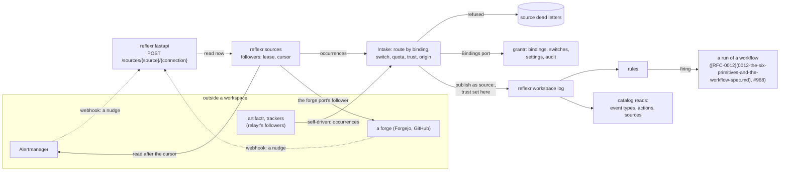

# RFC-0013: Event sources, stored workflows and reflexr's catalog

**Status:** Accepted
**Author:** Alex Nodeland
**Created:** 2026-10-30
**Discussion:** the pull request that adds this file
**Siblings:**

- lattice [RFC-0011](0011-the-v0-3-platform-capabilities-approvals-secrets-egress-and-adapters.md), the v0.3 platform, is what this builds on and does not redefine: the capability registry, the approval object, the secrets port, egress and taint, and the adapter registry. This RFC cites its sections.
- lattice [RFC-0012](0012-the-six-primitives-and-the-workflow-spec.md), the six primitives and the workflow spec ([#966](https://github.com/alexnodeland/lattice/issues/966)), defines stored workflows. This RFC keeps only how a source's events start a workflow run.
- [reflexr ADR-0057](../reflexr/adr/0057-reserved-publishers.md) reserves a namespace to its publisher; this RFC gives it the library-exported entry it left to revisit.
- [lattice RFC-0004](0004-relayr-and-task-trackers.md) is the shape every source here follows: a webhook nudges, a follower reads, with a lease and a cursor, and ids derived so that publishing is exactly once.

## Summary

reflexr gains **sources**: a `Source` protocol in `reflexr.sources`, through which anything outside a workspace publishes into it ([#839](https://github.com/alexnodeland/lattice/issues/839), [#841](https://github.com/alexnodeland/lattice/issues/841)). A source declares its event types, its trust level and what its bindings may select on; it is followed with a lease and a cursor, delivery is at least once and its effect exactly once, and what it can't deliver is a dead letter, never an append. Every envelope gains a **trust level**, which reflexr sets from the source's binding and never from the payload, and an **origin**, so a backfill or a test event can't set off rules written for live ones. **Bindings** route a tenant's or a deployment's source to workspaces; they are a lattice-core port that grantr stores and audits, as integrations are. **Quotas** are ADR-0030 settings per binding. relayr's bridges and trackers register as sources, with what they publish unchanged. reflexr's **catalog** reads (event types, actions, sources and their health) back #840's pages and the chat agent's drafting. The first sources are those the flagship [#898](https://github.com/alexnodeland/lattice/issues/898) needs: **Alertmanager** ([#846](https://github.com/alexnodeland/lattice/issues/846)) and **forge events** through the forge port ([#847](https://github.com/alexnodeland/lattice/issues/847), [#890](https://github.com/alexnodeland/lattice/issues/890)). Stored workflows are [RFC-0012](0012-the-six-primitives-and-the-workflow-spec.md)'s; this RFC fixes only what a run started by a source's events carries. Tracked by #839, under the epic [#837](https://github.com/alexnodeland/lattice/issues/837).

## Motivation

- **reflexr listens only to its own log.** External systems publish as a `SourceActor(name=...)` they choose, and nothing records what feeds a workspace, whether it is healthy, or how far its events can be trusted (#837). The bridges that exist (relayr's `artifactr:*`, `ui:form_submitted`, `excalidraw:elements_changed`, `tracker:*`, and schedules) were each built their own way.
- **The flagship starts with an alert and is steered by a red check** (#898, steps 1 and 6). Neither can reach a workspace today: stackr runs Prometheus and Grafana, but no Alertmanager and nothing that turns an alert into an event, and there is no forge source.
- **Prompt injection needs a boundary that a payload can't cross.** Forge comments, tracker items and webhook bodies are written by whoever can reach them. Taint ([RFC-0011](0011-the-v0-3-platform-capabilities-approvals-secrets-egress-and-adapters.md), #903) narrows what leaves a run that read them; it needs reflexr to say, for every envelope, which ones those are, from something the publisher can't forge.
- **Connectors (#925) and code sessions (#884) are about to build on it.** The connector port ([#926](https://github.com/alexnodeland/lattice/issues/926)) adds the action side and the connection to this protocol, and the forge port ([#893](https://github.com/alexnodeland/lattice/issues/893)) puts its event side on it. Fixing the source side first keeps them from each inventing one.
- **Why now:** #839 is in Wave 1 of the v0.3 plan, after [RFC-0011](0011-the-v0-3-platform-capabilities-approvals-secrets-egress-and-adapters.md) reached Discussion; M3, the flagship's thin path, builds #841, #846, #847 and #890 on it.

## Non-goals

- **Stored workflows' model,** the tool registry, dry runs, atomic proposals, budgets and their grantr actions (#843, #844). #843 and #844 were re-scoped to agents ([#947](https://github.com/alexnodeland/lattice/issues/947)) and workflows ([#965](https://github.com/alexnodeland/lattice/issues/965)); [RFC-0012](0012-the-six-primitives-and-the-workflow-spec.md) defines them, and the tool registry is [RFC-0011](0011-the-v0-3-platform-capabilities-approvals-secrets-egress-and-adapters.md)'s capability registry. [How a source's events start a workflow run](#how-a-sources-events-start-a-workflow-run) is all this RFC says of them.
- **The connector port's other halves:** the connection's lifecycle, the action side, the neutral event-type registry and the SDK ([#926](https://github.com/alexnodeland/lattice/issues/926), Wave 2). [What this RFC fixes and what it leaves to #926](#what-this-rfc-fixes-and-what-it-leaves-to-926) draws the line.
- **The generic signed webhook ([#842](https://github.com/alexnodeland/lattice/issues/842)), email, polls and Supabase rows ([#848](https://github.com/alexnodeland/lattice/issues/848)),** labelled `v0.3`, not `v0.3-core`, so 0.3.x. The protocol covers them; they are not built here.
- **Stored event types,** defined as data without code. Nothing in 0.3.0 needs them; they come with #842 (Decision R12).
- **Slack and the other chat sources:** not in 0.3.0, by the owner's decision.
- **The pages** of #840 and #928 beyond the reads that back them; their design is portalr's.

## Design

### Overview



- **A source adapts one system.** It says what it publishes, how to read it, and how to verify a webhook. It holds no lease, cursor, quota or trust logic.
- **The intake is reflexr's, one path for every source,** as [RFC-0011](0011-the-v0-3-platform-capabilities-approvals-secrets-egress-and-adapters.md)'s enforcer is one path for every capability: it routes each occurrence to its bindings, checks the switch, the quota and the size, sets the trust level and origin, and publishes or dead-letters. A source's actor publishes only through it.
- **The followers are reflexr's for the sources it drives,** with their leases and cursors in reflexr's storage. A self-driven source, such as relayr's followers, keeps its own lease and cursor and calls the intake; it reports its position, so its health reads the same.

### Trust levels

```python
Trust = Literal["untrusted", "authenticated", "internal"]   # in that order, lowest first
Origin = Literal["live", "backfill", "test"]

class Envelope(BaseModel):
    ...                                  # every field it has today
    trust: Trust = "untrusted"           # set by reflexr as it appends, never by the publisher
    origin: Origin = "live"
```

| Level | Means | Examples |
|---|---|---|
| `internal` | Written by lattice or the stack the operator runs | reflexr's own facts, schedules' ticks, Alertmanager's alerts, LiteLLM's budgets |
| `authenticated` | Written by an identified member of the tenant, through a surface that authenticated them | a person's publish over REST or MCP, artifactr's messages and proposals, forms, diagrams |
| `untrusted` | Content anyone outside the tenant can write | forge titles, bodies and comments; tracker items; webhook bodies; email |

- **One level per envelope, not per field.** A per-field mark would live in the payload, which is what the level must not depend on. A source whose event mixes structural fields with authored text takes the lower level, or publishes two types (Decision R1).
- **Where the level comes from,** in order, each step only lowering it:
  1. the source's declared `trust`, which the operator's configuration may raise up to the source's `max_trust`, never above;
  2. the binding's `trust`, which may only lower it;
  3. the occurrence's own `trust`, which a source sets to lower one event, never to raise it;
  4. the causation: an envelope published with causation is never more trusted than the firing that caused it.
- **Publishers that are not sources** get a level from their actor, so every envelope has one:

| Actor | Level |
|---|---|
| `SystemActor` (the reactor, schedules), reflexr's own facts | `internal` |
| `UserActor`, `ExternalAgentActor`, publishing through a surface | `authenticated` |
| `AgentActor`, `EvaluatorActor` (a run's events) | the lowest level among the firing's matched envelopes; a run started otherwise (#968) takes its cause's: a chat's `authenticated`, a schedule's `internal`, a parent run's own |
| `SourceActor` of a registered source | as above, through the intake only |
| `SourceActor` of no registered source | `untrusted`: an application that publishes as a made-up source keeps working, and its events are trusted least |

- **No publisher can set it.** `Workspace.publish` has no trust argument; the intake's handle is the only one that passes a level, and it computes it. An event type may have a field named `trust`, which is the event's and means nothing to reflexr.
- **A registered source's actor publishes only through the intake.** `publish` as `SourceActor(name="alertmanager")` from any other handle is `forbidden`, beside ADR-0057's check. That closes the hole ADR-0057 names, an application resolving a client to a reserved source, for every registered source (Decision R7).
- **Envelopes written before this** carry neither field. A before-validator fills an absent `trust` from the envelope's actor, by the table, with `SourceActor` as `untrusted`, and an absent `origin` as `live`; the field's own default, `untrusted`, applies only where no actor says more. Nothing is rewritten. Adding two fields with defaults is a minor change to reflexr's protocol schema (`reflexr:schema`, checked by `lattice:breaks`).
- **Trust and taint.** A run whose firing matched an `untrusted` envelope starts tainted, with those envelopes' ids as its causes, in [RFC-0011](0011-the-v0-3-platform-capabilities-approvals-secrets-egress-and-adapters.md)'s `Taint` ("Taint, as these parts read it"); the levels are what reflexr reads, and taint is what the enforcer narrows by.

**Rules filter on it,** through two new filter kinds in `reflexr.core`, because `where` reaches only an event's fields (Decision R2):

```python
on(ForgeCheckCompleted).where(state="failed").trusted(at_least="untrusted")
# {"kind": "trust", "at_least": "untrusted"}
on(AlertFiring).including("backfill")
# {"kind": "origin", "in": ["live", "backfill"]}
```

- **`origin` defaults to live.** A rule whose filter names no `origin` stage admits only `live` envelopes; the others still move its clock. So a backfill of 2000 past events, which lands at once because `ts` is the append time and never decreases, fires no `count` rule, and a test event from admin's "Send a test event" (#927) runs no workflow unless a rule opts in (Decision R3).
- Both are pure and stateless, so they join core's conformance fixtures, the rules' JSON Schema and the rule renderer (#838), and preview and replay stay exact. They are part of the condition language [RFC-0012](0012-the-six-primitives-and-the-workflow-spec.md) shares with rule predicates.

### The Source protocol

`reflexr.sources`, in reflexr's base distribution; it imports `reflexr.core`, `reflexr.workspace` and lattice-core's `integrations`, `settings`, `bindings` and [RFC-0011](0011-the-v0-3-platform-capabilities-approvals-secrets-egress-and-adapters.md)'s `secrets`.

```python
class SourceSpec(BaseModel, frozen=True):
    name: str                            # its actor is source:<name>, its switch source:<name>
    events: tuple[type[Event], ...]      # every type it publishes; it is their reserved publisher
    trust: Trust                         # its level where no one has lowered it
    max_trust: Trust                     # the most the operator may raise it to
    delivery: Literal["follow", "push"]  # follow: a webhook nudges, a follower reads; push: the delivery is the data
    driven: Literal["reflexr", "self"] = "reflexr"
    select: dict[str, JsonValue]         # the JSON Schema of what a binding may select on
    config: dict[str, JsonValue]         # the JSON Schema of a connection's configuration
    backfill: bool = False

class Occurrence(BaseModel, frozen=True):
    key: str                             # the source's idempotency key: an alert's fingerprint and start, a change's id and version
    event: Event
    tenant_id: str | None                # whose it is, for a deployment's connection; None reaches only the operator's bindings
    selectors: dict[str, JsonValue]      # what bindings match: {"labels": {...}}, {"repository": "acme/api"}
    trust: Trust | None = None           # lowers this one event, never raises it
    size: int                            # bytes as the source received it

class Page(BaseModel, frozen=True):
    occurrences: tuple[Occurrence, ...]
    cursor: JsonObject                   # opaque to reflexr, at most 256 KiB; saved after the page is published
    more: bool
    behind: timedelta | None = None      # how far the remote is ahead, where the source can tell

class Source(Protocol):
    spec: SourceSpec
    def streams(self, connection: Connection, /) -> Sequence[StreamKey]: ...
    async def read(self, connection: Connection, stream: StreamKey, cursor: JsonObject | None, /) -> Page: ...
    def verify(self, connection: Connection, delivery: Delivery, /) -> Nudge | Pushed | None: ...
    async def backfill(self, connection: Connection, stream: StreamKey, since: datetime, /) -> AsyncIterator[Page]: ...
```

- **The types it names:** a `Delivery` is a webhook's headers and raw body; a `Nudge` names the stream to read; `Pushed` holds the delivery's occurrences; a `StreamKey` is the source's name for one stream; a `Connection` is the minimal reference in [the table for #926](#what-this-rfc-fixes-and-what-it-leaves-to-926).
- **"A webhook nudges, a follower reads" is the standard shape** (`delivery="follow"`), as RFC-0004's trackers and the spike's finding, "events are hints, reconcile with status" ([PR #1222](https://github.com/alexnodeland/lattice/pull/1222)), both have it. `verify` checks a webhook's signature with the connection's secret and returns a `Nudge` naming the stream to read now, or None for anything it can't verify; the nudge carries nothing the intake publishes. A lost nudge is latency, never data.
- **The exception is a source that can't be read back** (`delivery="push"`): a generic webhook, or an Alertmanager the application can't reach. `verify` returns `Pushed`, the occurrences in the delivery, and the route answers 2xx only after the intake has committed them, so the sender's retries are the recovery; it has no stream, cursor or backfill. Its key must come from the delivery (a header or a field), never from arrival.
- **A stream is the unit of a lease and a cursor,** as the source divides its connection: a repository for a forge, a project for a tracker, the whole connection for Alertmanager. One follower per stream, in any number of processes, by a storage lease of 30 s renewed every third of that, as relayr's are ([relayr ADR-0015](../relayr/adr/0015-cursors-leases-and-dead-letters-in-the-ledger.md)).
- **The cursor is the source's state.** A level-triggered source keeps its snapshot in it (Alertmanager's active alerts), so it needs no table of its own; the limit keeps it a cursor and not a store.
- **Delivery is at least once, the effect exactly once.** The follower publishes a page, then saves its cursor; a crash between them, or a second process taking the lease, reads the page again. The intake derives each event's id, `src_` and the first 16 hex digits of a SHA-256 over the source, the connection, and the occurrence's key, joined by NUL bytes, and reflexr's `publish` appends an id once per workspace. Order is kept per stream and lease holder.
- **Started on open and at startup,** as relayr's followers are ([relayr ADR-0016](../relayr/adr/0016-followers-start-on-open.md)): the reactor resumes every stream with a binding, so a source is read even if no one opens a workspace.
- **Registered once,** `Workspaces(sources=[alertmanager, forge, ...])`, which derives `events=` and `publishers=` from the specs: each type in the workspaces' allowlist, reserved to `source:<name>`. A type two sources publish, such as `alert:firing` from Alertmanager and later from PagerDuty, is reserved to both. That is the library-exported entry ADR-0057 left to revisit. Each spec also declares its `Integration` (`source:<name>`, off by default unless the source says otherwise), which the application composes into its registry beside `KNOWN`, as [RFC-0011](0011-the-v0-3-platform-capabilities-approvals-secrets-egress-and-adapters.md)'s adapters declare theirs; lattice-core's `KNOWN` gains none.

### The intake

`Intake.accept(spec, connection, occurrences, origin=...)` decides each occurrence, in this order:

1. **Valid?** Its event's type is in the spec's `events`, and its size is within the source's limit (`source-size:<name>`, below). Otherwise it is dead-lettered as `invalid` or `too_large`, once, and nothing is appended anywhere.
2. **Routed:** the bindings of the connection (`Bindings.for_connection`) whose tenant is the occurrence's, whose `types` include its type, and whose `select` matches its selectors. A deployment's connection reaches a tenant's binding only for the tenant the source names, and an occurrence with no tenant reaches only bindings the operator made. None is counted as `unrouted`, not dead-lettered: a repository no one bound is not a failure.
3. **On?** `Integrations.is_enabled(tenant, workspace, "source:<name>")` for each binding. Off is counted as `paused` for that binding, neither queued nor dead-lettered (Decision R6). When every binding of a stream is off, its follower stops at its cursor instead, so turning the source on again resumes where it stopped, within what the remote keeps.
4. **Within quota?** The binding's rate (`source-rate:<name>`), counted through [RFC-0011](0011-the-v0-3-platform-capabilities-approvals-secrets-egress-and-adapters.md)'s `Counter` port. Over is dead-lettered as `rate_limited`.
5. **Trust and origin** as [above](#trust-levels); `origin` is `live` for a follower's pages, `backfill` for `backfill`'s, and `test` for admin's test event.
6. **Published** into each binding's workspace as `SourceActor(name=spec.name)`, with the derived id. A self-driven source may pass a `correlation_id` and causation, as relayr's follower does for a run's own writes ([relayr ADR-0021](../relayr/adr/0021-chains-continue-across-the-bridge.md)).
7. **Recorded:** the binding's last event, counts by outcome, and the stream's position, which the status reads report.

**What a source may filter before the log, and what it may not.** A binding selects by declared selectors (repository, label matchers, project, event types) and that is all: it is data, shown in admin, pure over the occurrence's selectors. A condition on an event's content is a rule's filter, which is pure, previewed and replayed; the intake has none (Decision R5).

### Dead letters

Source dead letters are a new kind: today's are a rule's.

- **In reflexr's storage,** `reflexr_source_dead_letters`, once per derived id and binding: the source, connection, binding (if routed), reason, the occurrence's key, selectors and event as JSON, and its size. A `too_large` one keeps the key, the selectors and a SHA-256 of the body, not the body.
- **A flood is not stored.** At most 100 dead letters per binding (or per connection, before routing) per minute are kept, and the rest are counted by reason, so a flood refused at the door can't fill the table behind it.
- **Retried** by `retry_source_dead_letter`, which runs the stored occurrence through the intake again, quotas included, with the same id, so a retry that succeeds publishes once.
- **Reasons:** `invalid`, `too_large`, `rate_limited`, `projection_failed` (a self-driven source's mapping raised), `depth_exceeded`. Anything else stops the stream's follower, logged, until it is started again, as relayr's do.

### Bindings

A binding says which of a source's events reach which workspace. It is a port in lattice-core, because three packages read it: reflexr's intake, relayr's trackers and the code sessions' repositories (#893). grantr stores it, audited, as it stores integrations and settings (Decision D8, [RFC-0011](0011-the-v0-3-platform-capabilities-approvals-secrets-egress-and-adapters.md)'s O13).

```python
class Binding(BaseModel, frozen=True):
    id: BindingId                        # "bnd_" and 16 hex digits
    tenant_id: str
    workspace_id: str
    source: str                          # a SourceSpec's name
    connection: str                      # the connection's id
    select: JsonObject                   # validated against the source's select schema
    types: frozenset[str] | None         # the types it receives; None: all of the source's
    trust: Trust | None                  # lowers the source's level here, never raises it
    options: JsonObject                  # the source's own, such as a tracker's default labels
    bound_at: datetime
    by: str                              # the operator, or the grantr subject who bound it

class Bindings(Protocol):
    async def for_connection(self, source: str, connection: str, /) -> Sequence[Binding]: ...
    async def for_workspace(self, tenant_id: str, workspace_id: str, /) -> Sequence[Binding]: ...
```

- **Two layers, as settings have:** the operator's, in the deployment's configuration, and the tenant's, in grantr's `grantr_bindings` table with row-level security by tenant. An admin's read shows the operator's as read-only.
- **Changed by grantr's commands,** each in its audit log in its transaction, under a new action, `grantr:manage_bindings`, held by a tenant's owners and admins. A workspace's admin pauses a source in their workspace with the switch `source:<name>`, under `grantr:manage_integrations`, as ADR-0027 already allows, under the tenant's ceiling.
- **`TRACKER_BINDINGS` becomes the operator's layer for trackers.** The template's `Bindings` reads it as it reads it today, `"<tenant>/<workspace>": {"project": ..., "labels": [...]}`, as a binding of `source="tracker"` on the adapter's connection, with `select={"project": ...}` and the labels in `options`; relayr's `TrackerBinding` is derived from it. It is deprecated once admin's Connectors page (#927) writes bindings, and read until then.
- **No history before `bound_at`.** `Workspace.history_from(types)` answers, for each type, the earliest `bound_at` among the bindings that deliver it here, or the workspace's start for types published by code. relayr's `preview` and the backtest (#845) say "no history before 14:02 on 30 Oct" instead of "would have fired 0 times".
- **Backfill,** where `spec.backfill` is true: binding with a `since`, or `backfill_source` later, reads `backfill(since)` into that binding alone, as `origin="backfill"`, under the binding's quota. A new binding otherwise starts silently, as RFC-0004's trackers do.

### Quotas

Settings, under [ADR-0030](../adr/0030-settings-typed-declared-in-lattice-core-and-only-narrowed-below.md), declared by each source as it registers:

| Key | Kind | Default | Lowest tier | Applies to |
|---|---|---|---|---|
| `source-rate:<name>` | `IntRange(0, 6000)`, events a minute | 120 | workspace | each binding; the workspace's layer is the binding's quota |
| `source-size:<name>` | `IntRange(1, 1048576)`, bytes | 262144 | tenant | each occurrence, before routing |

- **The tenant's layer bounds every binding in it,** and the workspace's narrows its own; neither may raise the operator's, which the deployment's configuration sets per source. A store that can't be read refuses, as ADR-0030 fails closed.
- **A connection's total,** across its bindings, is the operator's configuration in 0.3.0, enforced by the follower that holds the stream; a tenant's say over it comes with connections (#926).
- **Back-pressure:** a follower whose workspace appends are slow reads its next page later; nothing is buffered between the source and the log.

### relayr's bridges as sources

Each registers a `SourceSpec` with `driven="self"`, keeps its follower, lease, cursor and ledger as they are, and publishes through the intake instead of `Workspace.publish`. What each publishes is unchanged, and so are its tests, but for wiring.

| Bridge | Source | Trust | Binding | Delivery |
|---|---|---|---|---|
| artifactr's follower, with forms and diagrams | `artifactr`: `artifactr:*`, and `ui:*` and `excalidraw:*` through its projections, which `UI_PUBLISHERS` and `EXCALIDRAW_PUBLISHERS` already reserve to `source:artifactr` | `authenticated` | the same workspace, implied: a binding per workspace the ledger follows | self-driven, follower |
| trackers | `tracker`, one source for both adapters, as `SourceActor(name="tracker")` is today | `untrusted` (RFC-0004: "what comes back is untrusted text") | `TRACKER_BINDINGS`, then grantr's | self-driven, follower, nudged by `tracker_router` |
| schedules | `schedules`, reflexr's own | `internal` | a schedule's targets | reflexr, as today |

- **The artifactr bridge's level** is `authenticated` because it carries what members wrote; a person's message pasted from an outside source is still theirs. Its envelopes caused by a rule's write take the run's level, by the causation rule.
- **A spec's name is its actor's,** so no actor changes. Its switch is `source:<name>` unless the spec names others: the artifactr bridge gains `source:artifactr`, on by default as it is on today, and trackers keep `tracker:plane` and `tracker:vikunja`, the binding's adapter deciding which is asked, since they switch both sides today; splitting those into `source:` and `action:` keys is #926's.

### The first sources

#### Alertmanager and the stack's signals (#846)

The flagship's step 1, and so the first source built.

- **stackr gains an Alertmanager** (`prom/alertmanager`, pinned by digest) in the `observability` profile, and Prometheus's configuration gains `alerting` pointing at it and a rules directory. Today the stack has none: the state host's alerts say "add an Alertmanager if you want one" (Evidence). Grafana-managed rules reach the same Alertmanager as an external one (Unverified).
- **A webhook nudges, the follower reads.** Alertmanager's `webhook_configs` posts to `POST /reflexr/v1/sources/alertmanager/{connection}` with a bearer token, read from a file Alertmanager mounts, compared in constant time; the follower then reads `GET /api/v2/alerts` for the `lattice` receiver and diffs it with the active set in its cursor. A new `(fingerprint, startsAt)` is `alert:firing`; one gone from the list is `alert:resolved`. A silenced or inhibited alert is still listed, so it is not resolved. The follower also reads every 30 s, so a lost webhook is latency. Where Alertmanager can't be reached from the application (a hosted Grafana), the connection is `push`, and the webhook's payload is the data.
- **The key is the fingerprint and `startsAt`.** The fingerprint alone repeats each time the same labels fire again; with `startsAt`, a re-fired alert is a new event, and a redelivery or a restart publishes nothing new. A resolution's key adds `resolved`.
- **Tenants by label:** the connection is the deployment's, and the source names an alert's tenant from its `tenant_id` label, the label stackr's `prom-label-proxy` already scopes queries by. A tenant's binding selects by label matchers, such as `service=~"api.*"`, and receives only its own tenant's alerts. An alert without the label reaches only the operator's bindings. ([ADR-0019](../adr/0019-a-tag-for-each-tenants-workspace.md)'s tag is LiteLLM's spend; alerts carry the label.)
- **Trust `internal`, `max_trust` `internal`:** rules and annotations are the operator's. A label whose value comes from a request would carry outside text; the guide says not to template one into an annotation, and a tenant may lower the level for its bindings.
- **The types** are declared once, in `reflexr.sources.alerts`, in reflexr's base, so any later alert source publishes the same ones (ADR-0039 gives a namespace one declaring base):

```python
class AlertEvent(Event, abstract=True, event_namespace="alert"): ...

class AlertFiring(AlertEvent, name="firing"):        # alert:firing
    alertname: str
    fingerprint: str
    severity: str | None                             # the severity label, if any
    labels: dict[str, str]
    annotations: dict[str, str]
    starts_at: AwareDatetime
    generator_url: str | None
    receiver: str
    via: str                                         # "alertmanager"

class AlertResolved(AlertEvent, name="resolved"):    # alert:resolved, the same fields and ends_at
    ...
```

- **Where it lives:** `reflexr.sources.alertmanager`, behind a new `alertmanager` extra (httpx), an integration `source:alertmanager` off by default. It needs nothing of artifactr, so reflexr stays usable without it (Decision R10).
- **`examples/oncall`** replaces its simulated `oncall:alert.fired` with `alert:firing` from the stack, keeping the simulation for runs without the stack.
- **Budgets, scores and evaluations** (#846's other three) follow on the same protocol: LiteLLM's budget crossings at 80% and 100%, once per crossing per period (`litellm:budget.crossed`); Langfuse's scores below a threshold, polled with a cursor (`langfuse:score.below`); evalr's experiment results and regressions (`evalr:experiment.finished`, `evalr:regression`). Each is `internal`, bound by tenant, in its library's existing extra (`litellm`, `langfuse`, `evals`). They are after the flagship's path (Decision R14).

#### Forge events (#847, #890), through the forge port

#893 defines the forge port, in Wave 2. This RFC needs only its event side, and states that much:

- **One connection per tenant per forge,** shared with code sessions' forge connection (#886), so events and sessions don't hold two.
- **`verify(request) -> Nudge | None`:** the webhook's signature in the forge's own scheme (`X-Hub-Signature-256` for GitHub; Forgejo's own header, Unverified), and the repository to read.
- **A follower over changes:** `changes(connection, repository, cursor) -> Page`, reading what changed since the cursor, each change with a stable id (native id and version, or `updated_at`), so missed webhooks are recovered and a redelivery publishes nothing new.
- **Forge-neutral types,** `forge:change_request.opened`, `forge:check.completed`, `forge:issue.labeled`, `forge:review_comment.created` and `forge:change_request.conflicted`, each carrying `forge`, `repository`, the native ids and URL, and, for a check, a normalized `state`: a GitHub check run's failure and a Forgejo commit status's failure are both `failed` (the spike's CI was a Forgejo commit status, PR #1222). The namespace is #893's to declare; rules over it are written once for every forge.
- **A `backfill` capability flag,** where the forge can list changes since a time.
- **Its models importable without reflexr,** as #893 proposes for its package, so the source that maps them into `forge:` events is a bridge: it lives in relayr, as `relayr.forge` behind a `forge` extra, until #926 settles where connector adapters live, and reflexr imports nothing of it (Decision R10).
- **Trust `untrusted`, `max_trust` `untrusted` in 0.3.0** (Decision R9). Titles, bodies, comments, branch names and, on a fork's change request, even check names are written by whoever can open one; one level per envelope makes every forge event `untrusted`. A private repository's case for `authenticated` is revisited with connections (#926).
- **Bindings by repository** (`select={"repository": "acme/api"}`), and the binding's quota holds a busy organization.

The template rules of #890 (an issue labelled, CI red on a session's change request, a review comment, a conflict) run on these types, each with `.trusted(at_least="untrusted")` and a throttle, and each runs a workflow that accepts `untrusted`.

### How a source's events start a workflow run

Workflows are [RFC-0012](0012-the-six-primitives-and-the-workflow-spec.md)'s: their spec, steps, versions, scopes, budgets and grantr actions. Automations pin them (#972), and runs are decoupled from rules (#968). This RFC fixes only what crosses from the source to the run:

1. **A rule's `then` names a workflow** and a version, with a mapping from the event's fields to its inputs (#972); code actions stay as one-step workflows. The run's cause is the firing (#968).
2. **The run carries a trust level,** the lowest among the firing's matched envelopes, and passes it on: the run's events are no more trusted than it (the causation rule), its taint starts as [RFC-0011](0011-the-v0-3-platform-capabilities-approvals-secrets-egress-and-adapters.md) describes, and a code action's `Reaction` gains `trust`.
3. **A workflow declares the lowest level it accepts.** This RFC asks [RFC-0012](0012-the-six-primitives-and-the-workflow-spec.md) for the field, with `authenticated` as its default. A firing below it starts no run: the run is dead-lettered at once with the reason `trust_refused`, so the refusal is visible, and drafting (`check_draft`) says so when a rule's types come only from sources below it.
4. **Untrusted content reaches an agent only as data.** An input mapped from an `untrusted` envelope may be passed as a typed input and read through a tool's result (`read_events` today), never interpolated into an `agent_task`'s instructions or task text. This RFC asks [RFC-0012](0012-the-six-primitives-and-the-workflow-spec.md)'s static checks to refuse the interpolation.
5. **The tools a run may call** are [RFC-0011](0011-the-v0-3-platform-capabilities-approvals-secrets-egress-and-adapters.md)'s capabilities, narrowed by the run's taint; this RFC adds no registry.

For the flagship: `alert:firing` (`internal`) fires a rule whose one-step `agent_task` triages; `forge:check.completed` with `state="failed"` (`untrusted`) fires #890's rule, whose workflow accepts `untrusted`, and the session it steers is tainted, so marking the change request ready asks a person (#898 step 7, [RFC-0011](0011-the-v0-3-platform-capabilities-approvals-secrets-egress-and-adapters.md)'s approvals).

### The catalog

Each read is a `Workspace` method, carried on REST, WebSocket where it streams, and MCP through the one command handler ([reflexr ADR-0044](../reflexr/adr/0044-surfaces.md)), and in the protocol schema. Paths are under reflexr's router (`/reflexr/v1` in the template).

| Route | MCP tool | Answers | Asks `authorize` |
|---|---|---|---|
| `GET /workspaces/{id}/event-types` | `list_event_types` | each type in the workspace's registry: name, namespace, JSON Schema, reserved publishers, whether only runs may publish it, the sources that publish it here with their level, and `history_from` | `reflexr:read_catalog` |
| `GET /workspaces/{id}/actions` | `list_actions` | each action: name, kind (`function`, `agent`, `graph`, `workflow`), version, description, its params or inputs schema, emit allowlist, the rules that run it, a graph as Mermaid; a workflow's further fields are [RFC-0012](0012-the-six-primitives-and-the-workflow-spec.md)'s | `reflexr:read_catalog` |
| `GET /workspaces/{id}/sources` | `list_sources` | each binding reaching the workspace: source, connection, state (on, paused, off for the tenant, not installed), level, types, last event, lag, outcomes by reason over the last hour and day, dead letters, `bound_at`, `history_from`, whether it can backfill | `reflexr:read_sources` |
| `GET /sources` | `list_sources` with no workspace | the same across the tenant, by connection, for admin (#927) | `reflexr:read_sources`, no workspace |
| `GET /workspaces/{id}/sources/{binding}/dead-letters` | `list_source_dead_letters` | the binding's dead letters, newest first | `reflexr:read_dead_letters` |
| `POST /workspaces/{id}/sources/{binding}/dead-letters/{dl}/retry` | `retry_source_dead_letter` | the outcome of running it through the intake again | `reflexr:retry_source_dead_letter` |
| `POST /workspaces/{id}/sources/{binding}/backfill` | `backfill_source` | the backfill started, from `since` | `reflexr:backfill_source` |
| `GET /workspaces/{id}/events?participant=&correlation_id=` | `read_events` | the log as today, filtered also by actor and chain, for #840's Events page | `reflexr:read_events` |
| `POST /sources/{source}/{connection}` | none | a webhook's delivery: 204 for a nudge, 2xx once a push is committed, the same 401 for an unknown connection and a bad signature | none: verified by the source; refused above 1 MB before it is read |

- **Tools are not in reflexr's catalog.** They are [RFC-0011](0011-the-v0-3-platform-capabilities-approvals-secrets-egress-and-adapters.md)'s capabilities; portr and portalr read them from the composed registry.
- **Four new actions** join `ACTIONS`: `reflexr:read_catalog` and `reflexr:read_sources` (members), and `reflexr:retry_source_dead_letter` and `reflexr:backfill_source` (workspace admins). grantr's built-in roles gain them, and the template's `access.md` matrix and `tests/test_access.py` list each. The intake publishes beneath `authorize`, as the reactor's own work does: who may reach a source is the binding's, not a subject's.
- **`draft_rule` reads the catalog,** so a draft names real types, fields and actions, and is refused naming the known ones otherwise (#840).
- **Scoped by permission:** a read filters what it returns by what the caller may read, as `rules_for` does; a source's dead letters name events, so they need `read_dead_letters`, not only `read_sources`.

### What this RFC fixes and what it leaves to #926

| Fixed here, for 0.3.0 | Left to the connector port's RFC (#926) |
|---|---|
| The `Source` protocol, the intake and its order, delivery and dead letters | The connection's lifecycle: auth kinds, OAuth, refresh, revocation, a health check |
| Trust levels and origin on envelopes | The action side, registered as [RFC-0011](0011-the-v0-3-platform-capabilities-approvals-secrets-egress-and-adapters.md) capabilities |
| `Binding` and the `Bindings` port, grantr's store, `grantr:manage_bindings` | `connectors:*` grantr actions for connections; whether #926's `connectors:bind` and `connectors:pause` become these or aliases (D8: this RFC recommends #926 adopt these) |
| `source:<name>` as each source side's integration key | Splitting trackers' `tracker:<name>` into `source:` and `action:` keys |
| The quotas' settings per binding | A tenant's say over a connection's total; back-pressure across connectors |
| `alert:` types; the forge port's event side as this RFC needs it | The neutral event-type registry by domain, and which fields each guarantees |
| The minimal `Connection` the protocol reads: `id`, `source`, owner (the deployment or a tenant), `config`, and [RFC-0011](0011-the-v0-3-platform-capabilities-approvals-secrets-egress-and-adapters.md) `SecretRef`s | Where connections are stored and how admins create them (#927) |
| The source contract suite, below | The SDK, scaffold, recorded fixtures and conformance kit built on it (#929) |
| Where 0.3.0's sources live | Where connector adapters live from then on, including whether relayr becomes "connectors and bridges" |
| | Hosts a connection declares for egress ([RFC-0011](0011-the-v0-3-platform-capabilities-approvals-secrets-egress-and-adapters.md)'s O6) |

In 0.3.0, connections come from the deployment's configuration (Alertmanager) and from the forge port's connections (#886); nothing here creates one from admin.

### Where each part lives

Under [ADR-0018](../adr/0018-lattice-core-what-the-libraries-share.md), with [ADR-0026](../adr/0026-a-distribution-needs-a-reason-integrations-are-extras.md) for extras and [ADR-0027](../adr/0027-integrations-switched-per-workspace-through-one-port.md) for ports.

| Part | Home | Why |
|---|---|---|
| `Trust`, `Origin`, the envelope's fields, the `trust` and `origin` filters | `reflexr.core` | The log's model and core's pure filters |
| `Source`, `SourceSpec`, `Occurrence`, the intake, followers, statuses | `reflexr.sources`, base | #837 decided it: a protocol in reflexr keeps reflexr usable without artifactr |
| Source storage: streams, dead letters, activity | reflexr's `Storage` protocol, in memory and SQL | Beside the log it guards, in the same transaction as the append |
| Webhook route and catalog reads | `reflexr.fastapi`, `reflexr.mcp` | Every surface over one handler |
| `Binding`, `Bindings`, and `Trust` for the binding to name | `lattice_core.bindings`, no extra; `reflexr.core` re-exports `Trust` | Read by reflexr, relayr and the code sessions package, which import none of one another; ADR-0027's precedent of a port in lattice-core answered by grantr |
| The bindings store and its commands | grantr | Audited, per tenant, beside integrations and settings |
| `alert:` types | `reflexr.sources.alerts`, base | One declaring base for every alert source |
| Alertmanager source | `reflexr.sources.alertmanager`, `alertmanager` extra | Integrates reflexr with an HTTP API alone |
| Budgets, scores, evaluations | reflexr's `litellm`, `langfuse` and `evals` extras | The extras that already reach them |
| Forge source | `relayr.forge`, `forge` extra | A bridge between reflexr and the forge port's package |
| relayr's bridges' specs | `relayr.sources` | Beside the followers they describe |

- **lattice-core's new module imports only the standard library and pydantic,** as its layering test requires; reflexr's and relayr's layering tests gain `lattice_core.bindings`.
- **No library imports another.** grantr answers `Bindings` without importing reflexr; reflexr reads it without importing grantr; the application composes them.

### What changes in each package

| Package | Changes | Breaking |
|---|---|---|
| reflexr | `trust` and `origin` on `Envelope`; the `trust` and `origin` filters and their fixtures; `reflexr.sources` and its storage, with a migration; `Workspaces(sources=)`; the webhook route and catalog reads on REST and MCP; four actions; `history_from`; `reflexr.sources.alerts`, and the `alertmanager` extra; the budgets, scores and evaluations sources | No: fields with defaults and new extras; rules without an `origin` stage now skip non-live envelopes, which no log holds yet |
| lattice-core | `lattice_core.bindings` | No: an addition |
| grantr | `grantr_bindings` with RLS, its commands and audit, `grantr:manage_bindings`; the new reflexr actions in the built-in roles | No |
| relayr | Its bridges and trackers register specs and publish through the intake; `TrackerBinding` from `Bindings`; `relayr.forge` | Only for an application that publishes as `source:artifactr` or `source:tracker` itself, which ADR-0057 already forbids |
| portalr | The reads for #840's pages and #928 (pages in 0.3.x) | No |
| stackr | The Alertmanager service, Prometheus's alerting, the template's wiring of `source:alertmanager` and a test alert command; `TRACKER_BINDINGS` read as bindings | No |
| examples/oncall | Real alerts in place of simulated ones | No |

### Testing at 100% branch coverage

- **Core:** conformance fixtures for `trust` and `origin`, including a rule with no `origin` stage over a backfilled burst that fires nothing; property tests that any batching decides the same.
- **No payload sets a level:** a property test publishes arbitrary events, with fields named `trust` and `origin` among them, through every handle, and finds every envelope's level as the table says; the intake's level is never above the source's, the binding's or the cause's.
- **The intake, step by step,** with fakes for `Bindings`, `Integrations`, `Settings` and `Counter`: each refusal, the order (invalid before routed, paused before quota), fail-closed on an unreadable setting, the flood cap on dead letters.
- **Delivery,** in reflexr's storage behaviour suite, on memory, SQLite and PostgreSQL: a stream read again after a crash between publish and cursor, and a lease taken over mid-page, each publish every occurrence once; time by a fake clock, never by waiting.
- **A TLA+ spec,** `docs/reflexr/spec/SourceFollowers.tla`, of leases, cursors, nudges and takeover at small bounds, under [ADR-0025](../adr/0025-formal-specs-in-tla-and-lean.md), with its invariants tied to the delivery tests by name.
- **One source contract suite** in `reflexr.sources.testing`, run against a fake source of each kind (follow, push, self-driven) and every real one: verification refuses a forged delivery, keys are stable across reads, a cursor resumes, `backfill` marks its origin. It is the seed of #929's conformance kit.
- **Alertmanager:** recorded webhook payloads and API responses from the pinned release; live in stackr's smoke job, which posts a test alert to Alertmanager's API and waits for the event in a workspace.
- **Forge:** against the forge port's fake, and against Forgejo in CI, with GitHub's recorded fixtures.
- **Tenancy:** a two-tenant test in which each receives only its own alerts and repositories; bindings' RLS in grantr's suite.
- **Surfaces:** `tests/test_access.py` for every new method; the protocol schema and OpenAPI documents regenerated (`reflexr:schema`) and checked for drift and breaks.
- **relayr:** its existing suites pass unchanged, and one more asserts that each bridge appears in `list_sources`.

### Phases

| Phase | Milestone | Deliverable | Exit criteria |
|---|---|---|---|
| 0. Design | M1 | This RFC accepted; an ADR per decision as it is built | Accepted with [RFC-0011](0011-the-v0-3-platform-capabilities-approvals-secrets-egress-and-adapters.md) and [RFC-0012](0012-the-six-primitives-and-the-workflow-spec.md) |
| 1. The envelope | M3 | `trust` and `origin`, the two filters, their fixtures, the schema | Fixtures pass; `lattice:breaks` reports a minor change; no payload sets a level |
| 2. The protocol | M3 | `reflexr.sources`, the intake, followers, storage and migration, dead letters, quotas, statuses, the webhook route, `Workspaces(sources=)`; the TLA+ spec | Delivery once across crash and takeover on every storage; a burst over quota is dead-lettered and not appended; the contract suite passes on the fakes |
| 3. Bindings | M3 | `lattice_core.bindings`, grantr's store and commands, each source's `source:<name>` declared and composed, `TRACKER_BINDINGS` as the operator's layer | Two tenants never see each other's; every change is in Audit |
| 4. The bridges | M3 | relayr's bridges and trackers as sources | Their suites pass unchanged; each appears in `list_sources` |
| 5. Alerts | M3 | stackr's Alertmanager, the source, oncall on real alerts | #898's step 1 in CI: a test alert reaches a workspace and starts a run |
| 6. Forge | M3, after #893's port | `relayr.forge` on the forge port, #890's template rules, trust carried to the run (with #968) | #898's step 6 against Forgejo: a failed check steers the session, once per head commit |
| 7. Catalog | M3 | The catalog and status reads on REST and MCP; `draft_rule` on the catalog | The reads pass the access matrix; #898's run is visible from the alert to the change request |
| 8. Stack signals | M5 | Budgets, scores and evaluations | Each publishes once across restarts, bound by tenant |
| 0.3.x | | #840's and #928's pages, #842 with stored event types, #848, admin's backfill and test event (#927) | Their issues' criteria |

## Decisions

Decided by the owner:

| # | Question | Decided | Where |
|---|---|---|---|
| D1 | Where the protocol lives | A `Source` protocol in reflexr, concrete sources as extras, each an integration switched per tenant and workspace; relayr's bridges implement it | #837, Decisions so far; #841 |
| D2 | Who sets trust | Each source declares a level, which reflexr sets on its envelopes, never the payload | #837, cross-cutting concerns |
| D3 | Stored workflows | [RFC-0012](0012-the-six-primitives-and-the-workflow-spec.md) is written and accepted in M1, and this RFC builds on it; 0.3.0 ships a one-step `agent_task` workflow and decoupled runs (#968) | v0.3 plan, §7.1 (2026-10-30) |
| D4 | Slack | Not in 0.3.0; no chat source here | v0.3 plan, §7.4 |
| D5 | Forges and agents | Forgejo plus one ACP agent; GitHub stays the forge port's first adapter | v0.3 plan, §7.5 and §7.6; #958 |
| D6 | The platform | One RFC for #940 to #944, [RFC-0011](0011-the-v0-3-platform-capabilities-approvals-secrets-egress-and-adapters.md), which this cites and does not redefine | v0.3 plan, §7.3 |
| D7 | The webhook, email, polls and rows | 0.3.x: #842 and #848 are `v0.3`, not `v0.3-core` | their labels; the v0.3 plan, §2 |
| D8 | Where bindings are stored (this RFC's R4) | A `lattice_core.bindings` port, stored and audited by grantr under `grantr:manage_bindings`, held by a tenant's owners and admins | [RFC-0011](0011-the-v0-3-platform-capabilities-approvals-secrets-egress-and-adapters.md), Decision O13 (2026-10-31) |

Decided by the owner on 2026-10-31, on accepting this RFC:

| # | Question | Decided | Instead of |
|---|---|---|---|
| R1 | Trust's shape | Three ordered levels, one per envelope, lowered and never raised by binding, occurrence and causation; non-source actors by the table | A level per field (#847's question), which the payload would carry |
| R2 | Filtering on trust | `trust` and `origin` filter kinds in core | A reserved event field `trust`, which the payload would then hold |
| R3 | Backfills and test events | `origin` on the envelope; rules skip non-live envelopes unless they opt in | Backfills published as live, which fire every `count` rule at once |
| R5 | Filtering before the log | Bindings select by declared selectors only; content is rules' | A predicate on the source, which preview and replay couldn't see |
| R6 | Pausing a source in a workspace | Refused for that binding and counted, neither queued nor dead-lettered; resumed with a backfill where the source has one | Queued until resumed, which a pause of days would grow without bound |
| R7 | A registered source's actor | Publishes only through the intake | ADR-0057's rule alone, which trusts the application never to resolve a client to it |
| R8 | Alertmanager | stackr adds one; a webhook nudges and the follower reads `/api/v2/alerts`; the key is fingerprint and `startsAt`; tenants by `tenant_id`; `internal` | Grafana's contact point to the generic webhook, #846's fallback, without typed events or tenant bindings |
| R9 | Forge events' level | `untrusted`, with no raise in 0.3.0 | `authenticated` for structural events, which branch and check names on a fork's change request belie |
| R10 | Where the sources live | `reflexr.sources` in reflexr's base; Alertmanager and the stack's signals as reflexr extras; the forge source in relayr | Every adapter in relayr now, #926's proposal, which would make reflexr's own alerts need artifactr installed |
| R11 | Catalog actions | Four: `reflexr:read_catalog`, `read_sources`, `retry_source_dead_letter`, `backfill_source` | Reusing `read_rules`, which says nothing of what the read shows |
| R12 | Stored event types | Not in 0.3.0; with #842, by an ADR: types as JSON Schema under a tenant's namespace, versioned by addition only | Deciding now, with no source that needs one |
| R13 | What [RFC-0012](0012-the-six-primitives-and-the-workflow-spec.md) is asked for | A workflow's lowest accepted level, `authenticated` by default; refusing untrusted fields in instructions | A workflow that accepts whatever fires it |
| R14 | #846's other signals | Budgets, scores and evaluations in M5, after the flagship's path; #846 stays core | All four in M3 |

## Drawbacks

- **Every envelope grows two fields,** and core two filter kinds that the conformance fixtures, the rules' JSON Schema and the renderer must carry.
- **One level per envelope is coarse:** a forge event with one outsider's word in it is as untrusted as a stranger's webhook, and workflows over forge events must accept `untrusted`, so most of #890's runs are tainted. That is the price of a level no payload can shape.
- **A hot workspace stays serialized** (reflexr's open question): a busy organization's events to one workspace queue behind one lock. Quotas are 0.3.0's answer; partitioning a log is not.
- **Sources live in two packages** in 0.3.0, reflexr's extras and relayr's, until #926 decides; the protocol is one.
- **Alertmanager is one more service** in stackr's observability profile, and its webhook a route without a session, which must give nothing away.
- **`untrusted` as the default for unregistered sources** lowers events that applications publish today as made-up sources; their rules still fire, but a workflow that accepts only `authenticated` refuses them.

## Alternatives

- **Sources in relayr or a new package:** rejected by #837; a protocol in reflexr keeps reflexr usable without artifactr.
- **Trust as an event field,** declared per type: simpler for rules (`where(trust=...)`), but a field is the payload's.
- **Per-field trust marks** in the event type's schema: finer for forge events, but every consumer would have to honour them, and the envelope's one level is what taint and refusal read.
- **Webhooks as the source of truth:** lower latency, but deliveries are lost to restarts and deactivation, and order and ids aren't stable, as RFC-0004 found.
- **Backfills at their original times:** `ts` is the append time and never decreases, which rules' determinism rests on.
- **Bindings as settings:** settings are numbers and subsets per workspace, not routing with selectors.
- **Grafana's contact point to the generic webhook:** #846's fallback, kept for deployments without stackr's Alertmanager, without typed events or tenant routing.

## Unresolved questions

- **The accepted level, between this RFC and [RFC-0012](0012-the-six-primitives-and-the-workflow-spec.md).** R13 asks for a workflow's lowest accepted level, `authenticated` by default, refused as `trust_refused`; RFC-0012, accepted with this one, puts the levels on the agent (#947), fails an `agent_task` below them with `untrusted_trigger`, and declares none on the workflow. Which is built is still to reconcile. RFC-0012 fixes the input mapping (`then`'s `inputs`).
- **Whether evaluator verdicts on untrusted runs** should be `untrusted` too, by the causation rule, or `internal`, as judgements of lattice's own models.
- **Paused intervals in preview:** 0.3.0 reports `bound_at`; reporting the gaps a pause left is 0.3.x.
- **The neutral `alert:` fields** may grow when #926's registry lands; additions only.
- **A private repository's forge events** as `authenticated` (R9), with connections (#926).

### Unverified

Each is settled in phase 5 or 6, and recorded as a fixture.

- Alertmanager's `GET /api/v2/alerts` filters (`receiver`, `silenced`, `inhibited`, `active`), that it lists silenced and inhibited alerts with their state, and that a resolved alert leaves the list: from memory of Alertmanager's API.
- An alert's `fingerprint` is stable across Alertmanager restarts for the same labels, and `startsAt` is kept on re-notification: from memory.
- Alertmanager's webhook payload (version 4: `alerts[]` with `status`, `labels`, `annotations`, `startsAt`, `endsAt`, `fingerprint`, `generatorURL`) and `http_config.authorization.credentials_file`: from memory.
- Grafana-managed alert rules forwarding to an external Alertmanager in the stack's pinned Grafana, and whether its webhook contact point can sign with HMAC: from memory.
- Forgejo's webhook signature header and scheme, and its commit statuses' failed states: from memory; the spike read statuses back but didn't verify webhooks.
- GitHub's `X-Hub-Signature-256`: from #847.

## Tracking

- [ ] Where each item of #839 is settled ([below](#where-each-item-of-839-is-settled)), and each later sub-issue of #837 linked to its section
- [ ] reflexr: `trust` and `origin` on envelopes, the two filters, fixtures and schema (#841)
- [ ] reflexr: `reflexr.sources`, the intake, followers, storage, dead letters, quotas, statuses and the webhook route (#841)
- [ ] reflexr: the TLA+ spec of followers and its tests (ADR-0025)
- [ ] lattice-core and grantr: `lattice_core.bindings`, grantr's store and commands (D8, RFC-0011's O13), `source:*` integrations (#841)
- [ ] stackr: `TRACKER_BINDINGS` read as the operator's bindings
- [ ] relayr: the bridges and trackers as sources (#841, #930)
- [ ] stackr and reflexr: Alertmanager, the source, oncall on real alerts (#846, #931)
- [ ] relayr: the forge source on the forge port, after #893 (#847)
- [ ] stackr and reflexr: #890's template rules, with trust carried to the run (#890, #968, #972)
- [ ] reflexr: the catalog and status reads on REST and MCP, the four actions, grantr's roles and `access.md` (#840, #841)
- [ ] reflexr: budgets, scores and evaluations (#846)
- [ ] reflexr ADR: trust levels and origin on envelopes, set by reflexr and never by the payload, with the `trust` and `origin` filters; rules skip non-live envelopes unless they opt in (D2, R1, R2, R3)
- [ ] reflexr ADR: the intake: bindings select by declared selectors only, a paused binding refused and counted, a registered source's actor publishes only through it (R5, R6, R7)
- [ ] reflexr ADR: where sources live: the `Source` protocol in reflexr's base, Alertmanager and the stack's signals as reflexr extras, the forge source in relayr (D1, R10)
- [ ] reflexr and stackr ADRs: Alertmanager in stackr's observability profile, nudged and followed, keyed by fingerprint and `startsAt`, tenants by `tenant_id`, `internal`; #846's other signals in M5 (R8, R14)
- [ ] relayr ADR: the forge source, `relayr.forge`, its events `untrusted` with no raise in 0.3.0 (R9; RFC-0015's C13)
- [ ] reflexr ADR: the catalog's four actions (R11)
- [ ] reflexr ADR: what a run started by a source carries, a workflow's lowest accepted level and untrusted fields kept out of instructions, reconciled with RFC-0012's trust on the agent (R13)
- [ ] reflexr ADR (0.3.x, with #842): stored event types, as JSON Schema under a tenant's namespace, versioned by addition only (R12)
- [ ] Docs: reflexr's and relayr's architecture and protocol, the sources guide, stackr's Alertmanager guide, the upgrade note (#946)

### Where each item of #839 is settled

| #839 asks | Settled in |
|---|---|
| The `Source` protocol: namespace, types and schemas, publisher, follower with lease, cursor and dead letters; nudge and follower, and the exception | [The Source protocol](#the-source-protocol), [Dead letters](#dead-letters) |
| Trust levels, set by reflexr | [Trust levels](#trust-levels) |
| Bindings, their store, switches and `TRACKER_BINDINGS` | [Bindings](#bindings) |
| Quotas, refusals and filtering before the log | [Quotas](#quotas), [The intake](#the-intake) |
| No history and backfill | [Bindings](#bindings), and `origin` in [Trust levels](#trust-levels) |
| Stored event types | Deferred to #842, in 0.3.x (R12) |
| relayr's bridges and trackers | [relayr's bridges as sources](#relayrs-bridges-as-sources) |
| Stored workflows' model, tool registry, dry run, atomic proposals, cost and evaluation | [RFC-0012](0012-the-six-primitives-and-the-workflow-spec.md), #947, #965; the tool registry is [RFC-0011](0011-the-v0-3-platform-capabilities-approvals-secrets-egress-and-adapters.md)'s capability registry |
| Prompt injection | [Trust levels](#trust-levels), [How a source's events start a workflow run](#how-a-sources-events-start-a-workflow-run); taint is [RFC-0011](0011-the-v0-3-platform-capabilities-approvals-secrets-egress-and-adapters.md)'s |
| grantr actions for workflows | [RFC-0012](0012-the-six-primitives-and-the-workflow-spec.md) |
| grantr actions for sources | [The catalog](#the-catalog), [Bindings](#bindings) |
| The catalog's REST and MCP contract | [The catalog](#the-catalog) |

## Evidence

Gathered on 2026-10-30, with lattice read at `origin/main` (`a52c5f81`), and [RFC-0011](0011-the-v0-3-platform-capabilities-approvals-secrets-egress-and-adapters.md) at PR #1217's head.

| Claim | Where | |
|---|---|---|
| `Envelope` has `seq`, `id`, `ts`, `workspace_id`, `actor`, `causation`, `correlation_id`, `traceparent` and `event`, and no trust | `reflexr/core/events.py` | Verified |
| `SourceActor(name)`'s participant is `source:<name>` | `reflexr/core/actors.py` | Verified |
| `publishers=` reserves a namespace or type to actors by participant, beneath `authorize`; its Revisit names a library-exported entry | reflexr ADR-0057 | Verified |
| `ACTIONS` lists `reflexr:read_events`, `read_rules`, `read_dead_letters` and the other reads; none for a catalog or sources | `reflexr/workspace/workspace.py` | Verified |
| `GET /workspaces/{id}/events` exists; no event-types, actions or sources route | `reflexr/fastapi/router.py` | Verified |
| A rule's `where` reaches the event's fields; filters are `on`, `where`, `all`, `any`, `not`, `predicate` | `docs/reflexr/architecture.md` | Verified |
| `ts` is the append time and never decreases in a workspace | `docs/reflexr/architecture.md`, Tenancy and concurrency | Verified |
| Dead letters today are per rule | `docs/reflexr/architecture.md`, Data model | Verified |
| relayr's followers publish as `SourceActor("artifactr")` and `SourceActor("tracker")`, with leases and cursors in relayr's ledger | `docs/relayr/architecture.md` | Verified |
| `TRACKER_BINDINGS` is `{"<tenant>/<workspace>": {"project": ..., "labels": [...]}}` in the template's settings | `packages/stackr/template/tests/test_settings.py.jinja`, `settings.py.jinja` | Verified |
| An integration key is a name or `family:name` with one colon; `KNOWN` holds `tracker:plane` and `tracker:vikunja` | `lattice_core/integrations.py` | Verified |
| `Settings.value(tenant_id, workspace_id, key)` needs a workspace | `lattice_core/settings.py` | Verified |
| stackr runs Prometheus and Grafana and no Alertmanager; Prometheus has no `alerting` | `packages/stackr/compose.yaml`, `deploy/prometheus/prometheus.yml` | Verified |
| The state host's alerts send no notification: "add an Alertmanager" | `packages/stackr/deploy/aws/state-host/alerts.yml` | Verified |
| `prom-label-proxy` scopes portalr's queries by `tenant_id` | `packages/stackr/compose.yaml` | Verified |
| oncall's alerts are its own `oncall:alert.fired` | `examples/oncall/src/oncall/events.py` | Verified |
| The spike's CI was a Forgejo commit status; "events are hints, reconcile with status" | PR #1222's write-up | Verified |
| Alertmanager's API and webhook, Grafana's forwarding, Forgejo's signature | their documentation, not read here | Unverified |
