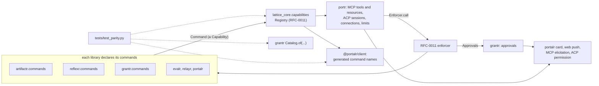

# RFC-0014: portr, the command catalog and the MCP/ACP gateway

**Status:** Accepted
**Author:** Alex Nodeland
**Created:** 2026-10-30
**Discussion:** the pull request that adds this file
**Siblings:**

- [lattice RFC-0011](0011-the-v0-3-platform-capabilities-approvals-secrets-egress-and-adapters.md), Accepted, is the platform this builds on: the capability registry and its enforcer, the approval object and its surfaces. This RFC defines none of them again; it cites [RFC-0011][rfc-0011]'s sections by name.
- [lattice ADR-0018](../adr/0018-lattice-core-what-the-libraries-share.md) is the boundary portr keeps: artifactr, reflexr and grantr import none of one another, and lattice-core imports no lattice package.
- [lattice ADR-0030](../adr/0030-settings-typed-declared-in-lattice-core-and-only-narrowed-below.md) is how portr's limits are set, and [ADR-0027](../adr/0027-integrations-switched-per-workspace-through-one-port.md) how its toolsets are switched.
- [artifactr ADR-0048](../artifactr/adr/0048-surfaces-over-the-runner.md) and [ADR-0056](../artifactr/adr/0056-access-asked-in-every-workspace-method.md) are why a new surface is safe: every surface hands commands to the runner, and every `Workspace` method asks `authorize`.

## Summary

portr serves all of lattice to outside clients through one gateway per deployment ([#914](https://github.com/alexnodeland/lattice/issues/914)). Every action a person can take in portalr is a **command**, declared once by the package that owns it in a shape lattice-core holds, `lattice_core.commands.Command`, which is a [RFC-0011][rfc-0011] `Capability` of provider kind `command` plus what only surfaces need: its toolset, its portalr route, whether it is a tool or a resource, and why it isn't exposed if it isn't. The gateway generates MCP tools and resources from the composed registry and calls every one through [RFC-0011][rfc-0011]'s `Enforcer.call`, so it imports no library. A **parity test** in CI fails when a portalr action has no command, a command has no tool, a tool has no grantr action, or a grantr action has no command ([#916](https://github.com/alexnodeland/lattice/issues/916)). People connect over Streamable HTTP with MCP's OAuth, Supabase Auth as the authorization server, and service principals with grantr keys ([#917](https://github.com/alexnodeland/lattice/issues/917)); a **connection** is a grantr object, consented per tenant and toolset, limited and revocable. Approvals reach the client as MCP elicitations, a surface of [RFC-0011][rfc-0011]'s approval object; in 0.3.0 a coding agent's ACP permission request is where an ask comes from, and editors' ACP permission requests follow in 0.3.x; and high-risk admin actions need the caller's own **confirmation** out of band, in portalr ([#918](https://github.com/alexnodeland/lattice/issues/918)). A client's conversation is a real thread, attributed "via <client>". 0.3.0 ships the catalog, the parity test, the core toolset and approvals (#916 to #918); the other toolsets, UI resources, the MCP client, ACP as an agent and WebMCP follow in 0.3.x (#919 to #924, [#990](https://github.com/alexnodeland/lattice/issues/990)). Tracked by [#915](https://github.com/alexnodeland/lattice/issues/915).

## Motivation

- **People work outside portalr.** Claude Desktop, claude.ai, ChatGPT, Cursor, Zed and terminals. Today artifactr and reflexr each serve an MCP server of their own, with no shared auth, approvals or toolsets, and grantr, evalr, relayr and portalr have none (#914).
- **Parity has to hold for features not yet written.** A checklist is missed; a test over declared commands is not (#916).
- **The catalog's shape touches every package,** so it is settled before #916 declares hundreds of commands (#915's Alternatives).
- **Why now:** [RFC-0011][rfc-0011], now Accepted, leaves commands' shape to this RFC ("this RFC requires only that a command is a `Capability`", its provider table). The v0.3 plan puts this RFC in Wave 1 and its build in M4: "Claude Desktop or Cursor connects over OAuth, runs the core toolset, and answers a #898 approval by elicitation; the parity test passes in CI".

## Non-goals

- **Redefining [RFC-0011][rfc-0011].** Tiers, effects, gates, the enforcer's nine steps, the `Approval` object, first answer wins and the surface port are [RFC-0011][rfc-0011]'s. What this RFC asked of them, [RFC-0011][rfc-0011] has since decided ([Requests to RFC-0011](#requests-to-rfc-0011)).
- **Listing in the MCP and ACP registries, and Agent2Agent** (#914's "Not now").
- **Slack** as an approval surface, out of 0.3.0 by the owner's decision (2026-10-30).
- **Code sessions' own tools** (#888, #907): they register as [RFC-0011][rfc-0011]'s `code_session` capabilities and reach clients through portr's `code` toolset in 0.3.x.

## Design

### Overview



- **A library declares its commands** next to the code that carries them out, and registers them through [RFC-0011][rfc-0011]'s `lattice.capabilities` entry point. It imports nothing new: `Command` is in lattice-core.
- **portr reads the composed registry,** never a library. It knows a command only as a capability with surface metadata, and calls it only through the enforcer, so grantr, integrations, tiers, limits, taint, approval and audit apply exactly as for an agent's call ([RFC-0011][rfc-0011], "One enforcement path").
- **portalr's client is generated from the same catalog,** so its actions name commands that exist, and the parity test can see both sides.

### The command declaration (#916)

`lattice_core.commands`, at the top level, imports only the standard library, pydantic and `lattice_core.capabilities`.

```python
Toolset = Literal["core", "automations", "research", "code", "files", "feedback", "admin"]
Exposure = Literal["tool", "resource", "both"]
Surface = Literal["portalr", "mcp", "acp", "webmcp"]

class NotExposed(BaseModel, frozen=True):
    reason: str                       # "approvals come from a person", "the runner's own bookkeeping"

class Command(BaseModel, frozen=True):
    capability: Capability            # RFC-0011's: name, version, schemas, tier, effects, reversibility, gate, limits, risk_class
    toolset: Toolset
    exposure: Exposure | NotExposed
    route: str | None                 # portalr's path for a link: "/t/{tenant}/w/{workspace}/threads/{thread_id}"
    resource: str | None = None       # a URI template, for reads exposed as resources: "artifactr://{tenant}/{workspace}/artifacts/{artifact_id}"
    surfaces: frozenset[Surface] = frozenset({"portalr", "mcp", "acp", "webmcp"})

class Commands(Protocol):
    def commands(self) -> Iterable[Command]: ...          # static: no I/O, no scope

class ResourceChanged(BaseModel, frozen=True):
    uri: str                          # a URI its command's `resource` template makes

class Watch(Protocol):                # answered by a bound provider, never by the static catalog
    def changes(self, scope: Scope, /) -> AsyncIterator[ResourceChanged]: ...
```

- **A command is a capability, not beside one.** `Command.capability.provider` is `"command"`; its `gate.action` is the grantr action the library's `Workspace` already asks (`artifactr:post_message`, `reflexr:retry_run`, `grantr:issue_key`). Several commands may share an action: `artifactr.list_artifacts` and `artifactr.read_artifact` both need `artifactr:read_artifacts`.
- **What a surface needs and [RFC-0011][rfc-0011] doesn't** is the rest: the toolset (#919's grouping), the portalr route that every result links to, whether a read is also a resource, and the surfaces it is offered on. `surfaces` lets a command be portalr's alone, such as the consent page's own approval of a connection, with the parity test asking for a reason.
- **The description is for models.** `Capability.description` is written to be read by a model choosing a tool: what it does, what it returns, and when not to use it. Reviewers read it as they read a docstring.
- **The input schema is the library's command model's,** generated from the pydantic models the REST and WebSocket surfaces already validate (`artifactr.core.commands`, reflexr's command union, grantr's request models), less the fields a surface fills in: `command_id` is optional, and ids of what a command creates are minted by the provider when absent, as artifactr's MCP server does today.

**Where each package declares its own.** Each library gains a `commands` module, beside its `workspace` (or `fastapi`, for grantr and portalr), which builds its catalog from what it already has: its `ACTIONS`, its command models and its read methods.

| Package | Module | Its commands in 0.3.0 | Later |
|---|---|---|---|
| artifactr | `artifactr.commands` | workspaces, threads, messages, artifacts, revisions, proposals, runs, feedback, questions and deferred answers; `artifactr.files`'s list and read | forms, connected apps, native files' check-out (#924) |
| grantr | `grantr.commands` | members, groups, keys, roles, grants, integrations, settings, audit, approvals' reads, connections | |
| reflexr | `reflexr.commands` | events, rules, runs (retry, skip, cancel), schedules, dead letters | sources (#839) and workflows, as lattice [RFC-0012][rfc-0012] adds them |
| evalr | none: evalr has no service of its own; feedback is artifactr's and reflexr's `give_feedback`, and scores are portalr's reads | | experiments, if they gain a surface |
| relayr | `relayr.commands` | chat rules, trackers' reads | |
| portalr | `portalr.commands` | its reads (telemetry, spend, usage, deployment), invites, tenants | |

**Binding.** A catalog is static, so the parity test, the schemas and the docs read it without a database. The application binds it to its runtime at its composition root, as stackr's template composes routers today: `artifactr.commands.provider(workspaces, runner)` returns the [RFC-0011][rfc-0011] `Provider` whose `call` opens the workspace for the caller and hands the command to `Runner.execute`, and which also answers `Commands`. The entry point names the unbound catalog; the application passes bound providers to `Registry(...)`, which [RFC-0011][rfc-0011]'s Decision T6 allows ("explicit composition always allowed").

**Names and versions.**

- **A command's name is its capability's,** `<package>.<name>`, one dot ([RFC-0011][rfc-0011]). Its MCP tool name is `<package>_<name>`, such as `artifactr_post_message`, since some clients refuse a dot in a tool's name (from memory, Unverified); the registry refuses two commands whose tool names collide.
- **A command's `version` is semver** ([RFC-0011][rfc-0011]). An added optional field is minor. A breaking change is a new command, `artifactr.post_message_v2`, beside the old one, which is marked deprecated in its description and kept for a release, as lattice-core changes only by addition and deprecation (ADR-0018). A client that cached a tool keeps working.
- **Each package publishes its catalog** as `schemas/<package>.commands.json`, regenerated by `<project>:schema`, drift-tested like its protocol schema, and checked for breaks by `lattice:breaks` ([lattice ADR-0012](../adr/0012-title-checks-the-breaks-in-the-public-apis.md)): a removed command or a narrowed input is a break.

### The parity test (#916)

`tests/test_parity.py`, in lattice's root `tests/`, since it spans packages, as [RFC-0011][rfc-0011]'s bypass test does. It composes every catalog through the entry points, grantr's `Catalog.of(...)` over every library's `ACTIONS`, portalr's client manifest and portr's generated tool list, and fails on each gap #916 names:

| Gap | How it is found |
|---|---|
| A portalr action calls no command | `@portalr/client` sends nothing without naming a command. Its REST helper takes the operation's command name, read from an `x-lattice-command` extension each library's OpenAPI document carries on every operation; on an operation that carries command frames, such as artifactr's `POST .../commands`, the extension names the frame union instead, and the frame's `type` picks the command, as on the stream, whose command frames' `type` names the action. `client:types` generates a `CommandName` union from the catalogs, so a name that doesn't exist fails `tsc`, and the client writes `commands.used.json`, the names it sends, which a drift test holds to its source |
| An operation has no command | Every operation in each `schemas/*.openapi.json` has `x-lattice-command`, or is in an allowlist of non-actions (health, `config.json`, the UIs' assets), each with a reason |
| A command has no tool | Each command's `exposure` is `tool`, `resource` or `both`, and portr's generator produced it; or it is `NotExposed` with a reason |
| A tool has no grantr check | Each command's `gate.action` is in the composed grantr catalog's `actions` |
| A grantr action has no command | Each action of every catalog is some command's `gate.action`, or is in grantr's `BOOKKEEPING` (claiming threads, keeping cursors), or is one of an explicit list of runtime actions (`artifactr:record`, `artifactr:use_model`, `reflexr:checkpoint_run`), each with a reason |
| A command is in no toolset, or two | `toolset` is required and single, which #919's acceptance asks |
| WebMCP (0.3.x) | Each route's registered tools name commands of `surfaces` with `webmcp` (#990) |

- **Each gap has a fixture that fails it:** a catalog missing a command, an operation without its extension, an action without a command, and so on, run through the same checks, as #916's acceptance asks.
- **It runs beside the template's `access.md` matrix test** (`packages/stackr/template/tests/test_access.py`), which already holds every role against every action, so a new command lands in the reviewed matrix too.

### Where portr lives

The plan left this open (§6 Q4, §7.7); the owner decided it on 2026-10-31 (O7). portr must reach every package's commands, carry MCP's SDK, OAuth and ACP, and keep ADR-0018's independence.

| Option | For | Against |
|---|---|---|
| **A. A new package, `portr`, on lattice-core and grantr (decided, O7)** | Imports no library: commands come through [RFC-0011][rfc-0011]'s registry, so it sits where portalr does in moon's graph. The MCP SDK, OAuth and ACP stay out of portalr and lattice-core (#914's Alternatives). Releases on its own | One more package to release and document |
| B. Part of portalr, behind a `gateway` extra | No new package; portalr already depends on grantr and serves admin, where connections are shown | portalr is the UI and its readers; the gateway's dependencies and its security surface would ship in portalr's wheel, and a deployment without the UIs couldn't run the gateway without portalr |
| C. A new package that imports each library, behind extras (`portr[artifactr]`), as relayr imports artifactr and reflexr | Each adapter is written once, in one place | portr would pin every library's API and release with each; the libraries' own commands would live in portr, not beside their code; [RFC-0011][rfc-0011]'s registry would be bypassed for commands |
| D. In stackr's template | No package at all | Each application would own a copy; nothing to test once |

**Decided: A** (Decision O7, by the owner on 2026-10-31, as this RFC recommended). portr depends on `lattice-core-ai` (`capabilities`, `approvals`, `commands`) and on grantr, for connections, keys and audit, exactly as portalr depends on grantr. It never imports artifactr, reflexr, evalr or relayr, which its layering test asserts, and deptry and `standalone` check. Its distribution name: `portr` and `portr-ai` were both free on PyPI on 2026-10-30.

| Module | Holds | Extra |
|---|---|---|
| `portr.core` | The generator (commands to tools, resources, toolsets), the connection model, limits, the "via" attribution | none |
| `portr.mcp` | The Streamable HTTP server on the `mcp` SDK, the protected resource metadata, the elicitation surface | `mcp` |
| `portr.oauth` | Token verification against Supabase Auth, the connection check, the consent API portalr's page calls | `mcp` |
| `portr.acp` | The ACP permission surface for coding agents (0.3.0); the workspace agent over ACP and the stdio bridge (0.3.x) | `acp` |

**Mounting.** An application mounts `portr_app(registry=, enforcer=, approvals=, grants=, resolve=, site=)` at `/portr`, beside `portalr_router` at `/portalr`, and stackr's template does it where `use_portal` is set. The gateway's URL is `https://<deployment>/portr/mcp`. The libraries' own MCP servers (`/artifactr/mcp/`, `/reflexr/mcp/`) stay for library users (#914).

### The gateway (#917)

**Transport.** Streamable HTTP at one URL. The MCP revision targeted is 2026-07-28 (Decision P5), which is stateless: no `Mcp-Session-Id`, no `initialize`, client capabilities on each request, server requests replaced by multi round-trip requests (`InputRequiredResult` and a retry with `inputResponses`), and `subscriptions/listen` for change notifications. The design leans on it: every piece of state across calls is a handle lattice mints and a client passes back (a thread id, a run id, an approval id), which is what the revision asks of servers. A client on 2025-11-25 is served too, where the SDK negotiates it, with elicitation as a server request on the call's stream (Unverified, below).

**OAuth, with Supabase Auth as the authorization server.**

1. A request without a token gets 401 with `WWW-Authenticate: Bearer resource_metadata=".../.well-known/oauth-protected-resource"`.
2. portr serves the protected resource metadata (RFC 9728): its canonical URI as `resource`, Supabase Auth's issuer as its one authorization server, and the toolsets as `scopes_supported`.
3. The client discovers Supabase's metadata and registers by Dynamic Client Registration, which Supabase Auth's OAuth 2.1 server offers as a switch. Client ID Metadata Documents, which MCP now prefers and marks DCR deprecated for, are taken as soon as Supabase supports them (Decision P9; Unverified).
4. Supabase sends the browser to the consent page, which the application hosts: portalr's `/portalr/app/connect`, signed in as usual. It names the client, asks for the tenant the connection is for and the toolsets it may use, shows each toolset's tiers, and on Allow records the **connection** in grantr before calling Supabase's approval endpoint.
5. Authorization code with PKCE, then access and refresh tokens. portr verifies each access token's signature against Supabase's JWKS, its issuer and expiry, its audience, and its `client_id` against a live connection.

**Audience.** MCP requires a resource server to accept only tokens issued for it; Supabase Auth is not known to honour RFC 8707's `resource` parameter (a FastMCP guide says so; Unverified). Two defences, both decided (Decision P6): a Supabase custom access token hook that sets `aud` to the gateway's canonical URI for tokens issued to OAuth clients, which portr requires; and the connection check, which refuses any token whose `client_id` and `sub` name no live connection, so a portalr session's token, which has no OAuth client, is never accepted at the gateway.

**Keys.** A service principal sends its grantr key, `Authorization: Bearer grantr_sk_...`, as the template's `auth.py` already accepts keys in place of tokens. It is a second scheme, told apart by its prefix, never confused with an OAuth token, and never sent anywhere else. A key's connection is the key itself: it is listed, limited and revoked as keys are (portalr ADR-0024), and its toolsets are granted to it in admin.

**Connections** are grantr objects (Decision P7), beside keys:

```python
class Connection(BaseModel, frozen=True):
    id: ConnectionId                  # "con_" and 16 hex digits
    tenant_id: str                    # one tenant per connection (Decision O12)
    subject: Subject                  # the person, or the service principal for a key
    client: ClientInfo                # OAuth client_id, its registered name ("Claude"), its URI where it has one
    toolsets: frozenset[Toolset]      # consented; "core" always
    created_at: datetime
    last_used_at: datetime | None
    revoked_at: datetime | None
```

- **Listed and revoked** under the person's account in portalr, and in admin's Access beside keys. Revoking one is audited, revokes the Supabase grant so it can't refresh, and stops it at the next call, since every call reads the connection, not the token alone.
- **New grantr actions:** `grantr:read_connections` and `grantr:revoke_connection`, a person holding both for their own; a tenant's admins for every connection in it.
- **Toolsets live on the connection,** not in OAuth scopes, since Supabase lists only `openid`, `email`, `profile` and `phone` as scopes (Unverified for custom scopes). portr still names toolsets in `scopes_supported` and in an `insufficient_scope` challenge, so a client that steps up is sent back to the consent page, which adds the toolset to the connection.

**From a connection to each package's actor.** portr builds [RFC-0011][rfc-0011]'s `CallContext` for every call: the caller is the person (or service principal), acting through the client, from surface `mcp`. Each provider turns that into its own actor, and both artifactr and reflexr already have the type for it: `ExternalAgentActor(client_id=<connection id>, name=<client name>, on_behalf_of=UserActor(<person>))`, which artifactr documents as "checked as them". So grantr checks the person's grants, every event is attributed to the client acting for the person, and portalr can name it "Alex via Claude". [RFC-0011][rfc-0011] carries the client as `CallContext.via`, the connection's id, the client's name and the surface (its Decision O14).

**The tier ceiling** for anything called through portr is [RFC-0011][rfc-0011]'s `tiers:<agent>` setting, as `tiers:portr`, a `Subset` of tiers whose default is `read` and `write`: the core toolset needs no more, and `run_code` and `outbound` open with the toolsets that need them (#924).

### The core toolset (#917)

Always on for every connection. Each tool is a command; its result is text and structured content, and always the portalr link built from its `route`.

| Area | Tools | Needs |
|---|---|---|
| Workspaces | `artifactr_list_workspaces` | `artifactr:read_workspaces` |
| Threads | `artifactr_list_threads`, `artifactr_read_thread`, `artifactr_post_message` (starts a thread when given none) | `artifactr:read_threads`, `artifactr:create_thread`, `artifactr:post_message` |
| Runs | `artifactr_read_run` | `artifactr:read_runs` |
| Artifacts | `artifactr_list_artifacts`, `artifactr_read_artifact`, `artifactr_list_revisions` | `artifactr:read_artifacts`, `artifactr:read_history` |
| Proposals | `artifactr_list_proposals`, `artifactr_respond_to_proposal` | `artifactr:read_proposals`, `artifactr:respond_to_proposal` |
| Files | `artifactr_list_files`, `artifactr_read_file` (a page at a time) | `artifactr:read_artifacts` |
| Approvals | `grantr_list_approvals` (the caller's pending ones, to find and open them) | `grantr:read_approvals` ([RFC-0011][rfc-0011]) |
| Search | `artifactr_search`, over the workspace's threads and artifacts | `artifactr:read_threads` and `artifactr:read_artifacts` |

- **Search is new:** artifactr has no search read today. 0.3.0's is a text match over titles and text the workspace already holds, behind the same `Hidden` filter as every read; global search (#992) replaces it later.
- **Answering an approval is never a tool.** `grantr:answer_approval` is `NotExposed("approvals come from a person: elicitation or portalr")`. A model that could call it would approve its own actions, which #990 forbids for WebMCP and this RFC forbids everywhere.
- **Resources and live updates:** an artifact (artifactr's URI today), a thread's messages and a workspace's proposals are resource templates. A bound provider that has a stream also answers `Watch`: artifactr's turns its workspace's envelopes into `ResourceChanged` URIs, as `ArtifactrMcp._notify` does for artifacts today, and reflexr's will for runs. portr subscribes once per scope a listener asks about, checks each URI's read as the listener (as artifactr's server checks each subscription), and delivers it on `subscriptions/listen`. A run's progress flows as progress notifications on the call that waits for it.

### Continuity of threads across surfaces

- **A client's conversation is a lattice thread.** `artifactr_post_message` without a thread creates one in the chosen workspace, titled from the message, made by the client acting for the person. It is the same thread portalr shows, live, with a "via Claude" mark from the actor's `name`, and audit records the connection on every change.
- **The turn is lattice's agent's.** The message starts the thread's agent as any message does (artifactr ADR-0048). The call waits for the turn to end, up to `portr-turn-wait` seconds (an `IntRange` setting, default 60), sending progress notifications, then returns the reply. A turn still running returns its run id, its status and the link; `artifactr_read_thread(after_seq=)` reads what came since. Long turns move to MCP's tasks extension when clients support it (0.3.x).
- **Resumable from either side.** In portalr, the person replies as themselves, and the next turn sees the whole thread. In the client, the thread id is the handle: the client passes it back, or finds the person's threads with `artifactr_list_threads(via="mine")`. Nothing depends on a transport session, which the 2026-07-28 revision removed.
- **Over ACP (0.3.x, #922),** a session is a thread: `session/new` creates one, a resumed session names it, and prompts are messages, with the same actor and the same mark ("via Zed").

### Approvals over elicitation and permission requests (#918)

portr implements [RFC-0011][rfc-0011]'s `ApprovalSurface` for MCP elicitation in 0.3.0, and for editors' ACP permission requests in 0.3.x (#922). In 0.3.0 a coding agent's ACP permission request is where an ask comes from, not a surface ("Surfaces", [RFC-0011][rfc-0011]). It decides nothing [RFC-0011][rfc-0011]'s policy decides; it only asks and answers.

- **Offered only to the client that made the call,** and only where the caller is among the approval's `answerers` and it isn't `different_approver`. Otherwise [RFC-0011][rfc-0011]'s fan-out leaves the caller's surfaces out, and the tool returns a pending status: the approval's id, who may answer, its deadline, and the portalr link ([RFC-0011][rfc-0011], "Different-approver approvals never reach the caller's surfaces").
- **Under multi round-trip requests** the call that hits a deferred capability returns `InputRequiredResult` with a form elicitation: the approval's rendering as its message (text, with the full diff behind the link), an Approve-or-Deny enum and an optional reason; and `requestState` naming the approval's id, signed by portr. The client's retry carries the answer, and portr calls `Approvals.answer(..., surface="mcp")`.
- **First answer wins, unchanged.** If portalr or a phone answered between the two requests, the retry finds the approval resolved, ignores the elicited answer, and returns the outcome: "approved in portalr by Sam at 10:02". The answer is bound server side: the approval the `requestState` names carries its `arguments_digest`, which the client never sees or sends.
- **Clients without elicitation,** or whose capabilities on the request don't declare it, get the pending status and the link, and the ask stays in portalr.
- **Timeouts are the approval's,** [RFC-0011][rfc-0011]'s `approve-within`. A client that gives up on a retry loses nothing: the approval stays pending, the run stays paused without holding memory, and the answer, from anywhere, resumes it.
- **ACP, in 0.3.0, is lattice as the client** of one coding agent (#895). The agent's `session/request_permission` becomes a `CallDeferred` on its code session's capability, so an `Approval` with its policy, which a person answers on the portalr card or by web push ([RFC-0011][rfc-0011]'s surface table); lattice then answers the agent with the option of kind `allow_once` or `reject_once`. It never selects an `*_always` option: what is remembered is lattice's policy, not the agent's. A `cancelled` outcome is not a denial; it withdraws the approval. In 0.3.x, as an ACP agent to editors (#922), lattice offers only `allow_once` and `reject_once`.

### Confirmations and risk classes (#918)

An **approval** asks whether something may happen; a **confirmation** asks the caller whether they meant it. #918 asks for the second for high-risk admin actions: "an elicited confirmation that names the action and its target, never automatic".

- **The risk class is [RFC-0011][rfc-0011]'s `risk_class`;** this RFC fills its vocabulary with one value in 0.3.0, `admin_high`. Reversibility stays [RFC-0011][rfc-0011]'s `reversibility`, which portr also maps onto MCP's tool annotations (`readOnlyHint` for `read`, `destructiveHint` for `irreversible`, `idempotentHint` where a `command_id` makes a retry safe).
- **`admin_high` commands:** `grantr.delete_tenant`, `grantr.revoke_key`, `grantr.grant` and `grantr.define_role` when the role holds `owner` or `admin`'s actions, `grantr.grant_operator`, `grantr.revoke_connection` of someone else's, and portalr's `create_tenant`. Deleting a workspace and "stop everything" have no command today; each is `admin_high` when it is added. A test holds the list to the catalogs.
- **A confirmation is out of band, never in the client.** It is answered on portalr's confirm page, `/portalr/admin/confirm/{id}`, alone, which the person opens signed in, as [RFC-0011][rfc-0011] decides (O15: never by the client that made the call, by elicitation, or by a push action). A URL-mode elicitation only carries the page's address to the client; the page names the action and its target and asks them to type the target's name. Form-mode elicitation is answered by the client's software, which may be set to accept on its own; a URL-mode elicitation opens a page the client can't read or fill (MCP's elicitation rules), and portalr checks that the person who opens it is the caller, as MCP requires. Where the client has no URL mode, the tool returns the same link as a pending status.
- **A person confirms for service principals.** A key has no person to confirm its `admin_high` call, and a service principal never answers an `admin_high` approval ([RFC-0011][rfc-0011], O15), so the call is never run on the key's word: it becomes a request that a person confirms only on portalr's signed-in confirm page; a web push may notify them and link to that page, but never answers it (O13). #918's exception, a key "granted the action specifically", is dropped.
- **Audited** as from the client: "Alex via Claude revoked key ci-bot", with the confirmation's id.
- **How it is built on [RFC-0011][rfc-0011]:** a confirmation is an `Approval` whose `answerers` name exactly the caller, offered on the URL surface alone. That gives it expiry, first answer wins and audit, and puts it in portalr's approvals list, with no second mechanism (Decision O8, which [RFC-0011][rfc-0011] records as O15).
- **A different approver, where asked.** An `admin_high` command needs a second person only where its gate's `different_approver` says so, or where `admin-high:different-approver` lists it: an ADR-0030 `Subset` over the registered `admin_high` capabilities, declared in lattice-core's `KNOWN_SETTINGS`, set by the operator, which a tenant may add to but never take from ([RFC-0011][rfc-0011], O15). Such an approval never reaches the caller's surfaces.

### Limits per client (#917)

Each is an ADR-0030 setting, set by the operator and only lowered by a tenant, and counted by [RFC-0011][rfc-0011]'s `Counter` port per connection, which [RFC-0011][rfc-0011] lets count per `CallContext.via` (its enforcer's step 4): a connection is one person and one client app in one tenant, so a limit per connection is a limit per person per client app.

| Setting | Kind | Default | Counts |
|---|---|---|---|
| `portr-calls-per-hour` | `IntRange(0, 10000)` | 600 | Tool calls per connection |
| `portr-turns-per-hour` | `IntRange(0, 1000)` | 60 | Agent turns a connection starts |
| `portr-spend-per-day` | `IntRange(0, 100000)`, in cents | 500 | Model spend of the turns a connection started, from the runs' usage |
| `portr-turn-wait` | `IntRange(5, 300)`, in seconds | 60 | How long `post_message` waits for a turn |

A limit reached answers a tool error that names it, the setting's layer and when it resets; a store that can't be read refuses (fails closed, ADR-0030). Limits per client app across a tenant, such as "Cursor, 1000 calls an hour for everyone", need a key per app that ADR-0030's registry can't know in advance; they are left to 0.3.x.

### Requests to RFC-0011

[RFC-0011][rfc-0011], now Accepted, settled each request this RFC raised in its Discussion, on 2026-10-31:

1. **`CallContext` carries the client:** `CallContext.via`, the connection's id, the client's name and the surface (`mcp`, `acp`), from which providers build `ExternalAgentActor(on_behalf_of=...)` ([RFC-0011][rfc-0011], O14). Decision O9 here.
2. **`admin_high` and `different_approver`:** the caller's own confirmation on portalr's confirm page by default, and a different approver where the gate or `admin-high:different-approver` says so ([RFC-0011][rfc-0011], O15). Decision O8 here.
3. **ACP's surface in 0.3.0:** a coding agent's permission request is where an ask comes from, not a surface, and a person answers it on the portalr card or by web push; editors' ACP surface (#922) is 0.3.x ([RFC-0011][rfc-0011]'s surface table). Decision O10 here.
4. **The `Counter` port keys by the connection:** a limit's `Counter` may count per `CallContext.via` connection ([RFC-0011][rfc-0011]'s enforcer, step 4). Decision O11 here.

### The rest of #914, in 0.3.x

Each builds on a section above, which its issue links:

| Issue | Builds | On |
|---|---|---|
| [#919](https://github.com/alexnodeland/lattice/issues/919) | Toolsets beyond `core`, enabled per connection; `portr_search_tools` over [RFC-0011][rfc-0011]'s registry search; lists filtered by grants and integrations, with `toolsListChanged` | [The command declaration](#the-command-declaration-916), [The gateway](#the-gateway-917) |
| [#924](https://github.com/alexnodeland/lattice/issues/924) | Every remaining command, each toolset done when the parity test shows no gap; the generated tool reference in the docs | [The parity test](#the-parity-test-916) |
| [#920](https://github.com/alexnodeland/lattice/issues/920) | portalr's renderers as MCP Apps resources, on the mini apps' sandboxed origin (portalr ADR-0051), their actions as tool calls | [The core toolset](#the-core-toolset-917) |
| [#921](https://github.com/alexnodeland/lattice/issues/921) | Lattice as an MCP client: [RFC-0011][rfc-0011]'s `mcp_tool` provider, every result `reads_untrusted` | [RFC-0011][rfc-0011] |
| [#922](https://github.com/alexnodeland/lattice/issues/922) | The workspace agent over ACP, by WebSocket and `lattice acp`; `lattice login` by device flow, `lattice mcp` | [Continuity](#continuity-of-threads-across-surfaces), [Approvals](#approvals-over-elicitation-and-permission-requests-918) |
| [#923](https://github.com/alexnodeland/lattice/issues/923) | Lattice as an ACP client beyond code, on #895's one ACP client | [Approvals](#approvals-over-elicitation-and-permission-requests-918) |
| [#990](https://github.com/alexnodeland/lattice/issues/990) | WebMCP in portalr: tools per route from the client's command names, under the person's session; approvals and confirmations stay the person's | [The parity test](#the-parity-test-916), [Confirmations](#confirmations-and-risk-classes-918) |

### What changes in each package

| Package | Changes | Breaking |
|---|---|---|
| lattice-core | `commands`: `Command`, `Commands`, `Toolset`, `NotExposed`; its schema | No: additions |
| portr (new) | `core`, `mcp`, `oauth`, `acp`; `portr_app`; its layering test | New package |
| artifactr | `artifactr.commands` and its bound provider; `x-lattice-command` on its OpenAPI operations; `artifactr.search`; `schemas/artifactr.commands.json` | No |
| reflexr, relayr, portalr | The same, for their commands | No |
| grantr | `grantr.commands`; connections (table, RLS, audit), `grantr:read_connections` and `grantr:revoke_connection` | No: a new table and actions |
| portalr's web | `client`'s `CommandName` and `commands.used.json`; the consent page; connections under the account and in admin; the confirm page | No |
| stackr | The template mounts portr; the Supabase OAuth server switched on, with the access token hook; the template's `access.md` grows by the new actions | No |

### Phases

| Phase | Milestone | Deliverable | Exit criteria |
|---|---|---|---|
| 1. Catalog | M2, after [RFC-0011][rfc-0011]'s phase 1 | `lattice_core.commands`; artifactr's and grantr's catalogs; schemas | Both catalogs' schemas drift-tested; every action of both is a command or listed |
| 2. Parity | M2 to M3 | Every 0.3.0 package's catalog; `x-lattice-command`; the client's `CommandName` and manifest; `tests/test_parity.py` with its failing fixtures | The parity test passes, and fails on each fixture |
| 3. Gateway | M4 | portr's MCP server, protected resource metadata, token and connection checks, keys, the consent page, connections, limits, the core toolset, continuity | Claude Desktop, claude.ai, ChatGPT and Cursor connect and use the core toolset, each verified by hand and written up; a thread from a client shows live in portalr "via" it and continues in either; revoking a connection refuses its next call |
| 4. Approvals | M4 | The elicitation surface; coding agents' permission requests as asks; confirmations; the confirm page | A #898 approval answered by elicitation; first answer wins between a client and portalr; a different-approver ask never reaches the caller's client; `admin_high` refused to a key |
| 5. Toolsets and directions | 0.3.x | #919, #924, #920, #921, #922, #923, #990 | Each issue's acceptance |

### Testing at 100% branch coverage

- **The generator** against fake catalogs: names, collisions, schemas, toolsets, annotations, resource templates, and a deprecated command beside its successor.
- **Every tool call goes through the enforcer:** portr's tests use [RFC-0011][rfc-0011]'s fake providers and assert each call reaches `Enforcer.call` with the connection's context; a provider that refuses yields the tool error the client sees.
- **Tokens and connections:** a fake JWKS and issuer; expired, wrong audience, wrong issuer, unknown or revoked connection, a portalr session's token, a key, a malformed key; each refused, with the right status and challenge.
- **Approvals under multi round-trip requests:** asked, answered by the retry; answered in portalr first, then the retry; expired; a forged or replayed `requestState`; a client without elicitation; a different-approver approval never elicited. Expiry by a fake clock, never by waiting.
- **Confirmations:** the confirm page refuses a person who isn't the caller; a key's call is refused; the audit entry names the client.
- **Limits** by a fake counter and clock; fails closed on an unreadable setting.
- **The parity test's fixtures,** one per gap, in root `tests/`.
- **End to end,** in portr's acceptance tests on the template's test application: an MCP client from the SDK connects with a token from GoTrue in compose, posts a message, reads the reply, answers an elicited approval, and sees its thread in the app's `bdd` scenario.

## Decisions

Decided by the owner (#914, the v0.3 plan's decisions of 2026-10-30, and O7 and O8 on 2026-10-31), and by [RFC-0011][rfc-0011] (O9 to O11, 2026-10-31):

| # | Question | Decided | Instead of |
|---|---|---|---|
| O1 | How many gateways | One per deployment, beside portalr's router; the libraries keep their own MCP servers | A server per package (#914) |
| O2 | The authorization server | Supabase Auth, through MCP's OAuth flow; grantr keys for service principals | Keys only, which leak when pasted into clients (#917) |
| O3 | Admin over MCP | Full parity, with high-risk actions confirmed | Admin left out of MCP (#924) |
| O4 | Slack | Not in 0.3.0; phone approvals by web push | Slack as the phone's surface |
| O5 | The 0.3.0 slice | #916, #917 and #918; the rest of #914 in 0.3.x | The whole epic in 0.3.0 |
| O6 | Not now | Registry listings and Agent2Agent | |
| O7 | Where portr lives (2026-10-31) | A new package, `portr`, depending only on lattice-core and grantr, reaching commands only through [RFC-0011][rfc-0011]'s registry ([Where portr lives](#where-portr-lives)) | Inside portalr; importing each library; in the template |
| O8 | `admin_high` (2026-10-31) | By default, the caller's own fresh confirmation on a signed-in portalr confirm page, not a second person, built as an `Approval` answered by the caller. A different approver may be required for particular `admin_high` actions, through an ADR-0030 setting the operator sets and a tenant may tighten ([Confirmations](#confirmations-and-risk-classes-918)) | A second person for every one, as [RFC-0011][rfc-0011] first said, before its O15 recorded this, which blocks revoking a leaked key; a confirmation mechanism of portr's own beside approvals |
| O9 | The client a call came through ([RFC-0011][rfc-0011], 2026-10-31) | `CallContext.via`, [RFC-0011][rfc-0011]'s O14 | No attribution of outside clients |
| O10 | ACP in 0.3.0 ([RFC-0011][rfc-0011], 2026-10-31) | A coding agent's permission request is a source of asks, answered by a person on the portalr card or by web push; editors' ACP surface in 0.3.x | An ACP approval surface in 0.3.0 |
| O11 | Limits per connection ([RFC-0011][rfc-0011], 2026-10-31) | [RFC-0011][rfc-0011]'s `Counter` may count per `CallContext.via` connection | Counting per tenant and workspace only |
| O12 | Tenants (2026-10-31) | One tenant per connection, chosen at consent; a second tenant is a second connection, from the tenant-named URL `/portr/t/{tenant}/mcp` | A `tenant` argument on every tool, which makes one connection's reach every tenant the person is in |
| O13 | A key's `admin_high` call (2026-10-31) | No exception: a key never runs an `admin_high` action on its own word. Automation may request it, and a person confirms it only on portalr's signed-in confirm page; a web push may notify them and link to that page, but never answers it | #918's exception for a key granted the action specifically |

Decided by the owner on 2026-10-31, on accepting this RFC:

| # | Question | Decided | Instead of |
|---|---|---|---|
| P2 | The command's shape | `Command` in lattice-core: a [RFC-0011][rfc-0011] `Capability` plus toolset, exposure, route, resource and surfaces | A second tool type beside capabilities; metadata held by portr |
| P3 | Declaration and binding | A static catalog per package, through [RFC-0011][rfc-0011]'s entry point; a provider bound at the composition root | Catalogs built only at runtime, which the parity test and schemas couldn't read |
| P4 | Tool names | `<package>_<name>`, collisions refused; a breaking change is a new command | Dots in names; versions in a tool's arguments |
| P5 | MCP revision | 2026-07-28 first, stateless, with state in handles; 2025-11-25 where the SDK serves it | 2025-11-25's sessions and server requests as the design's base |
| P6 | Token audience | Supabase's access token hook sets `aud`, and every call checks a live connection | Trusting Supabase's tokens without an audience |
| P7 | Connections | A grantr object, listed, limited, audited and revoked like keys | portr's own table; Supabase's grants alone, which can't be revoked at once |
| P9 | Client registration | Dynamic Client Registration first, as Supabase offers it; Client ID Metadata Documents when Supabase supports them | Pre-registered clients only |
| P11 | Approvals in clients | Form elicitation for approvals the caller may answer; never a tool that answers; the ACP client picks only `*_once` | Approvals in portalr alone (#918's Alternatives) |
| P12 | Limits | Four settings, counted per connection; per client app across a tenant in 0.3.x | Keys per client app in ADR-0030's registry |
| P13 | Parity's mechanism | `x-lattice-command` on every operation, command frames' `type`, the client's generated `CommandName` and manifest | Tagging in the UIs' components |

## Drawbacks

- **Every library takes on a catalog to maintain,** with model-facing descriptions; a lazy description is a worse tool.
- **Parity makes hundreds of tools,** which toolsets and tool search (#919) must keep usable.
- **Supabase's OAuth server shapes the flow,** and lacks pieces MCP asks for (resource indicators, custom scopes, Client ID Metadata Documents, as far as its docs say). The hook and the connection check work around them, and the self-hosted stack has to run a GoTrue that has the OAuth server at all.
- **The MCP revision is new.** 2026-07-28 removed sessions and server requests; clients will lag, and portr serves two revisions for a while.
- **Confirmations out of band cost a trip to the browser** for every high-risk admin action from a client. That is the point, but it is friction.
- **A client acting for a person is an agent the person chose,** not the person: a prompt-injected client can do whatever its connection's toolsets and the person's grants allow, short of approvals and confirmations. Tiers, toolsets and limits narrow it; nothing removes it.

## Alternatives

- **A server per package:** no shared auth, approvals or parity (#914).
- **portalr's client rewritten to speak MCP:** parity for free, but MCP is the wrong protocol for a browser app (#914).
- **Tools written by hand in portr:** quicker for the core toolset, and the drift parity exists to stop.
- **Confirmations as form elicitations:** smoother in the client, but answered by software that may accept on its own.
- **Toolsets as OAuth scopes alone:** standard, but Supabase can't issue them today, and consent couldn't name a tenant.

## Unresolved questions

As of 2026-10-31, P2 to P7, P9 and P11 to P13 are decided ([Decisions](#decisions)).

- **Per-client-app limits across a tenant,** and the operator naming known client apps, in 0.3.x.
- **What 0.3.0's search reads,** if a text match over threads and artifacts is too slow at a large workspace's size.

### Unverified

Each is settled in phase 3 or 4, or carried as an exit criterion; items marked "from memory" were not read in a document.

- The `mcp` SDK 2.2.0 in `uv.lock` serves 2026-07-28's stateless mode, `InputRequiredResult` and `subscriptions/listen` (artifactr's server already imports `SubscriptionsListenRequestParams`), and 2025-11-25 beside it.
- Which revision Claude Desktop, claude.ai, ChatGPT and Cursor speak, and whether each supports form and URL elicitation (from memory).
- Some clients refuse a dot in a tool's name (from memory).
- Supabase Auth's OAuth 2.1 server: custom scopes; Client ID Metadata Documents; RFC 8707 (a FastMCP guide says no); the access token hook setting `aud` for OAuth clients only; revoking a client's grant; its approve and deny API for the consent page; whether the GoTrue that stackr's local Supabase pins has it, and the flags that switch it on.
- `tools/list` may vary by the authenticated caller under 2026-07-28, which says lists "no longer vary per-connection".
- ACP's session resumption, and its transports beyond stdio (the page read didn't cover them).
- A run's usage gives its spend in time for `portr-spend-per-day` to stop the next turn.

## Tracking

- [ ] lattice-core ADR: the command declaration: `Command` as an RFC-0011 `Capability` plus toolset, exposure, route, resource and surfaces; a static catalog per package, bound at the composition root; tool names `<package>_<name>`, a breaking change a new command (P2, P3, P4)
- [ ] lattice ADR: portr, a new package on lattice-core and grantr, reaching commands only through RFC-0011's registry (O7)
- [ ] lattice ADR: parity's mechanism: `x-lattice-command` on every operation, command frames' `type`, the client's `CommandName` and manifest, root `tests/test_parity.py` (P13)
- [ ] portr ADR, with the package: the gateway's transport and tokens: MCP 2026-07-28 first and stateless, the access token hook's `aud` and a live connection on every call, Dynamic Client Registration first (P5, P6, P9)
- [ ] grantr ADR: connections as grantr objects, one tenant each, listed, limited, audited and revoked like keys (P7, O12)
- [ ] portr ADR, with the package: approvals by form elicitation and never a tool that answers; the ACP client picks only `*_once`; confirmations out of band on portalr's confirm page, and no `admin_high` on a key's word (P11, O8, O13)
- [ ] portr ADR, with the package: limits per connection, four settings; per client app in 0.3.x (P12)
- [ ] lattice-core: `commands` and its schema (#916)
- [ ] artifactr, grantr, reflexr, relayr, portalr: their catalogs, providers, `x-lattice-command` and schemas (#916)
- [ ] portalr's client: `CommandName` and `commands.used.json`; root `tests/test_parity.py` and its fixtures (#916)
- [ ] portr: the package, the MCP server, tokens, keys and connections, limits, the core toolset, continuity (#917)
- [ ] grantr: connections, their actions and audit (#917)
- [ ] portalr: the consent page, connections under the account and in admin (#917)
- [ ] stackr: the template mounts portr; the OAuth server and its hook in the stack (#917)
- [ ] portr: the elicitation surface, coding agents' permission requests as asks, confirmations and the confirm page (#918)
- [ ] Guides: one per client, and the generated tool reference (#917, #924)
- [ ] 0.3.x: #919, #924, #920, #921, #922, #923, #990
- [ ] Each sub-issue of #914 links the section it builds (#915's acceptance)

## Evidence

Gathered on 2026-10-30, with lattice read at `origin/main` (`a52c5f81`) and [RFC-0011][rfc-0011] at PR #1217's head; [RFC-0011][rfc-0011]'s settled requests read again on 2026-10-31, as its fold-in (#1230) makes it Accepted.

| Claim | Where | |
|---|---|---|
| Every action a `Workspace` asks is in its `ACTIONS`, a command's named by its `type` | `artifactr/workspace/workspace.py`, `reflexr/workspace/workspace.py` | Verified |
| grantr's own actions, `BOOKKEEPING`, and `Catalog.of(...)` over the libraries' catalogs | `grantr/core/roles.py` | Verified |
| portalr's catalog is three reads | `portalr/actions.py` | Verified |
| `ExternalAgentActor(client_id, name, on_behalf_of)`, "checked as them" | `artifactr/core/actors.py`; reflexr's alike | Verified |
| artifactr's MCP server: commands and reads as tools, artifacts as resources, a `SubscriptionBus`, `SubscriptionsListenRequestParams` imported | `artifactr/mcp/server.py` | Verified |
| `mcp` 2.2.0 and `pydantic-ai-slim` 2.55.0 are locked | `uv.lock` | Verified |
| The template mounts each library's MCP server, accepts grantr keys in place of tokens, and tests `access.md` | `stackr/template/src/…/app.py.jinja`, `auth.py.jinja`, `tests/test_access.py.jinja` | Verified |
| grantr keys are `grantr_sk_` and hex | `grantr/core/keys.py` | Verified |
| portalr's client types are generated from each library's OpenAPI and protocol schemas; commands go over each library's stream | `portalr/web/client/src/generated/`, `docs/portalr/architecture.md` | Verified |
| No delete-workspace or stop-everything command exists | `grep` over `packages/*/src` | Verified |
| MCP 2026-07-28: stateless, MRTR, `subscriptions/listen`, DCR deprecated for Client ID Metadata Documents | modelcontextprotocol.io, the changelog and Authorization pages | Verified |
| Form elicitation must not ask for sensitive data; URL mode is out of band, and the server must check the user who opens it | modelcontextprotocol.io, Elicitation | Verified |
| Supabase Auth's OAuth 2.1 server: PKCE, DCR, `openid`/`email`/`profile`/`phone` scopes, a consent page the app hosts, `client_id` in tokens | supabase.com/docs/guides/auth/oauth-server | Verified, at the overview's depth |
| Supabase doesn't honour RFC 8707 resource indicators | gofastmcp.com's Supabase guide, a search result | Unverified |
| ACP's `session/request_permission`: options of kind `allow_once`, `allow_always`, `reject_once`, `reject_always`; `selected` or `cancelled` | agentclientprotocol.com, Tool calls | Verified |
| `portr` and `portr-ai` are free on PyPI | pypi.org's JSON API, 404 for both | Verified, 2026-10-30 |

[rfc-0011]: 0011-the-v0-3-platform-capabilities-approvals-secrets-egress-and-adapters.md
[rfc-0012]: 0012-the-six-primitives-and-the-workflow-spec.md
