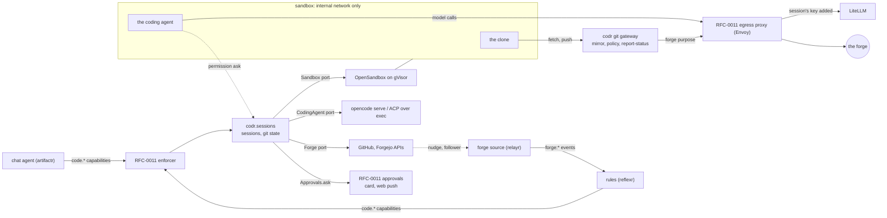

# RFC-0015: Ports and adapters for code sessions: forge, coding agent, IDE and sandbox

**Status:** Discussion
**Author:** Alex Nodeland
**Created:** 2026-10-30
**Discussion:** the pull request that adds this file
**Siblings:**

- lattice RFC-0011, the v0.3 platform ([#1217](https://github.com/alexnodeland/lattice/pull/1217), in Discussion), is what this builds on: the capability registry and its enforcer, the approval object, the secrets port, the egress policy and its proxy, and the adapter registry with its conformance harness. This RFC registers code sessions in them and redefines none of them.
- The spike [#899](https://github.com/alexnodeland/lattice/issues/899) is what this answers: one code session end to end on Forgejo, with opencode and with Claude Code over ACP, under gVisor, behind a credential proxy and an egress proxy. Its write-up is `spikes/0899-code-session/README.md` in [#1222](https://github.com/alexnodeland/lattice/pull/1222), cited below as "the spike".
- [lattice ADR-0018](../adr/0018-lattice-core-what-the-libraries-share.md) and [ADR-0026](../adr/0026-a-distribution-needs-a-reason-integrations-are-extras.md) decide where the code goes: lattice-core holds only what the libraries share, and a new distribution needs a reason.
- [lattice ADR-0027](../adr/0027-integrations-switched-per-workspace-through-one-port.md) and [ADR-0030](../adr/0030-settings-typed-declared-in-lattice-core-and-only-narrowed-below.md) switch each adapter per workspace and narrow its limits.
- [lattice RFC-0004](0004-relayr-and-task-trackers.md) is the precedent for a port proven by two adapters built together, a follower that reads what a webhook only nudges, and one neutral event namespace.

## Summary

Code sessions ([#884](https://github.com/alexnodeland/lattice/issues/884)) run a coding agent in a self-hosted sandbox on a repository's clone, and lattice turns its work into a branch, a change request and a record. They sit on **four ports**, each with normalized models, capability flags and a conformance suite: a **forge** (repositories, content, change requests, reviews, checks, events), a **coding agent** (launch, model wiring, policy, a session shaped as ACP's), an **IDE** (launch and links; its shape only in 0.3.0) and a **sandbox** (create, exec as a duplex stream, files, expose, lifecycle). **Lattice owns git state:** the diff is lattice's `git diff`, and every push goes through lattice's **git gateway**, which receives the pack into a mirror of its own, checks names and ancestry there, answers in git's `report-status`, and only then pushes upstream with a credential the sandbox never sees. The first adapters are GitHub, opencode and OpenSandbox on gVisor; the second, built beside them, are Forgejo and Claude Code over a generic ACP adapter. Every tool a code session offers is an RFC-0011 capability, every permission ask an RFC-0011 approval, and every byte that leaves the sandbox goes through RFC-0011's egress proxy or the git gateway. The code lives in a new library, `codr`, distributed as `codr-ai` (decided; [Where it lives](#where-it-lives)). Tracked by [#893](https://github.com/alexnodeland/lattice/issues/893), under the epic #884.

## Motivation

- **#884 was written around GitHub, opencode and code-server.** Their words (pull request, check run, `opencode.json`) would leak into the chat agent's tools, portalr's views, reflexr's rules and grantr's actions, the parts that are hardest to change later (#893). Each must be one adapter behind a port.
- **The spike showed what is hard,** and most of it is not where #884 put it. Force-pushes got past a proxy that read only ref names. opencode's permission endpoint that #884 and #888 cite is deprecated in 1.19.5, its diff endpoint returned nothing, and its event stream is noise beside two cheap status reads. The ACP agent wrote files itself and never called the client's `fs/*`. LiteLLM needed a chat-completions route for Claude Code. OpenSandbox 1.2 ships a credential vault and an egress policy of its own, which overlap RFC-0011's. gVisor installs with traps.
- **The flagship needs it.** Steps 4 to 6 of [#898](https://github.com/alexnodeland/lattice/issues/898) are a code session: fix, change request, CI red, steered to green. M3 of the v0.3 plan builds them, and RFC-0011's capability registry has to know their tool shapes first.
- **Two adapters per port from the start** (#893's sequencing comment), so the ports aren't shaped by GitHub and opencode alone. The owner narrowed the second adapters to Forgejo ([#894](https://github.com/alexnodeland/lattice/issues/894)) and one ACP agent ([#895](https://github.com/alexnodeland/lattice/issues/895)).

## Non-goals

- **GitLab, Bitbucket and Gitea** ([#1214](https://github.com/alexnodeland/lattice/issues/1214)), and the **other ACP agents** ([#1215](https://github.com/alexnodeland/lattice/issues/1215)): 0.3.x, behind the same ports and suites.
- **IDE adapters** (code-server, [#891](https://github.com/alexnodeland/lattice/issues/891); OpenVSCode Server and Theia, [#896](https://github.com/alexnodeland/lattice/issues/896)) and **the read-only viewer** ([#892](https://github.com/alexnodeland/lattice/issues/892)): 0.3.x. This RFC fixes the IDE port's shape so they add no change elsewhere.
- **The code interpreter** ([#900](https://github.com/alexnodeland/lattice/issues/900)), **connected machines as sandboxes** ([#908](https://github.com/alexnodeland/lattice/issues/908)), **microsandbox** and **Kubernetes agent-sandbox**: later adapters or consumers of the sandbox port.
- **Desktop IDEs** over SSH: the IDE port's connection descriptor leaves room for them.
- **The platform's parts.** Capabilities, approvals, secrets, egress, taint and adapters are RFC-0011's. Where this RFC needs something of them that RFC-0011 doesn't yet say, it is an [unresolved question](#unresolved-questions) addressed to RFC-0011, not a definition here.

## Design

### Overview



- **The session core owns the session:** its sandbox, its clone, its branch (`lattice/<session>`), its agent, its state, its taint and its record. It calls the four ports and nothing calls the adapters but it.
- **Agents and rules reach it only through capabilities** (RFC-0011's registry), so artifactr and reflexr never import it.
- **The sandbox reaches two things:** RFC-0011's egress proxy, for the model and for the registries a tenant enables, and the git gateway, for its one repository. Nothing in it holds a credential.

### Principles

As #893 states them, with what the spike changed:

- **Lattice owns git state.** The diff, the commit and the push are lattice's, from git in the sandbox, for every agent and forge. The spike confirmed it: opencode's `/session/{id}/diff` returned `[]` beside an untracked file, and the ACP agent's edits never passed through the client.
- **Push policy is enforced by lattice's git gateway,** for every forge. Reading ref names from `receive-pack`'s commands is not enough (the spike's force-push passed); the gateway holds a mirror ([The git gateway](#the-git-gateway)).
- **Capabilities, not the lowest common denominator.** Each adapter declares what it has; the UIs and the tools show only that.
- **Neutral vocabulary, native links.** A *change request* is a pull or merge request, a *check* a check run, pipeline job or commit status. Every normalized object keeps its native id and URL.
- **No secrets in the sandbox, ever,** and none in the agent's configuration: forge credentials stay in the git gateway and model keys are added by the egress proxy.
- **Events are hints; reads are the truth** (new, from the spike): an adapter's stream may be lost, reordered or noisy, and the port's contract is that two reads, status and pending asks, say where a session is.

### The forge port

`codr.forge`: the port, its models, a fake and its conformance suite.

```python
class Native(BaseModel, frozen=True):
    forge: str                      # the adapter: "github", "forgejo"
    id: str                         # the forge's own id
    url: str                        # its page there: "Open on Forgejo"
    noun: str                       # the forge's word: "pull request", "merge request"

class Repository(BaseModel, frozen=True):
    connection: ConnectionId
    full_name: str                  # "owner/name"
    default_branch: str
    private: bool
    native: Native

class Ref(BaseModel, frozen=True):
    repository: RepositoryId
    name: str                       # "refs/heads/lattice/ses_3f2a…"
    sha: str

class ChangeRequest(BaseModel, frozen=True):
    repository: RepositoryId
    number: int
    title: str
    body: str
    base: str
    head: Ref
    state: Literal["draft", "open", "merged", "closed"]
    mergeable: Literal["clean", "conflicted", "unknown"]
    native: Native

class ReviewComment(BaseModel, frozen=True):
    change_request: ChangeRequestId
    author: ForgeUser
    body: str                       # untrusted
    path: str | None
    line: int | None
    commit: str | None
    in_reply_to: str | None
    native: Native

class Check(BaseModel, frozen=True):
    name: str
    sha: str
    state: Literal["queued", "running", "passed", "failed", "cancelled", "skipped"]
    started: datetime | None
    finished: datetime | None
    native: Native                  # check run, pipeline job or commit status

class ForgeEvent(BaseModel, frozen=True):
    type: str                       # "forge:change_request.opened", "forge:check.completed", …
    forge: str
    repository: RepositoryId
    subject: Native
    occurred_at: datetime
    actor: ForgeUser | None
    fields: JsonObject              # structural fields from the API; authored text marked untrusted

class Forge(Protocol):
    capabilities: ForgeCapabilities
    async def credential(self, repository: RepositoryId, scope: Literal["fetch", "push", "api"], /) -> Credential: ...
    async def repositories(self, connection: ConnectionId, after: Cursor | None, /) -> Page[Repository]: ...
    async def tree(self, repository: RepositoryId, ref: str, path: str, /) -> list[TreeEntry]: ...
    async def blob(self, repository: RepositoryId, ref: str, path: str, /) -> Blob: ...
    async def compare(self, repository: RepositoryId, base: str, head: str, /) -> Comparison: ...
    async def search(self, repository: RepositoryId, query: str, /) -> list[SearchHit]: ...   # where code_search
    async def open_change_request(self, draft: ChangeRequestDraft, key: IdempotencyKey, /) -> ChangeRequest: ...
    async def update_change_request(self, ref: ChangeRequestId, fields: ChangeRequestFields, /) -> ChangeRequest: ...
    async def mark_ready(self, ref: ChangeRequestId, /) -> ChangeRequest: ...
    async def comment(self, ref: ChangeRequestId, body: str, key: IdempotencyKey, /) -> Native: ...
    async def reply(self, comment: ReviewCommentId, body: str, key: IdempotencyKey, /) -> Native: ...
    async def review_comments(self, ref: ChangeRequestId, after: Cursor | None, /) -> Page[ReviewComment]: ...
    async def checks(self, repository: RepositoryId, sha: str, /) -> list[Check]: ...
    async def check_log(self, check: Check, /) -> str: ...                                     # where check_logs
    async def changes(self, repository: RepositoryId, after: Cursor | None, /) -> Page[ForgeEvent]: ...
    def nudge(self, headers: Mapping[str, str], body: bytes, /) -> Nudge | None: ...
```

- **The forge port does not push** (the spike). The git gateway does; it asks the adapter only for a `Credential` to add.
- **`credential` mints where the forge can** (GitHub: an installation token scoped to one repository) and otherwise returns the connection's long-lived token (Forgejo), read through RFC-0011's `Secrets` port at the moment of use. It is called only by the git gateway and the application's forge client, never for the sandbox.
- **Writes take a key,** derived as RFC-0004's are, so a retried run opens one change request, not two. A forge without an idempotency header is guarded by a claim in `codr`'s store, then a lookup by head branch.
- **Events: a webhook nudges, a follower reads** (RFC-0004's rule, and [#847](https://github.com/alexnodeland/lattice/issues/847)'s). `nudge` verifies a delivery and names the repository to poll; `changes` reads what changed and returns `forge:*` events with ids derived from the forge, repository, object and version, so republishing is exactly once. The follower and the publishing are the forge source's ([Where it lives](#where-it-lives)).
- **Connections and bindings** (a repository bound to workspaces) are `codr`'s, stored and audited there, and shared with the forge source (#886, #847).

**Capability flags,** measured where the spike ran them:

| Flag | Values | GitHub (#886) | Forgejo (#894) |
|---|---|---|---|
| `draft` | `native`, `title_prefix`, `none` | `native` | `title_prefix` (`WIP:`, the spike) |
| `checks` | `runs`, `statuses` | `runs`, and `statuses` | `statuses` (the spike) |
| `check_logs` | bool | yes | Unverified (Forgejo Actions' log API) |
| `code_search` | bool | yes (from memory) | where the instance indexes (from memory) |
| `suggested_changes` | bool | yes | no (from memory) |
| `branch_protection` | bool: lattice can forbid force-pushes on `lattice/*` | yes (rulesets) | yes (protected branch patterns, from memory) |
| `short_lived_credentials` | bool | yes (installation tokens) | no: held in the gateway |
| `review_requests` | bool | yes | yes |

### The coding agent port

`codr.agents`. **The session model is ACP's** ([the spike](#how-this-answers-the-spike), recommendation 1), and the native opencode adapter maps onto it.

```python
WireApi = Literal["openai_chat", "openai_responses", "anthropic_messages"]

class NeutralPolicy(BaseModel, frozen=True):
    edits: Verdict                       # "allow", "ask", "deny"
    shell: tuple[CommandRule, ...]       # pattern and verdict, first match wins; default "ask"
    network: Verdict                     # the agent's own fetch tool, following `web:fetch` (#876)
    outside_workdir: Literal["deny"] = "deny"
    push: Literal["deny"] = "deny"       # git push is lattice's, always
    mcp_servers: tuple[str, ...] = ()    # none in 0.3.0

class Launch(BaseModel, frozen=True):
    layer: ImageRef                      # the agent's layer on the base image
    command: tuple[str, ...]             # "opencode serve …", "claude-agent-acp"
    transport: Literal["http", "stdio"]  # opencode's API, or ACP over the exec stream
    port: int | None
    env: dict[str, str]                  # no secret: base URLs and a dummy key
    files: dict[str, bytes]              # the translated policy and model wiring: opencode.json, settings.json

class Update(BaseModel, frozen=True):    # a hint, never the truth
    kind: Literal["message", "tool_call", "tool_call_update", "plan", "file_edit", "usage"]
    at: datetime
    data: JsonObject                     # untrusted

class PermissionRequest(BaseModel, frozen=True):
    id: str
    session: SessionId
    kind: Literal["edit", "shell", "network", "other"]
    title: str
    command: str | None
    paths: tuple[str, ...]
    patterns: tuple[str, ...]            # what the ask matched (opencode's `patterns`)
    always: tuple[str, ...]              # what "always" would save (opencode's `always`)

class AgentStatus(BaseModel, frozen=True):
    state: Literal["starting", "working", "waiting", "idle", "stopped", "failed"]
    stop_reason: str | None              # ACP's: "end_turn", …

class CodingAgent(Protocol):
    name: str
    wire_api: WireApi
    capabilities: AgentCapabilities
    def launch(self, policy: NeutralPolicy, model: ModelWiring, workdir: str, /) -> Launch: ...
    async def open(self, sandbox: SandboxHandle, launch: Launch, /) -> AgentHandle: ...
    async def new_session(self, agent: AgentHandle, /) -> AgentSessionId: ...
    async def prompt(self, session: AgentSessionId, text: str, *, delivery: Literal["queue", "steer"] = "queue") -> None: ...
    async def cancel(self, session: AgentSessionId, /) -> None: ...
    async def status(self, session: AgentSessionId, /) -> AgentStatus: ...                      # the truth
    async def pending_permissions(self, session: AgentSessionId, /) -> list[PermissionRequest]: ...  # the truth
    async def answer(self, session: AgentSessionId, request: str, reply: Literal["once", "reject"], /) -> None: ...
    def updates(self, session: AgentSessionId, /) -> AsyncIterator[Update]: ...                  # hints
```

- **Reconcile, don't trust the stream.** The session core reads `status` and `pending_permissions` on a timer, after every reconnect and after every update; updates only make it read sooner. The opencode adapter polls (the spike: 105 events for one short turn, and polling `/permission` and `/session/status` every 250 ms found the ask and the end of the turn). The ACP adapter's updates and answers share one pipe, so it gets the same for free.
- **Edits are on disk.** `file_edit` updates are hints for the progress view; the diff is always [lattice's](#git-state).
- **Model wiring declares the wire API,** and lattice points the agent at the LiteLLM route that serves it, through the egress proxy, with a dummy key the proxy replaces ([Egress](#egress-the-sandbox-and-opensandbox)). LiteLLM's route must match the wire API: the spike's Claude Code calls failed on an `openai/` route, where LiteLLM bridged Anthropic Messages to the Responses API, and worked on a chat-completions route with `drop_params: true` (Claude Code sends `context_management`). stackr's LiteLLM configuration gains one route per wire API, tested by the conformance suite.
- **Policy translation** turns `NeutralPolicy` into the agent's own: `opencode.json`'s `permission` block (`edit`, `bash` patterns, `webfetch`, `external_directory`, `doom_loop: ask`) or Claude Code's `settings.json` permissions. It is defence in depth: the sandbox contains what the agent does, and pushes and network are governed outside it. The same neutral policy gives different asks per agent (the spike: Claude Code auto-allowed `ls` where opencode asked), so the suite checks the translation's verdicts on a fixed set of commands, not the agent's behaviour.
- **Pinned, with its surface.** opencode 1.19.5 has two API surfaces (`/session/...` and `/api/session/...`) and three event streams, and deprecates `POST /session/{id}/permissions/{permissionID}` for `POST /permission/{requestID}/reply` (the spike). The adapter targets one release and one surface; its contract tests fail on an upgrade that removes either. Which surface is a phase 5 decision (Unverified).

**Capability flags:**

| Flag | opencode, native (#887) | Claude Code over ACP (#895) |
|---|---|---|
| `web_ui` | yes: `opencode web`, behind the agent-neutral auth proxy (#889) | no |
| `fork`, `revert` | yes | no (from memory) |
| `steer` | yes: `delivery: steer` on the `/api/` surface (the spike, read from its API) | no: cancel, then prompt |
| `plans` | yes (todos) | yes (`plan` updates, the spike) |
| `usage` | Unverified | yes (`usage_update`, the spike) |
| `client_fs` | no | **not offered:** the spike's agent never called `fs/*`, so the ACP client declares no file-system capability, and #895's "served from the sandbox" is dropped |

**The generic ACP adapter** (`codr.acp`) runs the agent's ACP command with `exec` in the sandbox and speaks JSON-RPC over its stdin and stdout: `initialize`, `session/new`, `session/prompt` to a stop reason, `session/cancel`, `session/update` notifications, and `session/request_permission`, answered `allow_once` or `reject_once` (the spike ran each but cancel). An agent is a **profile** on it: an image layer, the launch command, the wire API and the policy translation. Claude Code's is the first (Decided, C2), if its terms allow this use.

### The IDE port: its shape, in 0.3.0

`codr.ide` holds the port, its models and its suite; no adapter ships in 0.3.0 (Decided, O4).

```python
class IdeLaunch(BaseModel, frozen=True):
    command: tuple[str, ...]
    port: int
    auth: Literal["none_behind_proxy", "token_in_proxy"]   # the auth proxy holds any token
    extensions: ExtensionPolicy                           # Open VSX through the egress proxy, an allowlist

class IdeLink(BaseModel, frozen=True):
    connection: Literal["browser_origin"]                  # room for "ssh" later
    url: str                                              # on the session's own origin
    path: str | None
    line: int | None

class Ide(Protocol):
    capabilities: IdeCapabilities                         # deep_link, read_only, extensions
    def launch(self, workdir: str, policy: ExtensionPolicy, /) -> IdeLaunch: ...
    def link(self, origin: str, path: str | None, line: int | None, /) -> IdeLink: ...
```

The sandbox port's `expose(port)` is all it needs of the sandbox (the spike). portalr's "Open in editor" asks the port for a link, never an IDE by name, and is hidden in 0.3.0. #898's step 5, "open it in the IDE", is met in 0.3.0 by "Open in opencode" (its `web_ui`) and the diff in portalr.

### The sandbox port

`codr.sandbox`, importable without the rest of `codr` ([Where it lives](#where-it-lives)).

```python
class ImageRef(BaseModel, frozen=True):
    reference: str                       # by digest
    platform: Literal["linux/amd64", "linux/arm64"]

class SandboxSpec(BaseModel, frozen=True):
    image: ImageRef
    resources: Resources                 # CPU, memory, disk, processes: ADR-0030 settings
    network: SandboxNetwork              # the endpoints it may reach; deny everything else
    volume: VolumeRef                    # the working tree, kept across a rebuild
    labels: SandboxLabels                # tenant, workspace, session
    idle_after: timedelta
    destroy_after: timedelta

class Sandboxes(Protocol):
    capabilities: SandboxCapabilities
    async def create(self, spec: SandboxSpec, /) -> SandboxHandle: ...
    async def exec(self, sandbox: SandboxHandle, argv: Sequence[str], *, stdin: bool = False, cwd: str | None = None, timeout: timedelta) -> Process: ...
    async def read(self, sandbox: SandboxHandle, path: str, /) -> bytes: ...
    async def write(self, sandbox: SandboxHandle, path: str, data: bytes, /) -> None: ...
    async def expose(self, sandbox: SandboxHandle, port: int, /) -> Exposed: ...      # on lattice's network, never the host's
    async def pause(self, sandbox: SandboxHandle, /) -> None: ...
    async def resume(self, sandbox: SandboxHandle, /) -> None: ...
    async def snapshot(self, sandbox: SandboxHandle, /) -> SnapshotRef: ...           # where snapshots
    async def destroy(self, sandbox: SandboxHandle, /) -> None: ...
    async def status(self, sandbox: SandboxHandle, /) -> SandboxStatus: ...
```

- **`exec` returns a duplex byte stream** with an exit code, because ACP runs over it and lattice's git bundles and diffs come back through it.
- **Architecture is part of the image.** gVisor doesn't emulate: an amd64 image under `runsc` on arm64 fails with `exec format error`, where runc under Docker Desktop emulated it silently (the spike). `create` refuses an image whose platform isn't the host's, and stackr builds the sandbox image for both architectures, as a base and a layer per agent (#887).
- **Adapters in 0.3.0:** OpenSandbox on gVisor, the default ([#885](https://github.com/alexnodeland/lattice/issues/885)); and Docker with gVisor, for development and for CI on hosts where OpenSandbox's exec path can't be reached (the spike couldn't reach it from macOS, a limit of its rig).
- **gVisor is pinned:** a GitHub release of `runsc`, never `latest` (its URLs return 404), with the tarball's `gvisor-bin/` helpers beside `runsc` (else `gvisor_sentry` is not found). `make validate` checks both, and the host's architecture against the images'.

| Flag | OpenSandbox 1.2 | Docker + gVisor |
|---|---|---|
| `egress_policy` | yes: `networkPolicy`, ordered rules and a default, by an egress sidecar | no: the internal network alone |
| `credential_injection` | yes: its `credential-vault`; **declared and unused** ([below](#egress-the-sandbox-and-opensandbox)) | no |
| `pause`, `snapshot` | yes (the spike read its API; not exercised) | pause only |
| `pools`, `templates` | yes (not exercised) | no |

### Git state

The session core runs git in the sandbox through `exec`, as lattice, never as the agent:

- **Start:** clone from the git gateway (remote `http://git-gateway/<session>/<owner>/<repo>.git`, no credential), check out `lattice/<session>` from the base.
- **Diff:** after `git add --intent-to-add` on untracked files, `git diff <base>`, so new files show (the spike's file was untracked). It is what portalr shows, what an approval renders and what `code.session_diff` returns, for every agent. An agent's own diff is a cross-check at most.
- **Commit:** lattice commits the tree as the session, with trailers naming the session and the agent, when a push is asked for.
- **Push:** `git push` of the session's branch, which the gateway accepts only for the sha a person or a policy approved (below).

### The git gateway

The spike's credential proxy, given the section its recommendation 4 asks for. It is **lattice's own component, and a deliberate exception** to RFC-0011's established egress proxy (its O8): Envoy's `ext_authz` sees requests, not git's pkt-lines or a pack, so no established proxy can check ancestry. It is small because git does the protocol: it is `git http-backend` with hooks, behind an ASGI app in `codr.gateway`, run by stackr as a `git-gateway` service in the `code` profile, on the sandboxes' network and with no route out but the egress proxy.

- **Fetch** (`upload-pack`): for the session's one repository only, forwarded to the forge with the credential it adds.
- **Push** (`receive-pack`): the gateway receives the pack into **a bare mirror per session**, seeded from the forge with the base when the session starts and fetched again before each push, so `old` and the base's objects are there (on the session's volume, retained under [#904](https://github.com/alexnodeland/lattice/issues/904)). Its `pre-receive` hook runs in git's quarantine and refuses, unless every check passes:

  1. one ref, `refs/heads/lattice/<session>`; no other branch, no tag, no deletion;
  2. `new` is the sha of an open **push grant** for the session, which only an approved `code.push` call opens, for that sha, once;
  3. `git merge-base --is-ancestor old new`, unless the grant is a rewrite a person approved, with `old` as its lease;
  4. the upstream push, made from the quarantine with the forge's credential, through the egress proxy under `forge:<connection>`, succeeded.

- **Accepted only after the upstream push,** so the sandbox's `ok` is the forge's. **A refusal is git's own** `report-status`, `ng refs/heads/lattice/<session> <reason>`, so the agent and the person read why, instead of "the remote end hung up unexpectedly" (the spike).
- **Logged:** every ref update, accepted or refused, with tenant, workspace, session, old, new, reason and the approval it used, in `codr`'s store and RFC-0011's `Audit`. That is the record a person needs after a refused push (the spike).
- **The forge's branch protection is the second line** where `branch_protection` is declared: the GitHub and Forgejo adapters set "no force-push, no deletion" on `lattice/*` when a repository is bound, and the binding's page says where they can't.
- **Credentials:** the gateway is one of the components RFC-0011's secrets section names as reading a value at the moment of use. It reads it through `Forge.credential` (which mints or reads through `Secrets`), adds it to the upstream request, and tunnels to the forge with CONNECT through the egress proxy, so the forge's host is allowlisted and every request is logged there. The sandbox's requests to the gateway carry no credential, and any `Authorization` header they send is dropped.

### Egress, the sandbox and OpenSandbox

The sandbox calls out under RFC-0011's policy, through its proxy, under purposes RFC-0011 already names:

| From the sandbox to | Purpose (RFC-0011) | How |
|---|---|---|
| LiteLLM, the agent's model | `litellm`, with the session's virtual key injected (#887: a budget, an expiry, tagged with workspace and session) | the agent's base URL is the proxy's per-session route; the proxy strips every credential header the sandbox sends (`Authorization`, `x-api-key`, and the forge's), not only the one it replaces, then adds the key (the spike's recommendation 3) |
| the registries a tenant enables | `sandbox:registries`, no credential | `HTTPS_PROXY` with CONNECT, allowlisted and narrowed per workspace (ADR-0030) |
| the forge | none: the sandbox never reaches it | through the git gateway only |

- **Callers are identified per session,** as RFC-0011 requires. An agent configured with only a base URL can't send `Proxy-Authorization`, so the session's token is in the route's path (`http://egress/s/<token>/v1`) for the model, and in the proxy URL's user info for registries, which package managers send as `Proxy-Authorization`. The token names the session to the proxy and grants nothing the sandbox's network doesn't already allow; it is new each time the sandbox starts (Unverified, below).
- **Taint is RFC-0011's,** carried on the session: the authorizer narrows a tainted session's registries and model calls as it does any caller's.

**OpenSandbox's own vault and egress** (the spike's recommendation for RFC-0011's #942 and #943 parts, taken here):

- **Lattice keeps the policy and the audit.** The egress proxy's verdicts and logs, and the gateway's ref log, are the record. OpenSandbox's sidecar logs are not.
- **The adapter translates, as defence in depth.** Where `egress_policy` is declared, the OpenSandbox adapter renders the sandbox's `SandboxNetwork` (the egress proxy's sandbox listener and the git gateway, nothing else, default deny) into `networkPolicy`. The tenants' registry hosts are not copied into it: a sandbox that reached a registry directly would bypass the proxy's taint and logs, and a second copy of an allowlist is the drift the spike warned of. What OpenSandbox enforces is therefore derived, never authored, and the suite checks it against the endpoints the session was given.
- **Its credential vault is not used.** Host-and-path header injection can't express git's ref policy, and a model key in it would be a second copy of a secret outside Supabase Vault, with its own rotation and no RFC-0011 audit. The flag is declared so a later deployment that runs sandboxes far from the proxy can revisit it.

### Capabilities, approvals and taint

The package registers one RFC-0011 provider, `ProviderKind = "code_session"`, through the `lattice.capabilities` entry point (`codr = "codr.capabilities:provider"`). Every tool is gated by the integration `code:sessions` and a grantr action; the enforcer's nine steps run as RFC-0011 lists them.

| Capability | Tier | Effects | grantr action | Issue |
|---|---|---|---|---|
| `code.start_session(repository, base?, task, agent?)` | `run_code` | `reads_private` | `code:start_session` | #888 |
| `code.prompt_session(session, message, steer?)`, `code.abort_session(session)` | `run_code` | | `code:start_session` | #888 |
| `code.revert_session(session, message)`, where the agent declares `revert` | `write` | | `code:start_session` | #888 |
| `code.session_status(session)`, `code.session_diff(session)` | `read` | `reads_untrusted` | `code:read_session` | #888 |
| `code.push(session)` | `write`, a departure (below) | `sends_out` | `code:push` | #886 |
| `code.open_change_request(session, title, body)`, as a draft | `outbound` | `sends_out` | `code:open_change_request` | #888 |
| `code.mark_ready(change_request)`, `code.reply(comment, body)` | `outbound` | `sends_out` | `code:open_change_request` | #898 |
| `code.list_tree`, `code.read_file`, `code.search_code`, `code.compare`, `code.read_change_request` | `read` | `reads_private`, `reads_untrusted` | `code:read_repository` | [#901](https://github.com/alexnodeland/lattice/issues/901) |

- **grantr's actions are neutral:** #893's five, `code:start_session`, `code:push`, `code:open_change_request`, `code:manage_forges` and `code:manage_bindings`, and two more for reading, `code:read_session` and `code:read_repository` (Decision C11). `codr` exports them as `ACTIONS`, which the application passes to grantr's `Grants` with the others' catalogs.
- **Where each port reports untrusted reads** (#893's question for #903): every forge read of authored text (bodies, comments, file content, check logs), every agent update and every file read from the sandbox is `reads_untrusted`, and marks the session tainted at RFC-0011's step 8. A session started from a tainted run starts tainted.
- **A permission ask is an RFC-0011 approval.** When `pending_permissions` returns a request, the session core calls `Approvals.ask` for `code.agent_action`, a capability registered for this and offered to no agent, with a rendering of the command or paths and their `patterns`, bound to the request by its digest. It reaches the thread's card and a phone by web push as any approval does, and only a person answers: the answerers hold `code:start_session` on the session's workspace, and no service principal is granted it. Approved is `once`, denied is `reject`; a withdrawn or expired approval is `reject`.
- **"Always" is not offered in 0.3.0** (Decision C6). `always` is kept on the model; in 0.3.x it becomes an answer that widens the session's translated policy by those patterns, never past the workspace's, as an audited change of its own, once RFC-0011's answer can carry it (Unresolved).
- **`code.push` is `write` with `sends_out`,** where RFC-0011's T1 pairs `sends_out` with `outbound`. That is deliberate: the push reaches only lattice's own branch, at a sha the gateway checks, and is compensable; what a person must see leave, the change request and its readiness, is `outbound`.
- **Pushes in the flagship's CI loop.** A session steered by a failing check's log has read untrusted text, so each later `code.push` meets RFC-0011's taint step. Recommended: the workspace's taint policy maps `code.push` to `narrow`, which the gateway already enforces (the session's branch, the approved sha, fast-forward only), and keeps the person's gate where #898 puts it, at `code.mark_ready` (Decision C12). Otherwise every push of the loop asks a person.

### Where it lives

ADR-0018 keeps lattice-core to what the libraries share word for word, with no domain; ADR-0026 lets a new distribution exist only for a dependency set the base must not pull in, or consumers and a release cadence of its own. artifactr, reflexr and grantr import none of one another.

| Option | For | Against |
|---|---|---|
| **A. A new library, `codr`, beside artifactr and reflexr and importing neither (decided)** | Meets both of ADR-0026's reasons: OpenSandbox's SDK, forge clients and git are dependencies no other library should carry, and its consumers (artifactr's chat agent, reflexr's rules, portalr, evalr's scores, later quantr) are several, none of which may own it. It needs only lattice-core, and is reached through capabilities and events | A distribution's cost (ADR-0026): a pending publisher on PyPI, a release pull request, a place in `STAGES`, a moon project, a database in CI and a docs section |
| B. The ports and models in lattice-core, the code in stackr | No new distribution | Sessions, forges and agents are domain, which ADR-0018 keeps out of lattice-core; stackr is the stack and its template, not a library applications import |
| C. An extra of relayr | relayr already bridges artifactr and reflexr | relayr imports both, so code sessions could never run without artifactr; relayr's releases would carry the sandbox's |
| D. An extra of artifactr | No new distribution | reflexr's rules (#890) would need artifactr; quantr (#1013) too, for the sandbox |
| E. The sandbox port in lattice-core now, the rest in A | quantr and the code interpreter share it | Nothing is shared word for word yet; ADR-0018 moves code when it is |

**Decided: A** (C1, by the owner on 2026-10-31). The library is `codr`, after the libraries' `-r`; since `codr` on PyPI is an unrelated project (checked 2026-10-30), it is distributed as `codr-ai`, as `lattice-core-ai` and `relayr-ai` are, and imported as `codr`.

| Module | Holds | Extra |
|---|---|---|
| `codr.forge`, `codr.agents`, `codr.ide`, `codr.sandbox` | the ports, models, fakes and conformance suites; `codr.sandbox` imports nothing else of `codr` | none |
| `codr.sessions` | the session core, git state, push grants | none |
| `codr.capabilities` | the RFC-0011 provider and `ACTIONS` | none |
| `codr.sql` | sessions, connections, bindings, the ref log; its own Alembic chain with row-level security through `lattice_core.sql` | `sql` |
| `codr.gateway` | the git gateway | `gateway` |
| `codr.fastapi` | the session view's and admin's routes, which the application mounts for portalr | `fastapi` |
| `codr.github`, `codr.forgejo` | forge adapters | `github`, `forgejo` |
| `codr.opencode`, `codr.acp` (with the `claude_code` profile) | coding agent adapters | `opencode`, `acp` |
| `codr.opensandbox`, `codr.docker` | sandbox adapters | `opensandbox`, `docker` |

- **Each adapter is an RFC-0011 adapter,** `AdapterSpec` with kind `forge`, `coding_agent`, `ide` or `sandbox`, found through the `lattice.adapters` entry point and passing its suite in RFC-0011's harness. Each forge and agent is an ADR-0027 integration, off by default: `code:sessions`, `forge:<name>` (`forge:github`, `forge:forgejo`) and `agent:<name>` (`agent:opencode`, `agent:claude-code`). lattice-core's `KEY` allows a name or `family:name` only, so #895's and #896's `code:agent:<name>` and `code:ide:<name>` become `agent:<name>` and `ide:<name>`.
- **Who imports `codr`:** the application's composition root (stackr's template, `examples/oncall`), and relayr's `forge` extra, which is the forge source. Nothing else: artifactr and reflexr reach it through the registry, portalr through the routes the application mounts, evalr through `forge:*` events.
- **The forge source is relayr's,** because the Source protocol is reflexr's ([#841](https://github.com/alexnodeland/lattice/issues/841)) and `codr` imports no reflexr, and because a follower that leases and polls is what relayr's trackers already are (RFC-0004). This depends on what lattice RFC-0013 (#839, in Wave 1) settles about where sources live (Unresolved).

### How this answers the spike

| The spike found or recommended | Answered by |
|---|---|
| Force-pushes passed the proxy | [The git gateway](#the-git-gateway): a mirror, `--is-ancestor` in quarantine, and forge protection as the second line |
| Refusals read badly | `report-status` from git's own `receive-pack` |
| opencode's diff returned `[]`; ACP never called `fs/*` | [Git state](#git-state): lattice's diff, with untracked files; `client_fs` not offered |
| opencode's permission endpoint deprecated; two surfaces, three streams | Pinned release and surface, contract tests that fail on removal |
| opencode's stream is noisy; polling worked | "Events are hints": `status` and `pending_permissions` are the truth |
| LiteLLM needed a chat-completions route and `drop_params`; strip `x-api-key` too | Wire API declared per agent; a route per wire API; every credential header stripped |
| OpenSandbox's vault and egress overlap RFC-0011 | Policy and audit lattice's; `networkPolicy` derived; vault unused |
| gVisor's traps | A pinned release, helpers beside `runsc`, the platform in `ImageRef`, `make validate` |
| Exec through OpenSandbox unproven | Phase 2's exit criterion, on a Linux runner |
| A scripted stub model through LiteLLM for conformance | [Testing](#testing-at-100-branch-coverage) |
| Finish #899's first criterion on GitHub before Discussion ends | Tracking, and Decision C10 |
| Draft and checks as forge capabilities | [Capability flags](#the-forge-port) |

### Testing at 100% branch coverage

- **A fake per port and one suite per port** in RFC-0011's conformance harness, run against the fake on every pull request and against each adapter: the forge suite against Forgejo in a container on every change to `codr.forge` or an adapter, and against GitHub nightly with a test App where secrets allow; the agent suite against pinned opencode and against Claude Code's ACP adapter, and against a scripted fake ACP agent on every pull request; the sandbox suite against Docker with gVisor on CI's Linux runners, and OpenSandbox on gVisor in the smoke job.
- **No model key in CI:** each agent's suite runs against a scripted stub model behind LiteLLM, as the spike's was (write a file, ask before a command, answer), once per wire API.
- **Events are hints, tested:** the suite cuts the agent's stream mid-turn and drops and reorders updates; the session still reaches `idle` with its ask answered and nothing lost, by fake clock, never by waiting.
- **The gateway, with a real git client:** a push to `main`, a tag, a deletion, another repository, a force-push, a sha with no grant and a used grant are each refused with the right `ng` line; an upstream refusal is the sandbox's refusal; a rewrite with an approved lease passes; each is in the ref log.
- **No secret in the sandbox:** environment, files, `.git/config` and process arguments are searched for every credential the session's components hold, for each agent, after a whole session.
- **Network:** a sandbox reaches the egress proxy and the gateway and nothing else (host, other sandboxes, private ranges, the tailnet), on both sandbox adapters; the OpenSandbox adapter's `networkPolicy` is checked against the session's endpoints.
- **Policy translation:** golden files of `opencode.json` and `settings.json` from neutral policies, and the verdicts of a fixed command set.
- **Approvals:** a permission ask becomes one approval, answered once from either surface, and a second answer is refused, on RFC-0011's fakes.
- **Layering:** `codr`'s layering test keeps `codr.sandbox` free of the rest, and the base free of every extra; `standalone` installs the wheel with no extra and with each.

### What changes in each package

| Package | Changes | Breaking |
|---|---|---|
| codr (new) | All of the above | New |
| relayr | The `forge` extra: the forge source, `forge:*` event types and their publisher, after RFC-0013 | No |
| artifactr | The `code_session` artifact kind and its live output in the thread (#888); its chat agent gets `code.*` through the registry | No |
| reflexr | Nothing: rules match `forge:*` events and call `code.*` capabilities (#890) | No |
| grantr | Nothing: `codr.ACTIONS` is one more catalog | No |
| portalr | The code session view, the change-request card, "Open in <agent>" behind the auth proxy (#889); admin's Forges and Coding agents | No |
| evalr | Session scores from `forge:*` events (#906) | No |
| stackr | The `code` profile: OpenSandbox, gVisor pinned, the git gateway, sandbox images per architecture, LiteLLM's routes per wire API, a Forgejo service for development and CI, `make validate`'s checks | No |
| lattice-core | Nothing beyond RFC-0011 | No |

### Phases

| Phase | Milestone | Deliverable | Exit criteria |
|---|---|---|---|
| 1. Package and ports | M2, after RFC-0011's phase 1 | `codr`, its four ports, models, fakes and suites; its ADR | 100% coverage; every suite passes on its fake; `standalone` installs it bare |
| 2. Sandbox | M3 | Docker + gVisor and OpenSandbox adapters, `networkPolicy` translation, stackr's `code` profile, `make validate` | The suite on both, on Linux; the sandbox reaches only its two endpoints; a wrong platform is refused at `create` |
| 3. Git state and gateway | M3 | The session core's git, push grants, the gateway and its mirror, the ref log, `codr.sql` | Every refusal above, with `report-status`, in a real git client; no secret in the sandbox |
| 4. Forges | M3 | GitHub (#886) and Forgejo (#894) adapters; relayr's forge source (#847) | The suite on Forgejo per pull request and GitHub nightly; push policy holds on both; events published once across redeliveries |
| 5. Agents | M3 | opencode (#887), the ACP adapter and Claude Code's profile (#895), policy translation, LiteLLM's routes | Both pass the suite on the stub model; a cut stream loses nothing; an ask is answered only by a person |
| 6. Capabilities and views | M3 | The provider (#888), #901's tools, portalr's view (#889), the "CI red" rule (#890), the first scores (#906) | #898's steps 4 to 6 and 8 run in CI on Forgejo |
| 7. Reach and hardening | M4, M5 | Asks on a phone by web push (#952), the security suites (#945), host requirements' docs | #898 without stubs; gVisor on a KVM-less Linux host |

**The 0.3.0 slice for #898** is phases 1 to 7 with one adapter pair per port: GitHub and Forgejo, opencode and Claude Code, OpenSandbox and Docker with gVisor; the IDE port's shape with no adapter; `once` and `reject` answers; opencode's web UI as the only "Open in". The flagship runs in CI on Forgejo, which needs no secret, and nightly on GitHub (Decision C10). Everything else in #884 is 0.3.x.

## Decisions

Decided by the owner:

| # | Question | Decided | Instead of |
|---|---|---|---|
| O1 | First adapters | opencode, on OpenSandbox with gVisor (v0.3 plan §7.5, 2026-10-30); GitHub first among forges (#884, #886) | E2B or Daytona; lattice's own coding agent |
| O2 | Second adapters | Forgejo (#894) and the generic ACP adapter with one agent (#895), built beside the first (2026-10-30) | All four forges and three agents in 0.3.0 |
| O3 | The rest | GitLab, Bitbucket and Gitea (#1214) and the other agents (#1215) in 0.3.x | In 0.3.0 |
| O4 | IDE | The port's shape in 0.3.0; code-server (#891), the viewer (#892) and #896 in 0.3.x | code-server in 0.3.0 |
| O5 | Principles | Four ports; lattice owns git state; no secrets in the sandbox; neutral `code:*` actions (#884's re-scope, 2026-10-28) | GitHub, opencode and code-server hard-wired |
| O6 | Egress | RFC-0011's established proxy, Envoy recommended there (its O8, P1) | A proxy of the sandbox's own |
| C1 | Where it lives | A new library, `codr`, distributed on PyPI as `codr-ai`, importing only lattice-core, adapters as extras (2026-10-31; [Where it lives](#where-it-lives)) | lattice-core and stackr; an extra of relayr or artifactr |
| C2 | The first ACP agent | Claude Code through `claude-agent-acp`, on the condition that its terms allow running it on a server through a gateway; the terms check stays in Tracking (2026-10-31). The spike ran it end to end through LiteLLM (3 s, every method mapped) | Codex (its Responses route through LiteLLM unverified) or Gemini CLI (its ACP flag differs by version, unverified), the fallback if Claude Code's terms don't allow it |

Recommended, for the owner to confirm:

| # | Question | Recommended | Instead of |
|---|---|---|---|
| C3 | Force-pushes | The gateway receives into a per-session mirror and checks `--is-ancestor` in quarantine before it pushes upstream; forge branch protection on `lattice/*` as the second line | Ref names alone (the spike's hole); forge protection alone (not every forge, and too late) |
| C4 | Who may push | Only an open push grant for the approved sha, opened by `code.push` | Any push from the sandbox to the session's branch, which the agent could make itself |
| C5 | The agent port's contract | ACP's session shape; events are hints, `status` and `pending_permissions` the truth | opencode's model; trusting the stream |
| C6 | Permission answers | An RFC-0011 approval, `once` or `reject`; "always" in 0.3.x | Offering "always" now, beside an approval bound to one request |
| C7 | The diff | Lattice's `git diff`, untracked files included; no ACP `fs/*` | opencode's `/diff`; serving `fs/*` from the sandbox (#895) |
| C8 | OpenSandbox's vault and egress | Lattice keeps policy and audit; `networkPolicy` derived from the session's two endpoints; the vault unused | OpenSandbox's as the enforcement; registries copied into `networkPolicy` |
| C9 | Forge credentials | Read by the gateway and the forge client only, through `Forge.credential`, tunnelled through the egress proxy | Injected by Envoy from `X-Lattice-Secret`, which can't mint GitHub's installation tokens without the authorizer learning each forge |
| C10 | The flagship's forge in CI | Forgejo in a container on every run; GitHub nightly; #899's GitHub half done before this leaves Discussion | GitHub in CI, which needs an App's secrets |
| C11 | grantr actions | #893's five, plus `code:read_session` and `code:read_repository` | Reading under `code:start_session` |
| C12 | Pushes in a tainted session | `code.push` mapped to `narrow`, which the gateway enforces; the person's gate at `code.mark_ready` | Every push of a CI loop asking a person |
| C13 | The forge source | relayr's `forge` extra, subject to RFC-0013 | In `codr`, which would import reflexr |

## Drawbacks

- **One more distribution** (C1), with all of ADR-0026's ceremony, and a ninth package for every reader of the repository.
- **The gateway is a component of lattice's own** on a security boundary, beside RFC-0011's choice of an established proxy. It is narrow, and git does the protocol, but its hooks are lattice's to get right.
- **A mirror per session** costs disk and a full receive of each push; a large monorepo makes both noticeable.
- **Two adapters per port in 0.3.0** is more work than one, before the ports are proven useful.
- **Claude Code is not open source** (from memory), so the first ACP agent depends on a vendor's terms (C2).
- **opencode moves fast:** a pinned release falls behind, and each upgrade is a contract-test exercise.
- **gVisor narrows the hosts:** no emulation, a pinned install, and heavier toolchains still untested under it.

## Alternatives

- **ACP as the only agent interface** (#893). Simpler, but loses opencode's web UI, fork, revert and steering.
- **A native adapter per agent** (Claude Agent SDK, Codex's app server). More capability, much more code; native adapters can still be added where ACP falls short.
- **Ref names in a transparent proxy** (the spike's). Cheap, and misses force-pushes.
- **Lattice pushes from outside,** taking the commits out of the sandbox as a bundle over `exec`, with the sandbox's remote fetch-only. Also closes the hole, with no `receive-pack` from the sandbox at all, but the agent's own `git push` then fails without git's refusal, and the bundle path is lattice's to maintain where `http-backend` is git's.
- **OpenSandbox's vault and egress as the enforcement** (C8). One fewer hop, two places for one rule, and no taint.
- **Hard-wiring GitHub and opencode first, abstracting later** (#893). Cheaper today; the vocabulary would leak into the UI, rules and grantr.

## Unresolved questions

Two are asks of RFC-0011, for the follow-up that takes in the other RFCs' requests once it merges (#1217); this RFC doesn't define either.

- **Asked of RFC-0011:** forges and LiteLLM on private addresses. A self-hosted Forgejo and the stack's LiteLLM are on private ranges, which RFC-0011's egress always refuses. The `forge:<connection>` and `litellm` purposes need an operator-declared internal destination, or the gateway and the sandbox's model route need a path past the proxy. Recommended: an operator-declared internal upstream per purpose, in RFC-0011.
- **Asked of RFC-0011:** an approval answer that carries a scope, for "always" in 0.3.x (C6).
- **For RFC-0013:** where the Source protocol and concrete sources live, which settles C13.
- **Mirrors for large repositories:** a shared object store per repository and tenant, with alternates, may replace the per-session mirror's full copy. Measured in phase 3.
- **Which opencode surface:** `/api/session/...` if, at the pinned release, it covers status, pending asks and replies; the spike's otherwise.

### Unverified

Each is settled in its phase, or carried as an exit criterion.

- Pushing upstream from a `pre-receive` hook's quarantine, with the quarantine's objects, before the push is accepted (phase 3).
- `git http-backend` behind an ASGI app streams packs without buffering them whole (phase 3).
- OpenSandbox's exec path on a Linux host; its `networkPolicy` and pause and resume, which the spike only read (phase 2).
- A per-session token in a base URL's path reaches Envoy's `ext_authz` for each agent, and package managers send proxy user info as `Proxy-Authorization` (phase 5).
- Forgejo's Actions log API, code search, and branch protection by pattern through its API (phase 4).
- opencode's `usage` reporting, and which of its surfaces is stable at the pinned release (phase 5).
- Claude Code's terms for running on a server through a gateway, and Codex's and Gemini CLI's ACP wiring, for C2's fallback (before phase 5).
- gVisor on a KVM-less Linux host, with Go and Python builds and file-watching dev servers (phase 7; the spike ran it only nested, on macOS).

## Tracking

- [ ] #899's GitHub half, before this leaves Discussion (C10)
- [ ] ADR: `codr`, a new library for code sessions, under ADR-0018 and ADR-0026 (C1)
- [ ] codr: the four ports, models, fakes and suites (#893)
- [ ] codr and stackr: the sandbox port's adapters, the `code` profile and gVisor pinned (#885)
- [ ] codr and stackr: git state, the gateway, its mirror and ref log (#886)
- [ ] codr: the GitHub adapter (#886) and the Forgejo adapter (#894)
- [ ] relayr: the forge source, after RFC-0013 (#847)
- [ ] Claude Code's terms checked for running it on a server through a gateway, before its profile ships (C2); if they don't allow it, Codex or Gemini CLI instead (#895)
- [ ] codr: the opencode adapter (#887), the ACP adapter and Claude Code's profile (#895), after the terms check
- [ ] codr and artifactr: the provider, delegation and the `code_session` artifact (#888)
- [ ] codr: questions about a codebase (#901)
- [ ] portalr: the code session view and the agent's UI behind the auth proxy (#889)
- [ ] reflexr and stackr: the forge-event rules, "CI red" first (#890)
- [ ] evalr: the first session scores (#906)
- [ ] #898's code-session steps in CI on Forgejo
- [ ] Decisions C1 to C13, each recorded in an ADR as it is built (C1's in the ADR above)
- [ ] Docs: `docs/codr/`, its architecture, the forge and agent guides, the host requirements

## Evidence

Gathered on 2026-10-30, with lattice read at `origin/main` (`a52c5f81`) and RFC-0011 at its pull request's head.

| Claim | Where | |
|---|---|---|
| Force-push passed a proxy reading ref names; names, tags and deletions were refused | the spike, "What didn't" | Measured |
| opencode 1.19.5: deprecated permission endpoint, `/permission/{id}/reply`, two surfaces, three streams, `/diff` empty, 105 events a turn, polling worked | the spike | Measured |
| Claude Code over ACP: `initialize` to `end_turn` in 3 s; no `fs/*` calls; auto-allowed `ls` | the spike | Measured |
| LiteLLM: `openai/` route bridged to Responses; chat-completions route with `drop_params`; `x-api-key` stripped | the spike | Measured |
| OpenSandbox 1.2 on gVisor created a sandbox in about 1 s; its exec unreachable from macOS | the spike | Measured |
| OpenSandbox's `networkPolicy` and `credential-vault` | the spike, from its API | Read, not exercised |
| An integration key is a name or `family:name` | `lattice_core/integrations.py` `KEY` | Verified |
| Libraries pass `ACTIONS` catalogs to grantr's `Grants` | `packages/grantr/src/grantr/sql/__init__.py`, `grants/grants.py` | Verified |
| `codr` on PyPI is taken; `codr-ai` is free | PyPI's JSON API, 2026-10-30 | Verified |
| The Source protocol is reflexr's; concrete sources are extras | #841 | Verified |
| GitHub's code search, suggested changes and rulesets; Forgejo's protected-branch patterns and search; ACP stop reasons beyond `end_turn`; Claude Code's licence | memory | Unverified |
