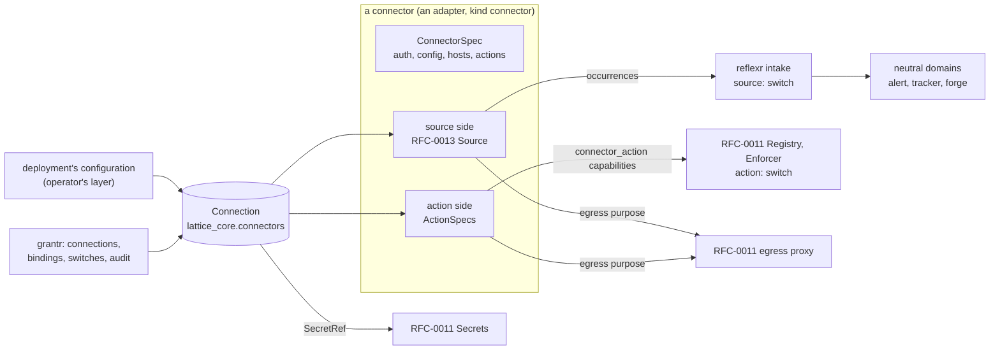
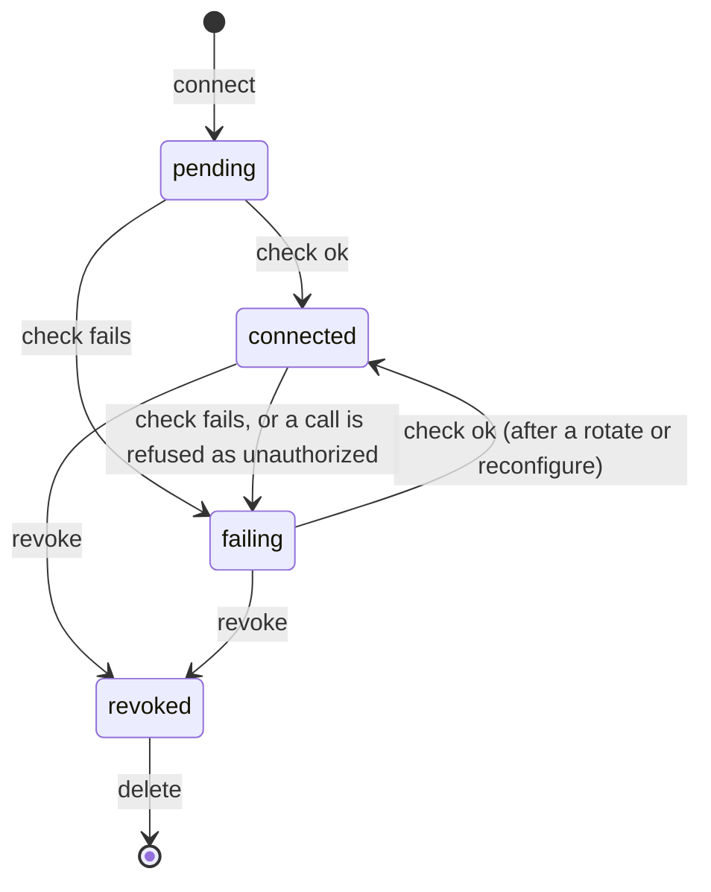

# RFC-0016: Connectors: connections, actions and neutral event types

**Status:** Draft
**Author:** Alex Nodeland
**Created:** 2026-10-31
**Discussion:** the pull request that adds this file
**Siblings:**

- [lattice RFC-0011][rfc-0011], the v0.3 platform, is what a connector's action side, credentials, egress and installation stand on: the capability registry with its `connector_action` provider kind, the approval object, the secrets port, the egress policy and its proxy, the adapter registry and its conformance harness, and `lattice_core.bindings`. This RFC cites them and redefines none.
- [lattice RFC-0013][rfc-0013], event sources, is a connector's source side: the `Source` protocol, the intake, trust levels and origin, bindings, quotas and dead letters. It left a list to this RFC ([its table for #926][rfc-0013-926]); [What this RFC answers](#what-this-rfc-answers-of-rfc-0011-rfc-0013-and-rfc-0015) takes each item.
- [lattice RFC-0015][rfc-0015], code sessions, holds the forge port and its adapters in `codr`, and puts the forge source in relayr until this RFC decides where connector adapters live (its C13).
- [lattice RFC-0014][rfc-0014], portr, has a `Connection` of its own: an outside client's OAuth connection *into* lattice, stored by grantr. A connector's connection is lattice's *out* to another system. They are different objects, kept apart by name, id and action ([K2](#recommended-for-the-owner-to-confirm)).
- [lattice RFC-0004](0004-relayr-and-task-trackers.md) built the first connector, the task trackers: a port, two adapters, a neutral namespace, a webhook that nudges a follower, writes made once by a key. Most of this RFC generalizes it.
- [lattice ADR-0018](../adr/0018-lattice-core-what-the-libraries-share.md), [ADR-0026](../adr/0026-a-distribution-needs-a-reason-integrations-are-extras.md), [ADR-0027](../adr/0027-integrations-switched-per-workspace-through-one-port.md) and [ADR-0030](../adr/0030-settings-typed-declared-in-lattice-core-and-only-narrowed-below.md) decide where the code goes, when a distribution is warranted, how each side is switched and how its limits are narrowed.

## Summary

A **connector** adapts one outside system to lattice through **one connection** that both of its sides share ([#926](https://github.com/alexnodeland/lattice/issues/926), under the epic [#925](https://github.com/alexnodeland/lattice/issues/925)). Its **source side** is [RFC-0013][rfc-0013]'s `Source`; its **action side** is a set of [RFC-0011][rfc-0011] capabilities of kind `connector_action`, called only through the enforcer. A **connection** is an object of its own, declared in `lattice_core.connectors` and stored by grantr beside bindings, with the deployment's connections in its configuration and a tenant's in grantr's store; its credentials are [RFC-0011][rfc-0011] secret references, read at the moment of use; it has a lifecycle (pending, connected, failing, revoked) and a health check. Each side is an [ADR-0027](../adr/0027-integrations-switched-per-workspace-through-one-port.md) integration, `source:<connector>` and `action:<connector>`, so trackers' `tracker:plane` and `tracker:vikunja` split in two. The **neutral event types** are a registry of **domains** (`alert`, `tracker` and `forge` in 0.3.0; the rest reserved), each with a version under [#946](https://github.com/alexnodeland/lattice/issues/946)'s rules and a published schema. 0.3.0 builds what the flagship [#898](https://github.com/alexnodeland/lattice/issues/898) and M3's [#929](https://github.com/alexnodeland/lattice/issues/929), [#930](https://github.com/alexnodeland/lattice/issues/930) and [#931](https://github.com/alexnodeland/lattice/issues/931) need: the contracts, the store, the trackers and relayr's outbound tools on the registry, the SDK and conformance kit, and the stack's sources. OAuth, admin's Connectors page, outside apps and the dataset side are 0.3.x.

## Motivation

- **#925 needs one shape before dozens are built.** Slack, Linear, AWS and Kafka (#932 to #937) will each want credentials, events, actions, switches and a page in admin. Today the only connector, the trackers, has its credentials in an environment variable (`TRACKER_CREDENTIALS`), its bindings in another (`TRACKER_BINDINGS`), one switch for both directions (`tracker:plane`), and its agent tools in a `FunctionToolset` of its own (Evidence).
- **Three accepted RFCs wait on this one.** [RFC-0011][rfc-0011] left the hosts a connection declares; [RFC-0013][rfc-0013] left the connection's lifecycle, the action side, the neutral registry, the `source:`/`action:` split and where adapters live; [RFC-0015][rfc-0015] put the forge source in relayr "until #926 settles where connector adapters live".
- **[RFC-0011][rfc-0011]'s bypass test makes the action side due in 0.3.0.** It fails on a `FunctionToolset` built in a library's `src/` outside the bridge's allowlist, and relayr builds two: the trackers' tools and the outbound tools rules' runs use to post into a thread (Evidence).
- **Rules should work across connectors of a kind.** A rule on `tracker:item_created` already works for Plane and Vikunja; one on `alert:firing` should work for Alertmanager and, later, PagerDuty. That needs the namespaces, their guaranteed fields and their versions written down once.
- **Why now:** the v0.3 plan puts #926 in Wave 2, after [RFC-0013][rfc-0013] and [RFC-0011][rfc-0011], and M3 builds #929, #930 and #931 on it.

## Non-goals

- **OAuth, cloud roles and broker credentials** as auth kinds that lattice builds. Their shape is declared here; nothing in 0.3.0 connects with them (K3).
- **Admin's Connectors page ([#927](https://github.com/alexnodeland/lattice/issues/927)) and the app's sources page ([#928](https://github.com/alexnodeland/lattice/issues/928)):** 0.3.x, by the v0.3 plan. This RFC defines the commands and reads they will call.
- **Outside apps** ([#932](https://github.com/alexnodeland/lattice/issues/932) to [#937](https://github.com/alexnodeland/lattice/issues/937)). Slack is out of 0.3.0 by the owner's decision; phone notification is by web push.
- **The generic signed webhook ([#842](https://github.com/alexnodeland/lattice/issues/842)), email, polls and Supabase rows ([#848](https://github.com/alexnodeland/lattice/issues/848)),** and stored event types: 0.3.x, by [RFC-0013][rfc-0013]'s D7 and R12.
- **The dataset side ([#1003](https://github.com/alexnodeland/lattice/issues/1003)),** which data spaces need: they ship in the 0.3.x knowledge release, by the owner's decision. Its seam is named ([The dataset side](#the-dataset-side-deferred)).
- **Anything [RFC-0011][rfc-0011] or [RFC-0013][rfc-0013] decides:** tiers, the enforcer's steps, approvals, the secrets port's API, the egress proxy, trust levels, the intake's order, bindings' fields.

## Design

### Overview



- **A connector is an adapter.** It declares a `ConnectorSpec` and is found through [RFC-0011][rfc-0011]'s `lattice.adapters` entry point, kind `connector`, so installing its extra adds its integrations and removing it removes them ([RFC-0011][rfc-0011]'s Adapters).
- **One connection, two sides.** The source side reads through the connection; the action side writes through it; both reach the outside under one egress purpose, `connector:<name>`, and spend one request budget.
- **lattice-core holds the contracts,** grantr the tenant's connections, the deployment's configuration the operator's. Each library that reads a connection (reflexr's intake and followers, relayr's trackers, `codr`'s forges, the action provider) reads it through one port, without importing another library.

### Connections

`lattice_core.connectors`, at the top level, so it imports only the standard library, pydantic, and lattice-core's `secrets` and `egress`.

```python
AuthKind = Literal["none", "token", "webhook_secret", "app", "oauth2", "cloud_role", "broker"]
ConnectionState = Literal["pending", "connected", "failing", "revoked"]

class ConfigRef(BaseModel, frozen=True):
    """A credential the deployment's configuration holds: an environment variable or a mounted file."""
    env: str | None = None
    file: str | None = None

class Health(BaseModel, frozen=True):
    checked_at: datetime
    ok: bool
    reason: Literal["unauthorized", "unreachable", "refused", "misconfigured"] | None
    detail: str | None                     # what the connector says, never a credential
    expires_at: datetime | None            # the earliest credential expiry it knows of

class Connection(BaseModel, frozen=True):
    id: ConnectionId                       # "cxn_" and 16 hex digits; never RFC-0014's "con_"
    connector: str                         # its ConnectorSpec's name: "plane", "alertmanager", "forgejo"
    source: str | None                     # the SourceSpec it feeds (RFC-0013): "tracker", "alertmanager", "forge"
    tenant_id: str | None                  # None: the deployment's own, reaching tenants only through bindings
    layer: Literal["operator", "tenant"]
    label: str                             # what admins call it: "Acme's Plane"
    config: JsonObject                     # validated against the spec's config_schema; never a secret
    hosts: frozenset[str]                  # derived from config by the connector, for egress (below)
    credentials: Mapping[str, SecretRef | ConfigRef]  # by role: "token", "webhook", "app_key"
    state: ConnectionState
    health: Health | None
    created_at: datetime
    created_by: str                        # the operator, or the grantr subject
    revoked_at: datetime | None

class Connections(Protocol):
    async def get(self, id: ConnectionId, /) -> Connection | None: ...
    async def for_tenant(self, tenant_id: str, /, *, connector: str | None = None) -> Sequence[Connection]: ...
    async def of_deployment(self, /, *, connector: str | None = None) -> Sequence[Connection]: ...
    async def record_health(self, id: ConnectionId, health: Health, /) -> Connection: ...
```

- **It is [RFC-0013][rfc-0013]'s minimal `Connection`, completed.** That RFC's protocol reads `id`, `source`, owner, `config` and the secret references, which keep their meaning; owner is `tenant_id`, `None` for the deployment's. The fields added are the connector, the layer, the label, hosts, state, health and who made it.
- **One connection per system, per owner,** shared by both sides and, for a forge, by code sessions and the forge source ([RFC-0015][rfc-0015], one per tenant per forge). A connection is a tenant's or the deployment's, never a workspace's: a workspace receives events and acts through bindings ([RFC-0013][rfc-0013]'s `Binding.connection`), and pauses either side with its switch.
- **Two layers, as bindings and settings have** (K2):
  - **the operator's,** in the deployment's configuration: Alertmanager, the stack's LiteLLM and Langfuse, lattice's own components, and in 0.3.0 the trackers' `TRACKER_CREDENTIALS`, read as one tenant-owned operator connection per tenant, as [RFC-0013][rfc-0013] reads `TRACKER_BINDINGS` as the operator's bindings. Admin shows them read-only;
  - **the tenant's,** in grantr's `grantr_connector_connections`, with row-level security by tenant, each change a grantr command audited in its transaction. In 0.3.0 `codr`'s forge connections are the only ones made there, from admin's Forges page ([RFC-0015][rfc-0015]); #927 makes the rest in 0.3.x.
- **Lattice's own components** (the artifactr bridge, schedules, the stack's signals) each have one implicit operator connection, `auth="none"`, made by the application at startup and never offered to connect, so every binding names a connection and every source reads the same.

**Credentials** (K3):

- **A tenant connection's are [RFC-0011][rfc-0011] `SecretRef`s,** owned by the tenant and the connection (RFC-0011's `Owner` already names one), with purposes in RFC-0011's form: `connector:token`, `connector:app_key`, `webhook:signing`, later `connector:oauth`. grantr stores the references; the values are in the secrets store.
- **An operator connection's are `ConfigRef`s,** read from the deployment's configuration, as every operator secret is today (LiteLLM's master key, Alertmanager's bearer token in [RFC-0013][rfc-0013], read from a mounted file). [RFC-0011][rfc-0011]'s `Owner` has no deployment variant, and this keeps it so: a deployment's credentials never enter a tenant's vault.
- **Read at the moment of use,** by the one component that sends them: the follower's client, the action's call, or the egress authorizer through `X-Lattice-Secret` ([RFC-0011][rfc-0011]'s injection). `lattice_core.connectors.credential(connection, role, secrets=..., reader=...)` resolves either kind, and a `SecretRef`'s read is audited by the secrets port as any is.
- **Shown once.** A credential lattice generates, such as a webhook's signing secret, is returned by the command that made or rotated it and never again; one the admin pastes is never returned at all.
- **Rotation** is [RFC-0011][rfc-0011]'s `rotate` with a grace: a webhook's `verify` accepts the current and the grace version until the grace ends, which #842's and #927's "two valid during rotation" asks.

**Auth kinds** (K3). `AuthKind` names every kind #926 lists, so a connector's spec can declare what it accepts; 0.3.0 builds four:

| Kind | Holds | 0.3.0 | Used by |
|---|---|---|---|
| `none` | nothing | Yes | lattice's own components |
| `token` | an API key or token, with an expiry where the system has one | Yes | Plane, Vikunja, Forgejo, LiteLLM, Langfuse, Alertmanager's bearer token |
| `webhook_secret` | a signing secret, generated by lattice or the system | Yes | trackers' and forges' webhooks |
| `app` | an app's private key, from which short-lived tokens are minted | Yes, for `codr`'s GitHub adapter ([RFC-0015][rfc-0015]'s `credential`) | GitHub |
| `oauth2` | a refresh token, the consented scopes, the token's expiry | No: with #927 and #932 | Slack, Linear, Google |
| `cloud_role` | a role or service account to assume, and its external id | No: with #934 | AWS, GCP, Azure |
| `broker` | a broker's credentials and TLS material | No: with #936 | Kafka, NATS |

**Lifecycle** (K1):



- **The health check** is the connector's `check(connection) -> Health`, one cheap authenticated read (Unverified, per system: Alertmanager's status, Forgejo's current user, Plane's workspace, Vikunja's user). It runs on connect, every 15 minutes, on demand from admin, and at once when a follower or an action is refused as unauthorized. A `Health` is recorded on the connection, and its change of state is audited.
- **Expiry is a warning, not a state:** a `Health.expires_at` within 14 days marks the connection as expiring in reads, as `make tracker-check` warns of Vikunja's tokens today (Evidence); an expired credential fails its next check.
- **`failing` stops nothing by itself.** Followers keep reading and fail as their requests fail, under [RFC-0013][rfc-0013]'s rules; actions fail with the remote's refusal. The state is what admin and, from M4, a notification to the tenant's admins by web push ([#952](https://github.com/alexnodeland/lattice/issues/952)) show.
- **`revoked` stops everything at once:** every `SecretRef` is revoked through the secrets port, each follower of the connection stops at its cursor (so a reconnect resumes within what the remote keeps), every action is refused with `not_connected` before the provider is called, and its webhook route answers the same 401 as an unknown connection.
- **Deleting** a revoked connection removes its bindings, calls `delete_owned_by` for its secrets, and drops its streams' cursors and dead letters, under retention ([#904](https://github.com/alexnodeland/lattice/issues/904)).

**grantr's commands and actions** (K4):

| Command | Does | Action |
|---|---|---|
| `connect(tenant, connector, label, config, credentials)` | Validates `config` against the spec, derives `hosts`, puts each credential, records the connection as `pending`, runs its check | the spec's `manage_action`, `grantr:manage_connectors` by default |
| `reconfigure(id, config)` | Changes `config` and `hosts`, runs the check | the same |
| `rotate(id, role, value or generate)` | Rotates one credential with a grace; a generated one is returned once | the same |
| `revoke(id, reason)`, `delete(id)` | As above | the same |
| `connections(tenant)`, `connection(id)` | Each connection, its state, health, bindings and the switches of its sides; never a credential's value | `grantr:read_connectors` |

- **`grantr:manage_connectors`** is held by a tenant's owners and admins, and **`grantr:read_connectors`** by them and by workspace admins. A spec may name its own management action instead: `codr`'s forges name `code:manage_forges`, as [RFC-0015][rfc-0015]'s C11 decides.
- **#926's `connectors:bind` and `connectors:pause` are not added,** not even as aliases: binding is [RFC-0011][rfc-0011]'s `grantr:manage_bindings` (its O13), and pausing a side in a workspace is that side's switch under `grantr:manage_integrations` ([ADR-0027](../adr/0027-integrations-switched-per-workspace-through-one-port.md)), as [RFC-0013][rfc-0013]'s D8 recommended. There is no `connectors:` namespace, since no package of that name declares actions.
- **The names keep clear of [RFC-0014][rfc-0014]'s,** whose `grantr:read_connections` and `grantr:revoke_connection` are for outside clients' connections into portr. grantr names its code for those `ClientConnection` and for these `ConnectorConnection`, which the implementing ADRs fix.

### The connector

```python
class ConnectorSpec(BaseModel, frozen=True):
    name: str                              # "plane"; its switches are source:plane and action:plane
    title: str                             # "Plane"
    domain: str | None                     # the neutral domain its source publishes: "tracker"
    source: str | None                     # the SourceSpec it feeds (RFC-0013), None if it has no source side
    action_namespace: str | None           # its capabilities' prefix: "tracker"; unique among providers
    actions: tuple[ActionSpec, ...]
    auth: frozenset[AuthKind]
    owners: frozenset[Literal["operator", "tenant"]]   # who may hold a connection to it
    config_schema: dict[str, JsonValue]
    manage_action: str = "grantr:manage_connectors"
    defaults: Mapping[Literal["source", "action"], bool]   # each switch's default (ADR-0027)
    purpose: Purpose                       # RFC-0011's egress purpose, key "connector:<name>"

class Connector(Protocol):
    spec: ConnectorSpec
    def hosts(self, config: JsonObject, /) -> frozenset[str]: ...
    async def check(self, connection: Connection, /) -> Health: ...
```

- **A connector's `AdapterSpec`** ([RFC-0011][rfc-0011]) has kind `connector`, its `integrations` the two switches, its `settings` the quotas below, and its `egress` the `purpose`. The source side's `Source` is [RFC-0013][rfc-0013]'s, registered with `Workspaces(sources=...)` as it decides.
- **Several connectors may feed one `SourceSpec`:** Plane and Vikunja feed `tracker`, Forgejo and GitHub feed `forge`. The intake asks the switch of the occurrence's connection's connector, `source:<connection.connector>`, which is what [RFC-0013][rfc-0013] allows a spec to name instead of `source:<spec>`.

### The action side

Each action is declared once and becomes one [RFC-0011][rfc-0011] `Capability` of provider kind `connector_action` (K5):

```python
class ActionSpec(BaseModel, frozen=True):
    name: str                              # "file_item": the capability "tracker.file_item"
    version: str                           # the action's semver; a new optional input field is minor
    description: str
    input: type[BaseModel]                 # its JSON Schema is the capability's input_schema
    output: type[BaseModel] | None
    tier: Literal["read", "write"]
    effects: frozenset[Effect]             # RFC-0011's; see the rule below
    reversibility: Reversibility
    action: str                            # the grantr action its gate names, from its package's ACTIONS
    bound: bool                            # acts only within a binding of its connection to the caller's workspace
    keyed: bool                            # takes an idempotency key; every write is keyed
    different_approver: bool = False
    limits: tuple[str, ...] = ()           # ADR-0030 keys, counted per connection
```

- **Names:** `<action_namespace>.<action>`, one dot, as [RFC-0011][rfc-0011]'s rule says (its own example `mcp.github.create_issue` has two, which its ADR should settle). A namespace is the connector's family where several share one (`tracker`), else the connector's name (`alertmanager`). relayr's outbound tools, which act in artifactr for a rule's run, take `relayr`, since `artifactr.` is artifactr's commands' prefix; the registry refuses a clash.
- **One provider per package,** `ConnectorActions(connectors, connections, bindings, credential=...)`, an [RFC-0011][rfc-0011] `Provider`. `capabilities(scope)` lists an action where the scope's tenant has a usable connection to its connector: one of its own, or the deployment's bound to the scope's workspace. Where the scope has more than one, the input schema gains a `connection` argument enumerating them, by label; with one, it is implied.
- **The gate** is `Gate(integration="action:<connector>", action=spec.action, different_approver=spec.different_approver)`, so a side switched off is `NotEnabled` before anything else ([artifactr ADR-0081](../artifactr/adr/0081-a-gate-before-access-integrations-switched-off-answer-not-enabled.md)'s order). Each package declares at most one grantr action per tier per connector: relayr's trackers `relayr:read_tracker` and `relayr:write_tracker`.
- **Bound actions** act only within a binding: a tracker action files into the workspace's bound project and labels, from the binding's `select` and `options`, so an agent can't write into another workspace's project by naming it. An unbound action, such as a later read of a connection's catalog, takes its targets as arguments.
- **Writes take a key,** as RFC-0004's and the forge port's do: derived from the run where the caller is a run, or given by the caller. The adapter uses the remote's idempotency where it has one (Plane's `external_id`) and otherwise a `Claims` port, which relayr's ledger answers for the trackers, as it does today ([relayr ADR-0033](../relayr/adr/0033-the-tracker-port-and-runs-that-write-to-it-once.md)).
- **Errors:** an unauthorized refusal marks the connection for a check and returns `not_connected`; a rate limit is retried within the attempt and then fails it, to be retried; a refusal the model can act on (a missing item, an invalid state) is a tool error.

**Tiers and effects,** one rule for every connector, so taint ([#903](https://github.com/alexnodeland/lattice/issues/903)) reads them the same:

| Action | Tier | Effects |
|---|---|---|
| Reads content people outside the tenant can write (a tracker item, a forge comment) | `read` | `reads_untrusted`, where the connector's source declares `max_trust` `untrusted` |
| Reads anything else (an alert, a dashboard) | `read` | `reads_private` |
| Changes the outside system (file, comment, move, silence) | `write` | `sends_out`, always: it carries lattice's data out |

- **Never `outbound`.** A connector's destination is fixed by its connection, not chosen by the caller; `outbound` stays for reaching arbitrary hosts ([RFC-0011][rfc-0011]).
- **So a tainted run's connector write** is narrowed or asked as [RFC-0011][rfc-0011]'s `TaintPolicy` maps `sends_out`, and a plan's listed connector writes are what [RFC-0012][rfc-0012]'s `may` names.
- **relayr's allowlists** ([relayr ADR-0020](../relayr/adr/0020-allowlists.md), [ADR-0034](../relayr/adr/0034-an-allowlist-for-the-tracker.md)) keep narrowing a rule's run inside the provider's call in 0.3.0; whether [RFC-0012][rfc-0012]'s `may` replaces them is relayr's ADR's.

### Integration keys

Each side is an [ADR-0027](../adr/0027-integrations-switched-per-workspace-through-one-port.md) integration in lattice-core's `name` or `family:name` form (K6):

| Key | Switches | Declared by | Default |
|---|---|---|---|
| `source:<connector>` | the connector's events reaching a workspace, checked by the intake's step 3 | the connector's `AdapterSpec` | the spec's; off unless it says |
| `action:<connector>` | its capabilities offered and called, checked by the enforcer's step 1 | the same | the same |
| `dataset:<connector>` | reserved for the dataset side, 0.3.x | nothing in 0.3.0 | |

- **Composed beside `KNOWN`,** as [RFC-0013][rfc-0013] and [RFC-0011][rfc-0011] compose sources' and adapters' keys: lattice-core's `KNOWN` gains none.
- **Lattice's own are on by default,** as they are today: `source:artifactr` ([RFC-0013][rfc-0013]) and `action:artifactr`, the outbound tools'.
- **`codr`'s keys are its own:** `code:sessions`, `forge:<name>` and `agent:<name>` ([RFC-0015][rfc-0015]) switch code sessions; a forge's events are `source:forgejo` and `source:github`. A forge has no `action:` side in 0.3.0, since its actions are `codr`'s `code.*` capabilities.

**The trackers' split.** `tracker:plane` and `tracker:vikunja` switch both directions today, on by default. In 0.3.0:

1. relayr's `plane` and `vikunja` extras declare `source:plane`, `action:plane`, `source:vikunja` and `action:vikunja`, on by default.
2. A grantr migration copies each stored switch of `tracker:<name>`, at every level, to both new keys, so nothing that was on turns off and nothing that was off turns on.
3. `tracker:plane` and `tracker:vikunja` stay in `KNOWN`, marked deprecated, read by nothing, because [ADR-0018](../adr/0018-lattice-core-what-the-libraries-share.md) has lattice-core change only by addition and deprecation, and an application may name them. `lattice:breaks` would not catch their removal: griffe compares a constant's value as text, which `scripts/breaks.py` leaves uncounted. They are removed in a later minor with `!` and an upgrade note.
4. The trackers keep their webhook route, `POST /relayr/v1/trackers/{tenant}/{tracker}`, which deployments have configured in Plane and Vikunja; they are self-driven sources in [RFC-0013][rfc-0013], nudged by it.

### Egress: the hosts a connection declares

[RFC-0011][rfc-0011]'s O6 makes egress hosts the operator's alone in 0.3.0 and left "hosts a connection declares" to this RFC. The answer keeps O6 (K7):

- **A connection's `hosts` are a narrowing, never a widening.** The connector derives them from `config` (Plane's `base_url`), no one types them, and `connect` refuses a connection whose hosts don't match the operator's universe for `connector:<name>`, with `host_not_allowed`, naming the host.
- **The authorizer allows a connection's requests only to its own hosts,** inside the universe and any tenant or workspace narrowing: `allowed = universe ∩ narrowing ∩ connection.hosts`, passed to `decide`. One tenant's Plane connection can't be used to reach another tenant's Plane.
- **The operator's universe may be a pattern,** such as `*.atlassian.net` for a Jira connector, which [RFC-0011][rfc-0011]'s `HostPattern` already is. A self-hosted system on a private address is one of the purpose's internal destinations, the operator's alone (its O10): the stack's Plane, Vikunja, LiteLLM, Langfuse and Alertmanager are reached so.
- **0.3.0 needs nothing more:** every 0.3.0 connection is the stack's, the operator's or a forge the operator lists.

### Quotas across a connection's sides

[RFC-0013][rfc-0013] set quotas per binding and left a connection's total and back-pressure across connectors here (K8):

| Key | Kind | Default | Lowest tier | Applies to |
|---|---|---|---|---|
| `connection-requests:<connector>` | `IntRange(0, 6000)`, requests a minute | the spec's; 300 for the trackers, today's `TRACKER_BUDGET` | tenant | each connection: its follower's reads and its actions' calls together |
| `calls-per-hour:<connector>` | `IntRange(0, 10000)` | the spec's | workspace | each action's calls, in its capability's `limits`, counted per connection |

- **Actions spend first, followers take what is left,** as relayr's tracker `Budget` does today per tenant (Evidence): a follower that finds the budget spent reads its next page later, which is latency, never loss; an action that finds it spent fails its attempt, to be retried.
- **Read at the tenant's layer,** as `source-size:<name>` is in [RFC-0013][rfc-0013]. `Settings.value` asks for a workspace (Evidence), so the budget is read with the tenant's and no workspace's layer, which the setting's lowest tier, `tenant`, makes the same for every workspace; how lattice-core spells that read is the ADR's (Unverified).
- **A deployment's connection** shared by tenants, such as Alertmanager, has the operator's total only.
- **Back-pressure from reflexr's log** stays as [RFC-0013][rfc-0013] has it: a follower whose appends are slow reads later, and nothing is buffered between them.

### Neutral event types

**A domain** is a namespace that more than one connector publishes, with the fields every one of them guarantees (K9). It is declared beside the namespace's one declaring base ([reflexr ADR-0039](../reflexr/adr/0039-namespaced-event-types.md)), in `reflexr.sources`' terms, since its types are reflexr `Event`s:

```python
class Domain(BaseModel, frozen=True):
    namespace: str                         # "alert"
    version: str                           # the domain's semver, under #946's rules
    types: tuple[type[Event], ...]
    connector_field: str                   # which field names the connector: "via", "tracker", "forge"
    id_field: str                          # the native id: "fingerprint", "item_id"
    url_field: str | None                  # the native page: "generator_url", "link"
    actor_field: str | None = None         # who acted there, where the system says
```

- **Roles by field name,** not fields renamed: `tracker:` shipped with `tracker`, `item_id` and `link`, and [RFC-0013][rfc-0013] decided `alert:`'s `via`, `fingerprint` and `generator_url`. A domain says which field plays each role, so portalr's "Open in <connector>" and the catalog read them one way. A new domain names them `connector`, `native_id`, `url` and `actor`.
- **Trust is not a field.** It is the envelope's, set by the intake ([RFC-0013][rfc-0013]'s R1 and R2), whatever #925 sketched.
- **The catalog shows it:** [RFC-0013][rfc-0013]'s `list_event_types` gains each type's domain and its version.

| Domain | Declared in | 0.3.0 connectors | Status |
|---|---|---|---|
| `alert` | `reflexr.sources.alerts` ([RFC-0013][rfc-0013]) | Alertmanager | 1.0.0 in 0.3.0; PagerDuty, Opsgenie and Datadog (#935) add to it |
| `tracker` | `relayr.trackers.events` (RFC-0004) | Plane, Vikunja | 1.0.0 in 0.3.0, as shipped; Linear and Jira (#933) publish it too |
| `forge` | `relayr.forge` ([RFC-0015][rfc-0015], C13) | Forgejo, GitHub | 1.0.0 in 0.3.0 |
| `chat`, `log`, `metric`, `object`, `payment`, `calendar`, `document`, `auth`, `analytics` | with their first connector, 0.3.x | none | Reserved names: a root test refuses a declaring base of one outside its listed home |

- **`tracker` stays `tracker`,** not #925's `ticket:`. It is already neutral across two trackers, rules and stored envelopes name it, and renaming it would be a break with nothing gained.
- **[RFC-0013][rfc-0013]'s open item on `alert:`** is answered by versioning: its fields grow only by addition, each a minor version of the domain.
- **Native types** stay beside them, in the connector's own namespace, for what a domain doesn't hold (`plane:cycle_started`, later).

### Versioning the domains (#946)

- **Each domain has a semver,** `version` on its `Domain`. A new type in the namespace, or a new optional field, is minor; a removed field, a field made required or a changed meaning is major (K10).
- **A breaking change is a new type,** published beside the old one for at least one minor release, the old one marked deprecated in the catalog, then removed with `!` and an upgrade note. A domain's namespace never changes.
- **Each domain publishes a JSON Schema** into its package's `schemas/events/<namespace>.json`, regenerated by that package's `schema` task and checked for drift and for breaks against the last release by `lattice:breaks`, as [ADR-0012](../adr/0012-title-checks-the-breaks-in-the-public-apis.md) and #946 extend it.
- **Consumers tolerate added fields.** reflexr's `Event` refuses unknown fields (`extra="forbid"`, Evidence), so a stored envelope with a field an older process doesn't know fails to load: in a rolling deploy, where two versions run at once, and after a rollback. reflexr changes to load a **stored** envelope of a known type with unknown fields, keeping them as `UnknownEvent` keeps an unknown type's, while a **publish** stays strict, so a producer's typo still fails loudly. That is a reflexr change, decided in its own ADR, and the one #946's rule rests on.
- **Connectors declare** the domain versions they publish, and the kit checks each occurrence against the domain's schema.

### Where connectors live

[RFC-0013][rfc-0013]'s R10 and [RFC-0015][rfc-0015]'s C13 put the 0.3.0 sources where their dependencies are, until this RFC decides (K11):

| Part | Home | Why |
|---|---|---|
| `Connection`, `Connections`, `ConnectorSpec`, `ActionSpec`, `ConfigRef`, `Health`, the action provider, `credential`, the health sweep | `lattice_core.connectors`, no extra | grantr stores connections, `codr` and reflexr read them, the registry calls the actions; none may import another ([ADR-0018](../adr/0018-lattice-core-what-the-libraries-share.md), read as [RFC-0011][rfc-0011] reads it) |
| `Domain` | `reflexr.sources` | Its types are reflexr `Event`s |
| The tenant's connections, their commands and audit | grantr | Beside bindings, integrations and settings |
| Alertmanager, the stack's signals | reflexr's extras ([RFC-0013][rfc-0013], R10) | They need only reflexr and an HTTP client |
| Trackers, the artifactr bridge, relayr's outbound tools, the forge source | relayr, and `relayr.forge` | They bridge artifactr or `codr` to reflexr |
| Forge adapters | `codr` ([RFC-0015][rfc-0015], C1) | The forge port is `codr`'s |

- **No new distribution in 0.3.0.** Each connector lives in the lowest package that holds everything it imports, which [ADR-0026](../adr/0026-a-distribution-needs-a-reason-integrations-are-extras.md)'s reasons allow without one. relayr's description becomes "the bridges and connectors between lattice's libraries and outside systems", with no rename.
- **The forge source stays in `relayr.forge`,** which answers [RFC-0013][rfc-0013]'s "until #926 decides" and [RFC-0015][rfc-0015]'s C13.
- **Outside apps (#932 to #937)** need neither artifactr nor `codr`, and are dozens. Whether they get a distribution of their own, by ADR-0026, is decided with the first of them, Slack (#932) or Linear and Jira (#933), in 0.3.x (Unresolved).

### The SDK and the conformance kit (#929)

- **The SDK** is the contracts above, [RFC-0013][rfc-0013]'s source protocol, and helpers in `lattice_core.connectors`: signature schemes (HMAC over the raw body with a timestamp window, constant-time compare), back-off on `Retry-After`, pagination by cursor, the `Claims` port and its fake, and a fake connector of each shape (source only, actions only, both).
- **The kit** is a suite per side in [RFC-0011][rfc-0011]'s harness, `lattice_core.conformance`, run in each connector's CI and from `make validate`:
  - the source side: [RFC-0013][rfc-0013]'s source contract suite (`reflexr.sources.testing`), which it seeds: once across redelivery and restart, forged deliveries refused, a cursor resumed, `backfill` marked;
  - the connection: `hosts` derived and within a test universe, `check` answers each `Health.reason`, a revoked connection's actions refused before the adapter, no credential in logs, reprs, exceptions or `Health.detail`;
  - the action side: each action's input and output schemas valid in [RFC-0012][rfc-0012]'s subset, tiers and effects by the rule above, keyed writes made once across a retry, `action:<connector>` off refuses;
  - the domain: every occurrence valid against its domain's published schema; trust never above the spec's.
- **Recorded fixtures:** an httpx transport that records a real system's responses and webhooks once, with credentials and the hosts' tokens redacted, and replays them, as relayr's Plane and Vikunja suites already do by hand ([relayr ADR-0033](../relayr/adr/0033-the-tracker-port-and-runs-that-write-to-it-once.md)).
- **The scaffold and the guide** (#929's last two) come in 0.3.x with #842 and the first OAuth connector, which #929 names as the guide's worked examples (K12).

### How the existing bridges fit

#926's second criterion. Each keeps what it publishes; what changes is wiring.

| Bridge | Connection | Source side | Action side | What changes |
|---|---|---|---|---|
| artifactr, with forms and diagrams | implicit, operator, `none` | `artifactr`, self-driven, `authenticated` ([RFC-0013][rfc-0013]) | `relayr.read_artifact`, `relayr.create_artifact`, `relayr.edit_artifact`, `relayr.post_notice`, `relayr.create_thread`, `relayr.send_message` | The outbound tools become capabilities under `action:artifactr`, on by default |
| Trackers (Plane, Vikunja) | one per tenant, from `TRACKER_CREDENTIALS`, `token` and `webhook_secret` | `tracker`, self-driven, `untrusted` | `tracker.file_item`, `tracker.comment_on_item`, `tracker.set_item_state`, `tracker.read_item` | The split keys; connections and bindings read through the ports; the tools become capabilities; `TRACKER_BUDGET` becomes `connection-requests` |
| Schedules | implicit, operator, `none` | `schedules`, reflexr's own, `internal` | none | Nothing but the implicit connection |
| Alertmanager | the deployment's, `token` from a mounted file | `alertmanager`, `internal` ([RFC-0013][rfc-0013], R8) | none in 0.3.0; silencing, with approval, in 0.3.x | New in 0.3.0 |
| Forges (Forgejo, GitHub) | one per tenant per forge, in grantr's store, `token` or `app` | `forge`, `untrusted` ([RFC-0013][rfc-0013], R9) | `codr`'s `code.*`, not connector actions | Connections in grantr's store rather than `codr.sql` (K2) |
| LiteLLM, Langfuse, evalr | the deployment's, `token` | `litellm:budget.crossed`, `langfuse:score.below`, `evalr:*` ([RFC-0013][rfc-0013], R14, M5) | none in 0.3.0 | New in M5 |

### The dataset side (deferred)

Data spaces need a third side, bulk tabular data with incremental sync and federation ([#1003](https://github.com/alexnodeland/lattice/issues/1003)). They ship in the 0.3.x knowledge release, so 0.3.0 builds nothing of it (K14). The seam is named so that release adds without changing what ships:

- **The connection is side-agnostic:** a `DatasetSource` reuses the `Connection`, its credentials and its egress purpose, as both other sides do.
- **`dataset:<connector>` is reserved** as its switch, and `ConnectorSpec` gains an optional `datasets` field then, a minor change.
- **A sync's request budget** is the same `connection-requests:<connector>`, so a large sync and a follower share one remote's limit.

### What this RFC answers of RFC-0011, RFC-0013 and RFC-0015

| Left to #926 | Where | Answered in |
|---|---|---|
| Hosts a connection declares, after O6 | [RFC-0011][rfc-0011], Unresolved questions | [Egress](#egress-the-hosts-a-connection-declares) (K7) |
| The connection's lifecycle: auth kinds, OAuth, refresh, revocation, a health check | [RFC-0013][rfc-0013], table for #926 | [Connections](#connections) (K1, K3) |
| The action side, as capabilities | the same | [The action side](#the-action-side) (K5) |
| `connectors:*` actions, and #926's `bind` and `pause` | the same; its D8 | [grantr's commands](#connections) (K4) |
| Splitting `tracker:<name>` into `source:` and `action:` | the same | [Integration keys](#integration-keys) (K6) |
| A tenant's say over a connection's total; back-pressure across connectors | the same; its Quotas | [Quotas](#quotas-across-a-connections-sides) (K8) |
| The neutral registry by domain, and the fields each guarantees | the same | [Neutral event types](#neutral-event-types) (K9) |
| Where connections are stored, and how admins create them | the same | [Connections](#connections) (K2); admin's page is #927, 0.3.x |
| The SDK, scaffold, fixtures and kit | the same | [The SDK](#the-sdk-and-the-conformance-kit-929) (K12) |
| Where connector adapters live | the same; its R10 | [Where connectors live](#where-connectors-live) (K11) |
| How `alert:` grows | [RFC-0013][rfc-0013], Unresolved questions | [Versioning](#versioning-the-domains-946) (K10) |
| A private repository's forge events as `authenticated` | the same; its R9 | [Trust](#trust-from-a-connection) (K13) |
| The forge source's home "until #926 settles" | [RFC-0015][rfc-0015], C13 | [Where connectors live](#where-connectors-live) (K11) |

### Trust from a connection

[RFC-0013][rfc-0013]'s R9 makes forge events `untrusted` with no raise in 0.3.0, and left a private repository's case to connections (K13):

- **No raise in 0.3.0,** for any connector: a connection carries no trust of its own.
- **In 0.3.x, the operator alone** may raise one connection's level, within its source's `max_trust` (which for forges would then rise to `authenticated`), and only where the connector can show that everyone who can write what it reads is a member of the tenant: a private repository with no outside collaborators and no forks, rechecked by the health check, which lowers the level again the moment it fails. A tenant can't, since a tenant's admin is not who must answer for a stranger's text reaching an agent as trusted.

### What changes in each package

| Package | Changes | Breaking |
|---|---|---|
| lattice-core | `lattice_core.connectors`: the contracts, `ConfigRef`, `credential`, the action provider, the health sweep, the SDK's helpers and fakes, its conformance suites; `tracker:plane` and `tracker:vikunja` marked deprecated in `KNOWN` | No: additions and a deprecation |
| grantr | `grantr_connector_connections` with RLS, its commands and audit, `grantr:manage_connectors` and `grantr:read_connectors` in the built-in roles; the migration that copies `tracker:*` switches to `source:` and `action:` keys | No |
| reflexr | `Domain`; the catalog's domain and version; stored envelopes with unknown fields loaded tolerantly; the intake asks `source:<connection.connector>`; Alertmanager's connector spec | Loading is more lenient, publishing unchanged: no |
| relayr | The trackers' connector specs, split keys, connections and bindings read through the ports, tools as capabilities with `relayr:read_tracker` and `relayr:write_tracker`; the outbound tools as `relayr.*` capabilities; the `tracker` domain and its schema; the forge domain in `relayr.forge` | Only for an application that builds `TrackerCapability` or `ArtifactrCapability` itself: the upgrade note says to use the registry's toolset |
| codr | Forge connections read from `Connections` rather than its own table; `code:manage_forges` as their `manage_action` | No: not yet built |
| stackr | The template composes the connectors, reads `TRACKER_CREDENTIALS` as operator connections, and declares each connector's purpose and internal destinations | No; `TRACKER_CREDENTIALS` is deprecated once #927 writes connections |
| portalr | Nothing in 0.3.0 beyond [RFC-0013][rfc-0013]'s reads; admin's Connectors page in 0.3.x (#927) | No |

### Testing at 100% branch coverage

- **Contracts:** each model's validation, `credential` for both reference kinds, the action provider's listing by scope (one connection implied, two enumerated, a deployment's offered only where bound), its gate, and every error mapping, on fakes of `Connections`, `Bindings`, `Secrets` and `Claims`.
- **The lifecycle as a state machine,** with a fake clock: every transition above, the check's schedule, `revoked` stopping followers at their cursors and refusing actions before the adapter, and deletion removing bindings and secrets; a Hypothesis state machine that no sequence of commands leaves a revoked connection usable.
- **grantr's store:** two tenants each see only their own connections, on SQLite and PostgreSQL; every command is in Audit in its transaction; a generated credential is returned once and never again; nothing returns a value.
- **The key split:** the migration on every combination of stored switches at the deployment, tenant and workspace levels leaves each new key with the old one's value; the old keys are read by nothing, which a test asserts over the composed registry.
- **Egress:** `connect` refuses hosts outside the universe; the authorizer refuses one connection's credentials for another's host.
- **Tolerant loading:** a property test stores envelopes of known types with arbitrary extra fields and finds each loads with them kept and round-trips; a publish with an unknown field is still refused.
- **Domains:** each domain's schema regenerated and checked for drift; the root test of reserved namespaces; the kit's domain check against recorded fixtures.
- **Nothing bypasses the enforcer:** [RFC-0011][rfc-0011]'s AST check passes with relayr's `FunctionToolset`s gone, and the trackers' and outbound suites pass through the registry's toolset with their behaviour unchanged.
- **The kit itself,** against a fake connector that passes and one that fails each check, as [RFC-0011][rfc-0011] tests its harness.

### Phases

| Phase | Milestone | Deliverable | Exit criteria |
|---|---|---|---|
| 0. Design | M1 | This RFC in Discussion, then accepted; an ADR per decision as it is built | The owner's answers to the K table |
| 1. Contracts | M3, after [RFC-0011][rfc-0011]'s phase 1 and [RFC-0013][rfc-0013]'s phase 3 | `lattice_core.connectors`, its fakes and suites; `Domain` in reflexr | 100% coverage; the kit passes on the fakes |
| 2. Store | M3 | grantr's connections, commands, actions and audit; the health sweep; operator connections from configuration | Two tenants isolated; a revoked connection stops at once |
| 3. Trackers | M3 | Plane and Vikunja as connectors: split keys and their migration, connections and bindings through the ports, tools as capabilities, `connection-requests` | relayr's tracker suites pass unchanged through the registry; the kit passes on both, on recorded fixtures |
| 4. Outbound | M3 | relayr's outbound tools as `relayr.*` capabilities | The bypass test passes across the repository |
| 5. Stack | M3 | Alertmanager's connection (with [RFC-0013][rfc-0013]'s phase 5); forge connections in grantr's store (with [RFC-0015][rfc-0015]'s phase 4) | #898's steps 1 and 6 read their connections through the port |
| 6. Domains | M3 | `alert`, `tracker` and `forge` as domains, their schemas, tolerant loading, the reserved names | `lattice:breaks` checks each domain's schema |
| 7. Signals | M5 | LiteLLM's, Langfuse's and evalr's connections, with [RFC-0013][rfc-0013]'s phase 8 | Each passes the kit |
| 0.3.x | | OAuth, cloud roles and brokers; #927 and #928; the scaffold and guide; #842 and #848; grantr's, files', code sessions' and portr's sources (#930); Supabase, Prometheus and Loki rules, Umami, the crafts, silencing alerts (#931); outside apps; the dataset side with the knowledge release | Their issues' criteria |

**The 0.3.0 slice of M3's issues** (K12):

- **#929:** the SDK, the kit and the fixture recorder, passed by the trackers and the bridges; the scaffold and the guide in 0.3.x.
- **#930:** artifactr, forms, diagrams and schedules on the port ([RFC-0013][rfc-0013]'s phase 4), and relayr's outbound tools as the artifactr bridge's action side; evalr's signals in M5 with #846; grantr, files, code sessions and portr as sources in 0.3.x, since #898 reads none of them.
- **#931:** Alertmanager (#846), Plane and Vikunja onto the port; LiteLLM and Langfuse in M5 ([RFC-0013][rfc-0013]'s R14); Supabase Auth, rows and storage, Prometheus- and Loki-managed rules, Umami, the crafts and Alertmanager's silence action in 0.3.x. #931's smoke criterion, "a Supabase row change through to a workspace", moves to #848 with the rows source, which [RFC-0013][rfc-0013]'s D7 puts in 0.3.x.

## Decisions

Decided already, which this RFC builds on:

| # | Decided | Where |
|---|---|---|
| D1 | The `Source` protocol is reflexr's; concrete sources are extras, each a switched integration; relayr's bridges implement it | [RFC-0013][rfc-0013], D1 |
| D2 | Trust is one level per envelope, set by reflexr from the source and binding, never the payload | [RFC-0013][rfc-0013], D2, R1, R2 |
| D3 | Bindings are `lattice_core.bindings`, stored and audited by grantr under `grantr:manage_bindings` | [RFC-0011][rfc-0011], O13; [RFC-0013][rfc-0013], D8 |
| D4 | Every tool is a capability in one registry, called through one enforcer; connector actions are provider kind `connector_action`, tiers and effects declared by the connector | [RFC-0011][rfc-0011], T1 |
| D5 | Secrets are references read at use through one port, Supabase Vault first; an owner may name a connection | [RFC-0011][rfc-0011], O4 |
| D6 | Egress hosts are the operator's alone in 0.3.0, narrowed below; private destinations are the operator's internal ones; metadata endpoints never | [RFC-0011][rfc-0011], O6, O10 |
| D7 | Adapters are found through entry points, kind `connector` among them, checked by one harness | [RFC-0011][rfc-0011], T6 |
| D8 | Alertmanager and the stack's signals are reflexr extras; `alert:` types in `reflexr.sources.alerts`; signals in M5 | [RFC-0013][rfc-0013], R8, R10, R14 |
| D9 | The forge source is `relayr.forge`; forge events are `untrusted`, with no raise in 0.3.0 | [RFC-0013][rfc-0013], R9, R10; [RFC-0015][rfc-0015], C13 |
| D10 | Forge adapters, `code.*` capabilities and `code:manage_forges` are `codr`'s | [RFC-0015][rfc-0015], C1, C11 |
| D11 | Integration keys are a name or `family:name` | the owner; `lattice_core.integrations.KEY` |
| D12 | Slack is out of 0.3.0; notifications and phone approvals by web push | the owner, v0.3 plan §7.4 |
| D13 | Knowledge, data spaces and quantr ship in a 0.3.x knowledge release | the owner, v0.3 plan §7.2 |
| D14 | The generic webhook, email, polls and rows are 0.3.x; stored event types come with #842 | [RFC-0013][rfc-0013], D7, R12 |

### Recommended, for the owner to confirm

| # | Question | Recommended | Instead of |
|---|---|---|---|
| K1 | What a connection is | One per connector per owner (a tenant or the deployment), shared by both sides, completing [RFC-0013][rfc-0013]'s minimal `Connection`; `pending`, `connected`, `failing`, `revoked`, with a health check on connect, every 15 minutes and on an unauthorized refusal | A connection per side, two credentials for one system (#925's rejected alternative); a workspace's own connections |
| K2 | Where connections live | `lattice_core.connectors`, the operator's in configuration and a tenant's in grantr's `grantr_connector_connections`, `cxn_` ids; `codr`'s forge connections there too, which amends [RFC-0015][rfc-0015]'s `codr.sql` row | `codr`'s table for forges beside grantr's for the rest, so admin and the forge source read two stores; one `Connection` type with [RFC-0014][rfc-0014]'s client connections |
| K3 | Credentials and auth kinds | A tenant's as `SecretRef`s, the operator's as `ConfigRef`s in its configuration; values read at use, generated ones shown once, rotated with a grace; seven kinds declared, four built in 0.3.0 (`none`, `token`, `webhook_secret`, `app`) | A deployment owner in [RFC-0011][rfc-0011]'s `Owner`, putting the operator's credentials in the vault; OAuth in 0.3.0 with nothing to use it |
| K4 | grantr actions | `grantr:manage_connectors` and `grantr:read_connectors`, a spec naming its own (`code:manage_forges`); no `connectors:` namespace and no aliases for `bind` and `pause` | #926's four `connectors:*` actions |
| K5 | The action side | An `ActionSpec` per action, a `connector_action` capability `<namespace>.<action>`, gated by `action:<connector>` and one grantr action per tier; the connection from the binding or a `connection` argument; every write keyed; reads `read`, writes `write` with `sends_out`, never `outbound` | Tools in each connector's own toolset, as the trackers' are; writes as `outbound` |
| K6 | Integration keys | `source:<connector>` and `action:<connector>`, declared by each connector; `tracker:plane` and `tracker:vikunja` split by a migration that copies their switches, kept deprecated in `KNOWN` through 0.3.0; `dataset:<connector>` reserved | One key per connector for both sides, as today; removing the old keys in 0.3.0, a break of lattice-core's public constant that no check would flag |
| K7 | Hosts a connection declares | A narrowing only: derived from its configuration, refused outside the operator's universe, and each connection's requests allowed only to its own hosts; O6 stands | Tenants adding hosts through a connection |
| K8 | A connection's total | `connection-requests:<connector>` a minute, shared by its sides, actions first, the tenant lowering it; `calls-per-hour:<connector>` per action | Quotas per binding only, so one tenant's actions and polls exhaust a remote's limit for every workspace |
| K9 | The neutral registry | A `Domain` beside each neutral namespace, naming the fields that play connector, id, URL and actor; `alert`, `tracker` and `forge` in 0.3.0, the rest reserved; `tracker` kept, not renamed `ticket` | A shared base with renamed fields, a break for `tracker:`; `ticket:` beside `tracker:` |
| K10 | Versioning the domains | Semver per domain, additions minor, a breaking change a new type beside the old for a minor release; schemas checked by `lattice:breaks`; reflexr loads stored envelopes with unknown fields, publishes strictly | `Event`'s `extra="forbid"` as it is, which fails a rolling deploy or rollback on any added field |
| K11 | Where connectors live | No new distribution in 0.3.0: contracts in lattice-core, each adapter in the lowest package holding its imports, the forge source staying in `relayr.forge`; a distribution for outside apps decided with #932 or #933 | Every adapter in relayr (#926's proposal), which makes reflexr's alerts need artifactr; a `connectr` distribution now, with nothing yet to put in it but what has a home |
| K12 | The 0.3.0 slice | The contracts, grantr's store, the trackers and relayr's outbound tools on the registry, the SDK, kit and recorder, Alertmanager and the forge connections; the scaffold and guide, #930's new sources and most of #931 in 0.3.x; #931's Supabase criterion moved to #848 | All of #929, #930 and #931 in 0.3.0 |
| K13 | Trust from a connection | No raise in 0.3.0; in 0.3.x the operator alone may raise one connection within its source's `max_trust`, where the connector shows every writer is a member, rechecked by its health check | A tenant raising its own connections; never raising |
| K14 | The dataset side | Deferred to the knowledge release, its seam the side-agnostic connection, `dataset:<connector>` and the shared budget | Building #1003's port in 0.3.0 for a release that comes after it |

## Drawbacks

- **grantr keeps growing:** bindings, approvals, secrets' metadata, client connections and now connector connections. Each is per tenant and audited, which is grantr's job, but its schema is the platform's busiest.
- **Two layers of connections** in 0.3.0, configuration and grantr, until #927 lets admins make connections and `TRACKER_CREDENTIALS` is retired.
- **Two kinds of credential reference.** `ConfigRef` keeps the operator's out of tenants' vaults at the cost of a second path, which `credential` hides and the kit tests.
- **Deprecated keys linger** in `KNOWN` for a release, read by nothing.
- **Tolerant loading** lets a stored envelope carry fields its type doesn't declare, which a rule can't filter on until the type catches up.
- **"The lowest package that holds its imports"** spreads connectors over reflexr, relayr and `codr` in 0.3.0; a reader finds them through the adapter registry, not one folder.

## Alternatives

- **A port per domain** (a chat port, a tracker port): #926's rejected alternative. Neutral types per domain give rules across connectors without fixing every connector's shape per domain; the trackers' port stays as one adapter family's internal shape.
- **Connections in each package that uses them** (`codr`'s for forges, relayr's for trackers): no grantr change, but admin's Connectors page, the health sweep and the source would read several stores, as bindings would have before [RFC-0011][rfc-0011]'s O13.
- **The operator's credentials in the vault** under a deployment owner: one reference kind, but [RFC-0011][rfc-0011]'s `Owner` and its row-level security by tenant change shape for credentials the deployment already keeps.
- **Neutral fields by inheritance,** a `NeutralEvent` base every domain extends: uniform, but `tracker:` and `alert:` would rename fields that are shipped or decided.
- **Versions in type names** (`alert:firing.v2` for every change): explicit, but every rule would name a version, and additions, the common case, don't need one.

## Unresolved questions

- **A distribution for outside apps,** decided with #932 or #933, by ADR-0026: relayr's extras, or a `connectr` of its own that imports reflexr and lattice-core only.
- **`CallContext` and relayr's derived ids:** relayr's tracker and outbound writes derive their ids from the run, its attempt and its last checkpoint. [RFC-0011][rfc-0011]'s `CallContext` carries "the caller (an agent's run)" and its correlation id; whether that is enough, or `CallContext` needs a run's attempt and checkpoint, an additive field, is asked of its ADR.
- **Capability names with two dots,** as [RFC-0011][rfc-0011]'s own `mcp.github.create_issue` example has beside its one-dot rule: this RFC keeps one.
- **Whether [RFC-0012][rfc-0012]'s `may` replaces relayr's allowlists** for rules' runs, or both narrow.
- **Notifications of a failing connection** reach tenants' admins by web push from M4 (#952); which other states notify.

### Unverified

Each is settled in its phase, or carried as an exit criterion.

- The health checks: Alertmanager's `GET /api/v2/status`, Forgejo's `GET /api/v1/user`, Plane's workspace read and Vikunja's user read each answer an authenticated request cheaply and refuse a bad credential with 401: from memory.
- Vikunja's API tokens carry an expiry that its API reports, and Plane's keys don't: from memory, beside the template's `expires_at` for Vikunja (Evidence).
- Rolling deploys on stackr's ECS recipe run two application versions at once against one database, which tolerant loading assumes: from memory of ECS's rolling update.
- [RFC-0011][rfc-0011]'s `HostPattern` accepts a leading wildcard (`*.atlassian.net`): its type isn't spelled out there.
- `Settings` can read a tenant-tier setting with no workspace for a connection's budget: [RFC-0013][rfc-0013] notes `Settings.value` needs a workspace.
- Plane's `external_id` answers a second create with the first item for every write the tracker actions make, which [relayr ADR-0033](../relayr/adr/0033-the-tracker-port-and-runs-that-write-to-it-once.md) records for items, not comments.

## Tracking

- [ ] lattice-core: `lattice_core.connectors`, its fakes, SDK helpers and conformance suites (#929)
- [ ] grantr: `grantr_connector_connections`, its commands, `grantr:manage_connectors` and `grantr:read_connectors`, audit; the `tracker:*` switch migration (#927's backend)
- [ ] reflexr: `Domain`, the catalog's domains, tolerant loading of stored envelopes; the intake asking `source:<connection.connector>`
- [ ] relayr: the trackers as connectors, their split keys and tools as capabilities (#931)
- [ ] relayr: the outbound tools as `relayr.*` capabilities, the bypass test passing (#930)
- [ ] reflexr and stackr: Alertmanager's operator connection (#931, #846)
- [ ] codr and grantr: forge connections in grantr's store (#886, #894)
- [ ] lattice-core: the fixture recorder; the bridges and trackers passing the kit (#929)
- [ ] reflexr, relayr: the `alert`, `tracker` and `forge` domains' schemas under `lattice:breaks`; the reserved names' test (#946)
- [ ] reflexr: LiteLLM's, Langfuse's and evalr's connections, in M5 (#846)
- [ ] 0.3.x: the scaffold and the guide (#929); grantr, files, code sessions and portr as sources (#930); the rest of #931; #931's Supabase criterion moved to #848
- [ ] lattice ADR: connections in `lattice_core.connectors`, the operator's in configuration and a tenant's in grantr, with `ConfigRef` for the operator's credentials (K1, K2, K3)
- [ ] codr ADR, with the package: forge connections read from grantr's store, amending [RFC-0015][rfc-0015], whose README status then says "Accepted, amended by codr ADR-NNNN"; its body is not edited (K2)
- [ ] grantr ADR: `grantr:manage_connectors` and `grantr:read_connectors`, a spec's own management action, no `connectors:` namespace (K4)
- [ ] lattice ADR: connector actions as capabilities: names, gate, connection selection, keys, and the tiers and effects rule (K5)
- [ ] lattice ADR: `source:` and `action:` keys per connector, the trackers' split and its deprecation (K6)
- [ ] lattice ADR: a connection's hosts as a narrowing of the operator's universe (K7; [RFC-0011][rfc-0011]'s O6)
- [ ] relayr ADR: `connection-requests` and `calls-per-hour`, generalizing the tracker budget (K8)
- [ ] reflexr ADR: neutral domains, their field roles and versions, and tolerant loading of stored envelopes (K9, K10; #946)
- [ ] lattice ADR: where connectors live in 0.3.0, the forge source staying in `relayr.forge` (K11; [RFC-0013][rfc-0013]'s R10, [RFC-0015][rfc-0015]'s C13)
- [ ] reflexr ADR (0.3.x): raising a connection's trust, the operator's alone (K13)
- [ ] Docs: relayr's and reflexr's architecture docs, lattice-core's connectors guide, the upgrade note's tracker keys and `TrackerCapability` (#946)

## Evidence

Gathered on 2026-10-31, with lattice read at `origin/main` (`811f3dbf`), and RFCs 0011 to 0015 as accepted there.

| Claim | Where | |
|---|---|---|
| `lattice:breaks` is griffe's check, and leaves a changed attribute value uncounted | `scripts/breaks.py` | Verified |
| An integration key is a name or `family:name`; `KNOWN` holds `tracker:plane` and `tracker:vikunja`, both on by default, and switches both directions | `lattice_core/integrations.py` | Verified |
| No `capabilities`, `connectors` or `bindings` module exists in lattice-core yet | `packages/lattice-core/src/lattice_core/` | Verified |
| `Event` sets `extra="forbid"`; `UnknownEvent` sets `extra="allow"`; `load_event` raises `ValidationFailed` on a known type's invalid data | `reflexr/core/events.py` | Verified |
| relayr builds `FunctionToolset`s for the trackers' tools (`file_item`, `comment_on_item`, `set_item_state`, `read_item`) and the outbound tools (`read_artifact`, `create_artifact`, `edit_artifact`, `post_notice`, `create_thread`, `send_message`) | `relayr/trackers/tools.py`, `relayr/outbound/tools.py` | Verified |
| `tracker:` events carry `tracker`, `project`, `item_id`, `number`, `name`, `link`, and are reserved to `source:tracker` | `relayr/trackers/events.py` | Verified |
| Tracker credentials are per tenant in `TRACKER_CREDENTIALS` (`base_url`, `api_key`, `webhook_secret`, Vikunja's `expires_at`); bindings in `TRACKER_BINDINGS`; `TRACKER_BUDGET` defaults to 300 | the template's `settings.py.jinja`, `.env.example.jinja` | Verified |
| The tracker budget is per tenant a minute, runs' writes first and polls taking what is left; the webhook route is `POST /relayr/v1/trackers/{tenant}/{tracker}` | `docs/relayr/architecture.md`, Trackers | Verified |
| relayr's base depends on artifactr and reflexr | `packages/relayr/pyproject.toml` | Verified |
| RFC-0014's `Connection` is a grantr object with `con_` ids, under `grantr:read_connections` and `grantr:revoke_connection` | [RFC-0014][rfc-0014], Connections | Read |
| RFC-0015 puts connections in `codr.sql` and says "Connections are `codr`'s" | [RFC-0015][rfc-0015], the forge port and Where it lives | Read |
| RFC-0011's capability name is "one dot", with `mcp.github.create_issue` as an example | [RFC-0011][rfc-0011], the capability registry | Read |
| RFC-0011's secrets `Owner` is a tenant with an optional workspace and connection | [RFC-0011][rfc-0011], the secrets port | Read |
| #931's acceptance asks for a Supabase row change in the smoke tests; #848 is `v0.3`, not `v0.3-core` | the issues, read 2026-10-31 | Verified |
| #929's guide uses the generic webhook and an OAuth connector as its worked examples | #929 | Verified |
| Health endpoints, Vikunja's token expiry, ECS's rolling updates | their documentation, not read here | Unverified |

[rfc-0011]: 0011-the-v0-3-platform-capabilities-approvals-secrets-egress-and-adapters.md
[rfc-0012]: 0012-the-six-primitives-and-the-workflow-spec.md
[rfc-0013]: 0013-event-sources-stored-workflows-and-reflexrs-catalog.md
[rfc-0013-926]: 0013-event-sources-stored-workflows-and-reflexrs-catalog.md#what-this-rfc-fixes-and-what-it-leaves-to-926
[rfc-0014]: 0014-portr-the-command-catalog-and-the-mcp-acp-gateway.md
[rfc-0015]: 0015-ports-and-adapters-for-code-sessions-forge-coding-agent-ide-and-sandbox.md
