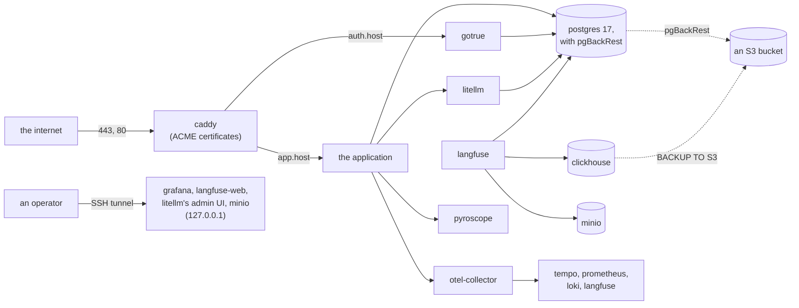
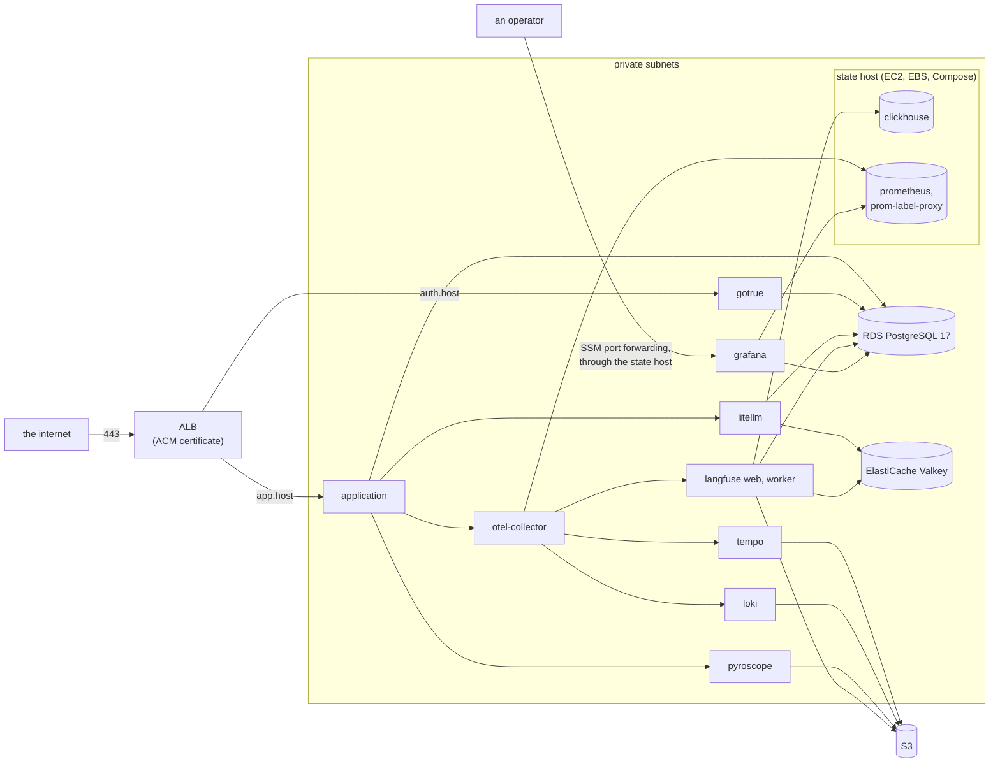

# RFC-0004: Hosting recipes

**Status:** Accepted
**Author:** Alex Nodeland
**Created:** 2026-10-12
**Discussion:** [#104](https://github.com/alexnodeland/lattice/pull/104); accepted on 2026-10-12, with the decisions in [Decisions](#decisions)
**Siblings:**

- [ADR-0001](../adr/0001-compose-first-with-profiles.md) made Compose the first deployment format, and said Kubernetes (Helm) and Terraform come later. [ADR-0023](../adr/0023-opentofu-for-aws-now.md) amends it for this RFC: OpenTofu, Terraform's open fork, comes now, for AWS. Helm still comes later.
- [ADR-0005](../adr/0005-ports-and-adapters-for-the-stack.md) puts every service behind a port. Each recipe is a set of adapters behind the same ports, so an application changes only its settings.
- [ADR-0002](../adr/0002-local-supabase-through-its-cli.md) and [ADR-0009](../adr/0009-local-supabase-as-the-database-adapter.md) make local Supabase the development adapter. It stays that. The recipes use plain PostgreSQL and Supabase's auth server alone.
- [lattice RFC-0001](../../rfcs/0001-grantr-identity-and-access.md#row-level-security)'s phase 6, and [ADR-0022](../adr/0022-row-level-security-in-the-template.md), give the template row-level security: the application migrates as the tables' owner, works as a role that owns nothing, and `db-roles` creates that role. Both recipes run it.

## Summary

stackr runs on one machine, for development. This RFC adds two ways to host it, both part of stackr's v0.1:

1. **A single host:** stackr's Compose stack on one VM, shaped for production. Caddy is the only service that faces the internet.
2. **AWS, with OpenTofu:** the stateless services on ECS Fargate, with RDS, ElastiCache and S3 as managed adapters. One EC2 "state host" runs ClickHouse and Prometheus with the single host's Compose.

In both, the database is plain PostgreSQL 17 and identity is Supabase's auth server (GoTrue) on its own. GoTrue serves the same JWKS as local Supabase, so an application changes only its settings. CI tests the AWS recipe against Floci, an AWS emulator, and never against AWS itself. One manual apply on real AWS gates stackr's v0.1.

The maintainer decided the recipes' scope, the database and identity, where state lives on AWS, how CI tests it, how ClickHouse is backed up, and where GoTrue is served, on 2026-10-12. The rest was settled with this RFC. [Decisions](#decisions) records both.

## Motivation

An application generated from the template runs beside the stack on a laptop. Nothing says how to run it anywhere else:

- **The stack's defaults are local.** Ports bind to `127.0.0.1`, local Supabase's keys are well known, and its ports listen on every interface ([Security](../guides/security.md)). The security guide says what to change "before the stack faces a network you don't trust", but no recipe makes the change.
- **State has no backups.** PostgreSQL, ClickHouse and Prometheus keep their data in Docker volumes, with nothing that copies them anywhere.
- **Configuration is mounted from the checkout.** Every service reads its files from `deploy/<service>/`, and Grafana reads the libraries' dashboards from `packages/<library>/`. A container platform has no checkout to mount.
- **Row-level security needs two roles.** An application with it migrates as the owner and works as a role that owns nothing, which `db-roles` creates before it first starts ([ADR-0022](../adr/0022-row-level-security-in-the-template.md)).

The applications built on the family are ready to be used by people other than their authors. They need somewhere to run that the maintainer can stand behind, on a VM with an S3-compatible bucket off the host for its backups, or in one AWS account, with no other hosted service to sign up for.

## Design

### Ports and adapters

Both recipes keep every port ([ADR-0005](../adr/0005-ports-and-adapters-for-the-stack.md)) and change only adapters. An application's code is the same everywhere. Only its settings change.

| Port | Development | Single host | AWS |
|---|---|---|---|
| Telemetry | The Collector | The Collector | The Collector, on Fargate |
| Profiles | Pyroscope | Pyroscope | Pyroscope, on Fargate, on S3 |
| LLM gateway | LiteLLM | LiteLLM | LiteLLM, on Fargate |
| Database | Local Supabase's PostgreSQL, or the `postgres` profile | The `postgres` profile, PostgreSQL 17 | RDS for PostgreSQL 17 |
| Object storage | MinIO | MinIO | S3 |
| Identity | Local Supabase's Auth | GoTrue, in a new `auth` profile | GoTrue, on Fargate |
| Evaluation data | Langfuse | Langfuse | Langfuse, on Fargate |

The internal ports change the same way: the Redis protocol is Valkey on the host and ElastiCache for Valkey on AWS, and ClickHouse runs on the host or on the state host.

**Identity without the rest of Supabase.** GoTrue is the service behind local Supabase's `/auth/v1`. Run alone, it signs tokens with the same asymmetric keys and serves the same JWKS. The template already verifies tokens against `AUTH_JWKS_URL`, with `AUTH_ISSUER` and `AUTH_AUDIENCE` ([ADR-0011](../adr/0011-the-application-template-in-detail.md)).

- **Its own subdomain.** GoTrue is served at `https://auth.<host>`, at its own root, so nothing rewrites a path. `AUTH_ISSUER` and GoTrue's `API_EXTERNAL_URL` are both `https://auth.<host>`, and `AUTH_JWKS_URL` is `https://auth.<host>/.well-known/jwks.json`.
- **Its admin API has its own setting.** The template's admin commands call `{AUTH_ISSUER}/admin/users` today. They gain `AUTH_ADMIN_URL`, which defaults to `AUTH_ISSUER`, so local Supabase is unchanged, and which the recipes set to GoTrue's private address. The edge refuses `/admin/*` on `auth.<host>`.
- **Its keys.** HCL can't make a JWK or sign a JWT, so a script, `scripts/auth-keys`, makes GoTrue's ES256 key set and signs the service role's key, `AUTH_SERVICE_ROLE_KEY`: a JWT with the `service_role` role. On the host, `make env` runs it. On AWS, a one-off task runs it and writes both into their secrets when they are empty. Without Supabase's gateway in front, GoTrue ignores the `apikey` header the admin commands send, and checks only the JWT.
- **Its database** is a role and the `auth` schema on the same PostgreSQL. `db-init` (`deploy/postgres/init.sql`) gains GoTrue's role, as it has Langfuse's and the gateway's. It already works where the admin role isn't a superuser, which is RDS's case too.
- **A new `auth` profile in `compose.yaml`** runs GoTrue on the database adapter. The `postgres` adapter then has identity in development and in CI too, so `make smoke-app` can run on it. `make up` refuses the `auth` profile with the `supabase` adapter, whose Auth is already running.
- **Its version follows the Supabase CLI's.** `scripts/check-config` fails when GoTrue's image differs from the version the CLI pinned in `versions.env` runs, as it already does for PostgreSQL's major version.

The Supabase CLI stays the development adapter. Its Studio, Data API, Storage and Realtime aren't part of either recipe.

### The single host

The host runs stackr's `compose.yaml` from a checkout of lattice at a stackr tag, with the `observability`, `langfuse`, `gateway`, `postgres` and `auth` profiles, the application's own Compose file, and an overlay, `deploy/host/compose.prod.yaml`. It mounts its configuration from the checkout, as development does.

- **Only Caddy publishes on a public interface,** on 80 and 443. The overlay uses Compose's `!reset` to remove the ports nothing outside the host needs: the Collector's, Tempo's, Loki's, Pyroscope's, Prometheus's, prom-label-proxy's and PostgreSQL's. Grafana, Langfuse, LiteLLM and MinIO keep theirs on `127.0.0.1`, for SSH tunnels. Langfuse's `NEXTAUTH_URL`, `http://localhost:3300`, and its media uploads to `http://localhost:9000` work through a tunnel unchanged.
- **PostgreSQL with pgBackRest.** pgBackRest isn't in the `postgres` image, so the overlay builds `deploy/host/postgres/Dockerfile`: the same pinned image, with Alpine's `pgbackrest` package. Its `archive_command` archives the WAL from the container, and a systemd timer runs `docker compose exec postgres pgbackrest backup`.
- **Local Supabase's network goes.** `db-init`, Langfuse and LiteLLM join only `stackr`, since PostgreSQL is the `postgres` service there, and so does the application.
- **Caddy** gets certificates from Let's Encrypt with ACME, sends the application's host to the application and `auth.<host>` to GoTrue, and refuses `/admin/*` on `auth.<host>`.

`deploy/host/` holds the overlay, the Caddyfile, PostgreSQL's Dockerfile, the backup configuration, the systemd units, a `bootstrap` script, and `restore-drill`.

### AWS

Every task and the state host are in private subnets. Only the ALB is public.

`packages/stackr/deploy/aws/` holds the modules and two roots:

| Module | Holds |
|---|---|
| `network` | A VPC across two zones, public subnets for the ALB and one NAT gateway, private subnets for everything else, and the security groups |
| `edge` | The ALB, its HTTPS listener with an ACM certificate for the application's host and `auth.<host>`, validated through Route 53, the HTTP listener that redirects, and the host-header rules |
| `data` | RDS for PostgreSQL 17, ElastiCache for Valkey with a `noeviction` parameter group, and the S3 buckets: Langfuse's, the telemetry stores', and backups |
| `secrets` | Every generated secret, in Secrets Manager |
| `ecs-service` | One Fargate service: its task definition, secrets from Secrets Manager, logs, its name in the private namespace, and its target group when it has one |
| `state-host` | One EC2 instance running ClickHouse, Prometheus and prom-label-proxy with Compose, its EBS volume, the DLM policy that snapshots it, and its fixed private address |
| `stack` | The cluster, the private DNS namespace (Cloud Map), every Fargate service through `ecs-service`, the state host, and the one-off tasks |

- **`envs/prod`** is the root an operator applies. Its state is in S3, with `use_lockfile`: one bucket per account, created once by hand with the commands its README lists, and one key per deployment. CI never applies it.
- **`envs/floci`** is the same modules against Floci: local state, the provider pointed at Floci through `AWS_ENDPOINT_URL`, smaller sizes, and the tests (`tests/*.tofutest.hcl`).
- **OpenTofu 1.13** and **tflint** are pinned in `.prototools`. proto has neither built in, so `[plugins]` names a community TOML plugin for each (`tofu`, `tflint`), pinned to a commit. Renovate's proto manager doesn't follow third-party plugins, so a Renovate custom manager moves each plugin's commit and tool version from their GitHub releases. tflint's AWS ruleset is pinned to a version in `.tflint.hcl`, which the same custom manager moves. The AWS provider is pinned at `~> 6.68`.

Where each service runs:

| Where | Services | Why |
|---|---|---|
| Fargate | The application, GoTrue, LiteLLM, Langfuse's web and worker, the Collector, Grafana | Stateless. Grafana keeps its database on RDS, which `db-init` creates, so its users and alert state survive a replaced task |
| Fargate, on S3 | Tempo, Loki and Pyroscope, each one monolithic task | Their blocks are in S3. A replaced task loses only its write-ahead log |
| The state host | ClickHouse, Prometheus and prom-label-proxy ([ADR-0020](../adr/0020-one-tenant-attribute-and-prom-label-proxy.md)) | They need a disk that outlives a task. Fargate can attach an EBS volume to a task, but the volume belongs to that task and is gone when it is replaced, and Prometheus doesn't support EFS |
| Managed | RDS, ElastiCache, S3 | |
| One-off tasks | `db-init`, `auth-keys`, and the application's `db-roles` | Run before the services that need them, on every apply that changes them |

- **The state host reuses the single host's recipe.** Its user data checks out lattice at the stackr tag, mounts the EBS volume, and starts ClickHouse, Prometheus and prom-label-proxy with Compose under a systemd unit, with an overlay, `deploy/aws/state-host/compose.yaml`, for the volume's paths and Prometheus's AWS scrape configuration. It is not in the ECS cluster.
- **Names.** Services find each other in one private namespace, `stackr.internal`, as `otel-collector.stackr.internal`. The state host keeps a fixed private address, registered once, which survives replacing the instance.
- **Langfuse reaches S3** with its task role, not with keys.
- **ElastiCache** has transit encryption and an auth token, so its clients use `rediss://`.
- **RDS requires TLS.** RDS for PostgreSQL 15 and later sets `rds.force_ssl`, so every client asks for it: `ssl=require` in the application's asyncpg URLs; `sslmode=require` in the URLs of Langfuse's and LiteLLM's Prisma, GoTrue, and the one-off tasks (`db-init`'s psql, `auth-keys` and `db-roles`); and `GF_DATABASE_SSL_MODE=require` for Grafana, which takes its database in separate settings, not a URL.
- **Operators** reach Grafana, Langfuse and LiteLLM's admin UI with SSM port forwarding through the state host, which runs the SSM agent. Nothing is opened for it: no bastion, no SSH.

### Images and configuration on AWS

Fargate can't mount a checkout, so each service on Fargate whose configuration stackr owns gets a **thin image**: the upstream image, pinned as `compose.yaml` pins it, with its files copied in. The single host and the state host mount their checkout instead.

- **The images:** `stackr-otel-collector`, `stackr-tempo`, `stackr-loki`, `stackr-pyroscope`, `stackr-litellm`, `stackr-db-init`, `stackr-auth-keys`, and `stackr-grafana`, with its provisioning and the dashboards of stackr, artifactr and reflexr.
- **One file per service.** Where a setting differs between Compose and AWS, such as Tempo's, Loki's and Pyroscope's storage, the file reads it from the environment (`-config.expand-env=true`).
- **Built in CI's Images job** on every pull request that changes them, as a `stackr:image` task.
- **Published to GHCR at each stackr release,** by a release step with `packages: write`. The images are public, as lattice is.
- **Pinned by digest in `envs/prod`.** Renovate proposes the new digests after each release, as it moves `compose.yaml`'s images, so a release reaches a deployment through a reviewed pull request.

### Secrets

- **Never in state.** OpenTofu makes each secret with an `ephemeral "random_password"` and writes it to Secrets Manager with `secret_string_wo`, a write-only argument. RDS's master password is RDS's own, with `manage_master_user_password`. A secret that a URL carries, such as LiteLLM's `DATABASE_URL`, is written whole, built from the ephemeral password.
- **Injected by ECS** into each task as an environment variable, from its ARN. No secret is in a task definition or a variable file. The state bucket is encrypted and versioned as well, as a second protection.
- **Secrets that encrypt data never rotate:** Langfuse's `SALT` and `ENCRYPTION_KEY`, and `LITELLM_SALT_KEY`, as on one machine ([Security](../guides/security.md#secrets-live-in-env)). Their write-only versions never change, so OpenTofu never writes them again.
- **Deleting a deployment is a choice.** RDS's `deletion_protection` and `skip_final_snapshot`, and Secrets Manager's recovery window, are variables: protected in `envs/prod`, and off in `envs/floci`, whose tests end in a destroy, as the manual gate does.
- **On the single host,** `.env` stays the store, as it is today. `bootstrap` runs `make env`, and the backup configuration names it as the one file to keep elsewhere.

### Security

- **No admin UI faces the internet.** Grafana, Langfuse, LiteLLM's admin UI, and MinIO's console on the host, are reached by an SSH tunnel on the host, and by SSM through the state host on AWS. The edge refuses GoTrue's `/admin/*`, and the admin commands reach it on the private network through `AUTH_ADMIN_URL`.
- **A firewall on the host,** ufw, allows 22, 80 and 443. Docker writes its own iptables rules for published ports, which ufw doesn't see, so a port published on every interface would bypass it. That is why the overlay publishes nothing but Caddy's ports, and binds the rest to `127.0.0.1`.
- **Security groups on AWS:** the ALB takes 443 and 80 from anywhere, and each task takes traffic only from the services that call it. RDS, ElastiCache and the state host take nothing from outside the VPC.
- **Row-level security** ([ADR-0022](../adr/0022-row-level-security-in-the-template.md)). With access by grantr, the application gets `DATABASE_URL`, a role that owns nothing, and `DATABASE_ADMIN_URL`, the tables' owner: it migrates at startup as the owner, and keeps the owner's engine for the reads that span tenants. `db-roles` creates the first role before the application first starts. With `access=none`, there is no `db-roles`, and the application gets one URL. ADR-0022 lets such an application turn row-level security on and create its role itself; the recipes don't wire that.
- **Images** are pinned by digest, and Renovate moves them.

### Operations

- **Updates.** On the host: check out the new stackr tag, `docker compose pull`, then `up`. On AWS: merge Renovate's digests in `envs/prod`, then `tofu apply`. ECS rolls each service, with its deployment circuit breaker rolling back a deployment whose tasks fail. Langfuse, LiteLLM and the application migrate their databases when they start, as they do now.
- **Backups on the host.** pgBackRest takes full and incremental backups of PostgreSQL to an S3 bucket, with its WAL archived, so it can restore to a point in time. ClickHouse's native `BACKUP ... TO S3` copies ClickHouse to the same bucket, run nightly by a systemd timer like pgBackRest's. Its bucket and credentials come from `.env` into a named collection in ClickHouse's configuration, so no key is written in the `BACKUP` statement. The bucket is any S3-compatible store off the host. Prometheus's data is not backed up: it is 15 days of metrics.
- **Backups on AWS.** RDS takes automated backups with point-in-time restore. DLM snapshots the state host's volume daily, which covers ClickHouse and Prometheus. Amended by [ADR-0037](../adr/0037-the-state-hosts-clickhouse-backups.md): ClickHouse is also backed up with `BACKUP ... TO S3` each night, and the backup is restored in a weekly drill.
- **The restore drill.** On the host, a weekly systemd timer runs `deploy/host/restore-drill`: it restores the latest backups into new containers beside the stack, checks that the application's tables and Langfuse's traces are there, and sends the result as a metric to the Collector. A Grafana alert fires when the drill hasn't passed in eight days. On AWS, an operator runs the drill by hand at each upgrade: a point-in-time RDS restore and a volume from the latest snapshot, with the same checks.
- **The hosted stack observes itself.** The Collector's health dashboard already shows whether each service is up. On AWS, container logs also go to CloudWatch Logs, with a short retention, for when the Collector itself is down.

### Floci and CI

Floci emulates AWS's APIs locally. Some services only record what they are given; others run real containers. What a test can show depends on which:

| Service | Emulated | Tested how |
|---|---|---|
| VPC, subnets, route tables | Yes. Each VPC is a Docker network | Applied in tier 2 |
| Security groups | Yes, filtered when `FLOCI_NETWORK_SECURITY_GROUP_ENFORCEMENT_ENABLED` is set | Not in tier 2, which leaves enforcement off ([ADR-0025](../adr/0025-what-the-floci-spike-found.md), [ADR-0036](../adr/0036-tier-2-against-floci.md)): tier 1's tests and checkov check the rules, and the manual apply checks them on AWS |
| NAT gateway | A record only | Applied, not used |
| ALB, target groups, host-header rules | Yes, real HTTP listeners | Tier 2's smoke, over HTTP, with each host's Host header |
| ACM | Issued at once | The HTTPS listener names its ARN, which Floci checks exists |
| Route 53 | Changes are `INSYNC` at once | Records are created |
| ECS on Fargate | Yes, tasks run as Docker containers | Tier 2: each service reaches its steady state, and the smoke runs through it |
| EC2, for the state host | Instances are containers that run their user data; EBS volumes are loop devices | Spike item: the state host's Compose inside Floci's instance |
| EBS snapshots, DLM | No | Not tested |
| RDS for PostgreSQL | Yes, a real PostgreSQL behind a relay (Floci's proxy) on ports 7001 to 7099 | Tier 2: `psql` through the relay, `db-init`, `db-roles` and the application's migrations |
| ElastiCache for Valkey | Yes, Valkey containers, with parameter groups | Spike item |
| S3 | Yes | Tier 2: Tempo, Loki and Langfuse write to it |
| Secrets Manager | Yes | Spike item: ECS's injection |
| Cloud Map | Yes, it answers DNS | Tier 2: the services find each other |
| CloudWatch Logs | Yes | Tier 2: the tasks' logs arrive |
| IAM | Stored. Enforcement is off by default | The spike tries `FLOCI_SERVICES_IAM_ENFORCEMENT_ENABLED` |

**What Floci cannot test:** IAM policies (unless the spike's trial holds), TLS at the edge and to RDS (`rds.force_ssl`; `envs/floci` asks for `prefer`), DNS validation of certificates, NAT egress, SSM port forwarding, Multi-AZ, EBS snapshots and DLM, rollouts across zones, and autoscaling. The manual apply on real AWS covers these before stackr's v0.1.

**Tier 1, on every pull request that touches `deploy/aws/**`:**

- `tofu fmt -check` and `tofu validate` for every module and root.
- tflint, with the AWS ruleset.
- checkov over the modules and over the plan's JSON.
- `tofu test` with `mock_provider "aws"`, which needs no Floci.

**Tier 2, when the recipe changes** (the modules, `envs/floci`, or the thin images), and nightly:

1. Floci in Docker mode, with the socket, its port ranges, and these settings on Floci's container:
   - `FLOCI_SERVICES_ECS_DOCKER_NETWORK`, a network the job creates;
   - `FLOCI_SERVICES_ECS_TASK_ROLE_CREDENTIALS_ENABLED`, which needs that user-defined network and Floci's network-helper image, so tasks get their roles' credentials;
   - `FLOCI_SERVICES_RDS_DEFAULT_POSTGRES_IMAGE`, PostgreSQL 17, since Floci's default is 16;
   - `FLOCI_NETWORK_SECURITY_GROUP_ENFORCEMENT_ENABLED`, which [ADR-0025](../adr/0025-what-the-floci-spike-found.md) and [ADR-0036](../adr/0036-tier-2-against-floci.md) amend: tier 2 leaves it off.
2. `tofu test` applies `envs/floci`.
3. The smoke runs through the ALB: HTTP, with the application's Host header and `auth.<host>`'s. A user signs in through GoTrue, a request without a token is refused, and an agent's turn completes. Amended by [ADR-0036](../adr/0036-tier-2-against-floci.md): a request without a token is refused, and a trace sent to the Collector is found in Tempo; GoTrue through its proxy, the sign-in and the agent's turn wait on what ADR-0036 lists.
4. `psql` through RDS's relay finds the application's schema, its role that owns nothing, and the row-level security policies. Amended by [ADR-0036](../adr/0036-tier-2-against-floci.md): it finds the schema as each of the application's roles; the role that owns nothing and the policies come next.
5. The turn's trace is found in Tempo.
6. `tofu test` destroys everything, and the job ends with Floci's containers removed.

AWS itself is never in CI. Floci is the `floci/floci:2.2.0` release, referenced by its digest (`floci/floci:2.2.0@sha256:…`), found with `docker buildx imagetools inspect`, as MinIO's is.

**The single host in CI.** A job brings up the stack with the overlay on a runner, with Caddy issuing from its own local CA (`tls internal`), and runs `make smoke` and `make smoke-app` through Caddy. Its restore drill backs up to the stack's own MinIO.

### The first-phase spike

Some of the design rests on behaviour of Floci or AWS that nothing here has confirmed. Floci's own OpenTofu compatibility suite leaves RDS out as untested ([floci#2263](https://github.com/floci-io/floci/issues/2263)), and neither of its suites covers load balancers' listener rules or ECS services. Phase 1 settles each item in a throwaway root against Floci, before the modules are written. Each answer picks one of the two branches the table names, and is recorded as an ADR:

| Item | Question | If it fails |
|---|---|---|
| `aws_db_instance` | Does PostgreSQL 17 round-trip: create, read back with no diff, destroy? | `envs/floci` ignores the drift it finds, and the manual gate checks RDS |
| `aws_lb` and its rules | Do the HTTPS listener, the redirect and the host-header rules round-trip, and route by Host? | Tier 2 reaches each service's target group directly |
| `aws_ecs_service`, `aws_ecs_task_definition` | Do they round-trip, and do services reach a steady state? | Raise it with Floci; tier 2 waits |
| ECS secrets | Does a task get its secrets from Secrets Manager by ARN? | Tier 2 passes them as plain environment in `envs/floci` only |
| ECS to RDS | Can a task reach RDS's relay by the endpoint RDS reports? | `FLOCI_SERVICES_RDS_ENDPOINT_HOST` set to an address on the tasks' network |
| The state host | Does its user data start Compose inside Floci's instance? | `envs/floci` runs its three services as Fargate tasks, without a volume |
| ElastiCache | Do the `noeviction` parameter group, transit encryption and the auth token round-trip? | Tier 2 runs without TLS, and the gap goes on the manual gate's list |
| GoTrue on RDS | Do GoTrue's migrations run on plain PostgreSQL, without the roles Supabase creates? | `db-init` creates the roles they expect |
| GoTrue's admin JWT | Does standalone GoTrue accept the service role's key, signed with its ES256 key, on `/admin/users`? | Keep a shared secret for the service role only |
| IAM enforcement | Does `envs/floci` apply, and the smoke pass, with `FLOCI_SERVICES_IAM_ENFORCEMENT_ENABLED`? | IAM policies stay on the cannot-test list |

### The generated application

- **Its image** is built by its CI, as now, and published to GHCR from its tags.
- **A `hosting` question** in the template, `none` by default, or `host` or `aws`:
  - `host` adds `deploy/host/compose.prod.yaml` for the application: its published image, no published port (Caddy reaches it on `stackr`), and its settings from `.env`.
  - `aws` adds `deploy/aws/`, a root that uses stackr's `stack` module from lattice at the commit the template was rendered from, as the libraries are pinned ([ADR-0018](../adr/0018-the-template-pins-the-libraries-at-its-own-commit.md)), with the application's image, host and settings.
- **`db-roles` is the application's only one-off.** With access by grantr, it runs before the service rolls: `docker compose run --rm` on the host, and an ECS task on AWS. The application then migrates at startup as the owner. `db-init` creates the application's database and its owner role, as it does Langfuse's.
- **Settings.** Each recipe writes the application's settings for the ports: `AUTH_JWKS_URL`, `AUTH_ISSUER`, `AUTH_ADMIN_URL`, `DATABASE_URL` and `DATABASE_ADMIN_URL`, `LITELLM_BASE_URL`, `OTEL_EXPORTER_OTLP_ENDPOINT` and the rest. A tenant's gateway key is still made with `make tenant`, run against the hosted gateway.

### What comes later

- **Multi-AZ:** RDS's standby, and the services spread across zones.
- **Mimir,** in place of Prometheus, when one disk isn't enough.
- **Replicated ClickHouse,** with Keeper, in place of one node on the state host.
- **Autoscaling** of the application and Langfuse's worker.
- **WAF** in front of the ALB.
- **A scheduled restore drill on AWS.**
- **Helm and Kubernetes,** as ADR-0001 planned, from the same thin images.

## Decisions

The maintainer decided H1 to H5, H12 and H15 on 2026-10-12, and H13's state bucket: one per account, one key per deployment. The rest were settled while writing this RFC, and accepted with it.

| # | Decision | Decided | Instead of |
|---|---|---|---|
| H1 | The recipes in v0.1 | Both: a single host, and AWS with OpenTofu. Hosted SaaS is out, since it needs other accounts | One recipe first; a hosted platform |
| H2 | Database and identity | Plain PostgreSQL 17 (RDS on AWS, the `postgres` profile on the host), and GoTrue alone, serving the same JWKS. The Supabase CLI stays the development adapter | Supabase's self-hosting Compose file; hosted Supabase |
| H3 | ClickHouse and Prometheus on AWS | One EC2 state host running them with the single host's Compose under systemd, with its own EBS volume and DLM snapshots. ECS runs only the Fargate services | The state host as an ECS container instance; Fargate with EFS, which Prometheus doesn't support; ClickHouse Cloud |
| H4 | Traces, logs and profiles on AWS | Tempo, Loki and Pyroscope monolithic on Fargate, on S3; Prometheus on the state host | All of them on the state host; Mimir now |
| H5 | Floci in CI | Two tiers: checks and a mocked test on every change to `deploy/aws/**`; a real apply against Floci, smoke and destroy when the recipe changes. AWS never in CI, and one manual apply on real AWS before stackr's v0.1 | An AWS account applied from CI |
| H6 | The scanner | checkov, run with `uvx` at an exact version, outside the workspace's resolution. It reads the plan's JSON as well as the modules, so values from variables are checked too | trivy, one more binary installed outside uv |
| H7 | The single host's edge | Caddy, with ACME | Traefik, whose routing lives in labels on every service |
| H8 | The host's Compose | An overlay, `deploy/host/compose.prod.yaml`, with `!reset` and `!override`, so only Caddy publishes 80 and 443 | A production Compose file generated from `compose.yaml` |
| H9 | Configuration on Fargate | Thin per-service images, built in CI's Images job; the hosts mount their checkout | Files in S3 or SSM, copied by an init container |
| H10 | Where the thin images live | GHCR, public, published at each stackr release, with digests moved by Renovate | ECR, a private registry to manage per account |
| H11 | Secrets | Ephemeral `random_password` written to Secrets Manager with write-only arguments; RDS's own master password. Deletion guarded by variables, not `prevent_destroy` | SSM SecureString parameters; secrets in an encrypted state |
| H12 | Backups | On the host, pgBackRest, and ClickHouse's native `BACKUP ... TO S3`, with a restore drill. On AWS, RDS's own backups and DLM snapshots, and, by [ADR-0037](../adr/0037-the-state-hosts-clickhouse-backups.md), ClickHouse's native backups and drill on the state host | WAL-G; clickhouse-backup |
| H13 | Tooling and layout | OpenTofu 1.13 and tflint in `.prototools`, the AWS provider at `~> 6.68`, the S3 backend with `use_lockfile`, one bucket per account and one key per deployment; the modules `network`, `edge`, `data`, `secrets`, `ecs-service`, `state-host` and `stack`, shared by `envs/prod` and `envs/floci` | Terraform, under its business source licence; one root per environment with no shared modules |
| H14 | Floci's version | `floci/floci:2.2.0`, by digest | A tag |
| H15 | Where GoTrue is served | Its own subdomain, `auth.<host>`, at its root | `/auth/v1` on the application's host, with the prefix stripped or rewritten at the edge |
| H16 | Operators' access | SSH tunnels on the host; SSM port forwarding through the state host on AWS; the edge refuses GoTrue's `/admin/*`, reached through `AUTH_ADMIN_URL` | A bastion; admin UIs behind the edge with a password |
| H17 | GoTrue in development | An `auth` profile in `compose.yaml`, refused beside local Supabase, so the `postgres` adapter has identity and `make smoke-app` runs on it | GoTrue only in the recipes |
| H18 | How the template offers the recipes | A `hosting` question, `none` by default, so `copier update` adds nothing an application didn't ask for | Always generating both |

## Phases

| Phase | Deliverable | Exit criteria |
|---|---|---|
| 1. Spike | A throwaway root against Floci, for each item in [the spike](#the-first-phase-spike) | Every item has an answer, recorded in an ADR |
| 2. Single host | The `auth` profile, `scripts/auth-keys`, `AUTH_ADMIN_URL`, `deploy/host/` with the overlay, the Caddyfile, PostgreSQL's image with pgBackRest, the backups and `restore-drill`, the CI job, and the template's `hosting: host` | CI brings the stack up with the overlay behind Caddy on a local CA, and `make smoke` and `make smoke-app` pass through it on the `postgres` adapter. The restore drill passes in the same job, against MinIO. An application generated with `hosting: host` passes its CI |
| 3. AWS modules and tier 1 | The thin images and the Images job, the seven modules, `envs/prod` and `envs/floci`, OpenTofu and tflint in `.prototools`, and tier 1 | Tier 1 passes on a pull request that touches `deploy/aws/**`, and each of checkov's findings is fixed, or skipped with its reason in checkov's configuration |
| 4. Tier 2 | The Docker-mode apply, the smoke through the ALB, `psql` through the relay, the trace in Tempo, destroy, and the template's `hosting: aws` | Tier 2 passes on a pull request that changes the recipe, and leaves nothing behind. An application generated with `hosting: aws` passes its CI. Amended by [ADR-0036](../adr/0036-tier-2-against-floci.md), which records what Floci 2.2.0 can't smoke |
| 5. Docs, ADRs and the gate | The hosting guides, ADRs that record the decisions grouped by area (the hosts, AWS's layout, secrets, backups, CI), beside the spike's ADRs, the release step that publishes the thin images, and the manual apply on real AWS | A real AWS apply passes the smoke over HTTPS, then destroys, before stackr's v0.1 is tagged |

Phase 2 and phase 3 are independent after the spike. Phase 4 needs 3.

## Drawbacks

- **More to keep current.** Two recipes, eight thin images, PostgreSQL's image on the host, and a set of modules, each moved by Renovate and checked in CI.
- **One state host.** ClickHouse and Prometheus share one instance in one zone. Replacing it means minutes without traces in Langfuse and without metrics; losing its zone means restoring from a snapshot.
- **Write-ahead logs on Fargate are lost** when a Tempo, Loki or Pyroscope task is replaced: seconds of telemetry.
- **Less than Supabase.** Applications that use the Data API, Storage or Realtime get none of them from either recipe.
- **An emulator is not AWS.** Tier 2 shows that the modules apply and the stack works, not that IAM policies and TLS are right. That rests on review, checkov, and the manual apply.
- **Cost.** The smallest AWS deployment still pays for an ALB, a NAT gateway, RDS, ElastiCache, the state host and about ten Fargate tasks.

## Alternatives

- **Kubernetes first,** with Helm, as ADR-0001 planned. It suits clusters this family doesn't run yet, and its first step on AWS would still need the VPC, RDS and S3 that OpenTofu creates here.
- **Supabase's self-hosting Compose file.** Every Supabase service, kept in step with Supabase's releases by stackr, when only Auth is used. See H2.
- **Hosted services:** hosted Supabase, Langfuse Cloud, Grafana Cloud, ClickHouse Cloud. Each is a port's alternative adapter already, and stays one, but none is part of a recipe that needs no other account.
- **LocalStack** in place of Floci. Its emulation of ECS, RDS and ELB is in its paid plans, which need an account.
- **Only a single host.** Simpler, but it leaves no path to managed databases and backups for an application that outgrows one machine.

## Unresolved questions

- **Email.** GoTrue sends invitations and password resets. On AWS, SES is in the same account. On the host, the operator supplies an SMTP relay; which one the guide recommends is open.
- **Alerts.** Grafana can alert, but where alerts go without a paging service is open: email through SES or SMTP is the likely answer.
- **PostgreSQL's major upgrades** on the host: `pg_upgrade` by hand, or a dump and restore by the drill's tooling.
- **Verifying RDS's certificate.** `require` encrypts without checking who answers. `verify-full` needs RDS's CA bundle in every image that connects.

## Tracking

Tracked in [#103](https://github.com/alexnodeland/lattice/issues/103).

- [x] Sign-off on H1 to H18 (2026-10-12)
- [x] Phase 1: spike ([ADR-0025](../adr/0025-what-the-floci-spike-found.md))
- [x] Phase 2: single host ([ADR-0026](../adr/0026-the-single-host.md))
- [x] Phase 3: AWS modules and tier 1 ([ADR-0029](../adr/0029-the-aws-modules-and-tier-1.md), [ADR-0034](../adr/0034-the-stack-on-aws.md))
- [ ] Phase 4: tier 2. Partly met: tier 2 passes in CI and leaves nothing behind ([ADR-0036](../adr/0036-tier-2-against-floci.md)); the template's `hosting: aws` is still to come
- [ ] Phase 5: docs, ADRs and the gate
