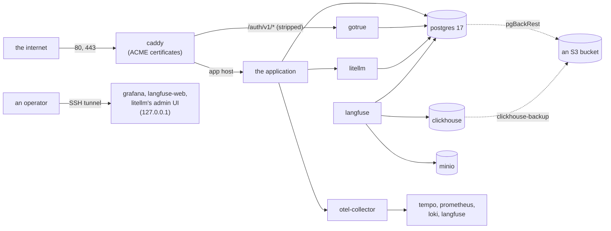
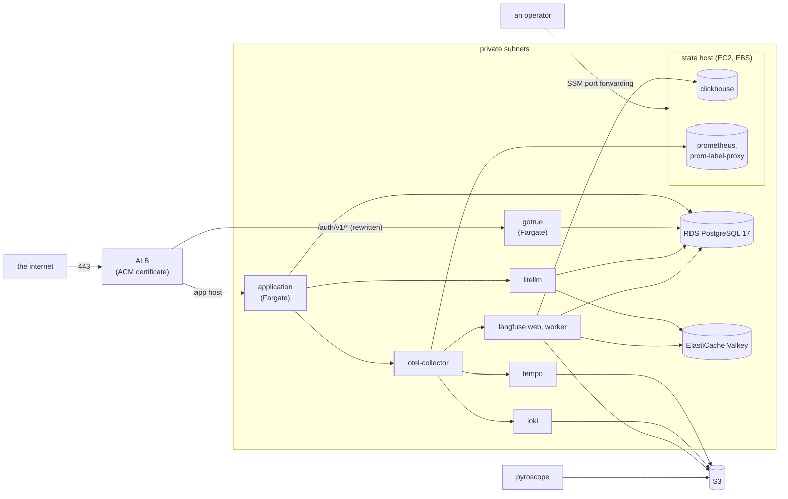

# RFC-0004: Hosting recipes

**Status:** Accepted
**Author:** Alex Nodeland
**Created:** 2026-10-12
**Discussion:** [#104](https://github.com/alexnodeland/lattice/pull/104); accepted on 2026-10-12, with the decisions in [Decisions](#decisions)
**Siblings:**

- [ADR-0001](../adr/0001-compose-first-with-profiles.md) made Compose the first deployment format, and said Kubernetes (Helm) and Terraform come later. This RFC amends it: OpenTofu, Terraform's open fork, comes now, for AWS. Helm still comes later.
- [ADR-0005](../adr/0005-ports-and-adapters-for-the-stack.md) puts every service behind a port. Each recipe is a set of adapters behind the same ports, so an application changes only its settings.
- [ADR-0002](../adr/0002-local-supabase-through-its-cli.md) and [ADR-0009](../adr/0009-local-supabase-as-the-database-adapter.md) make local Supabase the development adapter. It stays that. The recipes use plain PostgreSQL and Supabase's auth server alone.
- [lattice RFC-0001](../../rfcs/0001-grantr-identity-and-access.md#row-level-security) has the application connect as a role that doesn't own its tables. Its phase 6d gives the template a `db-roles` admin command that creates that role, and both recipes run it.

## Summary

stackr runs on one machine, for development. This RFC adds two ways to host it, both part of stackr's v0.1:

1. **A single host:** stackr's Compose stack on one VM, shaped for production. Caddy is the only service that faces the internet.
2. **AWS, with OpenTofu:** the same services as ECS tasks, with RDS, ElastiCache and S3 as managed adapters. One EC2 "state host" keeps what needs a disk.

In both, the database is plain PostgreSQL 17 and identity is Supabase's auth server (GoTrue) on its own. GoTrue serves the same JWKS as local Supabase, so an application changes only its settings. CI tests the AWS recipe against Floci, an AWS emulator, and never against AWS itself. One manual apply on real AWS gates stackr's v0.1.

The maintainer decided the recipes' scope, the database and identity, where state lives on AWS, and how CI tests it, on 2026-10-12. The rest was settled with this RFC. [Decisions](#decisions) records both.

## Motivation

An application generated from the template runs beside the stack on a laptop. Nothing says how to run it anywhere else:

- **The stack's defaults are local.** Ports bind to `127.0.0.1`, local Supabase's keys are well known, and its ports listen on every interface ([Security](../guides/security.md)). The security guide says what to change "before the stack faces a network you don't trust", but no recipe makes the change.
- **State has no backups.** PostgreSQL, ClickHouse and Prometheus keep their data in Docker volumes, with nothing that copies them anywhere.
- **Configuration is mounted from the checkout.** Every service reads its files from `deploy/<service>/`, and Grafana reads the libraries' dashboards from `packages/<library>/`. A container platform has no checkout to mount.
- **lattice RFC-0001's row-level security** needs an owner role and an application role. Something has to create them, and run the migrations as the owner, before the application starts.

The applications built on the family are ready to be used by people other than their authors. They need somewhere to run that the maintainer can stand behind, without another vendor's account.

## Design

### Ports and adapters

Both recipes keep every port ([ADR-0005](../adr/0005-ports-and-adapters-for-the-stack.md)) and change only adapters. An application's code is the same everywhere. Only its settings change.

| Port | Development | Single host | AWS |
|---|---|---|---|
| Telemetry | The Collector | The Collector | The Collector, on Fargate |
| Profiles | Pyroscope | Pyroscope | Pyroscope, on Fargate, on S3 |
| LLM gateway | LiteLLM | LiteLLM | LiteLLM, on Fargate |
| Database | Local Supabase's PostgreSQL, or the `postgres` profile | The `postgres` profile, PostgreSQL 17 | RDS for PostgreSQL 17 |
| Object storage | MinIO | MinIO | S3 |
| Identity | Local Supabase's Auth | GoTrue, in a new `auth` profile | GoTrue, on Fargate |
| Evaluation data | Langfuse | Langfuse | Langfuse, on Fargate |

The internal ports change the same way: the Redis protocol is Valkey on the host and ElastiCache for Valkey on AWS, and ClickHouse runs on the host or on the state host.

**Identity without the rest of Supabase.** GoTrue is the service behind local Supabase's `/auth/v1`. Run alone, it signs tokens with the same asymmetric keys and serves the same JWKS. The template already verifies tokens against `AUTH_JWKS_URL`, with `AUTH_ISSUER` and `AUTH_AUDIENCE` ([ADR-0011](../adr/0011-the-application-template-in-detail.md)).

- **The prefix is stripped at the edge.** GoTrue serves its routes at its root. The edge sends `/auth/v1/*` to it without the prefix: Caddy's `handle_path` on the host, and a listener rule's URL rewrite on AWS (a Caddy sidecar in GoTrue's task if the rewrite fails the spike). So `https://<host>/auth/v1/.well-known/jwks.json` reaches GoTrue's own JWKS, as it does on local Supabase.
- **The issuer is the public URL.** GoTrue's `API_EXTERNAL_URL` and `AUTH_ISSUER` are both `https://<host>/auth/v1`, so `iss` verifies.
- **Its database** is a role and the `auth` schema on the same PostgreSQL. `db-init` (`deploy/postgres/init.sql`) gains GoTrue's role, as it has Langfuse's and the gateway's. It already works where the admin role isn't a superuser, which is RDS's case too.
- **A new `auth` profile in `compose.yaml`** runs GoTrue on the database adapter. The `postgres` adapter then has identity in development and in CI too, so `make smoke-app` can run on it.
- **Its version follows the Supabase CLI's.** `scripts/check-config` fails when GoTrue's image differs from the version the CLI pinned in `versions.env` runs, as it already does for PostgreSQL's major version.

The Supabase CLI stays the development adapter. Its Studio, Data API, Storage and Realtime aren't part of either recipe.

### Images and configuration

A container platform can't mount `deploy/<service>/`, so each service whose configuration stackr owns gets a **thin image**: the upstream image, pinned as `compose.yaml` pins it, with its files copied in.

- **The images:** `stackr-otel-collector`, `stackr-prometheus`, `stackr-tempo`, `stackr-loki`, `stackr-pyroscope`, `stackr-litellm`, `stackr-db-init`, and `stackr-grafana`, with its provisioning and the dashboards of stackr, artifactr and reflexr.
- **One file per service.** Where a setting differs between recipes, such as Tempo's, Loki's and Pyroscope's storage, the file reads it from the environment (`-config.expand-env=true`).
- **Built in CI's Images job** on every pull request that changes them, as a `stackr:image` task. Published to GHCR at each stackr release, and pinned by digest in both recipes.
- **Development is unchanged.** `compose.yaml` keeps its mounts, so a change to a file shows without a build.

### The single host

The host runs stackr's `compose.yaml` with the `observability`, `langfuse`, `gateway`, `postgres` and `auth` profiles, the application's own Compose file, and an overlay, `deploy/host/compose.prod.yaml`:

- **Only Caddy publishes on a public interface,** on 80 and 443. The overlay uses Compose's `!reset` to remove the ports nothing outside the host needs: the Collector's, Tempo's, Loki's, Pyroscope's, Prometheus's, prom-label-proxy's, MinIO's and PostgreSQL's. Grafana, Langfuse and LiteLLM keep theirs on `127.0.0.1`, for SSH tunnels. Langfuse's `NEXTAUTH_URL`, `http://localhost:3300`, works through a tunnel unchanged.
- **Images become the thin ones,** with `!override` on the services' `image` and `!reset` on their configuration mounts.
- **Local Supabase's network goes.** `db-init`, Langfuse and LiteLLM join only `stackr`, since PostgreSQL is the `postgres` service there, and so does the application.
- **Caddy** gets certificates from Let's Encrypt with ACME, sends the application's host to the application, sends `/auth/v1/*` to GoTrue with the prefix stripped, and refuses `/auth/v1/admin/*`.

`deploy/host/` also holds the Caddyfile, a `bootstrap` script, the backup configuration, and `restore-drill`. The host's checkout is lattice at a stackr tag, with `.env` from `make env`.

### AWS

`packages/stackr/deploy/aws/` holds the modules and two roots:

| Module | Holds |
|---|---|
| `network` | A VPC across two zones, public subnets for the ALB and one NAT gateway, private subnets for everything else, and the security groups |
| `edge` | The ALB, its HTTPS listener with an ACM certificate validated through Route 53, the HTTP listener that redirects, and the rules for the application and GoTrue |
| `data` | RDS for PostgreSQL 17, ElastiCache for Valkey with a `noeviction` parameter group, and the S3 buckets: Langfuse's, the telemetry stores', and backups |
| `secrets` | Every generated secret, in Secrets Manager |
| `ecs-service` | One Fargate service: its task definition, secrets from Secrets Manager, logs, its name in the private namespace, and its target group when it has one |
| `state-host` | One EC2 instance in the ECS cluster, its EBS volume, the DLM policy that snapshots it, and its fixed private address |
| `stack` | The cluster, the private DNS namespace (Cloud Map), every stackr service through `ecs-service` or `state-host`, and the one-off tasks |

- **`envs/prod`** is the root an operator applies. Its state is in S3, with `use_lockfile`. The bucket is created once, by hand, with the commands its README lists. CI never applies it.
- **`envs/floci`** is the same modules against Floci: local state, the provider pointed at Floci through `AWS_ENDPOINT_URL`, smaller sizes, and the tests (`tests/*.tofutest.hcl`).
- **OpenTofu 1.13** is pinned in `.prototools`, and the AWS provider at `~> 6.68`.

Where each service runs:

| Where | Services | Why |
|---|---|---|
| Fargate | The application, GoTrue, LiteLLM, Langfuse's web and worker, the Collector, Grafana | Stateless. Grafana's data sources, dashboards and admin are provisioned, so it keeps nothing worth keeping |
| Fargate, on S3 | Tempo, Loki and Pyroscope, each one monolithic task | Their blocks are in S3. A replaced task loses only its write-ahead log |
| The state host | ClickHouse, Prometheus and prom-label-proxy ([ADR-0020](../adr/0020-one-tenant-attribute-and-prom-label-proxy.md)) | They need a disk. An ECS service on Fargate can't keep an EBS volume, and Prometheus doesn't support EFS |
| Managed | RDS, ElastiCache, S3 | |
| One-off tasks | `db-init`, and the application's `db-roles` and migrations | Run before the services that need them, on every apply that changes them |

- **Names.** Services find each other in one private namespace, `stackr.internal`, as `otel-collector.stackr.internal`. The state host keeps a fixed private address, registered once, which survives replacing the instance.
- **Langfuse reaches S3** with its task role, not with keys.
- **ElastiCache** has transit encryption and an auth token, so its clients use `rediss://`.
- **Operators** reach Grafana, Langfuse and LiteLLM's admin UI with SSM port forwarding through the state host, which runs the SSM agent. Nothing is opened for it: no bastion, no SSH.

### Secrets

- **Generated by OpenTofu,** with `random_password`, into Secrets Manager. ECS injects each into its task as an environment variable, from its ARN. No secret is in a task definition or a variable file.
- **Secrets that encrypt data never rotate:** Langfuse's `SALT` and `ENCRYPTION_KEY`, and `LITELLM_SALT_KEY`, as on one machine ([Security](../guides/security.md#secrets-live-in-env)). Their resources carry `prevent_destroy`.
- **Out of state where it works.** The spike checks OpenTofu's ephemeral resources and write-only arguments against Floci. If they round-trip, the generated values never reach the state. If not, the state bucket is encrypted and versioned, and only the operator's role reads it.
- **GoTrue's signing key** is generated the same way. The service role's key, `AUTH_SERVICE_ROLE_KEY`, is a JWT with the `service_role` role, signed by that key. The template's admin commands send it to `{AUTH_ISSUER}/admin/users`. Without Supabase's gateway in front, GoTrue ignores the `apikey` header and checks only the JWT; the spike confirms it accepts one signed with the asymmetric key.
- **On the single host,** `.env` stays the store, as it is today. `bootstrap` runs `make env`, and the backup configuration names it as the one file to keep elsewhere.

### Security

- **No admin UI faces the internet.** Grafana, Langfuse, LiteLLM's admin UI and MinIO's console are reached by an SSH tunnel on the host, and by SSM through the state host on AWS. The edge refuses GoTrue's `/auth/v1/admin/*`: the application's admin commands reach GoTrue on the private network, with `AUTH_ISSUER` set to its private address, since they verify no tokens.
- **A firewall on the host,** ufw, allows 22, 80 and 443. Docker writes its own iptables rules for published ports, which ufw doesn't see, so a port published on every interface would bypass it. That is why the overlay publishes nothing but Caddy's ports, and binds the rest to `127.0.0.1`.
- **Security groups on AWS:** the ALB takes 443 and 80 from anywhere, and each task takes traffic only from the services that call it. RDS, ElastiCache and the state host take nothing from outside the VPC.
- **Row-level security.** The application connects with `DATABASE_URL`, as a role that doesn't own its tables. `db-roles` creates that role using `DATABASE_ADMIN_URL`, the owner's, which only the one-off tasks receive.
- **Images** are pinned by digest, and Renovate moves them. The thin images are built from the same pins as `compose.yaml`.

### Operations

- **Updates.** On the host: check out the new stackr tag, `docker compose pull`, then `up`. On AWS: the new tag's digests in `envs/prod`, then `tofu apply`. ECS rolls each service, with its deployment circuit breaker rolling back a deployment whose tasks fail. Langfuse and LiteLLM migrate their databases when they start, as they do now.
- **Backups on the host.** pgBackRest takes full and incremental backups of PostgreSQL to an S3 bucket, with its WAL archived, so it can restore to a point in time. clickhouse-backup copies ClickHouse to the same bucket. Prometheus's data is not backed up: it is 15 days of metrics.
- **Backups on AWS.** RDS takes automated backups with point-in-time restore. clickhouse-backup runs on the state host to S3, and DLM snapshots the state host's volume daily.
- **The restore drill.** `deploy/host/restore-drill` restores the latest backups into new containers beside the stack and checks that the application's tables and Langfuse's traces are there. On AWS, the same script runs against a restored RDS instance and a ClickHouse restored on a scratch volume. The drill is a scheduled task that operators run, and its result goes to Grafana.
- **The hosted stack observes itself.** The Collector's health dashboard already shows whether each service is up. On AWS, container logs also go to CloudWatch Logs, with a short retention, for when the Collector itself is down.

### Floci and CI

Floci emulates AWS's APIs locally. Some services only record what they are given; others run real containers. What a test can show depends on which:

| Service | Emulated | Tested how |
|---|---|---|
| VPC, subnets, route tables, security groups | Yes. Each VPC is a Docker network | Planned in tier 1, applied in tier 2. Security groups don't filter unless `FLOCI_NETWORK_SECURITY_GROUP_ENFORCEMENT_ENABLED` is set |
| NAT gateway | A record only | Applied, not used |
| ALB, target groups, listener rules | Yes, real HTTP listeners | Tier 2's smoke, over HTTP with a Host header. The URL rewrite is a spike item |
| ACM | Issued at once | The HTTPS listener names its ARN, which Floci checks exists |
| Route 53 | Changes are `INSYNC` at once | Records are created |
| ECS on Fargate | Yes, tasks run as Docker containers | Tier 2: each service reaches its steady state, and the smoke runs through it |
| ECS on EC2 | Container instances register only through the API; Floci's local cluster has none | Spike item: the state host's services in Floci |
| EC2 and EBS | Instances are containers, and volumes are loop devices | Applied in tier 2 |
| EBS snapshots, DLM | No | Not tested |
| RDS for PostgreSQL | Yes, a real PostgreSQL behind a relay (Floci's proxy) on ports 7001 to 7099 | Tier 2: `psql` through the relay, `db-init`, `db-roles` and the migrations. Floci's default image is PostgreSQL 16, so `envs/floci` sets 17 |
| ElastiCache for Valkey | Yes, Valkey containers, with parameter groups | Spike item: the `noeviction` parameter group, transit encryption and the auth token |
| S3 | Yes | Tier 2: Tempo, Loki, Langfuse and the backups write to it |
| Secrets Manager | Yes | Spike item: ECS's injection |
| Cloud Map | Yes, it answers DNS | Tier 2: the services find each other |
| CloudWatch Logs | Yes | Tier 2: the tasks' logs arrive |
| IAM | Stored. Enforcement is off by default | Policies are not tested |

**What Floci cannot test:** IAM policies, security groups (unless enforcement is on), TLS, DNS validation of certificates, NAT egress, Multi-AZ, EBS snapshots and DLM, rollouts across zones, and autoscaling. The manual apply on real AWS covers these before stackr's v0.1.

**Tier 1, on every pull request that touches `deploy/aws/**`:**

- `tofu fmt -check` and `tofu validate` for every module and root.
- tflint, with the AWS ruleset.
- checkov over the modules and over the plan's JSON.
- `tofu test` of `envs/floci` with `command = plan`, against Floci with its `*_MOCK` settings, so no Docker socket is needed.

**Tier 2, when the recipe changes** (the modules, `envs/floci`, or the thin images), and nightly:

1. Floci in Docker mode, with the socket, its port ranges and `FLOCI_SERVICES_DOCKER_NETWORK`.
2. `tofu test` applies `envs/floci`.
3. The smoke runs through the ALB: HTTP, with the application's Host header. A user signs in through GoTrue, a request without a token is refused, and an agent's turn completes.
4. `psql` through RDS's relay finds the application's schema, its non-owner role, and the row-level security policies.
5. The turn's trace is found in Tempo.
6. `tofu test` destroys everything, and the job ends with Floci's containers removed.

AWS itself is never in CI. Floci is pinned by digest (`floci/floci:2.2.0`), found with `docker buildx imagetools inspect`, as MinIO's is.

**The single host in CI.** A job brings up the stack with the overlay on a runner, with Caddy issuing from its own local CA (`tls internal`), and runs `make smoke` and `make smoke-app` through Caddy.

### The first-phase spike

Some of the design rests on behaviour of Floci or AWS that nothing here has confirmed. Phase 1 settles each before the modules are written, in a throwaway root against Floci, and records the answers in this RFC's tracking:

| Item | Question | If it fails |
|---|---|---|
| `aws_db_instance` | Does PostgreSQL 17 round-trip: create, read back with no diff, destroy? | Pin Floci's PostgreSQL image, or mark the drift ignored in `envs/floci` |
| `aws_lb`, listener rules, URL rewrite | Do the rules and the rewrite transform round-trip, and does the rewrite strip `/auth/v1`? | A Caddy sidecar in GoTrue's task strips it |
| `aws_ecs_service`, `aws_ecs_task_definition` | Do they round-trip, and do services reach a steady state? | Raise it with Floci; tier 2 waits |
| ECS secrets | Does a task get its secrets from Secrets Manager by ARN? | Tier 2 passes them as plain environment in `envs/floci` only |
| ECS to RDS | Can a task reach RDS's relay by the endpoint RDS reports? | `FLOCI_SERVICES_RDS_ENDPOINT_HOST` set to an address on the tasks' network |
| ECS on EC2 | Can the state host's services be placed in Floci? | `envs/floci` places them on Fargate, without a volume |
| ElastiCache | Do the parameter group, transit encryption and auth token round-trip? | Tier 2 runs without TLS, and the gap goes on the manual gate's list |
| GoTrue's admin JWT | Does standalone GoTrue accept a service role JWT signed with its asymmetric key on `/admin/users`? | Keep a shared secret for the service role only |
| Secrets in state | Do OpenTofu's ephemeral resources and write-only arguments keep generated secrets out of the state, through Floci? | `random_password` in state, with the bucket encrypted and access limited |

### The generated application

- **Its image** is built by its CI, as now, and published to GHCR from its tags.
- **A `hosting` question** in the template, `none` by default, or `host` or `aws`:
  - `host` adds `deploy/host/compose.prod.yaml` for the application: its published image, no published port (Caddy reaches it on `stackr`), and its settings from `.env`.
  - `aws` adds `deploy/aws/`, a root that uses stackr's `stack` module from lattice at the commit the template was rendered from, as the libraries are pinned ([ADR-0018](../adr/0018-the-template-pins-the-libraries-at-its-own-commit.md)), with the application's image, host and settings.
- **Releases run one-off tasks first.** `db-roles`, and the migrations as the owner, run before the service rolls: `docker compose run --rm` on the host, and an ECS task on AWS. The service itself connects as the non-owner role.
- **Settings.** Each recipe writes the application's settings for the ports: `AUTH_JWKS_URL`, `AUTH_ISSUER`, `DATABASE_URL`, `LITELLM_BASE_URL`, `OTEL_EXPORTER_OTLP_ENDPOINT` and the rest. A tenant's gateway key is still made with `make tenant`, run against the hosted gateway.

### What comes later

- **Multi-AZ:** RDS's standby, and the services spread across zones.
- **Mimir,** in place of Prometheus, when one disk isn't enough.
- **Replicated ClickHouse,** with Keeper, in place of one node on the state host.
- **Autoscaling** of the application and Langfuse's worker.
- **WAF** in front of the ALB.
- **Helm and Kubernetes,** as ADR-0001 planned, from the same thin images.

## Decisions

The maintainer decided H1 to H5 on 2026-10-12. H6 to H18 were settled while writing this RFC, and accepted with it.

| # | Decision | Decided | Instead of |
|---|---|---|---|
| H1 | The recipes in v0.1 | Both: a single host, and AWS with OpenTofu. Hosted SaaS is out, since it needs other accounts | One recipe first; a hosted platform |
| H2 | Database and identity | Plain PostgreSQL 17 (RDS on AWS, the `postgres` profile on the host), and GoTrue alone, serving the same JWKS. The Supabase CLI stays the development adapter | Supabase's self-hosting Compose file; hosted Supabase |
| H3 | ClickHouse and Prometheus on AWS | One EC2 state host in the ECS cluster, with its own EBS volume and DLM snapshots | Fargate with EFS, which Prometheus doesn't support; ClickHouse Cloud |
| H4 | Traces, logs and profiles on AWS | Tempo, Loki and Pyroscope monolithic on Fargate, on S3; Prometheus on the state host | All of them on the state host; Mimir now |
| H5 | Floci in CI | Two tiers: checks and a mocked plan on every change to `deploy/aws/**`; a real apply, smoke and destroy when the recipe changes. AWS never in CI, and one manual apply on real AWS before stackr's v0.1 | An AWS account applied from CI |
| H6 | The scanner | checkov, run with `uvx` at an exact version, outside the workspace's resolution. It reads the plan's JSON as well as the modules, so values from variables are checked too | trivy, one more binary installed outside uv |
| H7 | The single host's edge | Caddy, with ACME and `handle_path` | Traefik, whose routing lives in labels on every service |
| H8 | The host's Compose | An overlay, `deploy/host/compose.prod.yaml`, with `!reset` and `!override`, so only Caddy publishes 80 and 443 | A production Compose file generated from `compose.yaml` |
| H9 | Configuration on a platform with no checkout | Thin per-service images, built in CI's Images job | Files in S3 or SSM, copied by an init container |
| H10 | Where the thin images live | GHCR, published at each stackr release, pinned by digest | ECR, which a single host can't pull from without AWS credentials |
| H11 | Secrets | `random_password` into Secrets Manager; the secrets that encrypt data carry `prevent_destroy` | SSM SecureString parameters |
| H12 | Backups | pgBackRest and clickhouse-backup to S3, with a restore drill; RDS's own backups on AWS | WAL-G, and ClickHouse's native `BACKUP` |
| H13 | Tooling and layout | OpenTofu 1.13 in `.prototools`, the AWS provider at `~> 6.68`, the S3 backend with `use_lockfile`; the modules `network`, `edge`, `data`, `secrets`, `ecs-service`, `state-host` and `stack`, shared by `envs/prod` and `envs/floci` | Terraform, under its business source licence; one root per environment with no shared modules |
| H14 | Floci's version | `floci/floci:2.2.0`, pinned by digest | A tag |
| H15 | GoTrue's prefix | Stripped at the edge: Caddy's `handle_path`, the ALB's URL rewrite, a Caddy sidecar as the fallback | GoTrue behind a proxy of the application's own |
| H16 | Operators' access | SSH tunnels on the host; SSM port forwarding through the state host on AWS; the edge refuses `/auth/v1/admin/*` | A bastion; admin UIs behind the edge with a password |
| H17 | GoTrue in development | An `auth` profile in `compose.yaml`, so the `postgres` adapter has identity and `make smoke-app` runs on it | GoTrue only in the recipes |
| H18 | How the template offers the recipes | A `hosting` question, `none` by default, so `copier update` adds nothing an application didn't ask for | Always generating both |

## Phases

| Phase | Deliverable | Exit criteria |
|---|---|---|
| 1. Spike | A throwaway root against Floci, for each item in [the spike](#the-first-phase-spike) | Every item has an answer recorded in the tracking issue, and the design changes it forces are made here |
| 2. Single host | The `auth` profile, the thin images and the Images job, `deploy/host/` with the overlay, the Caddyfile, `bootstrap`, the backups and `restore-drill`, and the CI job | CI brings the stack up with the overlay behind Caddy on a local CA, and `make smoke` and `make smoke-app` pass through it on the `postgres` adapter. The restore drill passes in the same job |
| 3. AWS modules and tier 1 | The seven modules, `envs/prod` and `envs/floci`, OpenTofu and tflint in `.prototools`, and tier 1 | Tier 1 passes on a pull request that touches `deploy/aws/**`, and each of checkov's findings is fixed, or skipped with its reason in checkov's configuration |
| 4. Tier 2 | The Docker-mode apply, the smoke through the ALB, `psql` through the relay, the trace in Tempo, and destroy | Tier 2 passes on a pull request that changes the recipe, and leaves nothing behind |
| 5. Docs, ADRs and the gate | The hosting guides, an ADR for each decision, the template's `hosting` question, and the manual apply on real AWS | An application generated with each `hosting` choice passes its CI, and a real AWS apply passes the smoke over HTTPS, then destroys, before stackr's v0.1 is tagged |

Phase 2 and phase 3 are independent after the spike. Phase 4 needs 3.

## Drawbacks

- **More to keep current.** Two recipes, eight thin images, and a set of modules, each moved by Renovate and checked in CI.
- **One state host.** ClickHouse and Prometheus share one instance in one zone. Replacing it means minutes without traces in Langfuse and without metrics; losing its zone means restoring from a snapshot.
- **Write-ahead logs on Fargate are lost** when a Tempo, Loki or Pyroscope task is replaced: seconds of telemetry.
- **Less than Supabase.** Applications that use the Data API, Storage or Realtime get none of them from either recipe.
- **An emulator is not AWS.** Tier 2 shows that the modules apply and the stack works, not that IAM and security groups are right. That rests on review, checkov, and the manual apply.
- **Cost.** The smallest AWS deployment still pays for an ALB, a NAT gateway, RDS, ElastiCache, the state host and about ten Fargate tasks.

## Alternatives

- **Kubernetes first,** with Helm, as ADR-0001 planned. It suits clusters this family doesn't run yet, and its first step on AWS would still need the VPC, RDS and S3 that OpenTofu creates here.
- **Supabase's self-hosting Compose file.** Every Supabase service, kept in step with Supabase's releases by stackr, when only Auth is used. See H2.
- **Hosted services:** hosted Supabase, Langfuse Cloud, Grafana Cloud, ClickHouse Cloud. Each is a port's alternative adapter already, and stays one, but none is part of a recipe that needs no other account.
- **LocalStack** in place of Floci. Its emulation of ECS, RDS and ELB is in its paid plans, which need an account.
- **Only a single host.** Simpler, but it leaves no path to managed databases and backups for an application that outgrows one machine.

## Unresolved questions

- **Email.** GoTrue sends invitations and password resets. On AWS, SES is in the same account. On the host, the operator supplies an SMTP relay; which one the guide recommends is open.
- **Migrations and `db-roles`.** The template migrates at startup, and with row-level security the application's role can't. lattice RFC-0001's phase 6d decides whether the migrations move into the admin command beside `db-roles`. The recipes run whichever commands it lands.
- **Alerts.** Grafana can alert, but where alerts go without a paging service is open: email through SES or SMTP is the likely answer.
- **PostgreSQL's major upgrades** on the host: `pg_upgrade` by hand, or a dump and restore by the drill's tooling.
- **Where the AWS recipe's state bucket lives,** if an operator runs several deployments in one account.

## Tracking

Tracked in [#103](https://github.com/alexnodeland/lattice/issues/103).

- [x] Sign-off on H1 to H18 (2026-10-12)
- [ ] Phase 1: spike
- [ ] Phase 2: single host
- [ ] Phase 3: AWS modules and tier 1
- [ ] Phase 4: tier 2
- [ ] Phase 5: docs, ADRs and the gate
